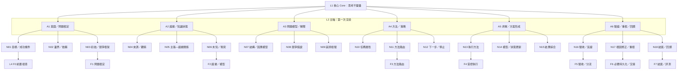
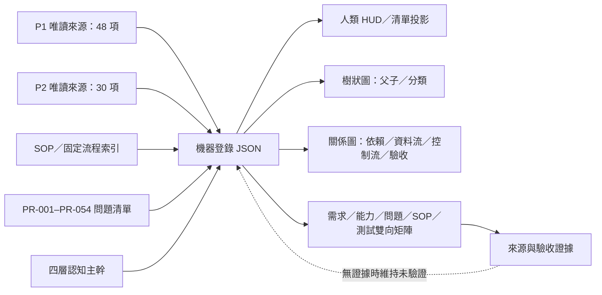

# forAVAr 基礎能力覆蓋清單與功能儀表板 v0.1

- **文件 ID：** FORAVAR-FOUNDATIONAL-CAPABILITY-COVERAGE-VIEW-20261022
- **狀態：** REFERENCE_DRAFT／覆蓋盤點，不是正式企劃，不代表 Runtime 驗收
- **機器版本：** [功能登錄 JSON](./功能清單_基礎能力覆蓋登錄_v0.1.json)
- **研究藍圖：** [核心重建施工藍圖](./解析文檔/forAVAr_核心重建施工藍圖_2026-10-22.md)
- **四層細項及結構圖：** [四層架構細項展開與閉環證據矩陣](./解析文檔/forAVAr_四層架構細項展開與閉環證據矩陣_2026-10-22.md)
- **P1/P2 功能樹：** [功能骨架樹全面重整版](./解析文檔/架構映射/P1-P2-功能骨架樹-全面重整版.md)
- **SOP 權威索引：** [SOP 清單與落實狀態分組](./SOP清單與落實狀態分組.md)
- **問題權威索引：** [S 級問題清單主軸與 ID 索引](./%28S級%29問題清單.md)

> 用途：讓 AI 不必要求使用者反覆重申「哪些基礎能力不能丟」，也讓人類可以從總覽、樹狀結構、關係圖和分類表快速找到具體功能。所有能力在盤點時先保留原始 ID 與來源；要不要以舊模組原樣實作，另做採納決策。

## 一、總覽 HUD｜目前盤點狀態

| 項目 | 盤點結果 | 判定 |
|---|---|---|
| 四層渲染流程 | 研究藍圖已寫 L1 Core → L2 A1–A6 → L3 N01–N18 → L4 F0–F7，並有細項矩陣及 Mermaid 圖 | **已文件化於草案；尚未核准、未驗收** |
| P1/P2 原功能索引 | forAVAr 既有功能樹已列出 P1 48 項、P2 30 項 | **來源映射存在；新藍圖尚未完成逐項雙向吸收對帳** |
| SOP 與固定流程 | 有 SOP 索引、SOP-META／DOC、CF-001–010、候選 SOP 與待裁定議題 | **有分組清單；不等於每項流程都已強制執行或驗證** |
| 反覆發生問題 | PR-001–PR-054 由問題主索引及分支維護 | **有穩定問題 ID；問題→控制→回歸映射仍需驗收** |
| 機器可讀版本 | 本次建立 JSON 欄位化登錄，涵蓋能力、SOP、問題與新視圖需求 | **新建參考草案** |
| 人類閱讀版本 | 本文件以分層 HUD、功能表、樹狀圖、關係圖與來源連結呈現 | **新建人類視圖；非已部署互動網頁** |
| JSON／人類視圖同步 | 登錄定義主資料與投影規則；本版本採同一更新集人工核對 | **規則已列；自動產生器與自動差異檢查未建立** |
| 實作／測試／Runtime | P1/P2 的狀態依各自權威矩陣；forAVAr 四層藍圖為草案 | **不得推定已接線或通過 Runtime** |

## 二、判定結論

**目前不能判定「現行藍圖已包含 P1、P2 的全部功能」。**

依據是：forAVAr 的功能樹確實保存 P1 48 項與 P2 30 項的來源分類，但 2026-10-22 四層施工藍圖明確把逐項雙向追溯列為後續施工階段，而不是已完成的吸收驗收。因此目前比較正確的狀態是：

- **四層渲染：** 結構已被定義和畫圖，尚待責任、分支、需求覆蓋與行為驗收。
- **78 項 P1/P2 來源功能：** 已列入來源樹／矩陣；對新四層的逐項映射、保留／整合／替代／退役判定仍未完成。
- **SOP：** 以標準流程／固定流程登錄；候選流程不得當成現行規則。
- **問題修正：** PR ID 保留原始失效模式；有處理方向不代表已解決，必須另有控制點與測試證據。
- **新便利性／方法功能：** 作為獨立類別記錄，不與 SOP 或問題修正混在一起。

## 三、四層渲染樹｜認知核心主幹

**讀圖規則：**這是主幹歸屬圖，不表示所有任務必須按圖中箭頭逐節執行。實際流程須由任務屬性、風險、資訊狀態、授權和成本決定；節點的正式依賴仍需契約和案例證據確認。

## 四、跨功能關係圖｜來源、SOP、問題與驗收

樹與關係圖的責任不同：**樹狀圖回答「它屬於哪一層／哪一類」；關係圖回答「它依賴誰、資料流往哪裡、誰驗收、哪個問題由哪項控制處理」。**不允許用樹狀歸屬替代依賴證據。

## 五、功能分類｜不要再混成一張無差別清單

| 類別 | 包含內容 | 建立原因／用途 | 當前裁定 |
|---|---|---|---|
| A. 基礎認知架構 | 核心、主軸、骨架、框架 | 防止思考核心漂移，並可逐層展開到可驗收工作結構 | 四層草案已有定義；待驗收 |
| B. 原始能力保留 | P1-F01–F48、P2-F01–F30 | 防止重建時只保留新架構名詞而丟掉原有責任 | 已盤點；逐項採納／替代決策未完成 |
| C. SOP／固定流程 | SOP-META、SOP-DOC、CF-001–CF-010 | 管理可重複工作方式、觸發、步驟、停止與驗收 | 文件狀態分組存在；有效性需依來源狀態 |
| D. 問題修正／風險控制 | PR-001–PR-054 及其控制點 | 追蹤已觀察失效，避免只修症狀或重犯 | 問題 ID 存在；修正驗收不是自動成立 |
| E. 新便利性／方法知識 | 機器可讀登錄、HUD、雙視圖、適應式呈現、圖表即程式碼、前置掃描 | 降低重複交代、搜尋、理解、同步與交接錯誤 | 部分來自 P2 設計，部分是本次新提案；自動化未驗證 |
| F. 待裁定項 | SOP-CAND-005–012、DISC-SOP-001–007 等 | 保留候選與決策分歧，防止未批准就變成現行規則 | 仍是候選／討論，非正式 SOP |

## 六、機器登錄的必要欄位

下列欄位是每個功能項目都必須有的最小資料契約；詳細規格與實際條目存在配套 JSON 中。

| 欄位 | 為什麼存在 |
|---|---|
| ID／名稱 | 保持穩定引用；避免改名讓舊連結失效 |
| 類型／生命週期分類 | 區分基礎能力、SOP、問題修正、新便利功能和待裁定事項 |
| 建立原因 | 說明為何需要此功能，避免只保留名稱 |
| 功能 | 說明該項負責產出什麼或防止什麼 |
| 邏輯 | 說明觸發、處理、分流、失敗與停止原理 |
| 觸發條件／輸入／輸出 | 避免功能只剩抽象描述，讓後續可以組成程序 |
| 依賴與關聯 ID | 建立功能、問題、SOP、來源、測試間的可追溯關係 |
| 來源參照／來源狀態 | 防止虛構能力、錯誤引用或用過期狀態 |
| 層級候選映射及映射狀態 | 區分已驗證歸屬與待驗證候選，避免硬塞到四層 |
| 覆蓋／實作／證據狀態 | 分開「有列入」「有規格」「有實作」「已執行」「Runtime 有觀測」 |
| 驗收條件 | 定義怎麼知道它真的有效，而非只存在於文件 |
| 採納決策 | 對來源能力決定保留、整合、替代、延後、退役或待裁定 |
| 備註 | 保存限制、不應外推的結論及來源差異 |

## 七、四層架構／新視圖需求登錄

| ID | 名稱 | 建立原因 | 功能／邏輯 | 狀態 |
|---|---|---|---|---|
| CORE-001 | L1 核心：思考不變量 | 避免系統核心從思考偏移成純治理、控制或文件管理。 | 定義所有任務共用的最小認知原則，而非固定執行所有步驟。 | INVENTORIED_NOT_YET_ACCEPTED |
| RENDER-001 | L2 主軸：第一次渲染 A1–A6 | 把抽象思考核心拆成可辨識的責任域，讓人類與 AI 能檢查是否漏掉認知責任。 | 以六個主軸呈現意圖／問題框定、證據／知識狀態、問題模型／解釋、方法／策略、求解／方案形成、驗證／重框／回饋。 | INVENTORIED_NOT_YET_ACCEPTED |
| SKELETON-001 | L3 骨架：十八個節點 N01–N18 | 將主軸繼續拆解到可檢查入口、操作、輸出、失敗狀態與下一步。 | 用每軸三個節點共十八節點，表示目標／邊界／框架、證據／主張／未知、因果／假說／檢驗、任務屬性／路由／停止、執行／更新／綜合、驗收／修正／結案。 | INVENTORIED_NOT_YET_ACCEPTED |
| FRAMEWORK-001 | L4 框架：條件式流程 F0–F7 | 讓骨架依風險、複雜度、證據、權限與成本生成適用流程，不把骨架變成所有任務的固定 SOP。 | 定義 F0 前置檢查、F1 問題框定、F2 證據／模型、F3 方法路由、F4 受控執行、F5 驗收分流、F6 必要持久化／交接、F7 結案／評測。 | INVENTORIED_NOT_YET_ACCEPTED |
| VIEW-001 | 機器可讀功能登錄（JSON） | 降低功能清單的歧義、重複、漏項與同步成本，讓 AI 能以固定欄位快速過濾、排序及追溯。 | 以穩定 ID、分類、建立原因、功能、邏輯、依賴、來源、問題／SOP 關聯、實作狀態、證據狀態及驗收條件保存每個能力項。 | INVENTORIED_NOT_YET_ACCEPTED |
| VIEW-002 | 人類可讀 HUD／功能面板（Markdown） | 讓人快速掃描系統總覽、狀態、依賴、任務阻塞和詳細分支，不必直接讀大型 JSON 或全部文件。 | 以摘要儀表板、分層樹狀圖、關係圖、分類表格、狀態文字和來源連結呈現功能清單；借鏡遊戲 UI 的任務面板與分區導航，但不把裝飾取代實質資訊。 | INVENTORIED_NOT_YET_ACCEPTED |
| VIEW-003 | 雙視圖一致性與差異檢查 | 避免機器版與人類版各自修改，形成兩套互相矛盾的事實來源。 | 把 JSON 定義為功能登錄的主資料，Markdown 為呈現投影；每次更新以同一變更集更新兩者，讀回並核對項目總數、ID、分類、狀態與圖表節點。 | INVENTORIED_NOT_YET_ACCEPTED |
| VIEW-004 | 樹狀圖與關係圖雙圖合約 | 樹狀圖表達分類／父子歸屬；關係圖表達依賴、交接、證據和跨模組關係，兩種圖不能互相取代。 | 提供四層渲染樹、P1/P2 十大功能分支樹、以及流程／依賴／問題—SOP—功能—驗收關係圖。 | INVENTORIED_NOT_YET_ACCEPTED |
| VIEW-005 | 來源／實作／測試／Runtime 分層狀態 | 避免看到藍圖、功能表或程式檔，就推論功能已接線、測試通過或真實運行。 | 每項能力區分設計狀態、來源 repo 狀態、forAVAr 覆蓋／映射狀態、實作接線狀態、測試狀態、Runtime 觀測狀態。 | INVENTORIED_NOT_YET_ACCEPTED |
| VIEW-006 | P1/P2 功能到 forAVAr 四層的雙向映射 | 功能來源樹能證明列入盤點，但不能證明新四層模型已吸收各項責任；要防止命名重構造成能力遺失。 | 為每個 P1／P2 原功能指定保留、整合、替代、延期、退役或待裁定決策，並映射到思考主軸／骨架，或標為橫向支援平面。 | INVENTORIED_NOT_YET_ACCEPTED |
| VIEW-007 | SOP／問題修正／新增功能分流標籤 | 使用者反覆需要重申清單類別；混合標準流程、事故修正與新便利功能會造成重複建檔或誤把候選當現行。 | 每個登錄項有明確類型與生命週期：已採用 SOP、SOP 候選、問題修正／風險、基礎能力、便利性、方法／知識、待決策。 | INVENTORIED_NOT_YET_ACCEPTED |
| VIEW-008 | 問題→控制點→回歸／復發檢查追溯 | 問題修正若只存在於分析文件，後續無法判定相關功能是否實際防止復發。 | 將 PR ID 連結至已確認根因、控制點／SOP、相關功能、驗收案例、證據、狀態變更和復發檢查。 | INVENTORIED_NOT_YET_ACCEPTED |
| VIEW-009 | 前置檢查：權威、唯一責任、衝突和影響範圍 | PR-053 顯示已知 SOP／職責／問題清單未必在寫入前被檢索與套用。 | 寫入或架構變更前，先找出現行權威、相近功能、職責歸屬、衝突和受影響檔案，再決定整合或獨立新增。 | INVENTORIED_NOT_YET_ACCEPTED |
| VIEW-010 | 適應式呈現：依讀者／用途選文字、表格或圖 | 單一文字形態不利於理解複雜關係，而所有任務都生圖又增加成本；需要按用途和讀者選視圖。 | 簡單任務用文字；結構／責任用架構圖；流程／狀態用流程圖或狀態機；規則用表格；只有互動比較確有收益時才使用互動頁面。 | INVENTORIED_NOT_YET_ACCEPTED |
| VIEW-011 | 能力採納／合併／替代／退場決策 | P1/P2 功能存在不代表 forAVAr 必須原樣複製；照搬所有模組可能形成重複 Runtime／職責。 | 對 78 項來源能力逐一做必要性、重疊、可替代性、維護成本、上下文成本與驗收方式評估。 | INVENTORIED_NOT_YET_ACCEPTED |
| VIEW-012 | 文件權威與藍圖狀態鎖定 | 目前新四層藍圖明確是施工草案，而不是已核准的正式藍圖；新功能清單不能悄悄變成第二套正式企劃。 | 明確區分正式企劃、施工藍圖、研究紀錄、機器功能登錄、人類展示視圖、SOP、問題清單與證據矩陣的權限。 | INVENTORIED_NOT_YET_ACCEPTED |

## 八、P1 原始功能覆蓋｜48 項

P1 的功能對照將原 48 個功能分類為模型原生認知、工具／證據保護和退役的獨立系統。**保留功能責任，不等於原樣複製 48 個 Runtime。**P1 原始功能矩陣及其分類為此表來源；forAVAr 新四層的逐項映射仍未驗證。

| ID | 功能名稱 | 原來源分類／責任域 | 功能核心／處理邏輯 | forAVAr 吸收狀態 |
|---|---|---|---|---|
| P1-F01 | 資料接收 | TOOL_GUARD／S01 Runtime） | schema / input validator。原功能責任納入覆蓋盤點，不代表要在 forAVAr 重建一個獨立 Runtime。 | **未完成映射驗收** |
| P1-F02 | 資料清理 | TOOL_GUARD／S01 Runtime） | deterministic normalization / dedupe。原功能責任納入覆蓋盤點，不代表要在 forAVAr 重建一個獨立 Runtime。 | **未完成映射驗收** |
| P1-F03 | 資料切分 | TOOL_GUARD／S01 Runtime） | parser + model fallback。原功能責任納入覆蓋盤點，不代表要在 forAVAr 重建一個獨立 Runtime。 | **未完成映射驗收** |
| P1-F04 | 資訊元素抽取 | MODEL_NATIVE／S01 Runtime） | model extraction + schema check。原功能責任納入覆蓋盤點，不代表要在 forAVAr 重建一個獨立 Runtime。 | **未完成映射驗收** |
| P1-F05 | 屬性抽取 | MODEL_NATIVE／S01 Runtime） | model extraction。原功能責任納入覆蓋盤點，不代表要在 forAVAr 重建一個獨立 Runtime。 | **未完成映射驗收** |
| P1-F06 | 主張／證據區分 | TOOL_GUARD／S01 Runtime） | classification + provenance guard。原功能責任納入覆蓋盤點，不代表要在 forAVAr 重建一個獨立 Runtime。 | **未完成映射驗收** |
| P1-F07 | 資料編碼 | TOOL_GUARD／S01 Runtime） | stable IDs。原功能責任納入覆蓋盤點，不代表要在 forAVAr 重建一個獨立 Runtime。 | **未完成映射驗收** |
| P1-F08 | 分類／重新分類 | MODEL_NATIVE／S01 Runtime） | model classification。原功能責任納入覆蓋盤點，不代表要在 forAVAr 重建一個獨立 Runtime。 | **未完成映射驗收** |
| P1-F09 | 新類別發現 | MODEL_NATIVE／S01 Runtime） | model proposal + review。原功能責任納入覆蓋盤點，不代表要在 forAVAr 重建一個獨立 Runtime。 | **未完成映射驗收** |
| P1-F10 | 資料缺口辨識 | TOOL_GUARD／S01 Runtime） | deterministic required-field / gap scan。原功能責任納入覆蓋盤點，不代表要在 forAVAr 重建一個獨立 Runtime。 | **未完成映射驗收** |
| P1-F11 | 共現 | MODEL_NATIVE／S02 Runtime） | model or parser。原功能責任納入覆蓋盤點，不代表要在 forAVAr 重建一個獨立 Runtime。 | **未完成映射驗收** |
| P1-F12 | 方向 | TOOL_GUARD／S02 Runtime） | model proposal + explicit evidence check。原功能責任納入覆蓋盤點，不代表要在 forAVAr 重建一個獨立 Runtime。 | **未完成映射驗收** |
| P1-F13 | 條件 | TOOL_GUARD／S02 Runtime） | model proposal + evidence check。原功能責任納入覆蓋盤點，不代表要在 forAVAr 重建一個獨立 Runtime。 | **未完成映射驗收** |
| P1-F14 | 依賴 | TOOL_GUARD／S02 Runtime） | model proposal + evidence check。原功能責任納入覆蓋盤點，不代表要在 forAVAr 重建一個獨立 Runtime。 | **未完成映射驗收** |
| P1-F15 | 衝突／支持 | TOOL_GUARD／S02 Runtime） | preserve both claims + provenance。原功能責任納入覆蓋盤點，不代表要在 forAVAr 重建一個獨立 Runtime。 | **未完成映射驗收** |
| P1-F16 | 時間 | TOOL_GUARD／S02 Runtime） | deterministic temporal ordering。原功能責任納入覆蓋盤點，不代表要在 forAVAr 重建一個獨立 Runtime。 | **未完成映射驗收** |
| P1-F17 | 關係強度 | TOOL_GUARD／S02 Runtime） | deterministic count/statistics。原功能責任納入覆蓋盤點，不代表要在 forAVAr 重建一個獨立 Runtime。 | **未完成映射驗收** |
| P1-F18 | 關係鏈 | TOOL_GUARD／S02 Runtime） | graph traversal。原功能責任納入覆蓋盤點，不代表要在 forAVAr 重建一個獨立 Runtime。 | **未完成映射驗收** |
| P1-F19 | 頻率模式 | TOOL_GUARD／S03 Runtime） | statistics / model interpretation。原功能責任納入覆蓋盤點，不代表要在 forAVAr 重建一個獨立 Runtime。 | **未完成映射驗收** |
| P1-F20 | 共同特徵 | MODEL_NATIVE／S03 Runtime） | model analysis。原功能責任納入覆蓋盤點，不代表要在 forAVAr 重建一個獨立 Runtime。 | **未完成映射驗收** |
| P1-F21 | 差異模式 | MODEL_NATIVE／S03 Runtime） | model + statistical comparison。原功能責任納入覆蓋盤點，不代表要在 forAVAr 重建一個獨立 Runtime。 | **未完成映射驗收** |
| P1-F22 | 趨勢 | TOOL_GUARD／S03 Runtime） | statistical time-series tool。原功能責任納入覆蓋盤點，不代表要在 forAVAr 重建一個獨立 Runtime。 | **未完成映射驗收** |
| P1-F23 | 群組 | TOOL_GUARD／S03 Runtime） | clustering / model。原功能責任納入覆蓋盤點，不代表要在 forAVAr 重建一個獨立 Runtime。 | **未完成映射驗收** |
| P1-F24 | 條件模式 | MODEL_NATIVE／S03 Runtime） | model analysis + evidence。原功能責任納入覆蓋盤點，不代表要在 forAVAr 重建一個獨立 Runtime。 | **未完成映射驗收** |
| P1-F25 | 週期 | TOOL_GUARD／S03 Runtime） | periodicity algorithm。原功能責任納入覆蓋盤點，不代表要在 forAVAr 重建一個獨立 Runtime。 | **未完成映射驗收** |
| P1-F26 | 異常 | TOOL_GUARD／S03 Runtime） | anomaly detection tool。原功能責任納入覆蓋盤點，不代表要在 forAVAr 重建一個獨立 Runtime。 | **未完成映射驗收** |
| P1-F27 | 例外 | MODEL_NATIVE／S03 Runtime） | model classification + preservation。原功能責任納入覆蓋盤點，不代表要在 forAVAr 重建一個獨立 Runtime。 | **未完成映射驗收** |
| P1-F28 | 反常組合 | MODEL_NATIVE／S03 Runtime） | model analysis。原功能責任納入覆蓋盤點，不代表要在 forAVAr 重建一個獨立 Runtime。 | **未完成映射驗收** |
| P1-F29 | 歸納 | MODEL_NATIVE／S04 Runtime） | model reasoning。原功能責任納入覆蓋盤點，不代表要在 forAVAr 重建一個獨立 Runtime。 | **未完成映射驗收** |
| P1-F30 | 模式解釋 | MODEL_NATIVE／S04 Runtime） | model reasoning。原功能責任納入覆蓋盤點，不代表要在 forAVAr 重建一個獨立 Runtime。 | **未完成映射驗收** |
| P1-F31 | 假設建立 | MODEL_NATIVE／S04 Runtime） | model reasoning。原功能責任納入覆蓋盤點，不代表要在 forAVAr 重建一個獨立 Runtime。 | **未完成映射驗收** |
| P1-F32 | 支持證據檢查 | TOOL_GUARD／S04 Runtime） | retrieval + source binding。原功能責任納入覆蓋盤點，不代表要在 forAVAr 重建一個獨立 Runtime。 | **未完成映射驗收** |
| P1-F33 | 反例搜尋 | TOOL_GUARD／S04 Runtime） | retrieval + counterexample record。原功能責任納入覆蓋盤點，不代表要在 forAVAr 重建一個獨立 Runtime。 | **未完成映射驗收** |
| P1-F34 | 替代解釋 | MODEL_NATIVE／S04 Runtime） | model reasoning。原功能責任納入覆蓋盤點，不代表要在 forAVAr 重建一個獨立 Runtime。 | **未完成映射驗收** |
| P1-F35 | 假設範圍限制 | TOOL_GUARD／S04 Runtime） | explicit scope constraint。原功能責任納入覆蓋盤點，不代表要在 forAVAr 重建一個獨立 Runtime。 | **未完成映射驗收** |
| P1-F36 | 假設修正 | MODEL_NATIVE／S04 Runtime） | model reasoning。原功能責任納入覆蓋盤點，不代表要在 forAVAr 重建一個獨立 Runtime。 | **未完成映射驗收** |
| P1-F37 | 假設比較 | MODEL_NATIVE／S04 Runtime） | model reasoning。原功能責任納入覆蓋盤點，不代表要在 forAVAr 重建一個獨立 Runtime。 | **未完成映射驗收** |
| P1-F38 | 證據—推論鏈 | TOOL_GUARD／S04 Runtime） | provenance graph。原功能責任納入覆蓋盤點，不代表要在 forAVAr 重建一個獨立 Runtime。 | **未完成映射驗收** |
| P1-F39 | 小結論 | MODEL_NATIVE／S05 Runtime） | model output。原功能責任納入覆蓋盤點，不代表要在 forAVAr 重建一個獨立 Runtime。 | **未完成映射驗收** |
| P1-F40 | 小結論檢查 | TOOL_GUARD／S05 Runtime） | validator / recheck。原功能責任納入覆蓋盤點，不代表要在 forAVAr 重建一個獨立 Runtime。 | **未完成映射驗收** |
| P1-F41 | 新問題生成 | MODEL_NATIVE／S05 Runtime） | model agent loop。原功能責任納入覆蓋盤點，不代表要在 forAVAr 重建一個獨立 Runtime。 | **未完成映射驗收** |
| P1-F42 | 缺口優先級 | TOOL_GUARD／S05 Runtime） | deterministic impact heuristic + model。原功能責任納入覆蓋盤點，不代表要在 forAVAr 重建一個獨立 Runtime。 | **未完成映射驗收** |
| P1-F43 | 迭代控制 | RETIRED_AS_SYSTEM／S05 Runtime） | model agent loop + loop guard。原功能責任納入覆蓋盤點，不代表要在 forAVAr 重建一個獨立 Runtime。 | **未完成映射驗收** |
| P1-F44 | 跨輪合併 | MODEL_NATIVE／S05 Runtime） | model context/state。原功能責任納入覆蓋盤點，不代表要在 forAVAr 重建一個獨立 Runtime。 | **未完成映射驗收** |
| P1-F45 | 結論穩定度 | TOOL_GUARD／S05 Runtime） | consistency / evidence delta check。原功能責任納入覆蓋盤點，不代表要在 forAVAr 重建一個獨立 Runtime。 | **未完成映射驗收** |
| P1-F46 | 未解問題保留 | TOOL_GUARD／S05 Runtime） | explicit unresolved registry。原功能責任納入覆蓋盤點，不代表要在 forAVAr 重建一個獨立 Runtime。 | **未完成映射驗收** |
| P1-F47 | 最終結論整合 | MODEL_NATIVE／S05 Runtime） | model synthesis。原功能責任納入覆蓋盤點，不代表要在 forAVAr 重建一個獨立 Runtime。 | **未完成映射驗收** |
| P1-F48 | 完整回溯 | TOOL_GUARD／S05 Runtime） | provenance / trace validator。原功能責任納入覆蓋盤點，不代表要在 forAVAr 重建一個獨立 Runtime。 | **未完成映射驗收** |

來源：[P1 48 功能 × 模型能力對照](https://github.com/upqq21477-star/P1/blob/main/docs/research/P1-48%E5%8A%9F%E8%83%BD-%E6%A8%A1%E5%9E%8B%E8%83%BD%E5%8A%9B%E5%B0%8D%E7%85%A7.md)。

## 九、P2 原始功能覆蓋｜30 項

P2 的每個功能要沿用其唯一功能實作／證據矩陣作為現況權威。此表保留名稱和來源摘要，**不把設計指定、檔案存在、測試檔存在或歷史模擬，當成目前測試／Runtime 通過**。

| ID | 功能名稱 | 為什麼存在／責任摘要 | 來源證據狀態（摘要） | forAVAr 吸收狀態 |
|---|---|---|---|---|
| P2-F01 | 問題輸入封包與限制 | 讓 Brain 的輸入受明確限制。 | FILE_PRESENT | **未完成映射驗收** |
| P2-F02 | Brain Proposal 驗證／轉成 Command | 避免語意提案直接改寫執行狀態。 | 部分路徑存在 | **未完成映射驗收** |
| P2-F03 | Planner／Capability Cards | 讓工作方式與能力有觸發及輸入輸出規格。 | FILE_PRESENT / SIMULATION_ONLY | **未完成映射驗收** |
| P2-F04 | Method／Pattern 到 Task Set | 把策略方法組裝為可交接的任務集合。 | 部分機制存在 | **未完成映射驗收** |
| P2-F05 | Central 路由與狀態轉移 | 集中控制狀態所有權，避免平行控制器。 | PATCHED_UNVERIFIED | **未完成映射驗收** |
| P2-F06 | Role 隔離與獨立驗收 | 角色名稱不能代替真正的權限／認知獨立。 | 來源交接記為 SIMULATION_ONLY | **未完成映射驗收** |
| P2-F07 | Current State、必要狀態轉移與執行真相 | 防止把計畫或模擬當成實際執行。 | PATCHED_UNVERIFIED / INCOMPLETE_RUNTIME | **未完成映射驗收** |
| P2-F08 | 知識匯入與來源追溯 | 防止知識在導入時失去來源、版本或範圍。 | PATCHED_UNVERIFIED / SIMULATION_ONLY | **未完成映射驗收** |
| P2-F09 | 知識檢索、Context、失憶恢復 | 降低過長上下文與跨會話狀態遺漏。 | PATCHED_UNVERIFIED / NOT_WIRED | **未完成映射驗收** |
| P2-F10 | 程式重建 Blueprint 與乾淨重建 | 確保程式組成和重建輸入可明確重現。 | 重建機制與輸入清單存在，但 check／clean build 本輪未執行。此項只代表程式組成與重建輸入，不等於完整的 Blueprint Engineering Capability | **未完成映射驗收** |
| P2-F11 | 來源／結果生命週期與封存治理 | 清除不再有效的資料與資產，避免活動資料膨脹。 | PATCHED_UNVERIFIED / SIMULATION_ONLY | **未完成映射驗收** |
| P2-F12 | 外部工具雷達與 Provider | 將工具採用建立於任務匹配而非人氣。 | 候選發現與 Adapter 程式存在不等於 Provider 真正啟用 | **未完成映射驗收** |
| P2-F13 | 自我評估、變更影響與演進回退 | 讓系統變更能評估風險、回歸與回退。 | PATCHED_UNVERIFIED / SIMULATION_ONLY | **未完成映射驗收** |
| P2-F14 | Current／文件投影／交接一致性 | 避免多份 Current／README／Handoff 各自成為真相。 | PARTIAL / PATCHED_UNVERIFIED / NOT_EXECUTED | **未完成映射驗收** |
| P2-F15 | 最低操作驗收與故障歸因 | 在最低環境下仍需區分文件操作閉環與程式驗收。 | BASELINE_DOCUMENT_LOOP_PASS（限定範圍） | **未完成映射驗收** |
| P2-F16 | AI 對話＋GitHub 最低操作模式 | 讓最低工作流程不依賴外部軟體或付費 API。 | BASELINE_DOCUMENT_LOOP_PASS（限定文件操作）；PROGRAM_EXECUTED_PASS／OBSERVED_RUNTIME = NOT_EXECUTED | **未完成映射驗收** |
| P2-F17 | Current-first 狀態與資料生命週期 | 避免歷史／中間資料污染當前上下文。 | PARTIAL / CODE_PRESENT_UNVERIFIED / NOT_EXECUTED | **未完成映射驗收** |
| P2-F18 | 必要能力納入與退場治理 | 避免功能累積到重複、過期或無用。 | CODE_PRESENT_UNVERIFIED / NOT_EXECUTED | **未完成映射驗收** |
| P2-F19 | UNKNOWN 觸發的針對性診斷與補救 | 避免因資料未知而全面盲掃或直接猜測。 | CODE_PRESENT_UNVERIFIED / NOT_EXECUTED | **未完成映射驗收** |
| P2-F20 | 系統建置工廠：按證據選擇 BUILD／REPAIR／EXTEND／REBUILD | 避免不同建置任務各自發明平行方案。 | CODE_PRESENT_UNVERIFIED / NOT_EXECUTED | **未完成映射驗收** |
| P2-F21 | Brain 常態認知控制：架構／模式選擇、研究式根因診斷與 THINKING↔CONSTRUCTION 切換 | 保留核心自我判斷，而不是變成被動照單執行。 | CODE_WIRED / IMPLEMENTED_UNVERIFIED / PROGRAM_TESTS_NOT_EXECUTED | **未完成映射驗收** |
| P2-F22 | 根因證據蒸餾與失效證據回收 | 防止根因未證實就蒸餾成永久規則或重複犯錯。 | CODE_PRESENT_UNVERIFIED / NOT_EXECUTED | **未完成映射驗收** |
| P2-F23 | 思考／施工隔離、獨立系統與乾淨交接口 | 降低施工上下文污染認知決策，避免跨系統直接寫入。 | CODE_PRESENT_UNVERIFIED / NOT_EXECUTED | **未完成映射驗收** |
| P2-F25 | 蒸餾操作包生成、增量重建與 Code-first 工作閉環 | 降低每次工作重讀全文和人工複製的成本。 | PATCHED_UNVERIFIED / FINAL_BATCH_ACCEPTANCE_DEFERRED / PROGRAM_TESTS_NOT_EXECUTED | **未完成映射驗收** |
| P2-F24 | 使用者意圖理解、語意歧義偵測與最小化澄清 | 避免目標猜錯，也避免沒有必要的重複提問。 | CODE_PRESENT_UNVERIFIED / NOT_EXECUTED | **未完成映射驗收** |
| P2-F26 | 整批更新、語意保真與單次手動整合驗收治理 | 避免多檔相依更新只完成一部分或語意被稀釋。 | CODE_PRESENT_UNVERIFIED / NOT_EXECUTED | **未完成映射驗收** |
| P2-F27 | 適應式呈現、圖表即程式碼與設計到可驗收程序的可追溯性 | 讓人類和 AI 按需要快速理解系統邊界、資料流與依賴。 | CODE_PRESENT_UNVERIFIED / NOT_EXECUTED | **未完成映射驗收** |
| P2-F28 | 系統性變更分類、職權路由、藍圖演進、需求優先級排序與規則蒸餾 | 避免一次性修補、共通能力與架構不變量混在一起。 | CODE_PRESENT_UNVERIFIED / NOT_EXECUTED | **未完成映射驗收** |
| P2-F29 | 事件觸發式施工健康回溯與維護資源預算 | 在變慢、反覆失敗或疑似超預算時才診斷，避免持續監控成本。 | IMPLEMENTED_UNVERIFIED / PROGRAM_TESTS_NOT_EXECUTED | **未完成映射驗收** |
| P2-F30 | 四階段批次治理與受控藍圖更新交易（Batch Phase Orchestrator） | 避免進度感知更新漏改派生文件、未核准改核心或缺回退。 | CODE_PRESENT_UNVERIFIED / NOT_EXECUTED | **未完成映射驗收** |

來源：[P2 功能實作與證據矩陣](https://github.com/upqq21477-star/P2/blob/main/docs/architecture/P2-Implementation-Evidence-Matrix-v1.0.md)，以及 [P2 唯一系統總體藍圖](https://github.com/upqq21477-star/P2/blob/main/docs/architecture/P2-System-Blueprint-v1.0.md)。

## 十、SOP／固定流程／候選流程／待裁定事項

這一類回答「重複工作時怎麼做」，不是描述一個問題，也不等於新功能已被批准。

| ID | 名稱 | 建立原因 | 功能／邏輯摘要 | 來源狀態 |
|---|---|---|---|---|
| SOP-META-001 | SOP 固定流程與演化管理 | 此條目屬於 forAVAr 現有 SOP／固定流程索引。 | SOP 的選用、任務分級、流程生命週期、驗收、重大變更模擬閘門及改良退役規則。 | PROVISIONAL_CURRENT，v0.5；已把關鍵語意變更前的現行／候選配對模擬定為文件治理層生效規則。 |
| SOP-DOC-001 | SOP 文件標準欄位與蒸餾建置流程 | 此條目屬於 forAVAr 現有 SOP／固定流程索引。 | 定義 SOP 必備欄位、可複製模板、對談蒸餾步驟、反向批判及驗收清單。 | TRIAL，v0.1；文件已建立，模板和程序已讀回。 |
| CF-001 | 問題屬性判定與方法路由 | 此條目屬於 forAVAr 現有 SOP／固定流程索引。 | 依目標、成熟度、未知、可觀測性及風險選擇方法模組。 | 已有方法選擇框架及流程目錄入口。 |
| CF-002 | 原始資料／封裝檔解析 | 此條目屬於 forAVAr 現有 SOP／固定流程索引。 | 原始來源盤點、結構驗證、抽取、分批和完整性驗收。 | 已有 ［解析步驟流程］(./解析步驟流程.md)。 |
| CF-003 | 跨文件去重與蒸餾 | 此條目屬於 forAVAr 現有 SOP／固定流程索引。 | 區分原始證據、解析副本、分析與蒸餾知識；保留差異、反例和未知。 | 已有 ［去重與初步蒸餾規範］(./去重與蒸餾規範.md)。 |
| CF-004 | 對話成果轉成可追溯文件 | 此條目屬於 forAVAr 現有 SOP／固定流程索引。 | 把對話結論映射到唯一責任文件，更新索引並驗收。 | 對話流程列表內已有完整程序。 |
| CF-005 | 問題登錄與追蹤 | 此條目屬於 forAVAr 現有 SOP／固定流程索引。 | 將缺口、衝突和失敗轉成穩定 ID，保存影響、證據及狀態。 | 已有問題清單主軸及 S/A/BCD/近期補入分支。 |
| CF-006 | 版本治理與備份輪替 | 此條目屬於 forAVAr 現有 SOP／固定流程索引。 | 管理 Current、分支、來源備份、變更、移除與恢復。 | 已有 ［版本治理與分流規範］(./版本治理與分流規範.md)。 |
| CF-007 | 主軸彙整與長度分流 | 此條目屬於 forAVAr 現有 SOP／固定流程索引。 | 同主題彙整，超過閾值後按唯一職責分支。 | 有流程入口及全域索引／版本治理支援。 |
| CF-008 | 雙向引用與追溯更新 | 此條目屬於 forAVAr 現有 SOP／固定流程索引。 | 管理引用來源／目標、incoming／outgoing 及變更事件。 | 有流程入口、索引引用圖與變更追溯總表。 |
| CF-009 | SOP 固定流程與演化管理 | 此條目屬於 forAVAr 現有 SOP／固定流程索引。 | 將重複有效做法納入 SOP，管理試行和生命週期。 | 流程目錄已有入口，連至 SOP-META-001。 |
| CF-010 | SOP 建檔與對話蒸餾 | 此條目屬於 forAVAr 現有 SOP／固定流程索引。 | 從對話／操作中抽出可重用控制點並形成 SOP 候選；把來源紀錄分離保存。 | 流程目錄已有入口，連至 SOP-DOC-001。 |
| SOP-CAND-005 | 意圖、既有職責與衝突的前置掃描 | 本次工作顯示，已有規則與相似流程未必會在新增內容前先被比較。 | 定義目標拆解、相關 MASTER／SOP／問題清單檢索、唯一責任比對、衝突分類及變更影響表；決定整合進現有流程或獨立 SOP。 | CANDIDATE_NOT_ADOPTED |
| SOP-CAND-006 | 問題到控制再到回歸的閉環 | 現有問題 ID、候選改善及 SOP 執行紀錄未形成每項問題都可追蹤的改善—復發檢查鏈。 | 定義問題、根因證據、改善負責角色、控制點、驗收案例、回歸測試及狀態變更的關聯。 | CANDIDATE_NOT_ADOPTED |
| SOP-CAND-007 | 變更影響與完成閘門 | 多文件更新可能產生部分新、部分舊狀態；完成文件不等於完成整體任務。 | 導入輕量 Definition of Ready／Definition of Done 清單與變更影響表，分清文件寫入、內容、引用、行為與 Runtime 證據。 | CANDIDATE_NOT_ADOPTED |
| SOP-CAND-008 | 一致性靜態檢查 | 連結、索引、ID、必備欄位和字元限制目前依賴人工讀回，容易漏檢。 | 盤點可由腳本或工具低成本檢查的項目，先定檢查輸入／輸出和錯誤分類，再評估執行方式。 | CANDIDATE_NOT_ADOPTED |
| SOP-CAND-009 | 改善成效基線與回歸量測 | 沒有基線時，不能證明增加治理程序後更正確、更省時或減少返工。 | 為代表性任務建立簡單基線，量測重複建檔、職責漏掃、衝突漏判、返工、錯誤、成本及延遲。 | CANDIDATE_NOT_ADOPTED |
| SOP-CAND-010 | 重大決策紀錄 | 架構／治理決策若只存最終規則，後續不容易理解被拒選項和取捨。 | 規劃輕量決策紀錄欄位：背景、問題、候選、選擇、理由、後果、授權、證據與重審條件。 | CANDIDATE_NOT_ADOPTED |
| SOP-CAND-011 | 先批判框架再細化 | 初始框架可能把後續研究鎖定在錯誤方向。 | 加入替代框架、未知、反例及依賴外溢檢查。 | CANDIDATE_NOT_ADOPTED |
| SOP-CAND-012 | 自我更新控制面與回歸閘門 | 若更新器可自行修改權限、評估門檻或回退規則，可能移除自身保護。 | 將內容面與控制面分離；未經明確授權不得自改核心規則、評估器、權限或回退條件；必要時使用預先保留案例。 | CANDIDATE_NOT_ADOPTED |
| DISC-SOP-001 | 前置閘門的文件歸位 | 意圖與職責掃描應獨立成 SOP，還是納入 SOP-META-001、CF-004、CF-010 的共用前置段？目前已知 CF-004 與 CF-010 有局部重疊，需先比較唯一責任。 |  | DISCUSSION_PENDING |
| DISC-SOP-002 | ADR／決策紀錄範圍 | 哪些決策需要正式紀錄？只限架構／治理決策，還是包括流程路由、資料分流與版本變更？ |  | DISCUSSION_PENDING |
| DISC-SOP-003 | 自動化方式 | 靜態檢查應由人工清單、腳本、GitHub 原生功能或其他方法執行？維護成本及目前可用操作環境需先確認。 |  | DISCUSSION_PENDING |
| DISC-SOP-004 | 回歸樣本與量測門檻 | 每個 SOP 需要幾個獨立案例、哪些分支必測、何種數值才算改善？ |  | DISCUSSION_PENDING |
| DISC-SOP-005 | 獨立審查角色 | L3 高影響任務需哪些獨立驗證或使用者核准？在目前工具與角色條件下如何落實？ |  | DISCUSSION_PENDING |
| DISC-SOP-006 | 流程分級與例外 | 哪些任務必須完整掃描，哪些可以採快速路徑？停止條件和風險門檻是否足夠精確？ |  | DISCUSSION_PENDING |
| DISC-SOP-007 | 自動自我維護的授權邊界 | 系統可自動提案、測試到何種程度？哪些變更必須由使用者核准？ |  | DISCUSSION_PENDING |

權威：[SOP 清單與落實狀態分組](./SOP清單與落實狀態分組.md)。所有候選 SOP 與討論項目維持候選／待裁定狀態，不可直接用作現行 SOP。

## 十一、問題修正／重複失效模式｜PR-001–PR-054

這些是問題清單中的穩定 ID，不是「已解決功能表」。每個問題要在後續形成：問題證據 → 已確認根因／未確認假說 → 控制點或 SOP → 驗收案例 → 證據 → 必要回歸／復發檢查。

| ID | 問題／失效模式 | 建立原因／問題本質 | 目前處理方向摘要 | 目前來源狀態 |
|---|---|---|---|---|
| PR-001 | 理解錯誤、目標漂移或把手段當成目的 | 後續推理只能根據模型形成的問題表徵運作；一開始定義錯誤，精密執行仍可能只是更有效率地解錯問題。 | 保留原始目標、限制、非目標及成功條件；把已確認內容與推論分開；只有會實質改變結果、範圍、風險或授權的歧義才要求澄清；交接及結案時回比原始目標。 2026-10-21 案例補充：工作開始前需推導根本目的與隱含成功條件，不能把「完成文件」等同於完成知識蒸餾；見［本次根因診斷］(./解析文檔/AI主動問題 | PERSISTENT_RISK。方法已有規格方向，跨任務的實際守標能力尚未驗收。 |
| PR-002 | 幻覺、捏造事實或虛報來源 | 生成流暢度不等於事實正確性；模型可能在證據不足時仍產生完整答案，語氣與信心不能代替驗證。 | 重要事實連回可檢查來源；檔案、數字、程式狀態與執行結果盡可能讀回或實際觀察；沒有證據就標示 UNKNOWN／UNVERIFIED，不得假造引用或完成狀態。。來源狀態：PERSISTENT_RISK。可降低、發現及阻止錯誤擴散，不能靠提示或自我檢查保證永不發生。。問題清單狀態與功能實作狀態是兩個維度； | PERSISTENT_RISK。可降低、發現及阻止錯誤擴散，不能靠提示或自我檢查保證永不發生。 |
| PR-003 | 來源失真、引用錯配與知識過期 | 摘要會壓縮資訊；版本、時間、來源範圍及因果限定一旦遺失，原本看似忠實的轉述也會產生語意漂移。 | 重要主張保留來源與版本；分開標記來源主張、推論和已確認事實；衝突不強行融合；涉及現行狀態或易變資訊時回查權威來源。。來源狀態：PERSISTENT_RISK。來源標記與唯一權威規則已寫入參考文件，持續核查成效仍需測試。。問題清單狀態與功能實作狀態是兩個維度；不得由有對策或文件化推定已解決。 | PERSISTENT_RISK。來源標記與唯一權威規則已寫入參考文件，持續核查成效仍需測試。 |
| PR-004 | 失憶、交接遺漏與跨會話狀態失效 | 模型上下文、持久化文件、交接摘要和真實執行狀態不是同一件事；記錄存在不代表下一個會話一定讀取或正確使用。 | 用唯一 Current／權威來源和精簡交接恢復狀態；保存仍有效的目標、限制、未知與下一步；啟動時核對版本和現況。規則載入及跨會話遵守另由 PR-021 跟蹤。。來源狀態：PERSISTENT_RISK。文件與索引可供查閱，但自動載入及行為一致性尚未得到完整驗收。。問題清單狀態與功能實作狀態是兩個維度 | PERSISTENT_RISK。文件與索引可供查閱，但自動載入及行為一致性尚未得到完整驗收。 |
| PR-005 | 長上下文中的關鍵資訊遺漏 | 上下文越長不保證資訊利用越完整。Liu 等人 2024 年研究觀察到，特定長上下文任務的表現會隨關鍵資訊所在位置而變化。 | 使用相關性檢索、關鍵段落定位與最小充分上下文；對高影響限制及數字定向核對；不要把全文重複貼入當成可靠性保證。。來源狀態：PERSISTENT_RISK。研究支持風險存在，但各模型、任務的實際幅度需另行測量。。問題清單狀態與功能實作狀態是兩個維度；不得由有對策或文件化推定已解決。 | PERSISTENT_RISK。研究支持風險存在，但各模型、任務的實際幅度需另行測量。 |
| PR-006 | 因果推理錯誤、根因誤判或因果鏈不閉合 | 同一現象可能由多種原因產生；若不提出可區分的假說並驗證因果鏈，局部看似合理的修正仍可能讓整體失效。 | 分開觀察事實、根因假說與已確認根因；列出少量替代解釋；選擇能區分假說的檢查；驗證前置條件、反例、失敗出口和回饋路徑。 2026-10-21 案例補充：新增文件前要先確認根因、既有職責與相近流程；只補表層缺項不能視為根因已處理，見［本次根因診斷］(./解析文檔/AI主動問題發現不足與治理閉環缺口_根因 | PERSISTENT_RISK。方法已記錄，根因判斷品質尚需用代表性任務驗證。 |
| PR-007 | 不確定性被掩蓋、衝突被硬合併 | 模型偏向產生可讀答案；若沒有正式的未知與衝突表示，缺資訊容易被語言填補。 | 區分 CONFIRMED、SOURCE_CLAIM、INFERENCE、HYPOTHESIS、UNKNOWN、CONFLICT、BLOCKED；允許無法判定、維持現況或停止。。來源狀態：PERSISTENT_RISK。狀態用語已有文件基線，路由與行為尚待驗收。。問題清單狀態與功能實作狀態是兩個維度； | PERSISTENT_RISK。狀態用語已有文件基線，路由與行為尚待驗收。 |
| PR-008 | 循環驗證、自我修正無效或把重述當證明 | 重複思考或增加代理數，不會自動提供獨立證據；若各階段共享相同錯誤前提，整套流程可能一致地判錯。 | 提案前先定義驗收條件；高風險結論優先使用外部可觀測結果、獨立反例、保留案例或不同方法驗證；區分靜態檢查、模擬、程式測試和真實 Runtime。。來源狀態：PERSISTENT_RISK。設計方向已列入反證研究，獨立驗證強度尚未全面實測。。問題清單狀態與功能實作狀態是兩個維度；不得由有對策或文件化推定 | PERSISTENT_RISK。設計方向已列入反證研究，獨立驗證強度尚未全面實測。 |
| PR-009 | 提示注入或不可信資料控制思考與行動 | 模型處理文字時，指令與資料可能在語意層發生混淆；檢索或微調本身不能完全消除 Prompt Injection。 | 將外部內容視為不可信資料，不允許其改寫治理規則或授權；工具呼叫前後檢查權限與副作用；高影響操作採最小權限及明確授權。。來源狀態：PERSISTENT_RISK。OWASP 已列為主要生成式 AI 風險；forAVAr 的完整防護與紅隊測試仍須驗收。。問題清單狀態與功能實作狀態是兩個維度；不得由有對策 | PERSISTENT_RISK。OWASP 已列為主要生成式 AI 風險；forAVAr 的完整防護與紅隊測試仍須驗收。 |
| PR-010 | 模型與工具更新造成行為漂移 | 介面相同不代表行為等價；模型快照和家族改變會影響輸出，外部服務也可能在版本標記不變時改變語意。 | 將模型與工具隔離在 Adapter；保留任務基線；以同一組正向、負向和邊界案例比較新舊版本；分階段採用，未達門檻就回退。。來源狀態：PERSISTENT_RISK。OpenAI 文件亦建議持續評估模型輸出；本系統的基線與回退流程仍需證明有效。。問題清單狀態與功能實作狀態是兩個維度；不得由有對策或文件 | PERSISTENT_RISK。OpenAI 文件亦建議持續評估模型輸出；本系統的基線與回退流程仍需證明有效。 |
| PR-011 | 把失敗蒸餾成錯誤規則，或一直重犯同類錯誤 | 單一故障不一定代表通用根因；文件增加也不代表實際行為改善。 | 區分單次問題、局部規則、共用能力與架構不變量；只有證據支持且能泛化的修正才採用；用舊案例、負例和新案例回歸驗證，否則拒絕或回退。 2026-10-21 案例補充：已知失敗須連到觸發檢查、可驗收改善與回歸案例，不能只在事後追加說明；見［本次根因診斷］(./解析文檔/AI主動問題發現不足與治理閉環缺口_ | PERSISTENT_RISK。根因蒸餾原則已記錄，是否真能降低重複錯誤仍需量測。 |
| PR-012 | 選錯研究／求解方法，或把特定流程強套所有問題 | 不同問題需要的認知操作、證據、成功判準和風險不同；固定步驟不是所有問題的通用解法。 | 依認知目的、問題成熟度、未知來源、可觀測性、目標與限制、系統互動及風險選擇方法；簡單低風險任務走快速路徑，高風險或高未知任務才展開框架與反證。 2026-10-21 案例補充：方法路由需先比對既有流程與責任，尤其 CF-004／CF-010 的交疊；見［本次根因診斷］(./解析文檔/AI主動問題發現 | DESIGN_DEFINED_UNVERIFIED。此項仍列 S，因方法選擇是核心思考職責；方法框架已修正為屬性導向，但尚未以對照實驗證明最佳。 |
| PR-013 | 第一版問題框架錯誤，後續細化將錯誤放大 | 早期框架會形成錨定；主題邊界可能排除未知的未知、跨領域因果或真正的需求變更。 | 第一輪先批判框架，而不是立刻填滿細節；保留替代框架、未知及框架外訊號；當新證據、重要反例或目標變更推翻前提時，允許受控重框並檢查下游影響。 2026-10-21 案例補充：細化前先批判初始框架、找替代方案並掃描既有規格，避免局部執行放大框架缺口；見［本次根因診斷］(./解析文檔/AI主動問題發現不足 | DESIGN_DEFINED_UNVERIFIED。已有條件化設計與反證紀錄，尚未證明此方法普遍優於替代方法。 |
| PR-014 | 變更波及面過大、依賴爆炸 | 隱性依賴、共用狀態或核心資料變更會影響大量下游元件。 | 明確依賴方向與模組責任；先分析直接依賴及共用契約，再依影響範圍做回歸；記錄實際變更半徑。。來源狀態：DESIGN_DEFINED_UNVERIFIED。問題清單狀態與功能實作狀態是兩個維度；不得由有對策或文件化推定已解決。 | DESIGN_DEFINED_UNVERIFIED |
| PR-015 | 接口過多、隱性耦合、Schema／語意漂移 | 每對功能自行整合會增加相依數；資料格式仍合法，但同名欄位或狀態含義已變。 | 少量共用契約、明確版本及依賴方向；測試實際交互；避免把所有內部細節都變成公開接口。。來源狀態：PARTIAL。問題清單狀態與功能實作狀態是兩個維度；不得由有對策或文件化推定已解決。 | PARTIAL |
| PR-016 | 能力選錯、能力描述被誤當成可執行功能 | 索引名稱不代表能力已實作、已接線、依賴可用或有驗收證據。 | 能力卡列觸發／禁止條件、輸入、輸出、依賴、版本與測試；沒有實作或 caller 時不得路由為可用能力。P2 R3d130j 快照另發現 F15／F16 引用的測試路徑不存在、F27 的程式與測試引用位於 archive 路徑；詳見 2026-10-21 封包分析主報告 REF-01／REF-02。。 | DESIGN_DEFINED_UNVERIFIED |
| PR-017 | 升級不相容、部分發布或回退失敗 | 新版只更新部分契約、插件、索引或測試；其餘元件提前使用新版本。 | 先驗證完整依賴集合，再切換路由；明確相容政策、版本指紋與回退版本；中途失敗時保持舊版有效。。來源狀態：DESIGN_DEFINED_UNVERIFIED。問題清單狀態與功能實作狀態是兩個維度；不得由有對策或文件化推定已解決。 | DESIGN_DEFINED_UNVERIFIED |
| PR-018 | 權限過大、插件副作用或供應鏈風險 | AI／工具獲得超出任務需要的讀寫及外部操作權限；不可信套件或資料可能帶入風險。 | 最小權限、明確寫入範圍、外部工具及來源審查、不可逆操作授權與工具前後政策檢查。。來源狀態：PARTIAL。問題清單狀態與功能實作狀態是兩個維度；不得由有對策或文件化推定已解決。 | PARTIAL |
| PR-019 | Current、藍圖、索引與派生視圖衝突 | 不同文件各自維護現況，造成多份互相矛盾的真相。 | 每種狀態只指定一個權威來源；README、索引與圖表屬派生視圖；衝突時回查權威並阻擋受影響工作。P2 R3d130j 快照實例：Current／Active Work 指 B1–B8 IN_PROGRESS，HANDOFF 仍指 R3d130k 的 W0／W1–W8；根 README 保留相衝的凍結 | PARTIAL |
| PR-020 | 確認過的差異與實際寫入內容不一致 | 確認後方案或基準又改變，或模糊的「更新」被解讀成授權全面修改。 | 寫入前重核基準、批准範圍與版本；任何變更須列差異、原因、影響及授權；超出範圍即停下重確認。。來源狀態：DESIGN_DEFINED_UNVERIFIED。問題清單狀態與功能實作狀態是兩個維度；不得由有對策或文件化推定已解決。 | DESIGN_DEFINED_UNVERIFIED |
| PR-021 | 規則寫入文件，但新會話沒有載入或遵守 | 文件存在不會自動改變執行行為；啟動入口、版本核對及失敗阻擋未必接線。 | 定義啟動載入及版本記錄，並將高影響更新前的職責／衝突掃描設為觸發式檢查；以新會話及同會話案例測試規則是否被實際採用。P2 離線案例已建立 State Bundle 草案與快照實例，但僅通過 JSON 結構核對；自動載入、過期偵測、衝突阻擋和跨會話行為均未測，不能視為 PR-021 已解決。詳見主報告 | OPEN |
| PR-022 | 角色分工名義獨立，實際權限與認知不獨立 | 不同角色若共用同一模型、同一上下文及同一錯誤前提，可能彼此複誦；角色名稱本身不構成存取控制。 | 用實際權限、資料邊界、不同驗證來源與外部可觀測證據建立獨立性；只增加角色數不算控制措施。。來源狀態：PARTIAL。問題清單狀態與功能實作狀態是兩個維度；不得由有對策或文件化推定已解決。 | PARTIAL |
| PR-023 | 測試集錯誤、基準過擬合或指標被美化 | 測試可能共享錯誤假設；只追求速度或通過率，會誘導跳過查證或關鍵負例。 | 先定接受條件；加入負例、邊界及保留案例；審核測試本身；分開呈現品質、安全、成本和回歸率。P2 快照有 90 個局部案例全為 NOT_RUN，57 個未綁定 test_method；官方整批測試名單仍為空。不得由案例登錄、測試檔存在或歷史結果推論目前通過。另需參照 ［治理更新對抗測試］(./解析文檔/ | DESIGN_DEFINED_UNVERIFIED |
| PR-024 | 無限研究、遞迴重試、成本失控或任務卡死 | 缺少停止條件、重試上限、預算或明確阻塞出口；研究也可能永遠不收口。 | 依資訊增益、目標、風險及預算決定是否深入；設停止／阻塞條件、重試限制和回退位置；允許維持現況。。來源狀態：PARTIAL。問題清單狀態與功能實作狀態是兩個維度；不得由有對策或文件化推定已解決。 | PARTIAL |
| PR-025 | 能力關係分析規模爆炸或未知關係被當成相容 | 若新增能力都與全部舊能力逐一比較，關係數可能二次成長；證據不足也可能被錯判為「無衝突」。 | 先做相關範圍檢索；關係邊附來源、方向及版本；未知關係保持 UNKNOWN，不可自動判相容。。來源狀態：DESIGN_DEFINED_UNVERIFIED。問題清單狀態與功能實作狀態是兩個維度；不得由有對策或文件化推定已解決。 | DESIGN_DEFINED_UNVERIFIED |
| PR-026 | 有版本紀錄但不能真正恢復 | Git 回退只能還原部分檔案，不一定能撤銷外部 API、資料庫、遠端服務或其他不可逆副作用。 | 區分可追溯、可重現、可補償、可復原與可回退；對外部副作用設補償或人工恢復方案。。來源狀態：DESIGN_DEFINED_UNVERIFIED。問題清單狀態與功能實作狀態是兩個維度；不得由有對策或文件化推定已解決。 | DESIGN_DEFINED_UNVERIFIED |
| PR-027 | 無基線，無法證明新框架比簡單方案更好 | 文件完整、節點更多或流程更嚴謹，不能證明實際任務品質／成本改善。 | 用相同代表性任務比較簡單基線、固定流程及屬性導向方案；測量錯誤、返工、成本、延遲及維護負擔。。來源狀態：OPEN。問題清單狀態與功能實作狀態是兩個維度；不得由有對策或文件化推定已解決。 | OPEN |
| PR-028 | 多檔更新只完成一部分，形成不一致版本 | README、責任矩陣、規格與能力索引可能依序更新；中途失敗會留下部分新、部分舊的狀態。 | 將一批相依更新視為同一變更單位；預先列更新清單；寫後逐檔讀回、核對引用與樹狀檔案；失敗明確標記未完成並修復。。來源狀態：DESIGN_DEFINED_UNVERIFIED。問題清單狀態與功能實作狀態是兩個維度；不得由有對策或文件化推定已解決。 | DESIGN_DEFINED_UNVERIFIED |
| PR-029 | 外部資料／工具行為改變而本地知識未更新 | 內容雜湊不等於語意新鮮度；API、授權、服務行為可能在本地文件未變時改變。 | 記錄來源與觀察時間；依資料易變程度設定重核條件；重大外部依賴必要時直接測試。。來源狀態：PARTIAL。問題清單狀態與功能實作狀態是兩個維度；不得由有對策或文件化推定已解決。 | PARTIAL |
| PR-030 | 風險分級、變更優先序缺乏一致判準 | 只依檔案數、行數或主觀的「看起來複雜」分級，可能讓小而高風險的寫入走捷徑，或讓低風險改動承受過重流程。 | 依語意影響、權限、不可逆性、依賴範圍與失敗代價判級；安全、授權及資料完整性是硬性 Gate，不能被速度抵銷。。來源狀態：DESIGN_DEFINED_UNVERIFIED。問題清單狀態與功能實作狀態是兩個維度；不得由有對策或文件化推定已解決。 | DESIGN_DEFINED_UNVERIFIED |
| PR-031 | 所有任務承受同一套完整流程 | 流程成本可能高於簡單任務本身。 | SOP-META-001 v0.4 明確分 L0–L3：L1 內縮規劃，L2 僅檢查直接相關文件；跨任務耗時與品質效益仍未測。DESIGN_DEFINED_UNVERIFIED。來源狀態：DESIGN_DEFINED_UNVERIFIED。問題清單狀態與功能實作狀態是兩個維度；不得由有對策或文件化推 | DESIGN_DEFINED_UNVERIFIED |
| PR-032 | 過度插件化、過早抽象 | 每個微小動作獨立成插件會增加接口、路由和版本成本。 | 只有可重用、可獨立替換、有獨立權限／副作用或驗收價值的能力才升格。DESIGN_DEFINED_UNVERIFIED。來源狀態：DESIGN_DEFINED_UNVERIFIED。問題清單狀態與功能實作狀態是兩個維度；不得由有對策或文件化推定已解決。 | DESIGN_DEFINED_UNVERIFIED |
| PR-033 | 規劃、施工、驗收各自建立平行流程 | 每套流程都管理自己的狀態與交接，容易重複且不同步。 | 已選定共用問題解決骨架與封包方式；保留各任務特有條件，不重造平行狀態機。DESIGN_DEFINED_UNVERIFIED。來源狀態：DESIGN_DEFINED_UNVERIFIED。問題清單狀態與功能實作狀態是兩個維度；不得由有對策或文件化推定已解決。 | DESIGN_DEFINED_UNVERIFIED |
| PR-034 | 多份索引、Schema 或登錄表變成第二套控制系統 | 每增加一份清冊就增加同步責任和矛盾可能。 | 每份文件只維護唯一責任，跨視圖用引用；新表格須證明現有權威來源無法承擔。PARTIAL。來源狀態：PARTIAL。問題清單狀態與功能實作狀態是兩個維度；不得由有對策或文件化推定已解決。 | PARTIAL |
| PR-035 | 主題分流導致紀錄碎片化或難以找回 | 每個主題分開保存可避免混題，但過度拆分會失去上下文和發現路徑。 | 新主題獨立成檔，索引保留用途與關聯；整合摘要只作入口，不複製各專題全文。DESIGN_DEFINED_UNVERIFIED。來源狀態：DESIGN_DEFINED_UNVERIFIED。問題清單狀態與功能實作狀態是兩個維度；不得由有對策或文件化推定已解決。 | DESIGN_DEFINED_UNVERIFIED |
| PR-036 | 只修症狀，根因仍存在 | 局部修補可暫時消除表象，但未確認共同機制。 | 依證據區分輸入、契約、能力、依賴及架構根因；修正後重跑原故障與相關回歸。PARTIAL。來源狀態：PARTIAL。問題清單狀態與功能實作狀態是兩個維度；不得由有對策或文件化推定已解決。 | PARTIAL |
| PR-037 | 以人氣或新穎度代替能力適配 | 高人氣不證明符合任務、授權、維護和成本要求。 | 工具雷達只負責發現候選；採用前獨立檢查功能匹配、來源、授權、維護、安全與任務基準。DESIGN_DEFINED_UNVERIFIED。來源狀態：DESIGN_DEFINED_UNVERIFIED。問題清單狀態與功能實作狀態是兩個維度；不得由有對策或文件化推定已解決。 | DESIGN_DEFINED_UNVERIFIED |
| PR-038 | 過期能力、重複規則與舊相容層無法退場 | 新能力不斷新增，舊能力無人敢移除，維護負擔累積。 | 記錄使用情況、替代者和依賴；退役前核對消費者、遷移及回退。PARTIAL。來源狀態：PARTIAL。問題清單狀態與功能實作狀態是兩個維度；不得由有對策或文件化推定已解決。 | PARTIAL |
| PR-039 | 一般更新缺乏前後比較 | 沒有基線就難以分辨改善、退化或偶然波動。 | 寫入模擬僅有操作數 5→4、合併讀回 9→8；實際時間、費用、品質、漏失與返工未測。後續用至少兩個代表性任務對照；未測標 UNMEASURED。架構級基線另列 PR-027。PARTIAL。來源狀態：PARTIAL。問題清單狀態與功能實作狀態是兩個維度；不得由有對策或文件化推定已解決。 | PARTIAL |
| PR-040 | 問題 ID 綁定嚴重度 | 降級或升級時改 ID，可能造成引用失效。 | 本版改採固定 PR-###，嚴重度獨立記錄。DOC_FIXED。來源狀態：DOC_FIXED。問題清單狀態與功能實作狀態是兩個維度；不得由有對策或文件化推定已解決。 | DOC_FIXED |
| PR-041 | 跨專案術語或相近名稱造成歧義 | 例如 P1／P2 可指專案，也可能被誤讀成抽象層或問題屬性。 | 首次出現使用完整術語或命名空間；已知歧義列入文件檢查。PARTIAL。來源狀態：PARTIAL。問題清單狀態與功能實作狀態是兩個維度；不得由有對策或文件化推定已解決。 | PARTIAL |
| PR-042 | 把「完成研究／文件完整」當作真正完成 | 文字成果容易遮蔽未執行、未接線、未驗收或未測量。 | 每份成果標示證據層級；分開設計、實作、測試、整合與 Runtime 狀態。P2 快照的程式／測試 Runtime 狀態分別為 IMPLEMENTED_UNVERIFIED、NOT_EXECUTED、INCOMPLETE；本輪封包完整性與語法檢查通過不會提升這些狀態。附帶稽核數字亦需對帳：舊計畫稱 s | PARTIAL |
| PR-043 | 索引、路徑或連結失效 | 新增／搬移文件後，導航可能未同步。 | 新文件同步更新 README 與責任矩陣；變更後讀回並抽查引用。P2 快照 REF-01：F15／F16 指向不存在的測試路徑；REF-02：F27 程式／測試引用與 archive 實際位置不一致；REF-03：測試策略文件的相對連結失效。是否為漏包、移位或過期引用仍待來源歷史核對，不能直接補造內 | PARTIAL |
| PR-044 | 命名、顯示或分類不一致 | 同一能力使用多個名稱，或不同概念共享名稱。 | 穩定 ID、唯一正式定義，別名只作搜尋導航。PARTIAL。來源狀態：PARTIAL。問題清單狀態與功能實作狀態是兩個維度；不得由有對策或文件化推定已解決。 | PARTIAL |
| PR-045 | 重複提問或過度打斷 | 把低風險歧義當成必須阻塞的問題。 | 只對會改變結果、風險、範圍或授權的關鍵歧義澄清；其他情境明示假設後前進。DESIGN_DEFINED_UNVERIFIED。來源狀態：DESIGN_DEFINED_UNVERIFIED。問題清單狀態與功能實作狀態是兩個維度；不得由有對策或文件化推定已解決。 | DESIGN_DEFINED_UNVERIFIED |
| PR-046 | 視圖形式與任務複雜度不匹配 | 簡單任務被過度圖表化，複雜依賴卻無法直觀檢查。 | 依任務選文字、表格或圖表；所有視圖回指權威來源。PARTIAL。來源狀態：PARTIAL。問題清單狀態與功能實作狀態是兩個維度；不得由有對策或文件化推定已解決。 | PARTIAL |
| PR-047 | 文件格式、目錄或描述增加閱讀成本 | 同一結論散落在多處，讀者難以找到唯一入口。 | README 作導航、責任矩陣分工、專題文件負責細節；不重複貼完整背景。PARTIAL。來源狀態：PARTIAL。問題清單狀態與功能實作狀態是兩個維度；不得由有對策或文件化推定已解決。 | PARTIAL |
| PR-048 | 新模型、多模態或新協定能力的導入時機 | 技術新不代表能改善當前問題。 | 先列候選並用任務基準證明收益，再決定採用。MONITOR。來源狀態：MONITOR。問題清單狀態與功能實作狀態是兩個維度；不得由有對策或文件化推定已解決。 | MONITOR |
| PR-049 | 低頻特殊領域問題 | 過早通用化會增加不必要的抽象。 | 重複出現、影響擴大或造成高成本失敗時再升級。MONITOR。來源狀態：MONITOR。問題清單狀態與功能實作狀態是兩個維度；不得由有對策或文件化推定已解決。 | MONITOR |
| PR-050 | 自動修改核心與完全自主演化 | 自我修改可能強化錯誤或產生不可恢復變更；評估器、權限與更新器若可互改，會形成自我放寬控制的回饋漏洞。 | 尚未建立獨立評估、明確授權、控制面隔離、分階段發布和回退前，不作預設機制。參考 ［10k 更新模擬］(./解析文檔/治理系統自我改善與一萬次更新壓力模擬_2026-10-21.md)。MONITOR。來源狀態：MONITOR。問題清單狀態與功能實作狀態是兩個維度；不得由有對策或文件化推定已解決。 | MONITOR |
| PR-051 | 為假想需求預建完整抽象 | 無實際用例的插件、角色、服務和 Schema 難以驗證且會累積維護成本。 | 只建立目前必要的最小架構與有證據支持的擴充點。MONITOR。來源狀態：MONITOR。問題清單狀態與功能實作狀態是兩個維度；不得由有對策或文件化推定已解決。 | MONITOR |
| PR-052 | 無 GitHub 可用上下文包，藍圖／舊交接被迫代替 Current，造成狀態重建偏差 | 無法讀取最新儲存庫時，沒有綁定來源版本、Current、Active Work、核心限制、證據及下一步的自足狀態包；模型以初始藍圖／部分摘要繼續推理，Current、README、HANDOFF 矛盾又放大偏差。這是 PR-001／004／005／019／021 的特定操作失效組合，不重複定義目標漂移本身。 | 建立由既有權威來源派生的可攜式 State Bundle，包含 Core Anchor、Current State、Task Contract、來源指紋、證據狀態及交接；缺失／過期／衝突時 fail-closed 為 BLOCKED_CONTEXT／STALE_CONTEXT；局部修改經 Core- | OPEN |
| PR-053 | 已知治理規則未觸發前置檢查 | 職責矩陣、既有 SOP、問題清單與流程索引雖已存在，但任務開始時不一定被檢索與套用；可能先新增文件，之後才發現重疊或漏掉通用抽象。 | SOP-META-001 v0.4 已明文化先查直接相關主軸／SOP／問題分支，再列變更集；但每次任務是否確實觸發、跨會話／Runtime 是否可靠仍未驗證。證據：［根因診斷］(./解析文檔/AI主動問題發現不足與治理閉環缺口_根因診斷紀錄_2026-10-21.md)及［本次 SOP 研討］(./ | OPEN |
| PR-054 | 資訊分類、唯一歸位與流程回寫未形成可驗收閉環 | 重要新資訊可能留在對話或個別分析文件，未被明確分類、歸入唯一責任位置，或未同步問題／SOP／索引／追溯；文件存在也無法證明流程已自動觸發。 | 候選修正： 裁定既有 CF-004／CF-008／CF-009／CF-010 分工；整合 SOP-CAND-005／006／008 的前置掃描、問題—控制—回歸與靜態檢查；建立資料分類／路由契約、變更影響與雙向引用驗收。跨任務觸發、Runtime、效益及完整性仍未驗證。詳見［整合研討紀錄］(./解析 | OPEN |

> 完整問題證據、根因與狀態仍以 [問題清單唯一索引](./%28S級%29問題清單.md) 及其 S／A／BCD／近期補入分支為準。本文件不覆寫問題狀態。

## 十二、使用方式與更新 SOP

1. 新任務先讀本儀表板摘要，依任務載入對應分類和原始 ID；不得每次從頭要求使用者重列基礎能力。
2. 判斷內容屬於 **SOP（怎麼重複做）**、**問題修正（對哪個已觀察失效加控制）**、**新功能／方法（提升能力或閱讀／操作效率）** 或 **待裁定**。一項內容只指定一個主要類型，可另加跨引用。
3. 要增補既有功能時，先查 JSON 的 ID、名稱、來源、SOP／PR 關聯和採納決策，避免產生重複功能。
4. 需要吸收 P1/P2 功能時，不可只填「已覆蓋」；要寫出新架構位置、保留／合併／替代決策、依賴、驗收案例與證據。
5. 每次更新同時核對 JSON 與人類視圖的 ID 集合、總數、狀態、來源鏈、樹狀節點及關係圖。自動產生器與自動驗證仍是待實施功能，未建立前由同一變更集人工驗收。
6. 完成報告必須分開「被登錄」「映射完成」「規格完成」「實作／接線」「已執行測試」「Runtime 已觀測」六種狀態；不可用一個「完成」概括。

## 十三、目前缺口與下一步判定

| 優先級 | 缺口 | 為什麼影響基礎能力 | 可驗收的完成條件 |
|---|---|---|---|
| P0 | 78 項 P1/P2 功能尚未全部與四層骨架雙向映射 | 只建立名稱索引無法確保責任被保留 | 每一項有採納決策、唯一責任位置、依賴／問題關聯與驗收證據 |
| P0 | 機器與人類兩種版本目前只有登錄和靜態投影，未做自動同步驗證 | 兩份視圖日後容易漂移 | 自動產生器／驗證器讀 JSON，生成 Markdown 並檢查 ID、欄位、狀態與圖表一致 |
| P1 | 既有 SOP、候選 SOP、PR 問題修正缺少完整的一對一／多對多追溯矩陣 | 可能有問題無控制、控制無問題依據或重複流程 | PR → 控制點／SOP → 測試 → 證據雙向查詢；未決映射明示 OPEN |
| P1 | 四層節點的契約、分支和反例尚待驗收 | 圖示不能證明流程閉合或思考效果提升 | N01–N18 及 F0–F7 有入口／出口／失敗狀態、測試案例和證據 |
| P1 | 新藍圖沒有直接包含完整功能表；目前仍由不同索引分擔 | 交接時很容易只看藍圖而漏掉舊能力清單 | 維持單一機器登錄和清楚引用；正式藍圖更新需依明確授權辦理 |
| P2 | 遊戲 UI 式視覺化未成為獨立互動面板 | Markdown 不具完整互動篩選／折疊功能 | 先確認靜態 HUD 足夠，再用需求／收益證據決定是否開發互動 UI |

**權限與狀態界線：**本次新增的是「功能覆蓋登錄」與「人類儀表板」兩份參考草案。它們不修改現有施工藍圖、不核准任何候選方案、不改動 PR／SOP 狀態，也不對 P1 或 P2 寫入。

