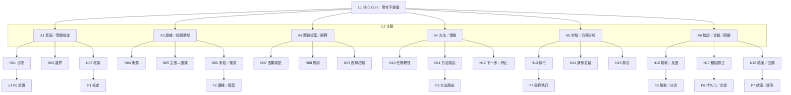
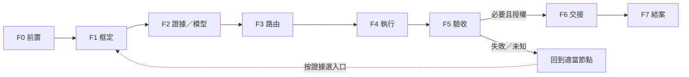
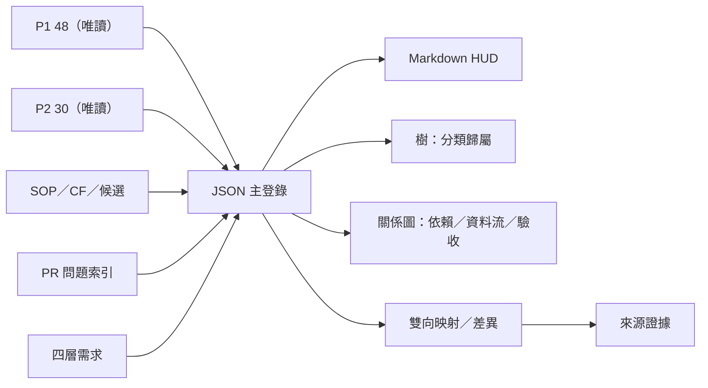

# 四層架構與雙視圖規格 v0.1

- 狀態：REFERENCE_DRAFT；不是正式藍圖。
- 來源：[四層施工藍圖](https://github.com/upqq21477-star/forAVAr/blob/main/參考資料/解析文檔/forAVAr_核心重建施工藍圖_2026-10-22.md)、[四層細項矩陣](https://github.com/upqq21477-star/forAVAr/blob/main/參考資料/解析文檔/forAVAr_四層架構細項展開與閉環證據矩陣_2026-10-22.md)。
- 機器分支：[四層與 VIEW-001–006](../功能覆蓋登錄/四層與VIEW-001-006_v0.1.json)、[VIEW-007–012](../功能覆蓋登錄/VIEW-007-012_v0.1.json)。

## 四層渲染樹

**連線解讀限制：**本圖用來展示四層的展開關係；圖中 N 節點到 F0–F7 的連線是施工示意，不能解讀為已驗收的一對一映射或表示所有任務都按此順序執行。正式依賴需逐項由節點契約、條件分支和測試證據確認。

## 框架執行順序

## 機器／人類視圖關係

**樹狀圖**表達分類歸屬；**關係圖**表達依賴、資料流、控制流、授權、交接與問題—SOP—測試追溯。Markdown 是人類視圖，JSON 是本覆蓋登錄的機器資料；原始來源仍是各領域權威。

| ID | 職責 | 狀態 |
|---|---|---|
| CORE-001 | 思考不變量，防止核心被治理流程取代 | 草案 |
| RENDER-001 | Core → A1–A6 第一次渲染 | 草案 |
| SKELETON-001 | A1–A6 → N01–N18 第二次渲染 | 草案 |
| FRAMEWORK-001 | N01–N18 → 條件式 F0–F7 第三次渲染 | 草案 |
| VIEW-001–003 | JSON 登錄、HUD、人機一致性檢查 | 未自動化 |
| VIEW-004–006 | 樹／關係圖、證據分層、P1/P2 雙向映射 | 未完成驗收 |
| VIEW-007–012 | 分類、前置掃描、呈現、採納／退場與權威鎖定 | 部分為候選／待驗證 |

圖或清單存在不代表功能已接線、測試通過或 Runtime 運作。
