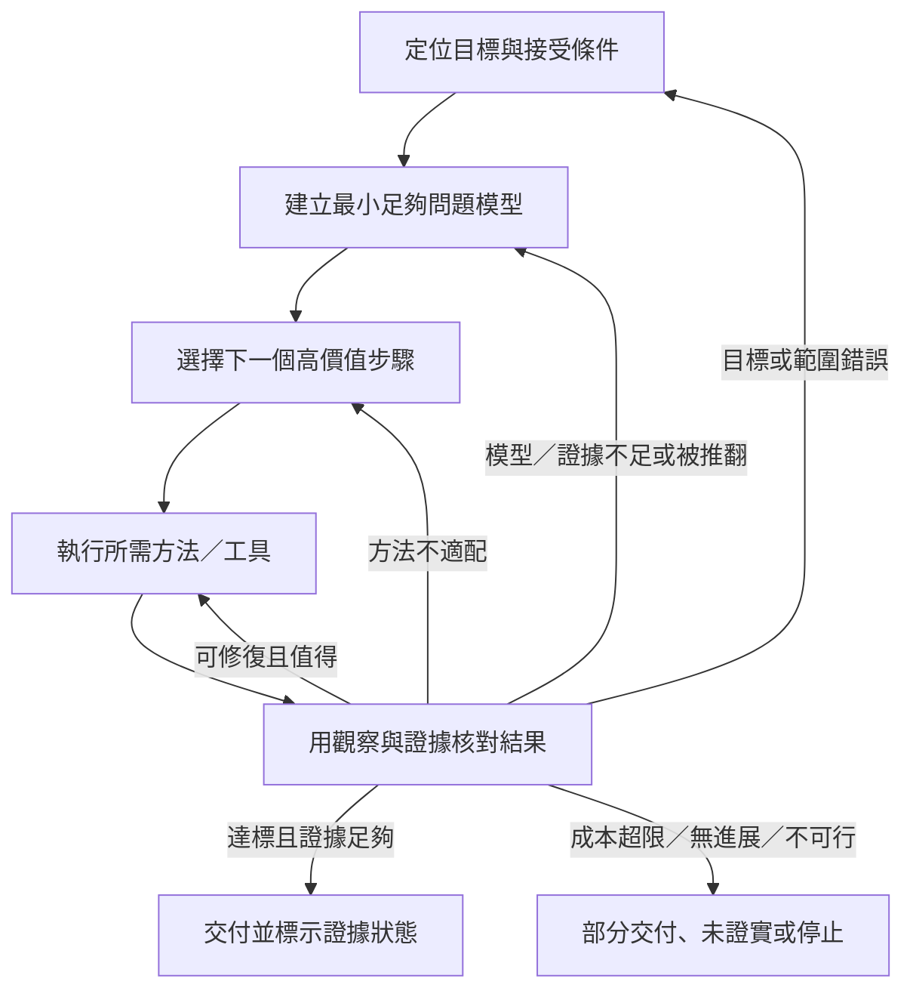

# 思考核心優先的全系統架構再設計｜候選 v0.3

- DOC_ID：FORAVAR-REASONING-CORE-FIRST-ARCH-003
- 日期：2026-10-22
- 狀態：CANDIDATE_FOR_REVIEW；未核准正式化、未執行 Runtime。
- 唯一責任：重新評估整體架構，防止局部優化讓思考核心偏移，提出可反證、可比較的精簡候選。
- 基線：舊四層施工藍圖、v0.2 彈性骨架與狀態路由候選。
- 邊界：這是獨立研究／候選紀錄，不覆寫正式企劃、不更改 P1／P2。所有優勢皆為設計推論，需用同任務測試驗證。

## 摘要與裁定

v0.2 改善了能力歸位、狀態失敗出口與追溯表達，但將 26 個能力節點、6 個狀態、7 個支援平面及多種關係型別一併放入主架構，可能使維護架構本身成為工作負擔。結構詳細不等於思考更準確；文件齊全、映射完整也不代表 Runtime 已有效。

v0.3 的核心假設是：**保持完整的思考責任，但讓每次任務只啟用足以完成任務的最小結構。** 核心不擴張，六個認知主軸不增加；能力庫按需載入；通用流程改為可跳步、可回流、能停止的推理循環；治理、文件、工具與圖表維持支援職責。

現階段建議把 v0.3 作為下一個待反證候選，保留 v0.2 為比較基線。沒有證據支持直接宣稱任何一版最優。

## 1. 第一原則：系統優化的真正目標

forAVAr 的主目標不是累積架構、流程、SOP、工具或文件，而是提升在不同任務下的思考品質：正確理解目標、建立足以解題的問題表徵、辨認證據與未知、選對方法、產生可檢查的結果，並在證據不支持時修正或停止。

每個新設計必須回答：
1. 它改善哪種思考失誤或任務結果？
2. 影響機制為何，什麼觀察可以推翻此說法？
3. 它增加多少時間、上下文、工具、維護與使用者負擔？
4. 是否讓其他任務變差、增加錯誤路由、隱藏未知或引入新單點失效？
5. 若不新增節點，只用既有能力的條件、屬性或路由規則，能否達到相同效果？

若只有文件更完整、分類更整齊或圖更複雜，卻沒有可測量的思考收益，不得將它升格成核心。

## 2. 全系統最佳化規則

採用「硬性約束優先，再比較可行方案」而非單一加權總分：

- **不可互相抵銷的底線：**使用者目標與範圍不可被悄悄替換；事實、推論與未知不可混寫；安全、授權與不可逆操作限制不可被效率分數抵銷。
- **可行方案的品質比較：**比較目標符合度、證據支持、解釋力、反例表現、結果可靠度、回歸風險與任務適配性。
- **成本一起計算：**計入耗時、檢索／工具操作、上下文占用、使用者澄清負擔、返工及長期架構維護成本。
- **採最小足夠方法：**在守住品質與安全門檻的方案中，優先選擇能達成目標且總成本較低的路徑；複雜度必須由任務風險、不確定性或預期收益證成。
- **邊際價值停止：**下一步若不太可能改變決策、減少重大不確定性或改善可驗收結果，且成本高於預期價值，應停止、交付部分成果或明確標記未證實。

不能把正確性、安全性、品質、時間、成本和完整度壓成一個平均分數。先檢查硬性底線，再看品質與成本的整體取捨。

## 3. 重整後的架構樹

```text
L0｜使命與優化準則
    提升思考品質；不以架構完整度取代任務價值
    │
L1｜思考不變量（穩定核心）
    目標忠實／知識誠實／模型可修正／方法適配
    品質與成本分離／可區辨驗證／受控更新／誠實收口
    │
L2｜六個認知責任域（不增加主軸）
    AX1 意圖與問題契約
    AX2 證據與知識狀態
    AX3 問題模型與解釋
    AX4 方法與決策規劃
    AX5 求解與產出
    AX6 驗證、修正與結案
    │
L3｜按需能力庫（可變；不代表每次都要執行）
    方法、反例、外部研究、計算、建置、診斷、
    因果分析、工具操作、回歸檢查等模組
    │
L4｜適應式思考循環（不是固定全流程）
    定位目標 → 建立最小問題模型 → 選下一步
        ↑                                ↓
    修正／重框／停止 ← 核對觀察與接受條件 ← 執行
     
橫向守門與支援：證據來源｜安全與授權｜狀態與上下文
                  工具執行｜評測與觀測｜文件、呈現與版本治理
```

層級意義不可混淆：L1 是跨任務不可丟失的思考規則；L2 是認知責任；L3 是按需調用的能力；L4 是本次任務的實際路徑。支援服務只提供資料、限制、執行能力或記錄，不是新的思考主軸。

## 4. L1｜八項思考不變量

| ID | 不變量 | 必須維持的行為 | 主要失效訊號 |
|---|---|---|---|
| I1 | 目標忠實 | 明確目標、成功條件、限制與非目標 | 完成流程卻沒解決原問題 |
| I2 | 知識誠實 | 區分來源、觀察、推論、假說、未知與衝突 | 猜測被寫成事實、來源超出支持範圍 |
| I3 | 模型可修正 | 同時留意替代框架與框架外訊號 | 只把錯誤前提推演得更精密 |
| I4 | 方法適配 | 先看問題屬性，再選方法及深度 | 所有任務套用同一重型流程 |
| I5 | 品質與成本分離 | 品質、正確性、安全、時間、成本分開檢查 | 速度或低成本掩蓋重大退步 |
| I6 | 可區辨驗證 | 事前定義可觀察的接受條件與反例 | 只用自我重述或同源判斷證明自己 |
| I7 | 受控更新 | 新證據改動模型時，檢查受影響的下游結論 | 局部修補造成其他分支繼續錯誤 |
| I8 | 誠實收口 | 允許完成、部分完成、未證實、阻塞、拒絕或停止 | 無限迭代、把草案當定論 |

這八項是穩定的檢查原則，不是每次任務都要輸出的八個章節。C-01–C-12 舊 ID 及其原意須保留追溯；歸併只有在逐項語意核對完成後才能正式接受。

## 5. L2｜六個認知主軸及邊界

| 主軸 | 唯一主要責任 | 不得越界 |
|---|---|---|
| AX1 意圖與問題契約 | 定義真正要解的問題、成功條件、範圍與非目標 | 不因手邊工具而改寫目標 |
| AX2 證據與知識狀態 | 管理來源、支持範圍、時效、衝突及未知 | 不把未解衝突硬合併成單一答案 |
| AX3 問題模型與解釋 | 表示對象、變數、條件、關係、根因與競爭假說 | 不把分類樹誤認為完整世界模型 |
| AX4 方法與決策規劃 | 選擇下一個最有價值的認知操作，設定成本與停止條件 | 方法被選中不代表已執行或獲准操作 |
| AX5 求解與產出 | 執行推理、研究、計算、設計、施工或綜合 | 不自行宣告成果已驗收 |
| AX6 驗證、修正與結案 | 比對接受條件、判斷失效類型、選擇回流或終態 | 不用主觀信心代替證據，不要求無限迭代 |

六軸維持 v0.2 的責任方向；優化重點是守住邊界，而不是新增軸。

## 6. L3｜能力庫：保留細節，但降低常駐負擔

v0.2 的 KG-01–KG-26 先視為**能力目錄候選**，不是固定骨架、必走節點或每次都要載入的上下文。原始節點、P1 48 項、P2 30 項、SOP 與 PR 編號繼續保留，以維持追溯；映射狀態仍須標明候選、待審或已驗證。

能力調用條件：
- 只有當任務特性、未知、風險或接受條件需要某能力時才載入。
- 同一責任可透過參數、條件分支或既有能力解決時，不優先新增節點。
- 只有當責任、輸入／輸出契約、失效模式或驗收方式確實不同，且拆分能帶來可測改善時才新增節點。
- 每個節點至少需要目的、觸發條件、輸入、輸出、失敗出口、必要權限、驗收條件和來源。
- 被移除或合併的節點保留舊 ID、替代映射與恢復方式，不得因重構失去來源線索。

## 7. L4｜按需推理循環與運行深度



流程約束：

- 目標辨認與輸出核對是共通責任；中間步驟可依任務省略、合併或重複。
- **快速模式：**問題明確、已知、低風險時，直接回答並做比例適當的核對。
- **標準模式：**需要建模、比較方法或查證主要主張時，執行最小充分分析。
- **深度模式：**高不確定、因果複雜、影響重大或使用者明確要求研究時，加入外部證據、競爭假說、反例、區辨測試與回歸檢查。
- **高風險守門：**涉及外部副作用、權限、不可逆行動或重大後果時，獨立檢查授權、範圍及安全限制；不得因快速模式而跳過。
- 模式是深度與預算設定，不是不同的核心。任務中若出現新證據、範圍改變、失敗或風險上升，可以升級、降級或重新路由。
- 每次回流必須指出改變了什麼，以及下一步預期提供什麼新資訊或修復；沒有新資訊、不同路徑或修正依據時，不重複同一嘗試。

## 8. 橫向支援：不得取代思考核心

| 支援責任 | 工作範圍 | 邊界 |
|---|---|---|
| 證據與來源 | 檢索、來源身分、版本、主張追溯、衝突 | 提供依據，不自行決定推論正確 |
| 安全、權限與信任 | 授權、作用範圍、不可逆行動與硬性限制 | 可以阻止行動，不改寫認知結論 |
| 狀態、上下文與恢復 | 目前狀態、必要記錄、交接與恢復 | 歷史記錄不等於當前事實 |
| 工具與執行 | 調用搜尋、計算、建置、修改或測試能力 | 工具存在不代表該用；工具成功不代表目標達成 |
| 評測與觀測 | 記錄路徑、結果、錯誤、成本、回歸與回饋 | 評分不能替代任務語境或硬性 Gate |
| 文件、呈現與治理 | 人類／機器視圖、索引、版本、SOP 與退場 | 只支援理解與維護，不升格成認知主軸 |

## 9. 全系統負面效應檢查

| 局部改善 | 可能引起的整體損失 | 防止方式 |
|---|---|---|
| 節點切得更細 | 更多判斷、載入與維護，任務變慢 | 預設不新增；先證明現有責任無法承載 |
| 狀態定義更完整 | 過度路由、形式合規、無進展循環 | 流程可跳步；回流必須有進展條件與停止規則 |
| 反證更頻繁 | 成本上升、簡單任務被拖慢 | 依錯誤代價與不確定性分級 |
| 來源和映射更全面 | 檔案膨脹、資訊重複、引用漂移 | 原始 ID 留在登錄層；核心只呈現必要內容 |
| 單一指標變好 | 其他品質、使用者負擔或維護成本變差 | 多維度報告；硬性門檻先檢查，不以平均值遮蔽 |
| 自我修正更積極 | 改動擴散、反覆改規則、測試過度擬合 | 版本化變更、保留測試集、下游影響與回歸檢查 |
| 機器規格更精細 | 人類難理解，機器規格和文件出現多份真相 | 指定一個權威來源；其他視圖由其生成，未自動化前逐次對帳 |

## 10. 與舊版及 v0.2 的整體比較

| 維度 | 舊版四層 | v0.2 候選 | v0.3 候選 |
|---|---|---|---|
| 思考核心可見度 | 高，但細項及流程契約較弱 | 有明確核心，但支援結構可能搶占注意力 | 最高優先；使命與核心先行 |
| 能力擴展 | 每軸固定節點不利於伸縮 | 可變能力圖，表達力高 | 能力圖保留為目錄，按需載入 |
| 流程適應性 | 條件式流程，需明確化 | 明確狀態、守衛與終態 | 推理循環＋模式深度，不強迫完整路由 |
| 追溯能力 | 需補映射 | 逐項映射與邊型更完整 | 保留映射登錄，但不讓映射主導核心 |
| 執行負擔 | 較低 | 最高；契約、狀態、支援平面較多 | 預期較低；實際成本仍待測 |
| 主要風險 | 節點切分僵硬、流程模糊 | 架構治理膨脹、形式化過度 | 深度路由不足、規則不夠精確 |
| 當前證據 | 未有公平對照 | 未有 Runtime 證明 | 新的設計推論，尚未驗證 |

目前的理性選擇不是宣布 v0.3 最優，而是測試它能否保留 v0.2 的追溯與失效處理優點，同時減少常駐結構與實際操作負擔。若不能，就保留 v0.2 的必要機制並縮減 v0.3，而不是為了版本進步而接受它。

## 11. 桌上模擬：必須通過的情境

| 情境 | 預期行為 | 失敗訊號 |
|---|---|---|
| 簡單且已知的問題 | 快速模式，核對後交付 | 強制深度研究或無必要澄清 |
| 目標有關鍵歧義 | 最小必要澄清，避免默默假設 | 直接把假設當契約 |
| 需要最新外部資料 | 查來源與時效，保留支持範圍 | 用記憶代替查證或誤引 |
| 多來源衝突 | 保留衝突、比較證據，必要時未證實收口 | 為了單一答案掩蓋差異 |
| 因果／根因診斷 | 建立競爭假說，找能區分假說的觀察 | 先認定根因，再尋找支持 |
| 新反例推翻模型 | 回到模型或問題契約，重驗下游結論 | 只局部改字，保留受影響錯誤 |
| 多檔案施工或外部副作用 | 核對範圍、權限、依賴與實際讀回證據 | 以寫入成功冒充整體驗收 |
| 重要資訊不可得 | 說明缺口、提供部分結果或停止 | 無限重試、虛構結論 |
| 成本／時間預算耗盡 | 根據已完成和未完成項目收口 | 隱瞞未完成或超支 |
| 架構新增功能提案 | 先檢查核心收益、重複能力與副作用 | 因新點子有趣就加入核心 |

此表是待執行的設計檢查，不表示已完成 Runtime 測試。

## 12. 如何判定 v0.3 值不值得採用

1. 固定兩版可接受的任務輸入、來源、權限、工具與資源上限；用相同任務配對比較。
2. 測試至少涵蓋上述不同類型及反例；先用小型試點找缺陷，再依變異與效果大小擴大測試。不能用少數桌上案例宣稱統計上最優。
3. 分開記錄：目標符合度、主張支持正確性、未知／衝突處理、路由失誤、硬性 Gate 遺漏、返工／回歸、耗時、工具／上下文成本、使用者負擔與維護成本。
4. 安全、授權與重大正確性要求採獨立通過門檻，不讓速度或平均分抵銷。
5. 若品質不退步且至少一項預先指定品質或效率指標有可重現改善、總成本沒有不合理增加，才進一步評估；結果不明則繼續測試或保留兩版，不宣稱勝出。
6. 使用未參與規則調整的保留案例檢查是否只是對熟悉案例過度擬合；每次變更都要跑回歸案例。
7. 如果更細的結構沒有帶來可測改善，就刪減、合併或維持候選；系統應有能力否決自己的架構。

## 13. 實施邊界與下一步

- 不覆寫 v0.2 或正式企劃；兩者保留為基線與歷史候選。
- P1、P2 僅唯讀參考。P1 48 項、P2 30 項原始 ID 不變；目前映射仍是候選，需逐項語意核對。
- 不把現有 SOP、PR、能力模組、便利功能全部塞進 L1／L2；各自留在對應登錄層，按需連接到認知責任。
- 先完成：原核心逐條語意核對、候選映射錯位校正、情境測試規格與新舊配對試驗；之後才決定採納、縮減或退回。
- 文件存在、架構圖完整、JSON 有效都不是實作、測試或 Runtime 證據。

## 14. 外部研究依據與適用限制

- NASA, *Systems Engineering Fundamentals*：整體設計要平衡互相衝突的限制，避免偏袒單一子系統。此處用來支持全系統權衡，不證明本架構正確。
  https://www.nasa.gov/reference/2-0-fundamentals-of-systems-engineering/
- ISO/IEC/IEEE 15288:2023：系統生命週期流程可迭代、遞迴運用，標準不指定唯一生命週期模型或方法。此處用來支持依情境裁剪，不是固定流程背書。
  https://www.iso.org/standard/81702.html
- NIST AI RMF：Govern、Map、Measure、Manage 是高階功能；治理貫穿其他功能，並非僵硬的線性清單。
  https://airc.nist.gov/airmf-resources/airmf/5-sec-core/
- OpenAI, *Evaluation best practices*：要定義目標、建立代表性資料、明確評量並持續比較；避免通用指標、偏差資料集及憑感覺判定。
  https://developers.openai.com/api/docs/guides/evaluation-best-practices
- Google Cloud Well-Architected Framework：強調簡化、解耦、持續改善與成本／可靠性等整體面向。
  https://docs.cloud.google.com/architecture/framework
- Donella Meadows, *Leverage Points*：介入系統可能出現違反直覺的副作用，應理解系統結構與目標，而非假定局部加力必然改善全局。
  https://donellameadows.org/archives/leverage-points-places-to-intervene-in-a-system/
- Artinger, Gigerenzer, Jacobs (2022), *Satisficing: Integrating Two Traditions*：在不確定性下，依適當門檻停止搜尋有時比無限制追求最優更合理；適用條件需依任務判斷。
  https://pubs.aeaweb.org/doi/10.1257/jel.20201396

外部來源提供原則與研究方向；本文對 forAVAr 的架構判斷仍屬待驗證推論。
