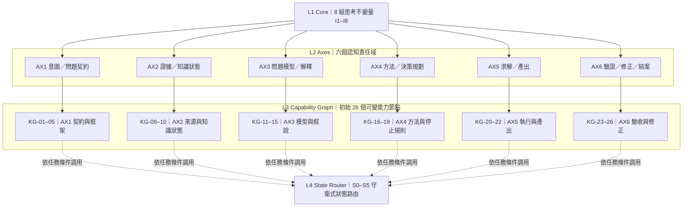
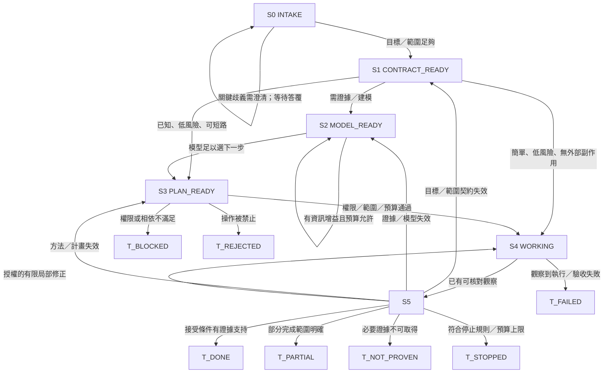
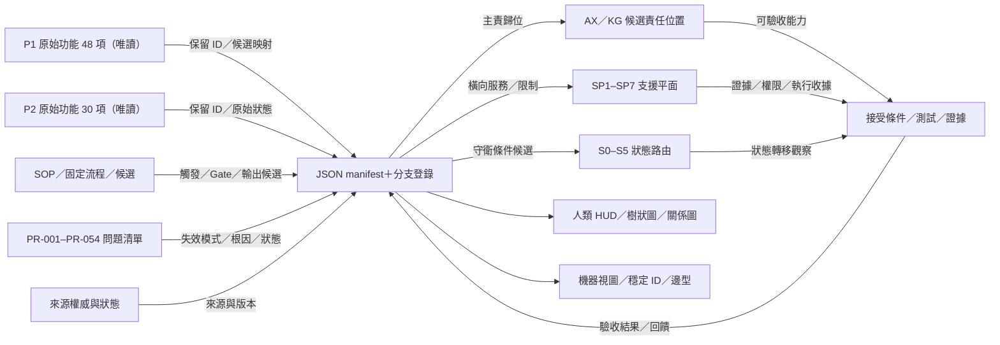

# 新框架結構圖與關係圖｜候選 v0.2

- **狀態：** DESIGN_VIEW_CANDIDATE；圖形表達尚未通過流程／Runtime 驗收。
- **架構規格：** [新框架規格](./新框架規格_v0.2.md)
- **新舊比較：** [優缺點分析](./新舊對比與優缺點_v0.2.md)
- **機器資料：** [architecture model](./機器版/architecture_model_v0.2.json)、[manifest](./機器版/manifest_v0.2.json)

## 1. 四層渲染樹

**讀圖規則：**前半部表示責任歸屬；虛線表示能力節點可能被本次任務路由器調用，不表示每個任務必須依序調用全部節點。L3 的 26 個節點是初始候選，不是永久固定數量。

## 2. L4 狀態轉移圖

**守衛規則：**直接路徑也要留下選路理由與接受條件。權限、安全及硬性成本 Gate 不可短路。S5 回流須依失敗類型選入口，不可一律重跑全流程；重試次數與停止條件由任務契約明定。

## 3. 跨功能關係圖

**關係型別不是裝飾。**分類父子歸屬、DEPENDS_ON、SERVES、GUARDS、EVIDENCE_FOR、VERIFIED_BY、INVALIDATES、REPLACES 和 RETIRES_TO 有不同語意。當來源或邊尚未驗證時，必須標成候選／未知，不可把視覺連線當成已確認的架構事實。

## 4. 圖形與資料的權威關係

- 機器版保存穩定 ID、來源、候選責任、支援平面、狀態與映射分支。
- 人類版提供樹狀圖、狀態圖、關係圖與說明，用來理解與導航。
- 原始 P1／P2 功能、SOP 狀態與 PR 問題狀態仍以各自權威文件為準。
- 自動生成、圖／JSON 差異檢查目前未實作；正式採納前須在同一變更集人工對帳。
- 圖表只表示設計模型。通過桌上模擬、測試或 Runtime 驗收須另有實際證據。
