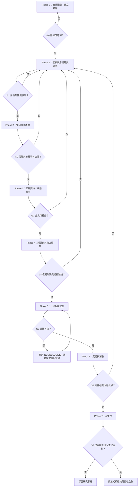

# forAVAr 核心重建施工藍圖｜2026-10-22

- DOC_ID：FORAVAR-CORE-REBUILD-EXECUTION-BLUEPRINT-20261022
- 日期：2026-10-22（Asia/Taipei）
- 文件類型：EXECUTION_BLUEPRINT_DRAFT／STAGED_VALIDATION_PLAN
- 狀態：規劃草案；尚未核准為正式企劃；尚未執行模擬或 Runtime 驗收
- 適用範圍：forAVAr 核心結構重建之研究、規格化、驗證準備與決策
- 核心依據：[核心四層重建研究紀錄](./forAVAr_核心四層重建研究紀錄_2026-10-22.md)、[四層架構細項展開與閉環證據矩陣](./forAVAr_四層架構細項展開與閉環證據矩陣_2026-10-22.md)
- 權限界線：本文件只規劃施工順序與驗收要求，不表示已核准修改正式企劃、重寫核心文件、建立執行程式或改變問題清單狀態。P1、P2 僅能唯讀參照；所有允許的專案文件新增與修改限於 forAVAr。
- 狀態聲明：本文件提出的階段、門檻、樣本數與指標，皆是待審核的執行提案，不是已完成的驗證結果。

---

## 摘要

本藍圖的目標不是繼續擴張 APSGA 或增加更多控制節點，而是先判斷 forAVAr 的「思考核心」是否能被清楚界定、是否能一致展開為主軸、骨架與條件式框架，以及這個結構在代表性任務上是否比現有流程更可靠、更有效。

採取七階段、八個決策門的順序：

1. 凍結研究邊界並建立現況基線。
2. 確認四層各自的責任、禁止事項與層間轉換契約。
3. 建立問題／需求到主軸、骨架、控制、測試與證據的雙向追溯矩陣。
4. 將十八個骨架節點與框架流程規格化為可檢查契約。
5. 用代表性案例進行桌上推演及失敗注入，先找出規格矛盾。
6. 在條件允許時進行公平對照試驗，區分「文件完整」與「實際效果」。
7. 根據證據作出保留、修正、縮減或否決候選架構的決策。

**最高優先原則：先驗證認知結構，再驗證流程；先確認問題是否被正確處理，再評估自動化；未通過決策門，不得把候選設計升格為正式核心。**

圖、節點對照、PR 映射、文件索引都只屬於可追溯性證據的一部分，不等於行為已實作，也不等於效果已驗證。不得因為架構「看起來完整」便直接宣告閉環或架構最優。

## 1. 任務定義

### 1.1 主要目標

- 建立單一、可檢查、可反證的思考核心定義。
- 依序呈現四層：L1 核心（思考）→ L2 主軸（第一次渲染）→ L3 骨架（第二次渲染）→ L4 框架（第三次渲染）。
- 把認知結構與治理／權限／工具／狀態／持久化／文件／評測等橫向支援平面分離。
- 讓每個重要問題都能追溯至處理位置、觸發條件、處置路徑、驗收證據與結束狀態。
- 用實驗辨別候選四層結構是否改善正確性、證據品質、目標達成、修正能力與成本。
- 保留「薄核心、依問題屬性選方法、按需要增加深度」原則，不把認知流程固化為所有任務都必須執行的同一套 SOP。

### 1.2 不在本藍圖直接執行的事項

- 不自動更新或重寫正式主企劃。
- 不宣告 APSGA、C′ 或其他現存架構已被正式取代。
- 不先把全部既有模組搬進新四層。
- 不以增加文件、節點或檢查表數量作為進度指標。
- 不把文件已定義、節點已映射或模擬已通過誤報為 Runtime 已通過。
- 不對 P1、P2 建立、修改、覆寫、刪除或回寫任何內容。
- 不在缺少基線、測試案例與驗收標準時，聲稱架構是「最優解」。

### 1.3 核心驗證問題

Q1. 四層的定義是否互不混淆，而且可以由上層穩定推導出下層？

Q2. 六個主軸與十八個骨架節點是否涵蓋必要的思考責任，又不強迫每個任務走完整流程？

Q3. 框架是否會根據任務風險、複雜度、證據狀態和成本選擇路徑，而不是機械式地執行所有節點？

Q4. 面對證據衝突、錯誤假設、框架錯置、工具失敗、未知和權限不足時，系統是否能正確分類並停止、重試、局部修正或重新定義問題？

Q5. 對比可重現的既有流程，候選架構是否在品質、韌性或成本上有可測量的改善？

Q6. 產生的改善能否歸因於思考結構，而不是額外上下文、更多工具權限、更多 token、評分偏差或測試集洩漏？

## 2. 四層施工基準

### L1｜核心 Core：思考

核心只定義必要的認知不變量，不規定所有工作的固定步驟。候選核心至少需維持：

- 先明確目標、限制與成功條件，再決定方法。
- 將問題表徵視為可修正假說，而非不可更改前提。
- 區分事實、來源主張、觀察、推論、假說、未知與衝突。
- 根據任務屬性選擇適配方法；不預設單一方法適用所有問題。
- 對重要假說建立能區分競爭解釋的檢驗。
- 區分執行成功與答案正確。
- 允許反證改變模型、結論、流程或停止決定。
- 新證據可以引發局部修正，也可以觸發整體重框。
- 分別評估品質、安全、資源與時間成本。
- 資訊不足時保留 UNKNOWN／NOT_PROVEN／BLOCKED 等狀態，不以猜測補空白。
- 流程深度必須有條件地增加或縮減。
- 核心自身的有效性也必須可被測試與否決。

**驗收要求：**逐項寫出不變量的定義、違反例、可觀察訊號與測試方法；不能只留下口號。

### L2｜主軸 A1–A6：核心的第一次渲染

- A1 意圖與問題框定：目標、成功條件、限制、邊界、依賴與競爭框架。
- A2 證據與知識狀態：來源、觀察、主張—證據關係、未知與矛盾。
- A3 問題模型與解釋：系統結構、因果關係、競爭假說與區辨檢驗。
- A4 方法選擇與策略：任務屬性、方法路由、成本／風險預算與停止判準。
- A5 求解與方案形成：執行選定方法、更新模型／狀態並綜合結果。
- A6 驗證、重框與回饋：驗收、反證、根因修正、重框、結案與後續評測。

**驗收要求：**每個主軸必須具有明確責任邊界、輸入、輸出、與其他主軸的依賴，以及「不處理什麼」的說明。

### L3｜骨架 N01–N18：主軸的第二次渲染

- A1：N01 目標／成功條件正規化；N02 邊界／依賴；N03 初始／競爭框架。
- A2：N04 來源／觀察；N05 主張—證據關係；N06 未知／衝突。
- A3：N07 結構／因果模型；N08 競爭假說；N09 區辨檢驗。
- A4：N10 任務屬性；N11 方法路由；N12 下一步／停止。
- A5：N13 執行選定方法；N14 模型／狀態更新；N15 結果綜合。
- A6：N16 驗收／反證；N17 根因修正／重框；N18 結案／回饋。

**驗收要求：**每個節點需定義入口條件、必需輸入、操作、輸出、失敗狀態、允許的下一步，以及與上層主軸的對應。不允許只用名稱相近就判定責任映射成立。

### L4｜框架 F0–F7：骨架的第三次渲染

- F0 接收與前置檢查：目標、權限、資料來源、既有規則、工作範圍及停止限制。
- F1 問題框定：生成可檢查的任務表徵及成功判準。
- F2 證據與模型：整理證據狀態、競爭解釋及關鍵未知。
- F3 方法路由：選擇方法、預算、風險控制、必要工具與停止條件。
- F4 受控執行：依選定方法工作，記錄關鍵狀態變更。
- F5 驗收及分類：檢查結果並決定通過、局部修正、方法重選、重框、阻塞、拒絕或停止。
- F6 持久化／交接／回復：只有在授權且有必要時才寫回；記錄修改、回復條件與交接內容。
- F7 結案與評測：保存結果、失敗原因、成本和後續可驗證的改進項目。

F0–F7 是候選工作結構，不代表每個任務必須執行全部階段。低風險、簡單且可逆任務應允許短路徑；高風險、多依賴、跨模組或不可逆工作才提高驗收強度。

**驗收要求：**每條流程分支均需有觸發條件、可觀察的判斷依據及終止狀態。不能使用「視情況」「適當處理」等未定義字眼作為關鍵控制條件。

## 3. 分階段施工路線

### Phase 0｜凍結範圍與建立工作基線

目的：防止重建過程再次偏移成文件治理或模組擴張專案。

工作：
1. 列出本輪權威文件、參考文件、候選規格、待驗證主張與禁止變更範圍。
2. 記錄現有問題清單 PR-001–PR-054 的狀態，不在沒有新證據時改變其狀態。
3. 記錄當前架構中哪些是概念定義、哪些是規格、哪些是已有實作、哪些曾接受實測。
4. 建立現況版本、測試環境、可用工具、資源上限及限制的基線。
5. 明確標記「尚未驗證」而非將空白欄位填成已完成。

交付物：
- 基線盤點表。
- 文件權威層級與來源登記。
- PR 狀態快照。
- 已知限制／未知清單。

通過門 G0：
- 每個被用來推導藍圖的關鍵來源均可定位。
- 研究草案與正式企劃、規格與實作、設計與測試結果彼此可區分。
- 若存在無法確認的權威衝突，先保留為 OPEN，不得進入正式升級決策。

### Phase 1｜四層語意與邊界審核

目的：先檢查概念本身，不先增加細節。

工作：
1. 對 L1–L4 分別寫出目的、輸入、輸出、責任、禁止事項。
2. 對六個主軸逐一檢查是否有功能重疊、責任空洞或層級錯置。
3. 對十八個節點逐一檢查歸屬、前置條件、輸出與必要性。
4. 標出治理／權限／工具／狀態／文件／評測等橫向支援能力，不將它們誤認為新的認知主軸。
5. 為每一項核心不變量建立至少一個違反案例與可觀察失敗訊號。

交付物：
- 四層責任與邊界表。
- 主軸／節點重疊與空缺清單。
- 核心不變量反例集。
- 暫定語意詞彙表。

通過門 G1：
- 不存在尚未解決、會改變整體架構含義的層級矛盾。
- 各層可以用輸入／輸出及責任邊界區分。
- 關鍵術語有一致定義。
- 未解決的爭議需標記為待驗證假說，不能偽裝成定案。

### Phase 2｜問題／需求追溯矩陣

目的：證明每個重要問題都有對應責任與驗收路徑，而非以節點數量暗示問題已解決。

每一列至少包含：
- Requirement／PR ID。
- 問題陳述與來源。
- 嚴重度、目前狀態及其狀態證據。
- 所屬主軸與骨架節點。
- 框架觸發條件及處置分支。
- 可觀察的正確行為與失敗行為。
- 測試案例 ID。
- 驗收指標與證據位置。
- 已知副作用、依賴及回復方式。
- 狀態變更紀錄與責任依據。

需雙向檢查：
A. 每個重要 PR／需求是否能找到處理位置和測試。
B. 每個架構節點是否有明確需求、認知責任或實驗依據；沒有理由的節點應刪減、合併或暫緩，而不是自動保留。

交付物：
- 正向追溯矩陣（問題→架構→測試→證據）。
- 反向追溯矩陣（架構→需求／價值→測試）。
- 未覆蓋、重複覆蓋及無依據節點清單。

通過門 G2：
- 重要問題不存在無處置責任的孤兒項目。
- 每個宣稱已解決的問題都有可檢查證據；僅有文件映射不得升級狀態。
- 所有沒有測試方法的關鍵需求都被明示為未驗證。
- 若發現無法合理映射的主軸或節點，先修正模型，不強行填表。

### Phase 3｜節點契約與框架分支規格化

目的：將圖示轉為可執行或可人工推演的明確規格。

每個骨架節點契約至少含：
1. ID 與唯一責任。
2. 觸發條件。
3. 必需輸入與輸入品質要求。
4. 操作規則及可選策略。
5. 輸出結構及狀態更新。
6. 成功條件。
7. 失敗分類。
8. 重試、局部修正、方法重選、重框、停止及升級條件。
9. 資源／安全／權限限制。
10. 可對應的測試案例和證據欄位。

框架端另規格化以下狀態，不得混用：
- PASS：符合已事先定義的成功條件。
- PARTIAL：部分成功，必須列出已完成與未完成範圍。
- LOCAL_FAILURE：局部步驟失敗，且問題可被局部隔離。
- METHOD_FAILURE：所選方法不適配或未能達到預期。
- MODEL_FAILURE：問題模型或解釋受到反證。
- FRAME_FAILURE：原始問題表述／目標框架本身不成立。
- BLOCKED：受權限、資料、工具、依賴或外部條件阻擋。
- UNKNOWN／NOT_PROVEN：目前證據不足以作出判定。
- REJECTED：因約束、風險或有效性理由不採用方案。
- CANCELLED：有明確理由停止工作。

交付物：
- N01–N18 節點契約。
- F0–F7 分支與狀態轉移表。
- 錯誤分類與回復／停止規則。
- 節點精簡候選清單。

通過門 G3：
- 不存在只有入口而沒有出口的關鍵節點。
- 每種失敗都能導向明確下一步或終止狀態。
- 任何重試都需有重試條件與停止上限，不能無限重試。
- 任何自動寫回都需有權限、範圍、驗證與回復約束；本藍圖本身不授權寫回其他正式文件。

### Phase 4｜測試集與桌上模擬

目的：先在低成本下暴露矛盾，再投入 Runtime 實作或大規模測試。

建立分層案例，至少包含：
1. 明確且簡單的低風險任務。
2. 目標模糊、需要澄清或重新框定的任務。
3. 多來源研究與證據品質判斷。
4. 互相衝突的來源或觀察。
5. 因果推理與競爭假說。
6. 多步驟規劃及跨模組依賴。
7. 程式／技術問題或工具失敗。
8. 資訊不足、權限不足、高風險或必須停止的任務。

建議兩輪測試：
- **試點集：24 個案例**，每一類至少 3 個案例，用來找出規格漏洞與評分規則問題。
- **擴充集：40 個以上案例**，每一類至少 5 個案例；試點修正後再凍結測試集，避免一面調規格一面以同一案例宣稱通過。

每個案例需提供：
- 任務輸入、背景與已知限制。
- 任務成功判準及不可接受行為。
- 需要或不需要的澄清資訊。
- 可用證據、工具和權限。
- 預期的停止、重框或執行條件。
- 評分規準、邊界案例及合理的 UNKNOWN／BLOCKED 答案。
- 測試案例版本及修改紀錄。

桌上推演至少涵蓋：
- 正常路徑。
- 證據衝突路徑。
- 錯誤假說被反證後的修正路徑。
- 方法失敗後的重新選擇路徑。
- 問題框架錯置後的重框路徑。
- 權限／工具被拒或失敗的阻塞路徑。
- 資訊不足但系統沒有胡亂補全的停止路徑。
- 不需要完整流程、可使用短路徑的簡單任務。

交付物：
- 案例集與標準答案／評分 Rubric。
- 桌上模擬紀錄。
- 未定義分支、循環、死路及狀態混淆缺陷清單。

通過門 G4：
- 所有核心不變量至少有一項測試。
- 所有重要失敗類別至少有一個可重現案例。
- 桌上推演不存在未處理的關鍵狀態；若仍存在，退回 Phase 1–3 修正。
- 此門只證明規格在案例中的內部一致性，不證明實際模型效能已提升。

### Phase 5｜公平對照實驗

目的：測量候選四層方法的實際收益與代價。

前置條件：
- 已有可重現的基線流程或基線提示；若「現行系統」無法被穩定重現，需先把基線定義清楚，不能假裝已完成比較。
- 測試案例及評分規則先行凍結。
- 執行條件可被記錄且可比較。
- 任務輸入、可用來源、工具權限和資源預算一致，或差異被明確記錄並做控制。

建議比較組：
- A 組：可重現的現行流程基線。
- B 組：薄核心＋四層候選架構。
- C 組（可選）：較少結構的簡化基線，用以估計額外架構的淨效益。

控制方式：
1. 以相同任務和相同來源／權限條件比較。
2. 隨機化或交錯執行順序，降低順序效應。
3. 將輸出以匿名 ID 交由盲評者按同一 Rubric 評分；若不能盲評，需記錄評分偏差風險。
4. 對隨機性較高的系統重複執行；建議每條件至少 3 次，並記錄模型／版本／提示／工具配置。
5. 將品質、安全／合規、成本和速度分開評估，不可用單一平均分抵銷重大安全失敗。
6. 固定一組保留測試案例，不可用於中途調整規格。
7. 同時記錄成功案例和失敗案例，不只抽取有利結果。

主要量測：
- 任務成功率及成功條件完成度。
- 事實正確性與引用可追溯性。
- 未知／不確定性表述是否校準。
- 對反證、衝突和新證據的修正能力。
- 問題框架錯置的偵測與重框成功率。
- 不必要流程、重複分析及過度擴張的頻率。
- 工具／計算／token／時間成本。
- 權限、安全、拒絕與停止條件的遵循情況。
- 結果穩定性，以及不同任務類型間的差異。

交付物：
- 實驗設計與執行紀錄。
- 原始輸出、盲評分數、爭議裁決與成本表。
- 與基線的差異分析及限制說明。
- 失敗分類統計與改版假說。

通過門 G5：
- 測試與評分流程可以重現。
- 不以單一任務或單一次執行判定勝負。
- 重大安全／權限失敗不可由品質高分抵銷。
- 若無可信的比較基線、樣本不具代表性或評分規則事後改動，結果只能標示為探索性，不能宣稱候選架構已被證實更優。

### Phase 6｜反證、消融與架構縮減

目的：確認收益來自哪些必要結構，識別可刪除或應簡化的部分。

工作：
1. 對核心不變量逐項提出可能推翻它的案例。
2. 對主軸和節點進行可行的消融／合併分析，檢查移除後是否損害品質或治理。
3. 分析額外流程是否只提高形式完整度、卻增加延遲或降低成功率。
4. 檢查模型是否會在低風險任務上過度進入長流程。
5. 檢查高風險或多階段任務是否因縮短流程而漏掉必要驗收。
6. 將每項改動和證據連結，避免因偏好某架構而保留無效節點。

交付物：
- 核心反證報告。
- 節點必要性／消融紀錄。
- 可縮減、可合併、必須保留、證據不足四類清單。
- 新一輪測試計畫（如需）。

通過門 G6：
- 所有會影響核心架構的反證均有結論或明確保留狀態。
- 節點保留理由可被追溯至需求或試驗證據。
- 若某節點沒有可辨識貢獻且不承擔必要安全／治理責任，必須考慮刪除或簡化。
- 不可用「可能以後有用」作為無限制擴張的充分理由。

### Phase 7｜決策包與正式化候選

目的：形成可被審查的決策材料，不自動改動正式企劃。

決策只能選以下之一：
- ADOPT_CANDIDATE：證據支持，建議進入正式企劃審查；不代表自動正式核准。
- REVISE：保留方向，但需要針對缺陷修正並重測。
- REDUCE：結構過度複雜，應縮減主軸／節點／流程。
- REJECT：候選模型無法證明必要性，或反證顯示其風險／成本高於收益。
- INCONCLUSIVE：證據不足、基線無法重現或測試設計不足。
- BLOCKED：因資料、權限、環境或外部依賴而無法執行。

交付物：
- 含支持證據與反證的決策報告。
- 未解決風險、成本、適用範圍與外推限制。
- 正式企劃需修改的候選差異清單（僅列差異，不自動套用）。
- 若需正式企劃更新，等待使用者明確授權後再進入正式修改流程。

通過門 G7：
- 決策結論有對應證據，且承認無法證明的部分。
- 未完成 Runtime 測試的功能仍標記為未完成。
- 未獲授權時，不將研究／藍圖內容寫入正式企劃。

## 4. 總體依賴圖

## 5. 工作優先級與變更控制

### P0｜阻塞項目

- 四層術語與責任邊界仍有重大矛盾。
- 關鍵問題沒有處置位置或驗收方式。
- 核心主張無法提出反例或可觀察證據。
- 基線無法重現，卻已打算宣稱改版優於現況。
- 主要失敗分支沒有停止、回復或重框規則。

P0 未排除前，不得展開大規模實作或正式架構升級。

### P1｜高優先

- 影響多數任務的證據狀態、方法路由、驗收和重框邏輯。
- 可能造成錯誤答案被誤判通過的問題。
- 可能造成未授權寫入、無法回復或無限循環的問題。
- 可能將治理層誤當認知核心的層級錯置。

### P2｜一般優先

- 不影響核心語意的命名、格式、索引及閱讀體驗改善。
- 可在核心和驗收穩定後再處理的便利性改良。

優先級排序不能取代原有 PR 狀態。任何狀態改變均需新證據、明確依據及紀錄。

### 變更規則

- 每次改動必須說明：問題、證據、假設、預期效果、可能副作用與回退方式。
- 先修改候選規格，再使用未參與本次調整的保留案例重測。
- 發現架構錯置時，允許退回任何前置 Phase；不能只修補最靠近失敗表面的節點。
- 不因單一失敗自動增加新模組；先判斷是核心、主軸、骨架、框架、資料、工具還是測試定義失敗。
- 不因單一成功就宣稱問題永久解決。
- 所有未完成工作保留明確狀態，不以空白或「稍後處理」代替。

## 6. 驗收儀表板

每次階段審核須輸出以下欄位：

| 維度 | 必要紀錄 | 可接受狀態 |
|---|---|---|
| 範圍 | 目標、限制、授權、版本 | 已確認／明確阻塞 |
| 結構 | 層級邊界、責任與依賴 | 無未處理的關鍵矛盾 |
| 追溯 | 問題→主軸→節點→框架→測試→證據 | 可雙向查詢；未覆蓋項目被明示 |
| 規格 | 輸入、操作、輸出、錯誤與下一步 | 可推演且可判定 |
| 測試 | 案例版本、條件、基線、執行紀錄 | 可重現或明示不可重現原因 |
| 品質 | 正確性、目標達成、證據品質、校準 | 分項評估，不混為單一分數 |
| 安全 | 權限、拒絕、停止、回復 | 重大違規不可被平均分抵銷 |
| 成本 | 時間、工具、token／計算成本 | 與基線可比較 |
| 缺陷 | 分類、嚴重度、修正及回歸測試 | 每項有負責階段與狀態 |
| 決策 | ADOPT_CANDIDATE／REVISE／REDUCE／REJECT／INCONCLUSIVE／BLOCKED | 有證據與反證支持 |

## 7. 風險登記表

| 風險 ID | 風險 | 早期訊號 | 控制方式 | 停止／回退條件 |
|---|---|---|---|---|
| RB-01 | 核心再度偏向治理流程 | 文件、控制節點增多，但認知效果沒有測量 | 每一主軸／節點必須連結到認知責任或必要的橫向控制需求 | 無法說明必要性者不得升級 |
| RB-02 | 把圖示當成閉環證據 | 有流程圖，但無觸發、輸出或測試證據 | 逐節點契約與測試追溯 | 無可驗證證據時標記 NOT_PROVEN |
| RB-03 | 節點爆炸 | 每種例外都變成新節點 | 優先檢查是否可用屬性、分支或既有節點處理 | 成本持續上升且無可測改善時縮減 |
| RB-04 | 測試集污染 | 針對相同案例反覆調整直到通過 | 分開試點集與保留集；版本化案例 | 保留集被用於調參時需重建保留集 |
| RB-05 | 假對照 | 測試條件、權限、模型或資源不同 | 固定條件並記錄例外 | 差異無法控制時只報探索結果 |
| RB-06 | 平均分掩蓋重大失敗 | 高品質輸出抵銷安全／權限失敗 | 安全獨立設 Gate | 重大違規未解決時不通過 |
| RB-07 | 無限重試／循環 | 相同失敗重複發生且狀態未變 | 設定重試預算、進展條件與停機狀態 | 沒有新資訊／新路徑時停止 |
| RB-08 | 過度宣稱閉環 | 宣稱涵蓋所有未知問題 | 將閉環限制為可追溯處理已識別事項，並保留異常發現與未知出口 | 沒有證據支持外推時降低聲稱強度 |
| RB-09 | 未授權正式化 | 草案內容被當成正式核心或企劃 | 文件狀態及正式變更權限分離 | 未獲明確授權就不改正式企劃 |
| RB-10 | 偏好確認偏誤 | 只記錄成功案例，忽略反證 | 盲評、保留案例、反證條件與消融 | 結論只依有利案例時不得採納 |

## 8. 文件與交接治理

建議依階段另立紀錄，避免把所有執行結果持續堆疊於本藍圖：
- Phase 0：現況基線盤點紀錄。
- Phase 1：四層語意與邊界稽核紀錄。
- Phase 2：需求／問題雙向追溯矩陣。
- Phase 3：節點契約與狀態轉移規格。
- Phase 4：案例集、桌上模擬及缺陷紀錄。
- Phase 5：公平對照試驗方案與結果。
- Phase 6：反證、消融及縮減分析。
- Phase 7：候選架構決策報告。

每個子文件都需標示 DOC_ID、版本／日期、狀態、唯一責任、輸入來源、輸出、已知限制、未完成項目與與其他文件的關係。後續同主題的深入研究建立新紀錄，不用直接覆寫過往研究結論。

## 9. 目前狀態與下一個可執行工作

- 藍圖狀態：DRAFT。
- Phase 0：部分現況資料已由先前檢視取得，但尚未形成完整、可逐項核對的基線表。
- Phase 1：已有四層候選結構與節點草案，尚需系統性責任邊界審核。
- Phase 2：目前已有部分 PR 映射線索，尚不能視為完整雙向追溯矩陣。
- Phase 3：已有部分節點輸入／輸出與失敗分支設計，尚未完成統一契約驗收。
- Phase 4–6：尚未執行正式桌上模擬、對照實驗、反證與消融。
- Phase 7：尚未進行；沒有證據可宣稱新架構已證實最優。
- Runtime 驗收：NOT_RUN。
- 正式企劃更新：未執行、未由本文件授權。
- P1／P2 寫入：NONE。

**建議下一步：先完成 Phase 0 的基線盤點表，將現有文件分成「權威／參考／候選規格／已實作／已測試／未驗證」六種證據層級，並核對 PR-001–PR-054 現況。只有基線可追溯後，才進入四層語意與邊界審核。**

## 10. 外部方法依據與使用限制

本藍圖使用的工程類比包括：
- NASA 的需求管理與雙向追溯觀念：支援需求到設計、驗證之可追蹤性；不直接證明 forAVAr 四層架構正確。
- NASA 系統工程的迭代與遞迴過程：支援在測試與新證據下反覆修正；不代表應採用特定節點數量。
- NIST 對控制迴路中測量、控制、執行與回饋的描述：支援「結果必須回流到判斷」的概念；不代表所有思考任務都要執行完整控制迴路。
- OpenAI 評測最佳實務：支援先定義目標、案例、指標、比較並持續評估；不直接證明本藍圖的測試樣本數或候選架構有效。

外部參考：
- NASA Requirements Management: https://www.nasa.gov/reference/6-2-requirements-management/
- NASA Fundamentals of Systems Engineering: https://www.nasa.gov/reference/2-0-fundamentals-of-systems-engineering/
- NASA Systems Engineering Handbook Appendix: https://www.nasa.gov/reference/system-engineering-handbook-appendix/
- NIST Control Loop: https://csrc.nist.gov/glossary/term/Control_Loop
- OpenAI Evaluation Best Practices: https://developers.openai.com/api/docs/guides/evaluation-best-practices

以上資料提供工程驗證方法的參考依據，不是對 forAVAr 候選架構的直接驗證結果。
