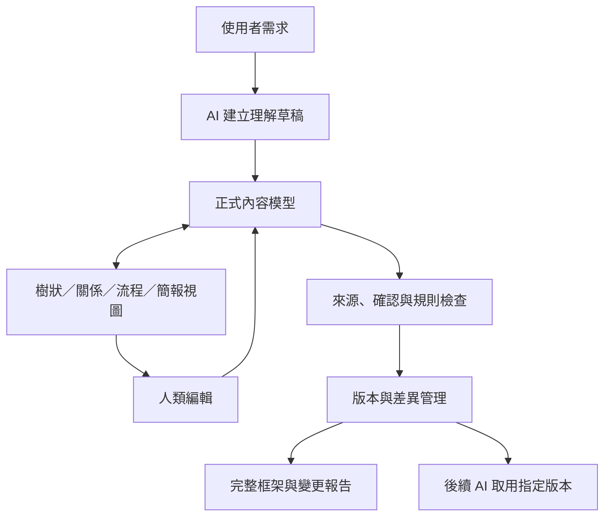

# AI 理解可視化與框架編輯介面：研究企劃書

> **文件性質：** 原理研究與架構企劃，非實作規格、非已驗收系統  
> **研究狀態：** 架構提案；部分設計具外部標準或研究依據，整體成效尚待驗證  
> **版本：** 0.3.0-draft  
> **日期：** 2026-10-26  
> **主要讀者：** 企劃決策者、系統架構設計者、AI 互動設計者、後續實作人員

---

## 摘要

本企劃提出一套「AI 理解可視化與框架編輯介面」，將 AI 對使用者需求、目標、限制、概念及其相互關係的理解，轉換成可閱讀、可直接修正、可追溯且可供後續 AI 使用的結構化模型。介面主要服務人類理解與校正，不以圖形美觀為首要目標。

本企劃的核心命題是：**同一份正式結構資料，可以有多種呈現方式；人類對資料的修改，必須回寫到同一份正式模型；輸出時，應同時交付完整框架與相對於明確基準版本的變更差異。** 樹狀圖用於展示層級，關係圖用於展示依賴與影響，流程圖用於展示條件與先後順序，簡報模式用於提供高層摘要。它們不是各自保存內容的獨立副本。

研究將節點、連線、條件、來源、確認狀態及版本基準分開定義，避免把結構關係、流程規則、因果主張與使用者確認混為一談。每個節點與關係均應保留穩定識別碼；內容來源和確認狀態須分離；使用者未操作某項內容不得視為已確認；AI 不得在沒有明確變更流程的情況下靜默覆寫已確認版本。後續輸出以機器可讀的結構資料與人類可讀的完整企劃並行，並提供版本差異、影響範圍、衝突及待確認事項。

外部依據主要包括 W3C PROV 的資料來源追蹤模型、JSON Schema 的結構驗證規格、RFC 6902 JSON Patch、React Flow 的節點與連線互動範例、Google People + AI Guidebook 的心智模型與回饋原則、Microsoft GraphRAG 文件，以及差異圖可讀性的學術研究。這些來源支持部分設計方向，但**不能直接證明本企劃的整體介面一定能改善 AI 理解品質**。本文件因此區分「外部來源已支持的原理」「本企劃提出的設計規則」與「必須透過實際評估驗證的假說」。

建議先完成資料模型、來源治理、確認流程、版本規則與驗證方法的設計，再決定前端圖形套件或資料庫。現階段不預設必須使用圖資料庫或 GraphRAG；技術選型應由資料規模、查詢模式、部署限制、維護成本與實際評估結果決定。

**關鍵詞：** AI 理解可視化、互動式框架、知識圖譜、節點與連線、資料來源追蹤、版本管理、差異比對、人機互動、GraphRAG、JSON Schema。

---

## 本次深化研究修訂摘要

本次修訂保留原企劃的核心方向，並加入候選方法簡述比較。除將結構角色與物件類型、來源與證據及審核狀態分離，也比較 JSON／RDF、JSON Schema／SHACL、文字差異／JSON Patch／語意差異、樹狀圖／節點連線圖／矩陣、Git／事件溯源／CRDT，以及一般 RAG／GraphRAG 的適用邊界。結論採目前需求下的最低複雜度方案，並列出日後重新評估的觸發條件。

理念拆分、外部工具與方法比較、演算法和取捨理由另見：[AI理解框架：理念拆分、外部方法比較與最佳適配架構](./AI理解框架_理念拆分與技術方案比較.md)。本企劃的建議方案是依目前需求形成的最佳適配起點，並非未經實測即可宣稱普遍最優。

## 目錄

- [1. 研究定位與範圍](#1-研究定位與範圍)
- [2. 問題定義與研究目標](#2-問題定義與研究目標)
- [3. 研究方法與證據分級](#3-研究方法與證據分級)
- [4. 外部研究與工具原理](#4-外部研究與工具原理)
- [5. 系統總體架構](#5-系統總體架構)
- [6. 正式資料模型](#6-正式資料模型)
- [7. 關係語意與條件規則](#7-關係語意與條件規則)
- [8. AI 理解建立與人類確認流程](#8-ai-理解建立與人類確認流程)
- [9. UI 與多視圖設計](#9-ui-與多視圖設計)
- [10. 編輯、驗證與防錯機制](#10-編輯驗證與防錯機制)
- [11. 版本、差異與衝突管理](#11-版本差異與衝突管理)
- [12. 輸出格式與後續 AI 使用](#12-輸出格式與後續-ai-使用)
- [13. 資料儲存與 GraphRAG 的定位](#13-資料儲存與-graphrag-的定位)
- [14. 手機優先與低成本原則](#14-手機優先與低成本原則)
- [15. 研究假說與評估方法](#15-研究假說與評估方法)
- [16. 主要風險與待決策事項](#16-主要風險與待決策事項)
- [17. 建議研究與建構梯次](#17-建議研究與建構梯次)
- [18. 結論](#18-結論)
- [19. 本次深化研究後的架構優化決議](#19-本次深化研究後的架構優化決議)
- [20. 候選方法簡述比較與採用決策](#20-候選方法簡述比較與採用決策)
- [參考資料](#參考資料)
- [理念拆分與技術方案比較](./AI理解框架_理念拆分與技術方案比較.md)
- [名詞表](#名詞表)
- [關鍵詞索引](#關鍵詞索引)

---

## 1. 研究定位與範圍

### 1.1 研究定位

本企劃研究一個人機共同維護的「理解模型」：AI 從使用者提出的需求中整理出目標、核心、主軸、骨架、模組、條件與關係，再用可編輯的視覺介面呈現；人類可以修正內容，系統則記錄修正、確認與版本變化，並把指定的正式版本交給後續 AI 工作使用。

它不是單純的流程圖工具、知識圖譜瀏覽器或畫圖程式。關鍵差異在於：圖形中的語意資料具有明確來源、確認狀態、版本基準與後續使用規則。

### 1.2 本企劃包含

1. 核心、主軸、骨架、模組及一般概念的分層表達。
2. 節點、關係、條件、來源、確認狀態和版本的概念模型。
3. 樹狀圖、關係圖、流程圖、卡片及簡報視圖的共同資料原則。
4. 新對話初始理解的建構、人類修改及確認流程。
5. 語意驗證、差異比較、修改影響分析及衝突處理。
6. Markdown 與 JSON 等人類／機器輸出的原理。
7. 對資料庫、圖形套件與 GraphRAG 的選型原則。
8. 評估介面是否改善理解校正效果的方法。

### 1.3 本企劃不包含

- 不代表已開發、部署或驗證任何 UI。
- 不指定最終前端框架、圖資料庫或雲端服務。
- 不承諾圖形化必然降低幻覺或確保 AI 正確理解。
- 不把 AI 推論視為客觀事實或使用者已確認的意思。
- 不假設 GraphRAG、向量搜尋或特定資料庫必然優於其他選項。
- 不在原理階段制定所有業務領域的專用規則；專用規則應按領域擴充。

### 1.4 設計對象與操作環境

主要使用者是需要確認 AI 是否理解自己意圖的人類。介面必須用淺顯語言顯示功能及關係，專業欄位應可展開，而非永久塞滿主畫面。手機是重要使用環境，因此必須提供無需精準拖曳的替代操作，並確保即使圖形編輯能力受限，也可以透過樹狀清單、選取操作和純文字完成同等的語意修改。

---

## 2. 問題定義與研究目標

### 2.1 問題定義

自然語言需求通常同時包含目標、限制、隱含假設、先後順序、依賴條件和未確定內容。純文字摘要可以濃縮內容，卻不一定能清楚展示哪些部分互相依賴、哪個條件控制流程，以及某個理解究竟來自使用者明說還是 AI 推論。

單純畫出節點與線也不夠：如果線沒有明確語意、來源和狀態，人類仍可能誤讀；如果畫面修改沒有回寫正式資料，AI 後續仍可能使用舊內容；如果差異報告沒有可靠基準，系統可能把歷史變更誤報成本次變更。

### 2.2 研究目標

**G1：讓 AI 理解可被檢查。** 人類可在圖形中查看核心、主軸、骨架、功能、關係及條件。

**G2：讓修正直接生效。** 編輯動作須轉換為明確的結構資料變更，而非只修改圖形外觀。

**G3：讓內容可以追溯。** 重要節點及關係可追到來源、產生過程、確認狀態與版本。

**G4：讓差異可以解釋。** 系統能指出新增、刪除、修改、連線變更、狀態改變及可能的下游影響。

**G5：讓後續 AI 使用正確版本。** 後續任務需取得明確指定或可解析的有效版本，不以模型的模糊回憶替代正式資料。

**G6：控制複雜度與使用成本。** 先完成最小、完整、可追溯的資料與編輯閉環，再增加進階圖形、儲存或檢索技術。

### 2.3 成功定義

本企劃不以「畫面完成」或「節點數量增加」作為主要成功指標。核心成功條件是：使用者能發現並修正 AI 理解中的錯誤；修改不會無聲遺失；輸出差異與基準一致；後續 AI 能取得正確版本；同一資料在不同視圖中不出現語意矛盾。

以上為規劃目標，尚非已達成的實驗結果。

---

## 3. 研究方法與證據分級

### 3.1 研究方法

本企劃採用設計研究與架構分析方法：

1. 分析使用情境與錯誤模式。
2. 參考正式標準、官方技術文件和學術研究。
3. 比較工具所支持的能力，不把工具功能直接等同於效果證據。
4. 建立概念資料模型及操作規則。
5. 明確列出風險、假說與需要實驗驗證的主張。
6. 後續以小規模原型和對照任務驗證可用性及正確性。

本文件的外部研究查證日期為 2026-10-26。網路文件可能繼續更新，實作時應再次核對版本與授權。

### 3.2 證據分級

| 標記 | 定義 | 使用方式 |
|---|---|---|
| E1：標準／正式規格 | 例如 W3C、IETF、JSON Schema 的規格文件 | 可支持相應格式、概念或操作定義，不代表整體產品有效 |
| E2：官方工具文件 | 專案官方文件與範例 | 支持工具具備某項能力，不代表該能力最適合本系統 |
| E3：學術研究 | 有出版資訊的方法或使用者研究 | 依研究對象、任務、方法與限制解讀，不任意外推 |
| D：設計提案 | 本企劃基於問題分析提出的規則 | 需接受專家檢視與原型評估 |
| H：研究假說 | 尚未證實的預期效果 | 必須制定可否證的評估方式 |
| U：未確定 | 資料不足或存在多種合理方案 | 不得以確定語氣呈現，保留決策紀錄 |

### 3.3 外推限制

某工具可以儲存圖形狀態，不代表它能保存本企劃需要的語意與來源；某研究發現特定差異圖降低計數錯誤，不代表所有顏色和差異呈現方式均有效；某圖資料庫適合圖形遍歷，也不代表它一定比 JSON 或關聯式資料庫更合適。此類界線是本企劃的必要研究紀律。

---

## 4. 外部研究與工具原理

### 4.1 資料來源追蹤：W3C PROV

W3C PROV 將來源資訊視為描述資料實體、產生活動與參與者的方式，並把可追溯性、重現性及版本等視為相關應用方向。[W3C PROV Overview](https://www.w3.org/TR/prov-overview/)；[PROV Model Primer](https://www.w3.org/TR/prov-primer/)

**對本企劃的用途：** 參考其分離原則，區分「內容本身」「內容如何產生／改變」「誰或什麼系統參與該過程」。本系統不必一開始實作整套 PROV 標準，但應避免把來源、推論過程和確認狀態壓成一個布林欄位。

**限制：** PROV 提供來源描述模型，不會自動判斷來源內容是否真實，也不保證 AI 推論正確。

### 4.2 結構驗證：JSON Schema

JSON Schema 2020-12 定義資料結構與驗證語彙，可檢查必要欄位、型別及條件相依等。[JSON Schema Specification](https://json-schema.org/specification)

**對本企劃的用途：** 讓匯出的 JSON 有可驗證的結構，例如節點必須有 ID、名稱和類型，關係必須有起點、終點和關係類型。

**限制：** JSON Schema 不足以獨立驗證所有跨節點規則、因果真實性或複雜流程是否可達；這些需要額外的圖形與領域規則。

### 4.3 局部變更格式：RFC 6902 JSON Patch

IETF RFC 6902 定義一組對 JSON 文件執行新增、移除、取代、移動、複製與測試的操作。[RFC 6902](https://www.rfc-editor.org/rfc/rfc6902.html)

**對本企劃的用途：** 可作為機器端記錄部分結構修改的參考，讓變更操作可被重放或檢查。

**限制：** JSON Patch 解決的是文件欄位如何變更，不會自動判斷兩個節點在語意上是否相同，也不會自行產生人類可讀的「為什麼要改」說明。

### 4.4 節點與關係編輯：React Flow

React Flow 官方範例展示連線驗證、防止循環、儲存與還原、觸控裝置連線、分組、復原與重做等互動能力。[React Flow Examples](https://reactflow.dev/examples)

**對本企劃的用途：** 可參考節點畫布、關係編輯及合法連線檢查的操作方式。它是可考慮的前端技術候選，而非已選定的實作技術。

**限制：** 圖形套件提供互動元件，不會替本系統定義「包含」「因果」「已確認」等語意，也不會自動完成 AI 理解治理。

### 4.5 人類對 AI 的心智模型：Google People + AI Guidebook

Google PAIR Guidebook 指出，人們會形成對產品如何運作、自己的操作會造成什麼影響的心智模型，而使用者理解與系統實際能力不一致時，可能造成落差與誤用；其指南也涵蓋解釋、信任、回饋、控制及失敗處理。[Mental Models](https://pair.withgoogle.com/guidebook-v2/chapter/mental-models/)；[Guidebook Chapters](https://pair.withgoogle.com/guidebook-v2/chapters)

**對本企劃的用途：** 介面應讓使用者知道哪一些內容是 AI 推論、哪一些已被確認，並提供直接修正的能力，而不是只展示一張看似權威的圖。

**限制：** 指南提供設計原則，不等於本企劃介面效果已經過實證驗證。

### 4.6 差異圖研究

Archambault、Purchase 與 Pinaud 的研究比較動態圖差異展示方式，報告指出，在判斷圖中新增或刪除連線數量的特定任務中，差異圖出現較少錯誤，且受測者偏好差異圖。[Difference Map Readability for Dynamic Graphs, DOI: 10.1007/978-3-642-18469-7_5](https://doi.org/10.1007/978-3-642-18469-7_5)

**對本企劃的用途：** 支持將增刪變更清楚分離展示，作為值得測試的介面設計方向。

**限制：** 該研究的任務範圍是特定的動態圖比較，不能推論所有 UI 差異顏色或所有 AI 框架修正情境均會獲得同樣效果。

### 4.7 GraphRAG

Microsoft GraphRAG 文件描述一個結構化 RAG 流程：從原始文字抽取實體、關係及主張，進行圖社群整理與摘要，再在查詢時提供相關結構給語言模型。[GraphRAG Documentation](https://microsoft.github.io/graphrag/)；[索引流程說明](https://microsoft.github.io/graphrag/index/overview/)

**對本企劃的用途：** 當資料規模大、需要跨文件或多跳關係檢索時，可作為進階檢索研究方向。

**限制：** GraphRAG 不等於共識管理或長期記憶；索引建置需要資源與調整，不能因為使用圖結構就推定回答必然可靠。對小型、以使用者確認為主的框架資料，先以簡單 JSON 和明確版本讀取可能更合適。

### 4.8 外部工具的整合判斷

| 參考方向 | 可借鑑的原理 | 不應直接推論的事 |
|---|---|---|
| 低程式碼建構器 | 元件、屬性、畫布、操作回饋 | 不能直接解決 AI 語意治理 |
| 節點圖形套件 | 節點與連線互動、驗證、儲存 | 不能自行定義本企劃關係語意 |
| PROV | 來源與活動追蹤 | 不保證內容真實 |
| JSON Schema | 結構驗證 | 不足以驗證全部語意 |
| JSON Patch | 標準化局部變更操作 | 不會自動判斷語意相等 |
| GraphRAG | 結構化知識檢索 | 不等於已確認的對話共識 |

---

## 5. 系統總體架構

### 5.1 架構原則

系統由四個相互配合的部分組成：

1. **正式內容模型：** 保存框架的節點、連線、條件及屬性。
2. **理解與確認管理：** 保存來源、產生過程、確認狀態與待確認問題。
3. **版本與變更管理：** 保存基準版本、修改紀錄、差異及衝突。
4. **展示與使用介面：** 提供樹狀圖、關係圖、流程圖、文字輸出和後續 AI 取用入口。

這是責任分工，而不是規定所有資料必須以四張資料表或四個服務實作。初期可以在同一份 JSON 文件內存放，只要語意責任明確即可。

### 5.2 關係示意



### 5.3 單一資料來源

樹狀圖、關係圖、流程圖與簡報不可各自保存獨立的語意副本。它們必須讀取同一份正式內容模型。視圖可以保存各自的版面配置，例如節點座標、縮放和折疊狀態，但版面配置不能成為另一份內容真相。

### 5.4 語意資料與版面資料分離

**語意資料**包括節點名稱、功能、類型、關係方向、關係類型、條件、來源和確認狀態。  
**版面資料**包括節點座標、卡片尺寸、顏色、視圖縮放、視窗位置和群組顯示方式。

拖曳一個節點不應自動產生語意修改；改變其所屬主軸或關係類型則應產生語意差異。顏色、線型等視覺樣式必須對應明確規則，不能取代底層狀態欄位。

---

## 6. 正式資料模型

### 6.1 資料實體

最低限度應能表達以下物件：

- **節點（Node）：** 一個概念、目標、功能、模組、條件或其他可辨識項目。
- **連線（Edge）：** 兩個節點之間的有向或無向關係。
- **來源紀錄（Provenance Record）：** 說明內容從何而來、由何種活動產生或修改。
- **確認紀錄（Review Record）：** 說明誰對哪個版本的哪項內容做出何種確認。
- **版本（Version）：** 某一時點的完整內容快照或可重建狀態。
- **變更集（Change Set）：** 從某一基準狀態到新狀態的差異。
- **視圖設定（View State）：** 只保存呈現方式，不改變語意模型。

### 6.2 節點欄位

| 欄位 | 必要性 | 說明 |
|---|---|---|
| `id` | 必要 | 穩定識別碼，不能因改名而改變 |
| `name` | 必要 | 簡短名稱 |
| `function` | 必要 | 一句話說明它的作用；功能型節點建議以動詞開頭 |
| `structural_role` | 必要／預設一般 | 核心、主軸、骨架、模組、細節等框架層級角色 |
| `entity_kind` | 必要 | 目標、需求、功能、概念、條件、決策等物件本身類型 |
| `claim_kind` | 視內容而定 | 使用者需求、設計決策、事實主張、推論、假說等命題性質 |
| `parent_ids` 或所屬關係 | 依模型選擇 | 用於層級與群組；若允許多重隸屬，不能假設單一父節點 |
| `provenance_refs` | 必要 | 連至來源紀錄或原始證據 |
| `review_status` | 必要 | 待檢視、已接受、已否決、爭議未解決等人工審核狀態 |
| `evidence_status` | 有事實主張時適用 | 不適用、未核實、有支持、證據不足、有反證等證據評估 |
| `attributes` | 選填 | 數據、限制、標籤或領域欄位 |
| `condition_refs` | 視類型而定 | 指向啟動、完成、失敗或取消條件 |

「名稱＋作用」是預設顯示規則，不是底層資料只能有兩欄。其他欄位應按需展開，避免畫面擁擠。

### 6.3 連線欄位

| 欄位 | 必要性 | 說明 |
|---|---|---|
| `id` | 必要 | 穩定識別碼 |
| `source_id` | 必要 | 起點節點 ID |
| `target_id` | 必要 | 終點節點 ID |
| `relation_family` | 必要 | 結構、依賴、時序、因果／影響、觸發、資料流等規則家族 |
| `relation_type` | 必要 | 家族內的具體關係，例如 `contains`、`depends_on`、`precedes` |
| `impact_policy` | 建議必要 | 無傳播、直接重檢、依關係傳播等影響政策 |
| `description` | 建議必要 | 用人話說明為何相連 |
| `direction` | 依類型而定 | 有向、無向或由關係類型決定 |
| `condition_refs` | 視類型而定 | 連至生效或流程條件 |
| `provenance_refs` | 必要 | 關係的來源依據 |
| `review_status` | 必要 | 該關係是否經確認 |
| `attributes` | 選填 | 權重、限制、例子或其他屬性 |

### 6.4 條件欄位

條件應能區分用途，不能只有一段不分類的自然語言：

- `start_condition`：流程或關係何時開始生效。
- `completion_condition`：何時視為正常完成。
- `failure_condition`：何時判定失敗或無法繼續。
- `cancel_condition`：何時取消或停止。
- `guard_condition`：啟動某一操作前必須滿足的條件。

並非每個節點或連線都要具備上述所有條件。類型規則必須指定何時必要、何時可留空。

若條件只供人閱讀，應標為描述性條件；若它將由系統自動判斷，則還需定義可檢查的表達方式、判定依據和失敗處理。單純有自然語言條件不等於系統已具備執行能力。

### 6.5 來源紀錄與確認紀錄

來源與確認是不同資訊，應分開保存。

來源紀錄至少能表達：來源類型、原始內容或引用位置、產生方式、關聯物件、產生時間及所使用的基準版本（適用時）。

確認紀錄至少能表達：被確認的物件 ID、對應版本或內容雜湊、結果、操作者類型、時間及可選的備註。若使用者修正內容，必須保留原內容的歷史來源與新內容的變更來源，不能把兩者合併成無法追溯的一筆紀錄。

### 6.6 身分識別與語意去重

固定 ID 的作用是識別同一個物件的歷史，不是保證兩個語意相似的節點一定相同。AI 可能提出名稱略有不同但實際同義的節點；系統可提供重複候選提醒，但合併必須有明確規則或人工確認，不能僅因文字相似就自動合併。

### 6.7 概念資料範例

以下僅示意結構，不是最終 JSON Schema：

```json
{
  "model_id": "model-example",
  "version": "0.1.0",
  "nodes": [
    {
      "id": "node-core",
      "name": "核心目標",
      "function": "界定整體要達成的結果",
      "structural_role": "core",
      "entity_kind": "goal",
      "claim_kind": "design_decision",
      "provenance_refs": ["prov-001"],
      "review_status": "pending_review",
      "evidence_status": "not_applicable",
      "attributes": {}
    },
    {
      "id": "node-axis-a",
      "name": "需求整理",
      "function": "把原始要求整理成可檢查的項目",
      "structural_role": "main_axis",
      "entity_kind": "capability",
      "claim_kind": "design_decision",
      "provenance_refs": ["prov-002"],
      "review_status": "pending_review",
      "evidence_status": "not_applicable",
      "attributes": {}
    }
  ],
  "edges": [
    {
      "id": "edge-001",
      "source_id": "node-core",
      "target_id": "node-axis-a",
      "relation_family": "structure",
      "relation_type": "contains",
      "impact_policy": "direct_review",
      "description": "需求整理是實現核心目標的一部分",
      "provenance_refs": ["prov-003"],
      "review_status": "pending_review",
      "evidence_status": "not_applicable"
    }
  ],
  "view_states": {
    "hierarchy": {},
    "relationship_graph": {}
  }
}
```

此範例只表達欄位和物件之間的關係。正式模型還需確立 ID 格式、型別清單、來源紀錄結構、版本規則、刪除策略和 JSON Schema。

---

## 7. 關係語意與條件規則

### 7.1 初始關係類型

建議從少數可區分的類型開始，避免大量近義關係造成混亂：

| 標準類型 | 人類顯示語句 | 主要意義 | 一般是否需要條件 |
|---|---|---|---|
| `contains` | A 包含 B | 結構層級 | 通常不需要 |
| `depends_on` | A 需要 B | 依賴或前置條件 | 視規則而定 |
| `precedes` | A 完成後才進行 B | 時序先後 | 通常有完成定義 |
| `causes` / `influences` | A 導致／影響 B | 因果或影響主張 | 應保存依據；不代表已證明 |
| `triggers` | 條件成立後啟動 B | 啟動或事件觸發 | 需要清楚定義條件 |
| `transfers_data_to` | A 把資料交給 B | 資料流向 | 視資料流規則而定 |
| `conflicts_with` | A 與 B 衝突 | 衝突關係 | 通常需描述衝突原因 |
| `supersedes` | A 取代 B | 版本或責任取代 | 應保存變更依據 |
| `explains` | A 用來說明 B | 解釋或證據關係 | 依情境而定 |

「介紹」不宜預設為所有圖中的通用關係類型，因為它可能只是節點說明文字，未必代表正式的語意連結。只有在確實需要表示「某內容用於解釋另一內容」時，才使用 `explains` 類型。

關係類型應進一步分成「關係家族」與「具體關係類型」，並為不同家族設定不同的循環、條件驗證及影響傳播規則。層級／依賴子圖可能要求無環；因果／影響圖則可能合理包含回饋環，不得把全圖一律當成 DAG。

### 7.2 因果關係需保留證據狀態

因果線不應因為被畫出來就被當成事實。關係至少應能區分：使用者明確提出、外部來源支持、AI 推論、人工確認及仍有爭議。即使使用者確認某項內容，也只能說該內容已被使用者接受為目前框架的一部分；這不自動等於外部世界中的因果已經科學證實。

### 7.3 循環不一律是錯誤

某些流程依賴不允許循環，否則會無法決定先後順序；但因果網路或回饋系統可能合理地存在循環。因此，系統必須按關係類型設定規則，而不是禁止整張圖出現任何循環。React Flow 有防止循環的範例可供實作參考，但是否禁止循環屬於本系統的語意規則，而非視覺套件可以替我們決定。[React Flow Preventing Cycles](https://reactflow.dev/examples/interaction/prevent-cycles)

### 7.4 條件連線的視覺表示

建議以線型、文字標籤和狀態標記共同表達：例如虛線可表示條件性、點線可表示待確認，但實際對應規則必須固定並有圖例。不得只靠顏色；要同時支援色彩辨識、手機畫面與輔助閱讀。

---

## 8. AI 理解建立與人類確認流程

### 8.1 觸發時機的定義

「新對話第一次交流結束」不是系統事件的天然定義，必須由產品規則具體化。本企劃建議：當使用者提交第一個實質需求，且 AI 已完成第一輪回覆後，系統可以產生一份**初始理解草稿**。如果第一輪只是問候、簡短閒聊或資料不足，則不強制產生完整圖，可顯示「目前資訊不足，先建立簡單需求卡」或提示尚未形成可用結構。

這是設計提案，需要依使用情境調整。不能將「任何第一次對話結束」都假設為足以構建完整框架。

### 8.2 初始建構流程

1. 擷取使用者明確提出的目標、限制、對象、必要功能和交付要求。
2. 分辨使用者原句、AI 歸納、AI 推論及資料不足之處。
3. 建立核心、主軸、骨架、節點及必要關係。
4. 對每個節點和重要連線保留來源依據。
5. 對推論與不確定項目加以標記，避免填補不存在的事實。
6. 生成精簡預覽，讓使用者先查看核心和重要關係。
7. 讓使用者修改後再確認，而非要求使用者一次接受整張圖。

### 8.3 確認狀態

人類審核狀態建議限定在一個清楚的集合：

- `pending_review`：尚待人類檢視。
- `accepted`：人類接受該項內容，作為目前工作模型的一部分。
- `rejected`：人類明確否決該項內容。
- `disputed`：存在未解決的意見或來源衝突。
- `needs_reconfirmation`：相關語意內容發生改變，既有接受決定可能不再適用。

「資料不足」不應同時作為審核狀態和證據狀態。對外部事實主張，另用 `evidence_status` 表達 `not_applicable`、`unverified`、`supported`、`insufficient` 或 `contradicted`；對使用者需求或設計決策，重點則是內容是否準確表達意圖，以及人類是否接受。

來源／產生方式、命題性質、證據狀態和人工審核狀態需要分開。AI 推論可以有可信的來源紀錄，但仍未獲人類接受；使用者可接受某一設計決策，但這不代表相關外部事實已被證實。

### 8.4 確認後「上鎖」的正確含義

建議不採用永久鎖定，而採用「正式版本保護」：AI 不得靜默覆寫已確認的正式版本；需要修改時，應建立新提案或變更集，展示內容與影響，讓人決定是否接受。人類始終保有修正權。

這同時避免兩種錯誤：AI 隨意改動共識，以及已確認內容因永久鎖定而無法演進。

### 8.5 確認後 AI 如何使用模型

後續工作應經由一個明確的版本選擇規則取得資料：優先使用當前正式發布版本；若任務明確指定某個歷史版本，則使用指定版本；若沒有正式版本，使用草稿並明確標示狀態。AI 不應從歷史對話任意重建一份「看似相同」的框架來取代正式模型。

如果正式模型不可取得或版本存在衝突，應回報無法確定使用哪個版本，而不是默默退回舊摘要。

### 8.6 使用者修正後的影響

當修改某節點時，系統應分析直接連線及可能依賴的下游項目。不是所有下游項目都必須重新確認；需依變更類型與關係規則判斷。例如，排版移動通常沒有語意影響；更改核心目標則可能影響多個主軸。影響分析應提供建議及理由，而非只顯示無法理解的警告。

---

## 9. UI 與多視圖設計

### 9.1 視圖設計

| 視圖 | 主要問題 | 預設呈現 |
|---|---|---|
| 總覽／樹狀圖 | 整體由哪些部分構成？ | 核心、主軸、骨架，可折疊展開 |
| 關係圖 | 節點之間如何互相影響？ | 重要關係、方向及關係標籤 |
| 流程圖 | 什麼先發生、何時啟動或結束？ | 起點、條件、動作、完成或失敗狀態 |
| 卡片清單 | 單一節點的內容是什麼？ | 名稱、作用、狀態與來源摘要 |
| 簡報模式 | 如何快速向人解釋整體框架？ | 一句核心、少量主軸、關鍵關係與風險 |
| 差異模式 | 與基準相比改了什麼？ | 新增、刪除、修改、狀態變化及影響 |

每種視圖只顯示對該任務有幫助的關係，但所有視圖必須讀取同一份正式語意資料。

### 9.2 分層展示

**第一層：核心。** 用一句話說明整體目的。  
**第二層：主軸與骨架。** 顯示主要部分及它們的關係，避免一開始出現大量細節。  
**第三層：節點細節。** 點開後顯示功能、依據、狀態、限制、條件及相關連線。  
**第四層：證據與變更。** 提供來源原句、歷史變更、確認紀錄及衝突。

節點數量「約七個」可以作為初始版面假說，但不能當作普遍認知定律。實際顯示數量應以任務和可用性測試決定；群組和折疊功能比硬性限制節點數更重要。

### 9.3 節點視覺規則

預設卡片只顯示：名稱、作用，以及必要的確認狀態。節點形狀或小型標記可區分類型；顏色只作輔助，不應成為唯一訊息通道。重要關係可以加強線條或標籤，但應避免同時使用過多顏色、粗細、動畫和圖示。

### 9.4 手機優先

手機端不應要求使用者精準拖曳大量節點。建議提供：

- 樹狀清單作為預設瀏覽入口。
- 選取起點、再選取終點的連線建立方式。
- 關係類型清單，而不是要求使用者拖線到狹小端點。
- 從節點面板修改名稱、功能及條件。
- 可折疊群組、簡易縮放及「定位到相關節點」。
- 純文字備援，以便在圖形操作不便時仍能完成修正。

### 9.5 重要狀態必須可辨識

節點或連線可以用虛線、徽標或顏色提示待確認狀態，但應提供文字標籤和圖例。新增、刪除、修改及未解決衝突都必須有文字描述，不能要求使用者僅靠顏色解讀。

---

## 10. 編輯、驗證與防錯機制

### 10.1 支援的編輯操作

- 新增、刪除、改名或修改功能描述。
- 調整節點層級或群組。
- 新增、移除或反轉連線。
- 修改關係類型及關係說明。
- 新增或修改啟動、完成、失敗、取消及守衛條件。
- 追加來源或證據。
- 標記確認、否決或資料不足。
- 撤銷與重做操作。

### 10.2 兩層驗證

**結構驗證**包括：ID 是否重複、連線的起終點是否存在、必要欄位是否缺失、類型是否合法，以及資料是否符合 JSON Schema。

**語意驗證**包括：關係類型是否允許、必要條件是否缺漏、是否有互相矛盾的條件、某流程是否存在無法抵達的結束狀態，以及循環是否違反特定關係規則。

不能把兩層檢查合併成一個「AI 認為正確」的狀態。建議實際拆成四類：JSON Schema 結構驗證、跨物件參照與不變式檢查、按關係家族執行的圖規則，以及需要來源和人工判斷的證據／語意檢視。前三類應盡量採可重現規則；第四類可以用 AI 提示風險，但不得把 AI 的合理性評語直接視為事實證明。草稿允許不完整，發布規則再判斷哪些問題必須阻擋。

### 10.3 刪除防護

刪除節點前應列出相關連線及受影響引用。對可能影響已確認框架的刪除，應要求明確操作；刪除後不能留下懸空連線。歷史版本需要保留刪除前的內容，以便追蹤和還原。

### 10.4 無效連線與衝突

如果連線不符合規則，介面應用人話說明原因，例如「這個流程需要一個啟動條件」或「這條依賴關係形成不允許的循環」。不要只顯示錯誤碼。若規則本身存在爭議，則應標示待決策，而不是阻止所有操作。

### 10.5 原子性與復原

一組互相依賴的修改應避免只套用一半。例如，修改節點 ID 引用或刪除節點及其連線時，若驗證失敗，正式模型不應停留在結構破損的中間狀態。RFC 6902 的操作順序與失敗處理可提供局部變更的參考，但本系統仍需定義自己的交易與復原策略。

---

## 11. 版本、差異與衝突管理

### 11.1 版本基準

初始理解草稿與首次正式發布可以使用 `V0`、`V1` 作為人類閱讀標籤，但正式識別應使用 Git commit SHA 或其他無歧義的修訂 ID。需分開管理模型內容修訂、`schema_version`、單項內容的審核狀態和整份模型的發布狀態。只有對外 API／格式相容性需要承諾時，才使用 Semantic Versioning 描述契約相容性。每一份差異報告必須記錄明確的來源版本與目標版本；不能依靠 AI 對歷史的模糊回憶。

### 11.2 差異分類

1. **新增：** 新節點、新關係、新條件或新來源。
2. **刪除：** 節點、關係、條件或資料被移除。
3. **修改：** 名稱、功能、類型、描述或屬性變化。
4. **關係變更：** 起點、終點、方向或關係類型改變。
5. **狀態變更：** 待檢視、已確認、否決等狀態改變。
6. **版面變更：** 座標、縮放、折疊或配色變化；通常另行列出。
7. **影響提示：** 其他可能需要重新檢視的項目。

### 11.3 差異輸出順序

每次輸出固定分成：

**A. 完整當前框架**：先提供核心、主軸、骨架、節點、關係、條件、來源及待確認內容。  
**B. 本次修改清單**：依新增、刪除、修改、關係變更、狀態變更排序。  
**C. 影響與未解決事項**：說明哪些項目受到影響、哪些衝突尚未裁決。  
**D. 機器讀取資料**：提供完整 JSON 或結構化變更資料。

### 11.4 視覺差異

新增、刪除與修改可以採用不同顏色、線型及文字標籤，但顏色只是一種輔助提示。差異圖研究支持在特定動態圖比較任務中使用差異視圖，實作時仍須測試本系統使用者能否準確辨識變更。

### 11.5 三方比較與衝突

當 AI 對既有模型提出新修改，而使用者已經在另一個版本做出變更時，需要比較：

- 共同基準版本。
- 人類目前的版本。
- AI 提出的新版本。

如果修改落在不同且互不依賴的物件上，可以提出自動合併候選；如果雙方修改同一節點的核心含義、同一條關係或相互依賴的條件，應列為衝突，讓人類裁決。自動合併必須有規則與可復原紀錄，不能只由 AI 自行決定。

### 11.6 未修改內容與確認狀態

未修改不代表已確認；未顯示也不代表不存在。只有明確的使用者確認操作才應產生確認紀錄。版本發布時，可以保留尚未確認的項目，但要清楚標記，不得假稱整份內容已經全部確認。

---

## 12. 輸出格式與後續 AI 使用

### 12.1 人類閱讀格式：Markdown

Markdown 應包含摘要、目錄、核心與主軸、節點功能、重要關係、條件、確認狀態、待確認項目、來源及差異報告。內容應先提供簡要完整模型，再附詳細資料，避免只輸出一大段沒有層級的文字。

### 12.2 機器讀取格式：JSON

JSON 應保留固定 ID、節點類型、連線起終點、關係類型、必要條件、來源引用、確認狀態、版本識別與視圖設定。它應可由 JSON Schema 驗證，且不依賴解析畫面文字來還原關係。

### 12.3 圖片與報告格式

PNG、SVG、PDF 或簡報適合觀看與分享，但不能取代完整結構資料。匯出圖像時仍應提供其所屬版本、生成時間與對應資料版本，避免圖片與正式內容分離後無法追溯。

### 12.4 後續 AI 使用契約

後續 AI 工作至少應取得：

- 模型 ID 與版本 ID。
- 當前核心及任務相關子圖。
- 已確認內容、AI 推論及未解決事項的區分。
- 必須遵守的限制與關係規則。
- 來源引用或證據摘要。
- 允許 AI 提案修改的範圍，以及正式版本不可被靜默覆寫的規則。

不是每個任務都必須把整張圖全文塞進模型上下文。可依任務範圍擷取相關子圖，但必須保留核心限制及必要依賴；若無法確定某段資料是否相關，應優先揭示不確定性而不是刪去可能重要的內容。

### 12.5 純文字備援

即使圖形介面不可用，使用者仍應能輸入或讀取 Markdown，並透過 JSON 保存和轉移結構。純文字不是未來才考慮的附加功能，而是避免 UI 成為唯一入口的基本保障。

---

## 13. 資料儲存與 GraphRAG 的定位

### 13.1 先模型、後選型

現階段不預設使用圖資料庫。第一階段先以結構化資料模型定義清楚以下需求：

- 預期節點與連線規模。
- 是否需要高頻率多跳查詢。
- 是否需要多人同時編輯。
- 是否要求跨版本查詢與審計。
- 是否包含大量外部文件、來源及全文檢索。
- 可接受的部署成本、維護負擔與服務限制。

### 13.2 技術候選

| 候選 | 適合情況 | 主要注意事項 |
|---|---|---|
| JSON 檔案／文件 | 小型、低成本、以版本化快照為主 | 需要自行設計一致性、鎖定與合併規則 |
| 關聯式資料庫 | 欄位、交易、查詢和資料完整性規則清楚 | 複雜圖遍歷可能需要較多查詢設計 |
| 屬性圖資料庫 | 關係密集、多跳遍歷、依賴探索是核心需求 | 增加部署、治理、查詢及維護負擔 |
| 圖＋向量混合檢索 | 同時需要精確關係與語意相似搜尋 | 更難診斷檢索錯誤，需分別評估兩種檢索品質 |

上述是選型比較框架，不是效能排名。沒有相同資料、查詢與部署條件的基準測試，就不能宣稱某方案必然最快或最省成本。

### 13.3 GraphRAG 不是共識管理的替代品

GraphRAG 適合把大型文字語料轉成實體、關係、摘要及檢索結構；本企劃的正式框架則需要管理使用者意圖、人工確認、版本、變更與衝突。兩者可以在未來結合，但目的不同。

即使導入 GraphRAG，也仍需獨立維護「哪個版本已確認」與「AI 可以使用哪些資料」的規則。圖資料庫能表示連結，不會自動保證所有連結正確，也不會自行判斷使用者是否認同某個 AI 推論。

### 13.4 成本與避免過度架構

初期優先使用結構化 JSON、靜態 Markdown、基本的版本比較與小型圖形編輯能力。只有當實際查詢或治理需求超出簡單方案能力時，才評估引入資料庫、向量檢索或 GraphRAG。避免先建立高成本系統，再尋找足以證明它必要的問題。

---

## 14. 手機優先與低成本原則

### 14.1 基本原則

1. 主要操作不依賴精準滑鼠拖曳。
2. 先看樹狀清單，再進入關係圖深入編輯。
3. 重要資料可透過文字讀取、複製與匯出。
4. 圖形編輯與 AI 生成需可分開使用，不應因其中一項服務不可用而失去正式資料。
5. 不把付費圖資料庫、外部 API 或額外運算視為核心功能的先決條件。
6. 對大圖提供搜尋、折疊、聚焦子圖和回到核心的方式。

### 14.2 低流量與可移轉性

正式資料應以可攜格式保存。避免依賴只能在單一 SaaS 帳號內讀取的隱藏狀態。若將來使用第三方視覺套件，其版面輸出可以獨立保存；但語意資料必須能在不使用該套件時繼續讀取。

### 14.3 最小版本的邊界

最小版本不必包含動畫、多人即時協作、GraphRAG、自動因果推理或複雜模擬。必須先完成的是：資料模型、節點／連線編輯、來源與確認狀態、正式版本、差異輸出，以及後續 AI 取用規則。

---

## 15. 研究假說與評估方法

本企劃目前是原理提案，尚無實測結果。以下假說需以原型或實際操作研究驗證，不得當成既成事實。

### 15.1 研究假說

**H1：** 相較於只提供文字摘要，結構化圖形能協助使用者更快發現層級、連線及條件上的理解錯誤。  
**H2：** 為推論與已確認內容標示不同狀態，能降低使用者把 AI 推論誤當成既定事實的比例。  
**H3：** 使用固定基準的差異報告，能降低使用者漏看新增、刪除與修改的比例。  
**H4：** 手機上的選取式連線操作，相較於精準拖拉，能降低操作失敗率。  
**H5：** 把正式模型與視圖版面分離，能減少無意義的版面變更干擾語意差異報告。  
**H6：** 後續 AI 明確讀取已確認版本，較依賴對話回憶更能維持對核心限制和關係的遵循。此項需嚴格設計對照組，不能只靠主觀感受判斷。

### 15.2 建議評估指標

| 指標 | 定義方式 | 目的 |
|---|---|---|
| 理解錯誤發現率 | 已成功辨識的預設錯誤數／預設錯誤總數 | 測試介面是否幫助找出錯誤 |
| 錯誤修改率 | 使用者錯誤修正數／所有修正數 | 確保修正流程沒有製造更多錯誤 |
| 變更漏看率 | 未被辨識的實際變更數／所有實際變更數 | 評估差異報告 |
| 操作完成率 | 成功完成指定任務的比例 | 評估基本可用性 |
| 任務耗時 | 完成相同任務的時間 | 評估效率，不可單獨作為品質指標 |
| 確認誤判率 | 把推論或未知內容誤認為已確認的比例 | 評估來源與狀態標記 |
| 版本使用正確率 | 後續 AI 使用正確版本的任務比例 | 評估正式資料是否真正接入工作流程 |
| 結構錯誤率 | 無效連線、懸空引用、違規狀態等數量 | 評估資料完整性 |

### 15.3 評估設計

可先建立含有已知錯誤的小型框架樣本，包括：錯誤層級、錯誤連線方向、缺少條件、虛構關係、未確認推論及版本差異。讓受測者分別使用純文字、樹狀圖、關係圖或結合差異報告的介面完成相同任務，比較錯誤發現、漏看、誤改及時間。

應記錄受測者背景、裝置、任務難度、錯誤種類與評分方法；樣本太小時，只能將結果視為初步探索，不能宣稱普遍適用。對 AI 版本遵循能力，也應用固定測試集和相同任務比較，而不是只挑選成功案例。

### 15.4 停止與擴充準則

若基本資料模型仍經常產生識別錯誤、版本不一致或人工無法理解的關係，應先修正基礎模型，不應增加動畫、更多視圖或複雜資料庫。只有當基本任務有可重現的改善，且明確需求超出現有架構時，才擴大功能範圍。

---

## 16. 主要風險與待決策事項

### 16.1 主要風險

| 風險 | 後果 | 應對原理 |
|---|---|---|
| 圖形看似完整但語意錯誤 | 使用者誤以為 AI 已理解 | 保留原句、來源、推論和待確認狀態 |
| 各視圖保存不同內容 | 資料互相矛盾 | 共用正式模型，視圖只保存版面狀態 |
| 未操作被當成確認 | 錯誤內容進入共識 | 只有明確確認操作才能更新確認紀錄 |
| AI 靜默覆寫正式內容 | 人類失去控制 | 提案、差異、確認與新版本流程 |
| 因果線被當成事實 | 推論過度確定 | 保留證據與狀態，區分推論和證實 |
| 所有循環都被禁止 | 合法回饋模型遭錯誤拒絕 | 依關係類型設定循環規則 |
| 直接採用複雜圖資料庫 | 成本和維護負擔過高 | 先定義需求，按實測選型 |
| 只靠顏色表達變更 | 無障礙與手機辨識困難 | 顏色、線型、文字標籤共同呈現 |
| 初始對話資料不足 | AI 強行補完架構 | 支援空白、部分草稿與待確認狀態 |
| 版本差異不穩定 | 重複報告或遺漏變更 | 固定 ID、明確基準與可追溯變更集 |

### 16.2 尚待決策

1. 最終節點型別是否限定為核心、主軸、骨架、模組，或允許一般概念與條件節點。
2. 一個節點能否隸屬多個主軸；若可以，樹狀圖如何呈現而不造成重複語意。
3. 哪些關係禁止循環、哪些允許回饋循環。
4. 使用者是否可以逐項確認，或需要同時支援整體確認與局部確認。
5. 修改核心後，哪些下游內容必須重新檢視，以及如何說明影響理由。
6. 正式版本採整份快照、操作日誌，或兩者並用。
7. 初期儲存採 JSON 檔案、Git 版本管理、資料庫或混合方式。
8. 後續 AI 使用完整框架、任務子圖，或兩者並用；何時應拒絕不完整的取用結果。
9. 版本保護如何配合多個 AI 提案與人類編輯，避免覆寫及衝突遺失。
10. 實際接受標準與測試任務由誰制定，何時能認定第一版具備足夠價值。

未完成決策的項目應保留在決策紀錄，不得因企劃書需要看似完整而自行定案。

---

## 17. 建議研究與建構梯次

以下是建議順序，不表示已執行或已通過驗收。

### 梯次一：原理閉合與資料模型

- 定義節點、關係、條件、來源、確認狀態、版本和版面狀態。
- 定義關係類型與其驗證規則。
- 定義哪些內容可為未知或空白。
- 定義 ID、引用、刪除與版本的基本規則。
- 產出資料模型草案與樣例。

**完成條件：** 以例子能完整表達核心、層級、關係、來源、確認與版本，且無需依靠畫面位置推斷語意。

### 梯次二：互動原理與差異規格

- 定義樹狀圖與關係圖的差異及共同資料來源。
- 定義手機端節點選擇、連線與屬性修改流程。
- 定義結構驗證和語意警告的責任分界。
- 定義版本基準、差異分類和衝突處理。
- 定義 Markdown 與 JSON 輸出內容。

**完成條件：** 指定一組修改，能明確說明哪筆資料改變、哪些視圖同步更新、差異報告如何呈現。

### 梯次三：AI 理解及共識使用規則

- 定義初始草稿產生條件。
- 定義來源原句、AI 整理、AI 推論和資料不足的區分。
- 定義使用者確認和否決的操作。
- 定義已確認內容的保護與新提案流程。
- 定義後續 AI 必須讀取哪個版本，以及資料不可用時的處理方式。

**完成條件：** 可以追溯每項重要內容的來源和狀態，並以測試確認後續 AI 讀取了指定版本。

### 梯次四：原型與模擬驗證

- 用小型樣本製作最小互動原型。
- 注入錯誤層級、錯誤關係、缺少條件、錯誤來源和版本衝突。
- 比較不同視圖及差異展示的任務效果。
- 驗證手機操作與純文字備援。
- 依結果修正原理，不先擴大功能。

**完成條件：** 有可重現的測試案例、結果紀錄、已知限制與明確的後續決策。若無實測資料，不得標示為已驗證。

### 梯次五：技術選型與正式實作規格

只有前四梯次已形成穩定需求後，才評估圖形套件、資料儲存、版本同步與檢索技術。此時才撰寫實作規格、介面流程與部署方案，避免先選工具再扭曲需求。

---

## 18. 結論

本企劃的核心不是「把文字轉成一張關係圖」，而是建立一個能被人類檢查、直接修正、保存確認狀態，並讓後續 AI 取得正確版本的共同理解模型。深化研究亦顯示，正式資料中的結構角色、物件類型、命題性質、證據狀態與人類審核狀態必須分開，並以關係類型決定驗證與影響傳播規則。

目前最有依據的設計方向是：使用單一正式資料來源，將語意內容與版面狀態分離，讓節點與連線擁有明確類型，保留來源追蹤，將確認狀態與版本狀態分開，並以明確基準產生差異報告。外部標準與工具文件可支持這些能力的設計方式，但本企劃是否實際改善人類校正效率、降低誤解或提升 AI 後續遵循程度，仍需實驗驗證。

因此，正確的建構順序是先確立資料模型、來源治理、確認規則、版本與差異機制，再完成 UI 互動原理，最後才選擇資料庫與進階檢索方案。若順序顛倒，系統容易得到一個能拖拉節點、卻無法可靠管理理解內容的圖形工具。

**最終設計原則：圖形是理解的可視化入口；正式資料才是共識本體；版本與來源是可信度的基礎；使用者確認是治理機制；後續 AI 正確使用已確認版本，才是整體系統的價值驗收。**

---

## 19. 本次深化研究後的架構優化決議

### 19.1 優化後的總體判斷

原企劃的「同一份正式資料、多種視圖、人類可直接修正、完整框架加版本差異」核心保留。此次修訂的重點不是增加子系統，而是拆開原本容易混淆的責任，使資料模型、驗證、審核、版本和展示互相配合。

### 19.2 最適合目前需求的起始方案

1. **正式模型：** 以 JSON 表達節點、關係、條件和必要 metadata；使用穩定 ID；允許同一對節點有多種關係。
2. **概念分類：** 將 `structural_role`（核心／主軸／骨架等）與 `entity_kind`（目標／需求／功能／條件等）分開，避免類型維度混合。
3. **知識治理：** 分開來源／產生方式、命題性質、證據狀態和人工審核狀態；不以單一確認欄位代表全部。
4. **版本：** 用 Git 保存正式快照與歷史；應用層依 ID 生成語意差異。JSON Patch 可作為變更傳輸格式，但不代替語意比較。
5. **驗證：** JSON Schema 檢查資料形狀，自訂確定性規則檢查參照完整性和關係不變式，來源與人工審核處理事實和意圖問題。
6. **影響分析：** 只沿已定義的關係政策傳播；每個受影響項目都需提供理由和關係路徑，不進行無差別的全圖重審。
7. **介面：** 樹狀／清單作為總覽與手機入口，節點連線圖用於局部稀疏關係，矩陣或密集關係表列為後續可選視圖。
8. **後續 AI：** 以明確版本 ID 和任務相關子圖作為輸入契約；無法讀取指定版本時應明確回報，不得默默使用舊摘要。
9. **技術選型：** 第一階段不強制導入圖資料庫、GraphRAG、完整 OWL/RDF、event sourcing 或 CRDT；只有實際需求和評估支持時再導入。

### 19.3 哪些理念保留、修改或延後

| 決策 | 原理 | 本次判斷 |
|---|---|---|
| 單一正式模型、多視圖 | 避免各視圖語意分裂 | 保留為核心原則 |
| 節點名稱＋功能預設顯示 | 降低主畫面認知負擔 | 保留；底層不能只存兩欄 |
| 核心／主軸／骨架 | 人類閱讀框架的層次 | 保留；改成結構角色維度 |
| 節點只有單一類型欄位 | 便於初始建模 | 修改；與物件類型分離 |
| 來源與確認分離 | 避免混淆內容來源與人類接受 | 保留並擴充為多個獨立狀態軸 |
| 所有關係用同一套規則 | 簡化初始實作 | 不採用；依關係家族設定規則 |
| 每次修改都全圖重檢 | 避免遺漏 | 修改成按關係政策做影響分析 |
| 文字差異／JSON Patch | 追蹤修改 | 保留作補充；語意差異依穩定 ID 計算 |
| 圖資料庫或 GraphRAG | 支援密集圖查詢或大型語料 | 延後，直到需求證明必要 |
| 事件溯源／CRDT | 全事件重播或即時多方同步 | 初期不採用 |
| 圖片視覺完整度 | 方便展示 | 不作成功標準；以錯誤發現、變更辨識和版本遵循衡量 |

### 19.4 需要實測的核心假說

本方案仍未通過原型驗證。至少需測試：使用者是否能更快發現 AI 的錯誤理解；推論是否常被誤認成已確認內容；差異報告是否降低變更漏看率；影響分析是否同時降低無效重審和漏檢；後續 AI 是否確實讀取指定版本。不能只以畫面完成或功能數量宣稱成功。

### 19.5 延伸研究文件

理念拆分、工具與演算法的詳細比較、取捨理由、測試案例及完整外部參考，整理於 [AI理解框架：理念拆分、外部方法比較與最佳適配架構](./AI理解框架_理念拆分與技術方案比較.md)。該文件是本企劃的研究依據與決策紀錄，不取代本主企劃。

## 20. 候選方法簡述比較與採用決策

本節濃縮各方案的差異、適用情境與本企劃的採用決定。這些是依目前需求所做的工程取捨，不是宣稱某技術在所有場景都優於其他技術。

### 20.1 核心方案比較

| 比較項目 | 候選方案 | 本企劃採用 | 理由與重新評估條件 |
|---|---|---|---|
| 正式內容表示 | 純 Markdown／結構化 JSON／RDF＋OWL | **JSON 作正式模型，Markdown 作人類閱讀輸出** | JSON 易於驗證和以 ID 比較；只有需要 RDF 生態互通或正式本體推理時，才考慮 RDF／OWL。模型範圍以必須回答的能力問題界定，避免預先擴張本體。[Ontology Development 101](https://protege.stanford.edu/publications/ontology_development/ontology101-noy-mcguinness.html) |
| 資料驗證 | JSON Schema／SHACL／僅靠 AI 檢查 | **JSON Schema＋確定性圖規則；AI 只作補充** | JSON Schema 檢查 JSON 結構；SHACL 是 RDF 圖約束語言，若不採 RDF 不值得為此換資料模型；AI 評語不能代替規則或證據。[JSON Schema](https://json-schema.org/specification) · [SHACL](https://www.w3.org/TR/shacl/) |
| 版本與差異 | 行文字差異／JSON Patch／穩定 ID 語意差異 | **Git 版本＋依 ID 的語意差異** | 行差異適合檔案對比，JSON Patch 表達 JSON 操作，兩者都不單獨解釋語意；語意差異才能標出哪個節點、關係或狀態改變。[RFC 6902](https://www.rfc-editor.org/rfc/rfc6902.html) · [Git 三方合併](https://git-scm.com/docs/user-manual) |
| 圖形表示 | 樹狀圖／節點連線圖／鄰接矩陣／二分圖 | **按任務混合使用** | 樹狀圖用於層級瀏覽；節點連線圖適合查看局部關係；密集交叉關係可評估矩陣。150 位受試者的研究顯示，二分圖在部分總覽任務有優勢，而矩陣在該研究的不同任務中較穩定；不能將結果外推成所有情境的固定排名。[IEEE／PubMed 研究](https://pubmed.ncbi.nlm.nih.gov/36191101/) |
| 影響分析 | 全圖重新審核／只看直接鄰居／按關係政策遍歷 | **以 BFS／DFS 沿允許傳播的關係做局部影響分析** | 兼顧漏檢與無效重審。依賴／時序子圖可另做拓撲排序；只有在該子圖禁止循環時，才以強連通分量等演算法定位循環。 |
| AI 初始輸出 | 自由文字／受 schema 約束的 JSON 草稿 | **優先採結構化草稿，再獨立驗證** | 支援結構化輸出的 API 可約束格式，但官方文件也提醒，符合 schema 不代表內容真實或符合使用者意圖；仍需來源標記、語意檢查及人工校正。[Structured Outputs](https://developers.openai.com/api/docs/guides/structured-outputs) |
| 儲存與檢索 | JSON＋Git／關聯式資料庫／圖資料庫／GraphRAG | **先用 JSON＋Git；資料需求成長後再選型** | 初期重點是正式版本、差異與低成本；多人交易、密集多跳查詢或大型非結構化語料出現時，再比較資料庫或 GraphRAG。GraphRAG 的主要價值是由語料抽取實體、關係和主張，建立檢索所需的結構，不等於人工共識治理。[GraphRAG](https://microsoft.github.io/graphrag/) |
| 協作與同步 | 單一編輯者版本提交／三方合併／CRDT | **先用 Git 提交、三方比較及人工裁決** | 目前沒有證據需要即時多人協作；CRDT 應等離線協作和高頻併發編輯成為明確需求後再評估。 |

### 20.2 狀態模型比較

| 方案 | 風險 | 決策 |
|---|---|---|
| 單一 `confirmed` 欄位包辦一切 | 把來源可靠、事實已證實、使用者接受及版本已發布混為一談 | 不採用 |
| 來源＋人工確認兩軸 | 仍無法清楚表達命題性質與證據強度 | 可作過渡，但不作目標模型 |
| 來源／命題性質／證據狀態／人工審核／發布狀態分離 | 欄位稍多，但每個狀態意義清楚，能針對不同內容類別選擇適用欄位 | **採用；不適用欄位可為 not_applicable，不要求全部填滿** |

### 20.3 演算法採用決策

| 任務 | 推薦演算法／方法 | 不建議的簡化 |
|---|---|---|
| 比較兩個模型 | 依穩定 ID 建立索引，線性比較節點／關係，再分類欄位差異 | 只用名稱比對或純文字 diff |
| 找出修改影響 | 多起點 BFS／DFS＋關係類型的 `impact_policy` | 所有關係一律向下傳播，或每次全圖重審 |
| 檢查有向流程是否違規循環 | 在明確禁止循環的子圖上做拓撲排序；需要定位時再算強連通分量 | 對所有類型的關係一概禁止循環 |
| 合併人類與 AI 提案 | 共同基準的三方比較；非重疊修改提出合併候選，語意衝突交由人類 | AI 直接覆蓋正式版本 |
| 找出可能重複節點 | 先比標準化名稱、同義詞、ID 和欄位；語意模型只提供候選 | 只因 embedding 相似就自動合併 |

### 20.4 簡述結論

最適合目前階段的組合是：**JSON 正式模型＋Git 版本歷史＋穩定 ID 語意差異＋JSON Schema 和自訂圖規則＋依任務選擇的多視圖＋明確版本的 AI 取用契約。**

這個方案的優勢是概念邊界較清楚、檔案可移轉、版本可追蹤、技術依賴少；主要代價是需要自行設計語意差異、關係規則和衝突治理。這些恰好是本系統本來就必須定義的領域規則，不能期待某一個圖形套件或資料庫代替。

### 20.5 重新評估技術選型的觸發條件

只有在以下情況出現時，才重新考慮增加架構複雜度：

- **改採 RDF／OWL／SHACL：** 必須與外部語意網標準互通，或需要正式本體推理和 RDF 圖約束。
- **改採資料庫：** 版本檔案難以維持一致性，或出現明確的交易、多人編輯、查詢效能需求。
- **引入 GraphRAG：** 文件語料大到逐份讀取不可行，且基準 RAG 對跨實體／全局問題的測試不足。
- **引入事件溯源：** 需要完整重播領域事件、精確審計每個操作，且快照＋Git 已無法滿足。
- **引入 CRDT／OT：** 離線、多端、即時併發編輯成為必要工作方式。
- **引入更複雜的圖視圖：** 基準測試顯示樹狀／局部關係視圖無法完成高密度關係任務。

在這些證據出現之前，應維持簡單方案。新增技術必須解決已觀察到的限制，而非只因它較新或較完整。

## 參考資料

> 下列來源用於支持本文件中所對應的技術概念、工具能力或研究結果。來源存在不代表整套設計已被證實有效。存取日期：2026-10-26。

1. **W3C.** *PROV-Overview: An Overview of the PROV Family of Documents.* https://www.w3.org/TR/prov-overview/  
   用途：資料來源追蹤、實體與活動、可追溯性及版本相關概念。

2. **W3C.** *PROV Model Primer.* https://www.w3.org/TR/prov-primer/  
   用途：理解來源紀錄中的實體、活動、使用與生成關係。

3. **JSON Schema.** *JSON Schema Specification (2020-12).* https://json-schema.org/specification  
   用途：結構化資料與欄位驗證。

4. **IETF.** *RFC 6902: JavaScript Object Notation (JSON) Patch.* https://www.rfc-editor.org/rfc/rfc6902.html  
   用途：JSON 文件的標準化局部變更操作。

5. **React Flow.** *Examples.* https://reactflow.dev/examples  
   用途：節點／連線編輯、驗證、避免循環、儲存還原與觸控裝置操作範例。

6. **Google People + AI Research.** *Mental Models.* https://pair.withgoogle.com/guidebook-v2/chapter/mental-models/  
   用途：使用者對 AI 能力的理解、預期管理及人機互動。

7. **Google People + AI Research.** *Guidebook Chapters.* https://pair.withgoogle.com/guidebook-v2/chapters  
   用途：AI 產品設計、回饋與控制、錯誤處理和評估方向。

8. **Microsoft GraphRAG.** *GraphRAG Documentation.* https://microsoft.github.io/graphrag/  
   用途：以實體、關係與分層摘要支援檢索增強生成。

9. **Microsoft GraphRAG.** *Indexing Overview.* https://microsoft.github.io/graphrag/index/overview/  
   用途：索引流程與結構化抽取的運作概念。

10. **Archambault, D., Purchase, H. C., & Pinaud, B.** *Difference Map Readability for Dynamic Graphs.* Graph Drawing, 2010（論文集出版於 2011），pp. 50–61. https://doi.org/10.1007/978-3-642-18469-7_5  
    用途：在特定動態圖比較任務中，評估差異圖的可讀性與錯誤率。

---

11. **W3C.** *PROV-DM: The PROV Data Model.* https://www.w3.org/TR/prov-dm/  
    用途：區分資料實體、產生活動、責任主體和衍生來源。

12. **W3C.** *PROV-O: The PROV Ontology.* https://www.w3.org/TR/prov-o/  
    用途：PROV 資料模型的 OWL 表達與跨系統來源互通。

13. **W3C.** *Shapes Constraint Language (SHACL).* https://www.w3.org/TR/shacl/  
    用途：RDF 圖的結構與條件驗證；只有採用 RDF 時才適用。

14. **IETF.** *RFC 8785: JSON Canonicalization Scheme.* https://www.rfc-editor.org/rfc/rfc8785.html  
    用途：需要可重現 JSON 表示和內容雜湊時的參考；屬 Informational RFC。

15. **Semantic Versioning.** *Version 2.0.0.* https://semver.org/  
    用途：公開介面相容性版本；不應取代內容修訂 ID。

16. **Git.** *User Manual: Merging Multiple Trees.* https://git-scm.com/docs/user-manual  
    用途：共同基準的三方合併。

17. **Fowler, M.** *Event Sourcing.* https://martinfowler.com/eaaDev/EventSourcing.html  
    用途：評估是否需要事件序列重播；非本企劃第一階段必要依賴。

18. **OpenAI.** *Structured Outputs.* https://developers.openai.com/api/docs/guides/structured-outputs  
    用途：以 schema 約束模型輸出格式；不代表內容正確性已得到保證。

19. **Noy, N. F., & McGuinness, D. L.** *Ontology Development 101: A Guide to Creating Your First Ontology.* Stanford University. https://protege.stanford.edu/publications/ontology_development/ontology101-noy-mcguinness.html  
    用途：能力問題、範圍界定及迭代式概念模型設計。

20. **Abdelaal, M. et al.** *Comparative Evaluation of Bipartite, Node-Link, and Matrix-Based Network Representations.* IEEE TVCG, 29(1), 896–906, 2023. https://pubmed.ncbi.nlm.nih.gov/36191101/  
    用途：不同網路圖形表示在不同任務中的比較。

21. **Yoghourdjian, V. et al.** *Scalability of Network Visualisation from a Cognitive Load Perspective.* https://arxiv.org/abs/2008.07944  
    用途：網路圖規模、密度及特定任務認知負荷的研究。

22. **NetworkX.** *strongly_connected_components.* https://networkx.org/documentation/stable/reference/algorithms/generated/networkx.algorithms.components.strongly_connected_components.html  
    用途：有向圖強連通分量與 Tarjan 演算法的實作參考。

## 名詞表

| 名詞 | 本企劃中的意思 |
|---|---|
| 正式內容模型 | 保存框架語意內容的主要資料來源 |
| 節點 | 一個可辨識的目標、功能、概念、模組或條件 |
| 連線／關係 | 描述兩個節點如何相連的結構化資料 |
| 視圖 | 用特定方式呈現同一份正式資料的畫面 |
| 版面狀態 | 座標、縮放、折疊與外觀等呈現資料 |
| 來源追蹤 | 記錄內容來源、產生過程和修改歷史 |
| 確認狀態 | 記錄內容是否待檢視、已確認、否決或資料不足 |
| 版本基準 | 差異比較時所依據的固定版本 |
| 變更集 | 描述從基準版本到目標版本的修改集合 |
| 影響分析 | 依關係與規則找出可能受修改影響的內容 |
| 知識圖譜 | 以節點、關係及屬性表示知識的結構 |
| GraphRAG | 結合圖結構與檢索，向生成式模型提供相關上下文的方法與工具鏈 |
| JSON Schema | 用來描述與驗證 JSON 結構的規格 |
| JSON Patch | 用操作序列表示 JSON 文件局部變更的標準 |
| 心智模型 | 使用者對系統如何運作以及操作會造成什麼影響的理解 |

## 關鍵詞索引

- **AI 理解：** [2. 問題定義](#2-問題定義與研究目標)、[8. 理解建立流程](#8-ai-理解建立與人類確認流程)、[12. 後續 AI 使用](#12-輸出格式與後續-ai-使用)
- **單一資料來源：** [5. 系統總體架構](#5-系統總體架構)、[9. 多視圖](#9-ui-與多視圖設計)
- **節點：** [6. 正式資料模型](#6-正式資料模型)、[7. 關係語意](#7-關係語意與條件規則)
- **連線／關係：** [6. 正式資料模型](#6-正式資料模型)、[7. 關係語意](#7-關係語意與條件規則)
- **啟動／結束條件：** [6.4 條件欄位](#64-條件欄位)、[7. 關係語意](#7-關係語意與條件規則)
- **來源追蹤：** [4.1 W3C PROV](#41-資料來源追蹤w3c-prov)、[6.5 來源與確認紀錄](#65-來源紀錄與確認紀錄)
- **確認狀態：** [8.3 確認狀態](#83-確認狀態)、[11.6 未修改內容](#116-未修改內容與確認狀態)
- **版本管理：** [11. 版本與差異](#11-版本差異與衝突管理)、[19. 架構優化決議](#19-本次深化研究後的架構優化決議)、[20. 候選方法比較](#20-候選方法簡述比較與採用決策)
- **技術方案比較：** [20. 候選方法比較](#20-候選方法簡述比較與採用決策)
- **BFS／DFS：** [20.3 演算法採用決策](#203-演算法採用決策)
- **拓撲排序／強連通分量：** [20.3 演算法採用決策](#203-演算法採用決策)
- **RDF／OWL／SHACL：** [20.1 核心方案比較](#201-核心方案比較)
- **CRDT／Event Sourcing：** [20.1 核心方案比較](#201-核心方案比較)、[20.5 重新評估觸發條件](#205-重新評估技術選型的觸發條件)
- **結構角色與物件類型：** [6.2 節點欄位](#62-節點欄位)、[理念拆分研究](./AI理解框架_理念拆分與技術方案比較.md)
- **命題性質與證據狀態：** [8.3 確認狀態](#83-確認狀態)、[理念拆分研究](./AI理解框架_理念拆分與技術方案比較.md)
- **語意差異與影響分析：** [11.2 差異分類](#112-差異分類)、[理念拆分研究](./AI理解框架_理念拆分與技術方案比較.md)
- **最佳適配方案：** [19. 本次深化研究後的架構優化決議](#19-本次深化研究後的架構優化決議)
- **差異比對：** [4.6 差異圖研究](#46-差異圖研究)、[11.2 差異分類](#112-差異分類)
- **衝突處理：** [11.5 三方比較](#115-三方比較與衝突)
- **JSON／Schema：** [4.2 JSON Schema](#42-結構驗證json-schema)、[12.2 機器讀取格式](#122-機器讀取格式json)
- **JSON Patch：** [4.3 局部變更格式](#43-局部變更格式rfc-6902-json-patch)
- **圖資料庫：** [13. 資料儲存](#13-資料儲存與-graphrag-的定位)
- **GraphRAG：** [4.7 GraphRAG](#47-graphrag)、[13.3 GraphRAG 的定位](#133-graphrag-不是共識管理的替代品)
- **手機操作：** [9.4 手機優先](#94-手機優先)、[14. 手機與低成本](#14-手機優先與低成本原則)
- **評估方法：** [15. 研究假說與評估](#15-研究假說與評估方法)
- **風險：** [16. 主要風險](#16-主要風險與待決策事項)
- **建構梯次：** [17. 建議梯次](#17-建議研究與建構梯次)

---

## 文件狀態與變更政策

- 本文件是研究企劃，不代表實作已開始或已通過驗收。
- 新外部主張須附來源；無足夠依據的內容需標記為假說、設計提案或待決策。
- 後續修改應先比較既有版本，再決定合併、取代或保留為新研究紀錄。
- 不應為了擴充內容而新增重複的概念類型；遇到新需求時，先檢查既有責任與語意是否已涵蓋。