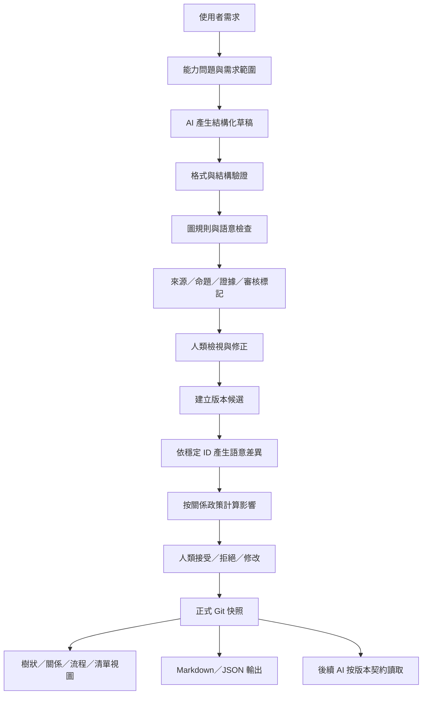

# AI 理解可視化框架：理念拆分、外部方法比較與最佳適配架構

> **文件性質：** 深度研究紀錄與架構決策分析  
> **對應主企劃：** [AI 理解可視化與框架編輯介面研究企劃書](./AI理解可視化與框架編輯介面_研究企劃書.md)  
> **版本：** 0.1.0  
> **研究日期：** 2026-10-26  
> **狀態：** 方案比較完成；最佳適配方案為研究建議，尚未經原型實測  
> **範圍聲明：** 本文件比較概念、標準、方法與演算法；不代表相關軟體已實作或整體效果已被證明。

---

## 摘要

本研究把「AI 先建立自身對需求的理解，再以可視化方式讓人類檢查和修改，最後將確認後的框架供後續 AI 使用」拆解為十二個責任領域：任務定義、概念模型、正式資料、關係語意、來源追蹤、知識狀態、確認治理、驗證、版本差異、變更影響、視圖互動及後續 AI 取用。

研究發現，現有企劃的主要方向合理，但若直接實作，仍有幾個會造成長期結構混亂的風險。第一，「核心／主軸／骨架」是結構角色，而「目標／需求／功能／條件」是物件類型，二者不應放在同一個類型欄位。第二，資料來源、命題性質、證據狀態、人工接受狀態及版本發布狀態不能合併成單一的「已確認」標籤。第三，圖形編輯、語意差異、版本保存和後續 AI 使用是不同責任，不能由一個圖形套件或資料庫自動解決。第四，影響分析不應把任何修改都擴散成整份框架重新審核，而應根據修改類型及關係類型傳遞影響。

外部研究支持以能力問題（competency questions）界定模型範圍、以來源模型追蹤內容如何產生、以結構 schema 檢查資料形狀、以明確基準進行三方合併，以及依任務選擇合適的圖形表示。W3C PROV 支持來源描述；JSON Schema 適合 JSON 資料的結構驗證；SHACL 適用於 RDF 圖的約束驗證；RFC 6902 是 JSON 變更操作格式，而不是語意差異判定器；Git 三方合併可提供衝突處理的參考模式。圖形研究則顯示，節點連線圖和矩陣等表示法在不同網路規模與任務下各有優勢，不宜把整份框架永久放進一張大圖。

**依目前的低成本、可移轉、以人類確認為核心的需求，最佳適配的起始方案是：JSON 作為正式語意模型，Git 作為版本快照與歷史底層，依穩定 ID 產生語意差異，以 JSON Schema 加上自訂確定性規則分層驗證，使用輕量多視圖介面，並由明確版本契約供後續 AI 讀取。** 不建議第一階段導入完整本體工程、圖資料庫、GraphRAG、事件溯源平台、即時多人協作或 CRDT。這不是宣稱上述技術較差，而是它們在目前需求尚未證明需要時，會增加成本和故障面。

此結論是「現有約束下最合適的起始架構」，不是對所有規模與領域的普遍最優解；其成效仍須由原型任務、錯誤注入及版本遵循測試驗證。

**關鍵詞：** AI 理解模型、理念拆分、輕量本體、型別化有向多重圖、資料來源、命題狀態、語意差異、三方合併、影響分析、分層驗證、圖形可讀性。

---

## 目錄

1. [研究問題與決策準則](#1-研究問題與決策準則)
2. [理念拆分總表](#2-理念拆分總表)
3. [現有架構的關鍵缺口](#3-現有架構的關鍵缺口)
4. [外部方法與工具比較](#4-外部方法與工具比較)
5. [最佳適配的總體架構](#5-最佳適配的總體架構)
6. [建議的概念資料模型](#6-建議的概念資料模型)
7. [核心演算法與觸發條件](#7-核心演算法與觸發條件)
8. [最小可行方案與延後項目](#8-最小可行方案與延後項目)
9. [驗收問題與研究指標](#9-驗收問題與研究指標)
10. [決策結論與保留條件](#10-決策結論與保留條件)
11. [參考資料](#參考資料)
12. [關鍵詞索引](#關鍵詞索引)

---

## 1. 研究問題與決策準則

### 1.1 研究問題

本研究不只問「怎樣把資料畫成圖」，而是回答：

1. 如何讓 AI 產生的初始理解可以被使用者檢查和修正？
2. 如何表示不同層級、物件、關係、條件和來源，避免概念互相混淆？
3. 如何區分 AI 推論、外部證據、使用者需求及人類接受狀態？
4. 如何讓所有視圖共享相同的正式資料？
5. 如何可靠識別內容變更、影響範圍和衝突？
6. 如何防止後續 AI 使用錯誤、過期或未確認的版本？
7. 如何在不過度架構化的前提下保留日後擴充能力？

### 1.2 決策準則

| 準則 | 問題 | 優先級 |
|---|---|---|
| 語意清晰 | 不同概念、狀態與關係是否被分開表示？ | 最高 |
| 可追溯 | 是否能查明重要內容的來源與修改過程？ | 最高 |
| 版本可靠 | 是否能用明確基準重建與比較內容？ | 最高 |
| 人類控制 | AI 是否無法靜默覆寫正式確認內容？ | 最高 |
| 下游一致 | 後續 AI 是否知道要讀取哪一個正式版本？ | 最高 |
| 低實作成本 | 在需求尚未證明前，是否避免不必要的服務？ | 高 |
| 可移轉 | 是否可用通用檔案格式匯出，而不被 UI 套件綁定？ | 高 |
| 手機可用 | 是否可不用精準拖曳完成核心操作？ | 高 |
| 可擴充 | 是否能新增領域規則，而不重寫整個模型？ | 高 |
| 即時協作 | 是否支援多人同時編輯同一模型？ | 初期低，需求出現後再評估 |

### 1.3 以能力問題限制模型範圍

Ontology Development 101 建議從模型必須回答的問題界定範圍，而不是先把所有可能概念都建模。這個方法對本企劃特別重要，因為此系統容易因「想把一切都畫出來」而膨脹。

初始能力問題（competency questions）應至少包括：

- 系統目前採用的核心目標是什麼？
- 每個主軸如何支援核心目標？
- 某個功能屬於哪個結構層級？它的作用是什麼？
- 某條關係為什麼存在？依據來自使用者、外部資料還是 AI 推論？
- 哪些內容已被人接受，哪些仍待審核或缺乏證據？
- 改變某個核心節點後，哪些依賴內容需要重新檢視，理由是什麼？
- 目前正式發布的是哪個版本？與前一個基準有何差異？
- 後續 AI 取用的是哪一版模型？它是否包含未確認內容？
- 若一個關係無法證實，系統是否能保留「未知」而不是猜測？

**決策：** 先以這組能力問題驗證資料模型是否足夠，再依實際新需求擴充類型。這比預先建立龐大通用本體更符合目前目標。[來源：Ontology Development 101](https://protege.stanford.edu/publications/ontology_development/ontology101-noy-mcguinness.html)

---

## 2. 理念拆分總表

### 2.1 十二個責任領域

| 編號 | 理念／責任 | 解決的問題 | 必須保存的核心資訊 | 不應和什麼混為一談 |
|---|---|---|---|---|
| C01 | 任務與範圍定義 | 何謂足夠理解？ | 目標、限制、能力問題 | UI 功能列表 |
| C02 | 概念與結構模型 | 內容如何組成？ | 結構角色、物件類型、關係 | 單純的畫面位置 |
| C03 | 正式資料與多視圖 | 哪裡才是真相來源？ | 一份正式語意模型 | 各圖表的個別副本 |
| C04 | 關係語意 | 線代表什麼？ | 方向、類型、理由、影響規則 | 顏色和線型本身 |
| C05 | 來源與衍生歷史 | 內容從何而來？ | 來源、活動、生成／修改關係 | 人類是否接受 |
| C06 | 命題性質與證據狀態 | 內容是需求、事實還是推論？ | 命題類別、證據狀態 | 內容來源或 UI 確認 |
| C07 | 人類確認治理 | 哪些內容已被接受？ | 審核決定、操作者、時間、對象版本 | 外部事實是否已證明 |
| C08 | 結構和語意驗證 | 資料是否完整、規則是否相容？ | schema 規則、跨物件不變式、警告 | LLM 的主觀評語 |
| C09 | 版本和語意差異 | 究竟改了什麼？ | 基準版本、物件 ID、欄位差異 | 純文字行差異 |
| C10 | 影響分析與衝突 | 哪些內容需重新檢視？ | 依賴關係、傳播政策、衝突集合 | 全圖一律重審 |
| C11 | 視圖與人機互動 | 人類怎麼理解和修改？ | 任務對應的視圖、狀態標示、替代操作 | 正式資料模型 |
| C12 | 下游 AI 使用契約 | AI 如何持續遵循？ | 模型／版本 ID、任務子圖、限制、未解決事項 | 對話歷史中的模糊回憶 |

### 2.2 五個層次，不等同五個服務

建議從概念上把所有責任歸納成五層：

1. **問題層：** 目標、限制、能力問題及完成條件。
2. **語意層：** 節點、關係、條件、結構角色和物件類型。
3. **治理層：** 來源、命題性質、證據狀態、人類確認及發布狀態。
4. **變更層：** 穩定 ID、版本基準、語意差異、衝突和影響分析。
5. **使用層：** 樹狀／關係／流程視圖、編輯介面、匯出和 AI 取用。

這五層是責任分離，不要求第一版拆成五個微服務。初期可在少量程式模組和 JSON 文件內實現；只要介面清楚，就可以在實際需求增長時再拆分。

### 2.3 四種狀態軸線

至少需要分開四個意義：

| 軸線 | 例子 | 回答的問題 |
|---|---|---|
| 來源／產生方式 | 使用者原述、外部來源、AI 推論、規則計算 | 這項內容是怎麼產生的？ |
| 命題性質 | 需求、設計決策、事實主張、推論、假說、問題 | 這項內容主張什麼性質的事情？ |
| 證據評估 | 未核實、有支持、證據不足、有反證、互相矛盾 | 目前有多少證據支持它？ |
| 人類審核 | 待檢視、接受、否決、爭議未解決 | 人類是否接受它作為當前工作內容？ |

模型／版本的發布狀態另行保存，例如 draft、proposed、published、superseded、archived。

**重要區分：** 使用者可以確認「本系統採用某個設計決策」，但這不等於某個外部事實已經得到科學驗證。對使用者的要求、偏好和設計選擇，主要問題是是否正確反映其意圖；對外部世界的事實主張，則仍需證據與驗證。不能只用一個 `confirmed=true` 表達兩者。

---

## 3. 現有架構的關鍵缺口

### 3.1 缺口一：結構角色與物件類型混在一起

原企劃的節點 `type` 示意值把「核心、主軸、骨架」與「概念、條件」放在同一集合。這是不同維度：

- **結構角色（structural role）：** 核心、主軸、骨架、模組、細節。
- **物件類型（entity kind）：** 目標、需求、功能、概念、條件、決策、主張等。

例如，一個「條件」可以位於主軸下，也可以是骨架的一部分。若把層級角色和物件本體類型合併，類型數會持續增加，並造成重複定義。

**修正：** 分開保存 `structural_role` 與 `entity_kind`；若某個物件不需顯示特殊結構角色，使用一般值，而非強迫歸入其中一種層級。

### 3.2 缺口二：來源、證據、接受和發布被過度壓縮

PROV-DM 描述實體、活動、責任主體和資料衍生關係，目的是提供來源資訊，而不是直接決定內容真假或人類是否認同。[W3C PROV-DM](https://www.w3.org/TR/prov-dm/)

**修正：** 來源、命題性質、證據評估、人類審核和版本發布是不同狀態軸線。以最少必要欄位分離它們，而不是建立一個無法解釋的可信度分數。

### 3.3 缺口三：層級、流程和因果共用同一組關係規則

「包含」「先於」「依賴」「造成」「觸發」的語意不同。若所有連線共用同一種循環檢查或影響傳播規則，就會誤拒絕合法回饋環，或漏掉真正的流程錯誤。

**修正：** 每個關係類型定義方向語意、端點限制、是否允許循環、是否傳播修改影響，以及是否需要證據。只在有需要的子圖上執行相應規則。

### 3.4 缺口四：差異只以文字或 JSON Patch 表示

RFC 6902 定義對 JSON 文件執行的操作序列，適用於文件修改；它不是語意比對器，無法獨立判斷「同一個功能改名」或「兩條相同端點但不同類型的連線」的意義。[RFC 6902](https://www.rfc-editor.org/rfc/rfc6902.html)

**修正：** 先依穩定 ID 比較模型物件，形成語意變更分類，再視需要把結果編碼成 JSON Patch。機器操作格式與人類解釋必須分開。

### 3.5 缺口五：每次修正都可能造成全圖重審

若每次變更都要求全圖再次確認，效率會快速下降；如果完全不分析影響，又會使依賴內容保持過期狀態。

**修正：** 依變更類型及邊的影響政策，以圖遍歷計算受影響範圍。排版移動不傳播語意影響；更改核心目標則沿著指定的依賴／支援關係尋找需要重檢的項目。因果邊不應自動等同於依賴邊。

### 3.6 缺口六：未定義模型不完整時的合法狀態

初始使用者需求可能不足以形成完整框架。若 schema 和 UI 強迫所有資訊一次填滿，AI 會被鼓勵補造內容，使用者也會被迫接受錯誤結構。

**修正：** 草稿模型允許未知、待補、未連接和有爭議的內容；發布規則才判定哪些缺漏是阻擋條件。草稿不完整並非錯誤，未標示的不確定性才是風險。

### 3.7 缺口七：沒有為不同任務選擇圖表的規則

大型節點圖可能形成難讀的「毛球」。研究顯示，表示法的任務效果取決於圖的大小、密度和要完成的工作，而非只取決於視覺偏好。[節點連線圖、矩陣與二分圖比較研究](https://pubmed.ncbi.nlm.nih.gov/36191101/)

**修正：** 層級總覽使用樹狀圖；稀疏且局部的互動使用節點連線圖；必要時才用矩陣或表格檢查大量交叉關係。手機端以清單、細節面板和聚焦子圖作為主要操作方式。

---

## 4. 外部方法與工具比較

### 4.1 本體工程：採用「輕量受控詞彙」，不先採用完整本體推理

Ontology Development 101 建議界定範圍、列出能力問題、考慮重用現有詞彙、列出重要術語、再定義概念層級與屬性限制。它同時指出本體設計不存在普遍唯一解，並且需要迭代修正。[原文](https://protege.stanford.edu/publications/ontology_development/ontology101-noy-mcguinness.html)

本企劃需要的是可持續一致使用的受控詞彙：少量節點類型、少量關係類型、清楚的狀態欄位，以及隨領域擴充的驗證規則。第一階段沒有足夠理由導入完整 OWL 推理、龐大類別階層或多個本體映射層。

**採用：** 能力問題、受控類型、命名規則、迭代修訂。  
**延後：** 完整 OWL 本體與自動邏輯推論，除非未來確實需要跨本體互通或正式語意推理。

### 4.2 結構驗證：JSON Schema 與 SHACL

| 方法 | 適用資料 | 優勢 | 限制 | 本企劃決策 |
|---|---|---|---|---|
| JSON Schema 2020-12 | JSON 物件 | 直接對應節點／連線 JSON；生態系成熟 | 複雜跨節點圖規則仍需程式檢查 | 第一階段採用 |
| 自訂圖規則 | JSON 內節點／邊索引 | 可檢查引用、類型限制、循環、影響規則 | 規則需自行測試與維護 | 第一階段採用 |
| SHACL | RDF 圖 | 專門描述與驗證 RDF 圖中的節點和屬性約束 | 需要採用 RDF 資料模型與 SHACL 工具鏈 | 只有改用 RDF 時再採用 |

JSON Schema 官方規格將 Core 與 Validation 分開；SHACL 則定義以 shapes 描述 RDF graph 的約束並產生驗證結果。[JSON Schema](https://json-schema.org/specification)；[W3C SHACL](https://www.w3.org/TR/shacl/)

SHACL 1.2 Core 在 2026-10-25 的官方頁面仍標示為 Working Draft；如果專案未使用 RDF，本階段沒有必要為此引入不同資料堆疊。[SHACL 1.2 Core](https://www.w3.org/TR/shacl12-core/)

### 4.3 變更管理：語意差異、JSON Patch、Git 與事件溯源

| 方法 | 解決什麼問題 | 成本／限制 | 本企劃用途 |
|---|---|---|---|
| 依 ID 的語意差異 | 判斷哪個節點、邊、欄位或狀態改變 | 必須定義穩定 ID 與語意欄位 | 核心機制 |
| JSON Patch | 把已決定的 JSON 修改寫成可執行操作 | 不會自動提供語意判斷 | 可選的變更交換格式 |
| Git commit／diff | 保存完整檔案快照、歷史與回復點 | 須管理分支、衝突與大型檔案差異 | 初期版本底層 |
| Event Sourcing | 以領域事件序列重建系統狀態 | 要設計事件契約、事件演進、快照與重播 | 初期不採用完整模式 |

Git 使用共同基準的三方合併，比較基準、兩側內容來處理分支差異；但這並不代表語意衝突可以完全自動化。[Git User Manual：Merging Multiple Trees](https://git-scm.com/docs/user-manual) Event Sourcing 則以事件序列重新推導狀態，適用於需要完整事件重播的情境，但會增加模型和運維複雜度。[Martin Fowler：Event Sourcing](https://martinfowler.com/eaaDev/EventSourcing.html)

**決策：** 使用 Git 儲存正式模型快照；在應用層以穩定 ID 產生語意差異；同一物件不同欄位的獨立修改可以提出安全合併候選，對同一語意欄位的衝突則要求人工裁決。初期不實作完整事件溯源。只有當必須逐事件重播、審計每個微操作、或跨多客戶端復原狀態時，才重新評估。

### 4.4 版本標籤與內容識別

Semantic Versioning 的 MAJOR/MINOR/PATCH 適合描述公開介面相容性的變更，不應強制套用到每一個內容修正。[SemVer 2.0.0](https://semver.org/)

建議分開：
- **Git commit SHA：** 指向一個不可含糊的儲存版本。
- **模型內容修訂標籤：** 供人理解的里程碑名稱，可選。
- **Schema 版本：** 描述資料格式本身是否相容。
- **公開 API 版本：** 只有對外介面需要相容性承諾時，才考慮 SemVer。

若要以 JSON 內容雜湊判斷某項確認是否仍對應同一份內容，可以研究 RFC 8785 的 JSON Canonicalization Scheme。它提供可重現的 JSON 序列化方式，但屬 Informational RFC，不是 Internet Standards Track；而且 JCS 不會重新排序陣列。若應用層認為節點與邊的陣列順序沒有語意，就必須先依 ID 排序，再做 canonicalization 和雜湊。[RFC 8785](https://www.rfc-editor.org/rfc/rfc8785.html)

初期不應因為可以使用內容雜湊就讓模型變得更複雜；Git 版本 ID 已能提供基本歷史定位，只有在需要識別單一命題的內容變更是否使確認過期時，才引入欄位級內容指紋。

### 4.5 圖形表示法：節點連線圖不是萬用視圖

一項 2023 年發表於 IEEE Transactions on Visualization and Computer Graphics 的研究比較節點連線圖、鄰接矩陣和二分圖表示，使用 150 位受試者評估不同網路任務；結果指出，二分圖在部分總覽任務有優勢，矩陣在所測任務中表現較穩定。[論文摘要與出版資料](https://pubmed.ncbi.nlm.nih.gov/36191101/)

另一項研究探討節點連線圖的認知負荷，指出圖的密度與規模會影響特定路徑搜尋任務的難度，並觀察到高密度圖中的困難。[Scalability of Network Visualisation from a Cognitive Load Perspective](https://arxiv.org/abs/2008.07944)

**設計含意：**
- 樹狀視圖負責層級導覽。
- 節點連線視圖用於局部、稀疏、需要直接操縱關係的任務。
- 表格／矩陣適合集中檢查大量交叉關係，作為後續選項。
- 不採固定節點數上限作為認知定律。
- 超過一個畫面可讀範圍時，優先搜尋、聚焦、群組、折疊和按任務切換視圖，而不是只靠自動佈局。

### 4.6 LLM 結構化輸出：格式遵循不等於內容為真

部分模型 API 支援依 JSON Schema 約束輸出格式。例如 OpenAI Structured Outputs 的用途是讓輸出符合指定 schema；官方也建議清楚命名欄位並以評測驗證結構設計。[Structured Outputs 文件](https://developers.openai.com/api/docs/guides/structured-outputs)

但這只解決格式與型別遵循問題，不能證明節點、關係或推論符合使用者本意，也不能證明外部事實正確。

**決策：** 若所選模型支援結構化輸出，可用 schema 約束初始草稿；隨後仍須經過 deterministic validation、來源及狀態標記、必要的人工審核。即使格式有效，模型內容仍可能錯誤。

### 4.7 GraphRAG 與一般 RAG

Microsoft GraphRAG 同時提供 Global、Local、DRIFT 與 Basic Search 等不同查詢模式；其文件也強調需依資料與提示調整。[GraphRAG 官方文件](https://microsoft.github.io/graphrag/)

這說明 GraphRAG 是一種可供大型語料檢索使用的方案，而不是本企劃唯一合理的知識表示法。正式框架的權威版本、使用者確認、歷史差異及衝突治理仍需要明確機制，不能委託給檢索流程。

**決策：**
- 小型且已整理的框架：直接讀取正式 JSON 和必要的 Markdown。
- 大量跨檔案搜尋：先建立可測量的基準 RAG。
- 需要跨大量實體與多跳關係查詢，且簡單 RAG 不足：再對照 GraphRAG。
- 不為了「看起來是圖系統」就導入圖資料庫或 GraphRAG。

### 4.8 協作同步：三方合併先於 CRDT

若只有一位主要編輯者，使用 Git 版本、明確衝突和三方合併通常比即時協作資料層簡單。CRDT 是協同系統中值得研究的分散式資料方法，但需要選擇符合應用語意的資料結構與合併規則，不是所有編輯器都必須先採用。[Collabs: A Flexible and Performant CRDT Collaboration Framework](https://arxiv.org/abs/2212.02618)

**決策：** 第一階段以版本快照、變更提案、三方比較和人工裁決處理衝突。只有多人同時編輯成為明確需求，且離線合併、低延遲同步確實重要，才評估 CRDT／OT。

---

## 5. 最佳適配的總體架構

### 5.1 建議的邏輯架構



### 5.2 五層責任

**A. Model Layer（正式模型）**  
保存節點、連線、條件和必要屬性。具有穩定 ID，視圖不擁有獨立語意副本。

**B. Governance Layer（內容治理）**  
保存來源、命題類別、證據評估與人工接受狀態。這些欄位不必全部出現在卡片上，但可從節點詳情中查閱。

**C. Validation Layer（驗證）**  
使用 JSON Schema、參照完整性檢查、關係類型規則和條件規則。AI 產生的檢查建議不能取代確定性規則。

**D. Change Layer（變更）**  
以 ID 比對基準和候選版本，產生語意差異、衝突清單及影響範圍；只有明確接受後才能形成正式版本。

**E. Projection & Consumption Layer（視圖與取用）**  
視圖及輸出均從同一正式版本產生。下游 AI 必須收到版本 ID 和必要上下文，而不是依賴對話回憶。

這是模組責任，不是強制微服務架構。第一版可將它們實作在同一個前端／後端或一組檔案中。

### 5.3 正式資料與視圖分離

正式語意資料可包含：
- 模型 metadata；
- 節點清單；
- 關係清單；
- 條件和規則引用；
- 來源紀錄；
- 人類審核紀錄；
- 必要的版本／狀態指標。

視圖狀態另存，包括座標、折疊、縮放、顏色與選取位置。若只改變視圖狀態，不應更新語意審核狀態，也不應讓後續 AI 得到不同的模型含義。

### 5.4 最小的正式工作流程

1. **草稿生成：** AI 提取目標和限制；未知內容留白。
2. **確定性驗證：** 檢查資料格式、ID、引用和關係規則。
3. **人類校正：** 使用者改節點、關係、條件或狀態。
4. **差異生成：** 和明確基準比較，不靠模型回憶。
5. **影響分析：** 依受影響的依賴關係找出需要重檢的項目。
6. **正式接受：** 人類決定發布哪些變更。
7. **版本保存：** Git 形成可回復的正式快照。
8. **下游取用：** 後續 AI 讀取指定版本及與任務相關的必要子圖。

### 5.5 正式模型的最小結構

概念上可使用：

```json
{
  "schema_version": "1.0",
  "model_id": "stable-model-id",
  "model_state": "draft",
  "nodes": [],
  "edges": [],
  "conditions": [],
  "sources": [],
  "reviews": [],
  "rule_profile": "default"
}
```

這是欄位配置示意，不是已發布 schema。模型的真實版本應指向 Git commit 或其他不可混淆的修訂 ID，不應要求模型 JSON 本身記錄一個不能穩定自我指向的 commit 值。視圖佈局資料應放在獨立檔案，避免移動節點使語意差異變得混亂。

---

## 6. 建議的概念資料模型

### 6.1 節點：結構角色與物件類型正交

推薦欄位：

| 欄位 | 用途 | 例子 |
|---|---|---|
| `id` | 穩定識別 | `node-4f3...` |
| `name` | 人類可讀名稱 | 「版本治理」 |
| `function` | 作用說明 | 「指定基準並保存可追溯變更」 |
| `structural_role` | 所在框架層次 | `main_axis`、`skeleton`、`module` |
| `entity_kind` | 內容本身的類型 | `goal`、`requirement`、`function`、`concept`、`condition` |
| `claim_kind` | 該內容的命題性質（必要時） | `user_requirement`、`design_decision`、`fact_claim`、`hypothesis` |
| `provenance_refs` | 來源紀錄引用 | `src-002` |
| `review_status` | 人類審核狀態 | `pending`、`accepted`、`rejected`、`disputed` |
| `evidence_status` | 證據評估（有事實主張時） | `unverified`、`supported`、`insufficient`、`contradicted` |
| `attributes` | 領域特定欄位 | 任務所需的額外數據 |

不要求每個概念都填滿全部欄位；以型別和使用情境判斷哪些必要。對純設計節點可能需要人類接受狀態，但未必需要外部事實的證據評估。對外部事實主張則相反，只有被使用者接受不代表證據已充分。

### 6.2 關係：採用有向多重圖，但按關係家族分規則

模型應允許同一對節點具有不同的關係。例如 A 可能「依賴 B」，同時又「受到 B 影響」。因此，不能簡化成每對節點只有一條無類型的連線。

推薦欄位：
- `id`、`source_id`、`target_id`；
- `relation_family`，如 structure、dependency、sequence、causal、trigger、dataflow；
- `relation_type`，如 contains、depends_on、precedes、influences、triggers、transfers_data_to；
- `description`；
- `provenance_refs`；
- `review_status`；
- `impact_policy`，例如 none、direct_review、propagate_review；
- 若必要則有 `condition_ref`。

「支持證據」或「由某來源產生」可由來源引用和來源紀錄表達；若需要在使用者視圖中把它們當作可獨立查詢的節點關係，才建立專用的治理視圖，不把治理邊與所有業務語意邊混為一談。

### 6.3 關係家族和循環規則

| 關係家族 | 代表性例子 | 循環政策 | 修改影響 |
|---|---|---|---|
| 結構 | contains／part_of | 層級子圖須符合無環規則 | 父子結構變更需局部檢查 |
| 依賴 | depends_on | 若代表有向前置依賴，通常需無環 | 可沿依賴方向傳播重檢 |
| 序列 | precedes | 排程／流程子圖通常需可拓撲排序 | 後續步驟可能受影響 |
| 因果／影響 | causes／influences | 允許回饋環，依模型類型決定 | 不自動等同依賴失效 |
| 觸發 | triggers | 依事件與條件規則檢查 | 可重檢觸發條件與受觸發行為 |
| 資料流 | transfers_data_to | 依管線規則決定 | 若資料契約變動則傳播重檢 |
| 衝突／取代 | conflicts_with／supersedes | 不套用一般流程循環規則 | 必須保留解決或取代紀錄 |

### 6.4 條件：自然語言和可執行表達分離

簡單條件可保存自然語言描述；只有當系統需要自動判斷時，才定義機器可評估的條件語法或受控欄位。不要把任意自然語言直接當作可執行邏輯。

對流程或功能而言，可能需要區分：
- 啟動條件；
- 正常完成條件；
- 失敗條件；
- 取消條件；
- 守衛條件。

不是所有節點都需要所有條件。規則應定義欄位需求，而不是讓模型填滿所有欄位來假裝完整。

### 6.5 來源紀錄與審核紀錄

來源紀錄應保留能重新找到原始證據的必要資訊，例如來源種類、URL 或文件 ID、標題、引用位置、擷取日期及相關物件。大段原文或整份外部文件不必重複儲存在每個節點內。

審核紀錄則記錄：
- 被審核的物件或命題 ID；
- 當時的內容／版本指紋；
- 人類決定；
- 決定時間及操作者類型；
- 必要的備註。

若內容已改變，應判斷原有審核是否仍適用；對某個版本所做的接受，不應自動延伸到語意已經修改的新內容。

### 6.6 版本和模式版本必須分開

- **模型修訂：** 資料內容某一次被保存的狀態，以 Git commit 等穩定 ID 定位。
- **schema_version：** 資料格式的版本。
- **release_status：** 草稿、待發布、正式發布、已被取代或封存。
- **review_status：** 單一內容是否被接受、否決或待確認。

不要把資料格式更新、內容新增和人工確認全部塞在同一個版本數字中。對外 API 才需要額外制定相容性版本承諾。

---

## 7. 核心演算法與觸發條件

### 7.1 穩定 ID 與索引

每個節點和關係都具有穩定 ID。改名不應建立新物件；刪除後重新建立的同名物件，也不應假裝自動繼承先前確認。

程式內建立：
- `node_by_id`；
- `edge_by_id`；
- `out_edges_by_node`；
- `in_edges_by_node`。

這讓引用檢查、局部關係查詢、變更比對和影響分析可以直接操作，而不必每次重新掃描所有原始資料。ID 相似或文字語意相似只能當成去重候選，不能作為自動合併的唯一依據。

### 7.2 語意差異演算法

輸入：基準模型 (B) 與候選模型 (C)。

1. 以 ID 對應兩個模型的節點和關係。
2. 只在 (B) 出現的 ID 為刪除候選。
3. 只在 (C) 出現的 ID 為新增候選。
4. 兩者皆有的 ID，比較語意欄位、狀態和來源引用。
5. 把版面座標／縮放等視圖資料另行比較。
6. 產生標準化差異清單；每一項差異均帶有基準版本與候選版本。
7. 依關係與規則計算影響範圍。
8. 產生人類可讀的理由和機器可讀的變更資料。

這種語意差異通常可透過 ID map 在 O(V+E) 的線性量級處理基本物件配對；實際成本取決於屬性大小、索引與資料儲存方式。這只是演算法複雜度分析，不是本企劃已測得的效能承諾。

### 7.3 變更影響分析：依政策選擇 BFS／DFS，而非全圖重審

輸入為語意變更物件集合、變更類型及有影響政策的關係圖。

1. 排除純版面變更。
2. 將語意變更分類為名稱／描述、結構角色、功能、關係、條件、來源或狀態。
3. 從變更物件開始，沿符合 `impact_policy` 的關係做多起點 BFS／DFS。
4. 記錄每個受影響物件的路徑和觸發理由。
5. 按影響規則分為「必須重新檢視」「建議檢視」「僅提示」。
6. 若邊類型沒有定義影響傳播，預設不做無限制的自動擴散，而是產生有限警告或要求補充規則。

圖遍歷的基本時間複雜度為 O(V+E)，其中 V、E 是實際遍歷子圖所涉及的節點與邊數；使用索引及停止條件可避免反覆掃描全圖。重要的是正確的語意傳播政策，而不只是演算法本身。

### 7.4 拓撲排序與循環檢查

- 對必須無環的層級或依賴子圖，使用拓撲排序判斷是否可形成合法順序。
- 若排序失敗，再針對該子圖使用深度優先搜尋或 Tarjan 強連通分量演算法，定位循環集合。
- 對允許回饋循環的因果／影響圖，不套用「任何循環都錯」的規則。
- 發現循環時，回報關係類型、涉及節點和規則依據，而非只顯示「圖錯誤」。

Tarjan 強連通分量演算法有成熟的標準實作參考，例如 NetworkX 文件列出其有向圖用途。[NetworkX: strongly_connected_components](https://networkx.org/documentation/stable/reference/algorithms/generated/networkx.algorithms.components.strongly_connected_components.html)

### 7.5 三方合併

輸入：共同基準 B、人類修改 H、AI 修改 A。

- 若 H 和 A 修改不同節點或彼此獨立的欄位，可建立自動合併候選。
- 若雙方修改同一物件的不同欄位，先檢查欄位是否存在語意依賴，再決定是否可合併。
- 若雙方修改同一欄位、對同一關係採取相反方向、或一方刪除另一方修改的物件，列為衝突。
- 任何自動合併後都必須重新執行結構與語意規則檢查。
- 只提供合併候選，不讓 AI 靜默覆寫人類已接受版本。

Git 的三方合併是可借鑑的版本模型，但 Git 無法替本系統理解領域語意；領域層衝突仍需由本系統標記和裁決。[Git merge strategies](https://git-scm.com/docs/merge-strategies)

### 7.6 分層驗證管線

| 等級 | 驗證項目 | 典型處置 |
|---|---|---|
| L0 | JSON 可解析、欄位型別可讀 | 失敗時阻擋載入 |
| L1 | JSON Schema 的必要欄位、型別、列舉 | 確定性錯誤 |
| L2 | ID 唯一、所有引用存在、無懸空關係 | 確定性錯誤 |
| L3 | 依關係家族執行循環、端點、條件及一致性規則 | 錯誤或警告，依規則嚴重性處理 |
| L4 | 來源是否支持、命題是否矛盾、因果是否過度主張 | 證據警告或人工審核 |
| L5 | 發布條件：必要項目是否已足夠確認 | 決定能否發布，不必阻止草稿保存 |

L0–L3 應優先使用可重現的確定性規則。L4 可以使用規則、外部來源和 AI 輔助，但不能把 AI 輸出的「看似合理」視為已經證實。草稿可以保留不完整內容；發布才套用更嚴格門檻。

### 7.7 假說和低成本去重

先用受控詞彙、同義詞表、標準化文字、相同來源引用和欄位比對來發現可疑重複。語意嵌入或 LLM 可在未來提供「可能重複」建議，但不應自動把相似節點合併，因為兩個相似名稱可能代表不同職責或適用範圍。

---

## 8. 最小可行方案與延後項目

### 8.1 第一階段必須具備

1. 一份正式 JSON 模型以及明確的 schema 版本。
2. 穩定 ID 的節點與關係。
3. 分離的結構角色、物件類型及關係類型。
4. 最基本的來源紀錄、命題類別和人工審核狀態。
5. JSON Schema + 參照完整性 + 依關係類型的確定性規則。
6. 樹狀瀏覽、節點細節面板及局部關係視圖。
7. 人類可以新增、修改、刪除節點／關係，並查看刪除影響。
8. 依 ID 的語意差異與明確基準。
9. 以 Git 版本保存、還原與衝突記錄。
10. Markdown／JSON 匯出，以及下游 AI 的版本取用契約。
11. 未知、待確認和證據不足的明確狀態。

### 8.2 初期不做

- 完整 OWL／RDF 語意網堆疊。
- 以圖資料庫取代簡單 JSON，除非查詢需求證明必要。
- GraphRAG 或多層檢索管線。
- 全系統 event sourcing。
- 即時多人協作、CRDT 或 OT。
- 自動從文字相似度合併語意節點。
- 對所有改動自動執行全圖重審。
- 過度細分的上百種關係類型。
- 只靠顏色和動態動畫表示狀態。

### 8.3 儲存方案比較

| 方案 | 初期成本 | 版本可追溯 | 多跳查詢 | 目前判斷 |
|---|---|---|---|---|
| JSON + Git | 低 | 強，依賴提交和差異管理 | 需建立索引／局部遍歷 | **起始首選** |
| 關聯式資料庫 | 中 | 需自行整合版本策略 | 透過查詢與關聯表可完成 | 交易或多人編輯需求升高後評估 |
| 屬性圖資料庫 | 中至高 | 需要額外版本／審核設計 | 關係密集、多跳查詢較自然 | 只有圖查詢成為核心負載時評估 |
| RDF + PROV-O + SHACL | 高於 JSON-only | 可有豐富來源語意 | 語意查詢能力強 | 需要語意網互通或嚴格 RDF 約束時評估 |
| GraphRAG | 高於單純檢索 | 不自動等於人工共識版本 | 大型語料的跨實體檢索 | 作為未來檢索層，而非核心模型 |

這個判斷以目前資料量、成本和可靠性需求為前提。若未來出現多使用者交易、數十萬個關係、跨語料全局問題或外部語意互通等新要求，應重新執行方案比較，而不是固守 JSON。

---

## 9. 驗收問題與研究指標

### 9.1 結構能力問題

原型必須能正確回答：

- 每個節點的穩定 ID 是什麼？
- 哪些是結構角色，哪些是物件類型？
- 這條線的方向、類型及理由是什麼？
- 哪個來源支持這個命題？
- 內容是否只是 AI 推論？是否獲得人類接受？
- 修改某內容後，哪些物件因何種關係被判定需重檢？
- 從基準模型到候選模型，增刪改有哪些？
- 候選版本是否通過應用規則？
- 後續 AI 讀取的是哪一個精確版本？

若資料模型無法回答這些問題，就還沒有完成基本架構設計。

### 9.2 失敗注入案例

至少建立以下測試案例：

1. 節點改名但 ID 保持不變，差異不得誤報為刪除加新增。
2. 節點同名但 ID 不同，不得自動合併。
3. 某條關係的方向改變，必須產生關係差異。
4. 移動節點位置，不得改變語意審核狀態。
5. 刪除一個節點，引用該節點的關係不得殘留。
6. 修改核心功能，影響分析只沿允許傳播的關係找出受影響項目。
7. 修改一條允許循環的因果邊，不得被錯誤的全局 DAG 規則拒絕。
8. 未確認的 AI 推論不能因為被放入圖中就被發布為已接受事實。
9. 人類與 AI 基於同一基準作不同修改時，系統需要辨識衝突。
10. 後續 AI 必須取得指定版本；若版本不存在或無法解析，需明確報錯。

### 9.3 量化指標

- 預置錯誤發現率；
- 變更漏看率；
- 錯誤合併率；
- 結構錯誤漏檢率；
- 確認狀態誤判率；
- 受影響項目判定精確率／召回率；
- 後續 AI 讀取正確版本的比例；
- 使用者完成任務時間；
- 手機端操作失敗率。

不能只用平均耗時來判定效果。更快的介面若使使用者漏看更多衝突，並不是優化。

### 9.4 研究方法

對相同任務比較純文字、樹狀清單、局部關係圖和差異視圖。用固定資料集注入已知錯誤，讓操作結果可以重現。初期結果只用於發現問題，不宣稱具普遍性的統計結論；若後續需要對外主張效果，應採用有合理樣本、預先定義指標和透明報告的研究設計。

---

## 10. 決策結論與保留條件

### 10.1 最佳適配解

在目前目標和成本條件下，建議採取以下組合：

**資料模型：** JSON 為正式來源，以型別化有向多重圖表達節點與關係；結構角色和物件類型分離。

**來源和信任：** 以類似 W3C PROV 的概念記錄來源與衍生關係，但不必初期實作完整 PROV-O；另行管理命題性質、證據評估和人類審核狀態。

**驗證：** JSON Schema 檢查格式；自訂確定性規則檢查 ID、引用及圖不變式；證據與事實問題透過來源、規則和人工審核管理。

**版本：** Git 保存快照與歷史；應用層依 ID 產生語意差異；AI 和人類的修改以三方比較處理；不以 JSON Patch 取代語意 diff。

**影響分析：** 只沿具明確影響政策的關係傳播，並為每個受影響項目提供理由和路徑。

**介面：** 樹狀圖優先，局部關係圖輔助，細節面板承載複雜屬性；大圖可搜尋、聚焦、折疊，矩陣作為日後按需要增加的視圖。

**下游 AI：** 明確讀取指定的正式版本及必要子圖；不依靠模糊對話記憶；版本不可用時明確回報。

**技術延後：** 先不導入圖資料庫、GraphRAG、完整 OWL 推理、event sourcing 或 CRDT，除非評估證明其必要。

### 10.2 這不是通用的唯一解

本方案的「最優」意義是：在目前需求中優先滿足正確性、可追溯、人類控制、可移轉與低成本，並保留擴充路徑。若專案後來轉為多人即時協作、大量企業文件檢索或語意網互通，最適方案可能改變。

### 10.3 實施前的停止條件

在正式實作前，至少應回答：

1. 節點和關係的受控類型是否已清楚、沒有概念混層？
2. 來源、命題性質、證據狀態、審核狀態和發布狀態是否可分辨？
3. 什麼修改需要傳播影響，什麼修改不需要？
4. 差異是否有明確基準、穩定 ID 和可復現輸出？
5. 後續 AI 如何取得精確版本？
6. 哪些內容可留白，哪些是發布阻擋條件？
7. 是否存在足以支持引入更複雜資料庫或檢索方案的實際證據？

尚未解決的項目應留為明確決策，不應為追求文件表面完整而自行假定答案。

---

## 參考資料

> 參考資料用於支持相應的方法、規格或研究，不代表本企劃整體效果已獲實證。存取日期：2026-10-26。

1. Noy, N. F., & McGuinness, D. L. *Ontology Development 101: A Guide to Creating Your First Ontology.* Stanford University. https://protege.stanford.edu/publications/ontology_development/ontology101-noy-mcguinness.html  
   用途：能力問題、範圍界定、概念與關係定義、迭代式模型設計。

2. W3C. *PROV-DM: The PROV Data Model.* https://www.w3.org/TR/prov-dm/  
   用途：實體、活動、責任主體和衍生來源的概念模型。

3. W3C. *PROV-O: The PROV Ontology.* https://www.w3.org/TR/prov-o/  
   用途：以 OWL 表達 PROV 資料模型及跨系統來源交換。

4. JSON Schema. *Specification (2020-12).* https://json-schema.org/specification  
   用途：JSON 欄位、型別和結構驗證。

5. W3C. *Shapes Constraint Language (SHACL).* https://www.w3.org/TR/shacl/  
   用途：RDF 圖的條件與結構約束驗證。

6. W3C. *SHACL 1.2 Core.* Working Draft, 2026-10-25. https://www.w3.org/TR/shacl12-core/  
   用途：近期發展狀態參考；本研究不把工作草案視為穩定依賴。

7. IETF. *RFC 6902: JavaScript Object Notation (JSON) Patch.* https://www.rfc-editor.org/rfc/rfc6902.html  
   用途：JSON 局部變更操作格式。

8. IETF. *RFC 8785: JSON Canonicalization Scheme (JCS).* https://www.rfc-editor.org/rfc/rfc8785.html  
   用途：JSON 標準化序列化以支援一致的雜湊與簽章；此 RFC 為 Informational。

9. Semantic Versioning. *Version 2.0.0.* https://semver.org/  
   用途：公開介面相容性版本，不應直接取代內容版本。

10. Git. *User Manual: Merging Multiple Trees.* https://git-scm.com/docs/user-manual  
    用途：共同基準的三方合併概念。

11. Git. *Merge Strategies.* https://git-scm.com/docs/merge-strategies  
    用途：三方合併策略與衝突處理限制。

12. Fowler, M. *Event Sourcing.* https://martinfowler.com/eaaDev/EventSourcing.html  
    用途：事件作為狀態變更來源、重建和快照模式。

13. OpenAI. *Structured Outputs.* https://developers.openai.com/api/docs/guides/structured-outputs  
    用途：以 JSON Schema 約束模型輸出格式；適用於支持該功能的 API，不等於內容正確性保證。

14. React Flow. *Examples.* https://reactflow.dev/examples  
    用途：節點與連線互動、儲存、驗證、觸控及防循環案例。

15. Microsoft. *GraphRAG Documentation.* https://microsoft.github.io/graphrag/  
    用途：GraphRAG 的索引與查詢模式。

16. Abdelaal, M., Schiele, N. D., Angerbauer, K., Kurzhals, K., Sedlmair, M., & Weiskopf, D. *Comparative Evaluation of Bipartite, Node-Link, and Matrix-Based Network Representations.* IEEE Transactions on Visualization and Computer Graphics, 29(1), 896–906, 2023. https://pubmed.ncbi.nlm.nih.gov/36191101/  
    用途：不同網路視圖在各任務中的表現比較。

17. Okoe, M., Jianu, R., & Kobourov, S. *Node-Link or Adjacency Matrices: Old Question, New Insights.* IEEE Transactions on Visualization and Computer Graphics, 25(10), 2940–2952, 2019. https://pubmed.ncbi.nlm.nih.gov/30130228/  
    用途：節點連線圖和鄰接矩陣的任務比較。

18. Yoghourdjian, V., Yang, Y., Dwyer, T., Lawrence, L., Wybrow, M., & Marriott, K. *Scalability of Network Visualisation from a Cognitive Load Perspective.* https://arxiv.org/abs/2008.07944  
    用途：圖的規模、密度與特定網路任務的認知負荷。

19. Nguyen, T., Canossa, A., & Zhu, J. *How Human-Centered Explainable AI Interface Are Designed and Evaluated: A Systematic Survey.* arXiv:2403.14496, 2024. https://arxiv.org/abs/2403.14496  
    用途：人本式 XAI 介面設計和評估的研究整理。

20. NetworkX. *strongly_connected_components.* https://networkx.org/documentation/stable/reference/algorithms/generated/networkx.algorithms.components.strongly_connected_components.html  
    用途：有向圖的強連通分量演算法及 Tarjan 演算法實作參考。

21. Weidner, M. et al. *Collabs: A Flexible and Performant CRDT Collaboration Framework.* https://arxiv.org/abs/2212.02618  
    用途：評估未來即時多人協作資料層的參考。

22. Google People + AI Research. *Mental Models.* https://pair.withgoogle.com/guidebook-v2/chapter/mental-models/  
    用途：使用者如何理解 AI 能力及系統行為。

---

## 關鍵詞索引

- **AI 結構化輸出：** [4.6](#46-llm-結構化輸出格式遵循不等於內容為真)
- **能力問題（Competency Questions）：** [1.3](#13-以能力問題限制模型範圍)
- **本體工程／輕量本體：** [4.1](#41-本體工程採用輕量受控詞彙不先採用完整本體推理)
- **節點類型與結構角色：** [3.1](#31-缺口一結構角色與物件類型混在一起)、[6.1](#61-節點結構角色與物件類型正交)
- **命題性質／證據狀態：** [2.3](#23-四種狀態軸線)、[6.1](#61-節點結構角色與物件類型正交)
- **來源追蹤／PROV：** [3.2](#32-缺口二來源證據接受和發布被過度壓縮)、[參考資料](#參考資料)
- **JSON Schema：** [4.2](#42-結構驗證json-schema-與-shacl)
- **SHACL：** [4.2](#42-結構驗證json-schema-與-shacl)
- **JSON Patch：** [4.3](#43-變更管理語意差異json-patchgit-與事件溯源)
- **Git／三方合併：** [4.3](#43-變更管理語意差異json-patchgit-與事件溯源)、[7.5](#75-三方合併)
- **語意差異：** [4.3](#43-變更管理語意差異json-patchgit-與事件溯源)、[7.2](#72-語意差異演算法)
- **影響分析：** [3.5](#35-缺口五每次修正都可能造成全圖重審)、[7.3](#73-變更影響分析依政策選擇-bfsdfs而非全圖重審)
- **拓撲排序／強連通分量：** [7.4](#74-拓撲排序與循環檢查)
- **圖形可讀性／矩陣：** [4.5](#45-圖形表示法節點連線圖不是萬用視圖)
- **GraphRAG：** [4.7](#47-graphrag-與一般-rag)
- **事件溯源：** [4.3](#43-變更管理語意差異json-patchgit-與事件溯源)
- **CRDT／協作：** [4.8](#48-協作同步三方合併先於-crdt)
- **最低可行方案：** [8.1](#81-第一階段必須具備)
- **評估與驗收：** [9. 驗收問題與研究指標](#9-驗收問題與研究指標)
- **最佳適配決策：** [10.1](#101-最佳適配解)

---

## 文件治理

- 本文件與主企劃用途不同：本文件負責理念拆分、方法取捨及研究依據；主企劃負責整體研究設計和系統方向。
- 新增概念前，先檢查它是否已由現有責任或欄位涵蓋。
- 新技術只有在明確需求、測量結果或互通要求支持時，才升級為必要依賴。
- 所有成效描述須區分外部研究結果、設計推論和本專案實測結果。
- 若未來方案改變，須保留本次決策理由及相對版本差異，不能只更換結論而不記錄原因。