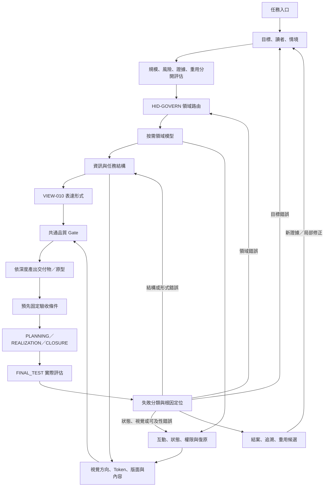

# UI 治理框架｜整合研究企劃書

- 日期：2026-10-28
- 狀態：研究結論已整理；系統流程規格供既有 VIEW-010 採用
- 研究範圍：網頁製作工具、UI／UX 設計與原型工具、設計系統、互動模式、人類理解與操作治理
- 目的：建立一套跨網頁、報告、圖表、操作介面與互動流程通用的「如何讓人理解並正確完成任務」治理方法
- 研究邊界：分析可公開檢視的產品功能、官方文件、設計系統與互動模式；不宣稱取得廠商未公開的內部原始碼、演算法或設計決策。

## 摘要與裁決

**裁決：有必要納入 forAVAr，但應作為既有能力 VIEW-010「適應式呈現」的流程級治理補全，而不是另建一個平行認知核心，也不是把 UI 樣式做成固定模板。**

forAVAr 現行能力登錄已存在 VIEW-010：依讀者與用途選文字、表格或圖，避免簡單任務被過度圖表化，也避免複雜依賴無法直觀檢查；問題登錄已存在 PR-046「呈現形式與任務複雜度不匹配」。這表示責任方向已存在，缺口主要是可重複執行的判斷步驟、版型／風格的適用條件，以及可以驗收的品質條件。不應再新增同義能力。

本研究建議將 UI 治理定義為 **人類展示與互動的決策流程**，以 VIEW-010 為既有責任擁有者，並與既有 A1（目標與限制）、A3（問題模型與關係）、A4（方法與表達路由）、A6（驗收與修正）銜接。它是核心認知架構的支援能力，不是新的思考核心；每項介面仍由任務目的與證據決定，不能由視覺偏好凌駕。

需要成為必要流程的是「判斷該不該設計、選什麼表達方式、如何驗收」；不需要把每次回答都變成網頁，也不需要每項任務都跑完完整 UI 設計週期。簡單答案走輕量路徑，複雜操作介面才升級到資訊架構、風格系統、互動原型及實際驗收。

## 目錄

1. 研究問題與方法
2. 外部榜單與網頁製作工具樣本
3. UI 設計、原型與治理工具樣本
4. 成熟工具共通原理
5. UI 治理核心
6. 表達形式與視覺風格選型矩陣
7. 從需求到驗收的標準流程
8. 必要功能、非目標與整合方式
9. 驗收條件與風險
10. 來源索引
11. 跨領域擴展：遊戲、軟體、學習、協作與美學
12. 階段性選擇樹
13. 對接 forAVAr 的整合原則
14. 本輪研究限制
15. 完成企劃所需的能力總清單
16. 外部標準／框架交叉比對
17. 現有能力覆蓋、缺口與證據狀態
18. 目標框架與權責邊界
19. 運行軌跡與節點關係圖
20. 分階段融入路線與資料權責
21. 驗收設計與不誤判規則

## 1. 研究問題與方法

研究要回答的不是「哪個工具看起來最漂亮」，而是：

- 怎樣先讓使用者知道這是什麼、為什麼存在，以及第一步應該做什麼？
- 如何把資訊量、重要性、依賴關係和操作順序轉成易理解的頁面層級？
- 什麼情況適合文字、表格、卡片、流程圖、樹狀圖、關係圖、儀表板、分步表單或敘事式頁面？
- 如何在不同品牌調性中保持可讀性、可操作性、一致性與可維護性？
- 如何判定介面真的讓人更容易完成任務，而不只是視覺上吸引人？

方法採「公開產品功能盤點 → 官方設計文件 → 跨工具共通模式 → 任務適配矩陣 → 治理流程 → 驗收條件」。工具清單是跨類型的成熟樣本，不是聲稱有一個適用所有人的唯一世界排名。網站建置平台、文件框架、原型工具和設計治理工具用途不同，不能只用同一分數硬排高下。

來源優先順序：官方文件與設計系統用於判斷產品功能及其公開設計原則；獨立評測只用來補充市場樣本和類別，不把帶有贊助或聯盟行銷的榜單當成客觀排名證據。

## 1.1 外部榜單交叉參考：前十候選與排名限制

為對應「網頁製作前十、UI 設計前十」的要求，將第三方榜單作為**候選池與市場快照**，再使用官方文件逆向分析其功能。這些榜單不是統一的學術排名；評分標準、測試深度、受眾、地區、商業合作與更新時間都可能不同，因此不得將名次直接等同於設計品質或普遍適用性。

### 網頁製作工具：2026 十項候選

iTechGuides 的 2026 網站建置比較以用途區分工具，並提供十個候選。下列用途是研究用的簡化標籤，不等於該來源所有評分理由：

| 榜單位置 | 工具 | 主要用途（研究分類） |
|---:|---|---|
| 1 | Wix | 泛用網站、初學者與小型企業 |
| 2 | Squarespace | 品牌、作品集與視覺導向網站 |
| 3 | Shopify | 電商與商品銷售 |
| 4 | WordPress.com | 內容出版、部落格與擴充 |
| 5 | Hostinger Website Builder | 低門檻、低預算網站 |
| 6 | Webflow | 高自由度視覺設計、CMS 與精細版面 |
| 7 | Framer | 作品集、品牌與動態行銷頁 |
| 8 | Duda | 代理商／自由工作者及多站管理 |
| 9 | BigCommerce | 大型商品目錄與較複雜電商 |
| 10 | GoDaddy | 快速建立基礎商業網站 |

來源：iTechGuides，*10 Best Website Builders in 2026*（2026-08-10）：<https://www.itechguides.com/10-best-website-builders-in-2026-our-evidence-based-picks/>。交叉參考：TechRadar 的 2026 評測涵蓋 80 多個建站平台，按整體、價格、模板、電商、小型企業、行銷、代理商、大型商店與免費方案等用途分項推薦；頁面揭露聯盟行銷佣金，因此此榜只能作為候選來源之一，而非無商業偏差的客觀排名。<https://www.techradar.com/news/the-best-website-builder>

### UI 設計／原型工具：2026 十項榜單候選

iTechGuides 的 2026 UI/UX 工具榜顯示以下十個排序位置。來源頁明確揭露廣告商可以付費取得較高展示位置，故本報告只用它建立市場樣本，不把名次／分數當成工具優劣的中立證明。

| 榜單位置 | 工具 | 主要用途（研究分類） |
|---:|---|---|
| 1 | Figma | 協作式介面設計、原型與交接 |
| 2 | Axure RP | 條件式、資料型與高互動 UX 原型 |
| 3 | Sketch | macOS 介面設計、Library 與原型 |
| 4 | Penpot | 開源設計平台、元件與設計 Token |
| 5 | Lunacy | 介面設計與素材／文件工作流 |
| 6 | Balsamiq Wireframes | 低保真線框與早期需求討論 |
| 7 | Framer | 視覺設計、原型及網站發布 |
| 8 | UXPin | 程式元件驅動設計、原型與交接 |
| 9 | Mockplus | 線框、協作與互動原型 |
| 10 | Justinmind | 高保真原型與互動流程模擬 |

來源：iTechGuides，*Best UI/UX Design Tools in 2026*：<https://www.itechguides.com/best/ui-ux-design-tools/>。榜單的商業揭露與局限必須保留，不應使用其名次推導「第 1 名一定最適合 forAVAr」。

### 為什麼原理研究還會納入 Storybook、Miro、ProtoPie、Visily 等工具？

榜單回答「哪些工具值得列入樣本」，不完整回答「介面治理必須學什麼」。因此後續逆向分析另外納入具代表性的治理／互動工具：
- **Storybook**：隔離展示元件狀態、互動與無障礙測試。
- **Miro**：整理流程、結構、線框與共同理解。
- **ProtoPie**：分析觸發條件、變數、公式與多階段互動。
- **Visily**：觀察 AI 生成畫面如何保持可編輯、可修改。
這些是用來補足特定設計機制的代表樣本，不冒充上述榜單的前十名次。

## 2. 網頁製作工具十項樣本

以下十項按「用途覆蓋、成熟度、工作流程代表性」選入，不表示從第一名到第十名的絕對排名。

| 工具 | 主要定位 | 公開可觀察的做法 | 可借鑑之處 | 不應照搬之處 |
|---|---|---|---|---|
| Webflow | 視覺化專業建站、CMS、互動 | 視覺畫布、即時預覽、CMS、變數／元件與發布流程 | 設計系統與內容管理要能共用，變更需可跨頁生效 | 專業自由度高不表示新手初始畫面也該開放所有選項 |
| Framer | 設計導向的行銷及品牌網站 | 畫布編輯、響應式版面、CMS、互動與發布 | 視覺方向、排版、行動版和實際發布應一起檢查 | 行銷頁的大型主視覺不能直接套用到操作台或技術文件 |
| Wix | 泛用無程式碼建站 | 範本、拖放、AI 起稿、行動版調整、網站功能整合 | 從目標與受眾開始，再挑範本、定內容、調整與發布 | 功能廣泛的工具容易把所有商業功能同時放進一個介面 |
| Squarespace | 品牌、作品集與內容型網站 | 範本、全站字體／色彩／按鈕風格、響應式編輯 | 以整體視覺規則維持品牌一致，而非每個區塊獨立設計 | 高度風格化的模板不一定適合資訊密集的技術工作 |
| WordPress Site Editor | 內容管理與整站編輯 | 將頁面、導覽、樣式、範本、區塊模式分開管理 | 區塊／模板重用與全站樣式治理，讓內容與外觀分層 | 插件與主題的堆疊會增加維護與相容性成本 |
| Shopify Theme Editor | 電商 storefront 與商品內容 | 預覽、區段與區塊、商品／集合資料和主題設定 | 編輯時即時預覽實際輸出；有風險的修改先備份／複製 | 電商購買流程的強 CTA 不該變成所有產品的通用視覺語言 |
| Carrd | 單頁網站與快速簡介 | 畫布加屬性面板、區段與簡單進階選項 | 低複雜度需求採少量工作區、按選取物件顯示相關屬性 | 單頁極簡模式不適用於多角色、多狀態、深層依賴系統 |
| Lovable | 以自然語言建立應用 | 先描述需求，再生成介面、資料與流程，後續用文字或程式細修 | 將需求轉成可檢視的初稿，再透過修正迭代 | 一次提示生成的外觀不是需求確認或可靠性驗收的替代品 |
| Bolt.new | AI 網站／應用建置 | 自然語言描述、即時程式與預覽、迭代及發布 | 讓方案很快可視化，提早揭露資訊架構與互動假設 | 「很快產生」不等於「已理解使用者」或「已驗證邊界情況」 |
| Docusaurus | 開源專案文件與內容網站 | 分層文件、側邊導覽、搜尋、版本、國際化及可客製元件 | 文件產品應以內容層級、導航、可搜尋性與版本清晰度為主 | 不應為了用框架而引入比內容本身更複雜的建置棧 |

### 本組工具的可追溯來源

- Webflow 設計系統與變數、元件、樣板：<https://help.webflow.com/hc/en-us/articles/41959932025235-Using-a-design-system-in-Webflow>、<https://webflow.com/feature/cms>
- Framer 響應式網站建置：<https://www.framer.com/solutions/responsive-website-builder/>、<https://www.framer.com/solutions/website-builder/>
- Wix 建站與響應式能力：<https://www.wix.com/website-builder>、<https://support.wix.com/en/article/creating-responsive-sites-with-wix>
- Squarespace 品牌、版面與響應式編輯：<https://www.squarespace.com/website-design>
- WordPress Site Editor 的樣式、導覽、頁面、範本和區塊模式：<https://wordpress.com/support/site-editor/>
- Shopify Theme Editor 的即時預覽與區段設定：<https://help.shopify.com/en/manual/online-store/themes/customizing-themes>
- Carrd 畫布與屬性面板：<https://carrd.com/docs/building/overview>
- Lovable 從提示到介面、資料與流程：<https://lovable.dev/build/app-builder>
- Bolt 的應用建置方式：<https://support.bolt.new/building/intro-bolt>
- Docusaurus 的文件架構、搜尋、版本、設計原則與部署：<https://docusaurus.io/docs>

## 3. UI 設計／原型／治理工具十項樣本

這一組刻意涵蓋從早期線框、畫面設計、細緻互動到設計系統與品質驗收的不同階段。

| 工具 | 主要定位 | 公開可觀察的做法 | 可借鑑之處 |
|---|---|---|---|
| Figma Design／FigJam | 協作介面設計、原型、白板與交接 | 共用設計稿、元件、變數、原型、協作與 Dev Mode | 設計意圖、重用規則與交付規格應可被同一團隊理解 |
| Penpot | 開源設計平台與設計系統 | 設計 Token、共用元件、設計檔案與程式交接 | 使用命名一致的語意 Token，而不是在每個畫面手選色值 |
| Sketch | 介面設計、Library、原型與交接 | 共用 Library、畫面原型、覆蓋層、固定元素及滾動區 | 把跨畫面共用結構與互動模式做成可重用項目 |
| Axure RP | 高互動／條件式 UX 原型 | 事件觸發、條件、變數、資料表單與狀態面板 | 複雜互動要測狀態與分支，不能只檢查靜態截圖 |
| Balsamiq | 低保真線框與早期討論 | 粗略結構優先、減少視覺細節、釐清問題及使用者流程 | 結構還不清楚時，先做低保真；不要太早追求精緻外觀 |
| ProtoPie | 逼真互動原型 | 觸發器、變數、公式、多步回應與分支 | 互動的狀態、觸發條件、回饋及錯誤分支應可明確檢查 |
| UXPin | 程式元件驅動的設計系統與原型 | 將真實元件、屬性、樣式和互動帶進設計流程 | 設計稿與落地元件應盡可能共用同一來源，減少交接落差 |
| Miro | 白板、流程、線框與協作 | 同一畫布整合發想、圖示、流程與原型 | 複雜問題先讓團隊共同看見結構與流程，再決定視覺細節 |
| Visily | AI 輔助的可編輯 UI 初稿 | 從文字、截圖或圖表產生可編輯畫面並重新套用風格 | AI 生成應產生可修訂的結構，不只是不可編輯的圖片 |
| Storybook | 元件工作台、文件、互動與無障礙測試 | 隔離展示元件、記錄不同狀態、視覺／互動／無障礙檢查 | 不能只驗收首頁；需驗收元件狀態與錯誤、空值、載入等情境 |

### 本組工具的可追溯來源

- Figma 功能與工作區：<https://help.figma.com/hc/en-us/articles/14563969806359-What-is-Figma>；設計系統指南：<https://help.figma.com/hc/en-us/articles/14552901442839-Overview-Introduction-to-design-systems>
- Penpot 設計 Token 與元件：<https://help.penpot.dev/user-guide/design-systems/design-tokens/>、<https://help.penpot.app/user-guide/design-systems/components/>
- Sketch 工具與原型：<https://www.sketch.com/docs/getting-started/what-is-sketch/>、<https://www.sketch.com/docs/prototyping/>
- Axure 條件、變數與互動：<https://www.axure.com/axure-rp>
- Balsamiq 十項線框原則：<https://balsamiq.com/blog/ten-principles-effective-wireframes/>
- ProtoPie 互動邏輯：<https://www.protopie.io/features/interaction-logic>
- UXPin 程式元件與設計系統：<https://www.uxpin.com/>、<https://www.uxpin.com/docs/design-systems/design-systems/>
- Miro 線框與原型：<https://help.miro.com/hc/en-us/articles/360017572154-Wireframing-library>、<https://help.miro.com/hc/en-us/articles/26654102601874-Miro-Prototypes-overview>
- Visily AI 設計：<https://www.visily.ai/ai-design/>
- Storybook 元件工作台與測試：<https://storybook.js.org/>、<https://storybook.js.org/docs/writing-tests/accessibility-testing>

**狀態提醒：** Adobe XD 不列入前十樣本，因官方已明確標示進入 maintenance mode，不再持續開發新功能。官方來源：<https://helpx.adobe.com/xd/desktop/introduction/faq.html>。這是以維護狀態而非歷史知名度篩選工具的例子。

## 4. 逆向歸納：成熟工具的共同原理

這裡的「逆向」是從公開功能與文件歸納可觀察的設計原理，不宣稱知道廠商內部決策。

### 4.1 共通的結構原理

1. **先定義任務，再呈現操作工具。** Wix 的建站步驟先定網站目標；Balsamiq 要求先理解問題與使用者需求；Docusaurus 把內容與建置框架的責任分開。
2. **低保真先於視覺精修。** 先確定資訊階層、使用流程與狀態，再決定字體、色彩、圖像與動效。此順序能避免美化一個錯誤的內容結構。
3. **把經常重複的規則抽成共用資產。** 設計 Token、元件、樣板、版面和內容模式能降低不一致；但只有在重用收益明確時才抽象化。
4. **編輯時應能看見結果。** 畫布預覽與原型讓內容、結構和互動在發布前可被審視；「有程式碼」或「有設計稿」本身不是正確性的證據。
5. **把互動當成狀態與轉換，不只是裝飾。** 觸發條件、狀態、回饋、錯誤出口、空狀態和取消／復原都應是設計的一部分。
6. **為任務選擇合適的抽象層。** 簡單事情用少量步驟；複雜依賴用結構圖；狀態分支用流程／狀態圖；需要判斷的資料用表格；需要操作大量資料時才使用儀表板。
7. **視覺一致性必須能維護。** 全站色彩、字體、間距、邊界、元件狀態與主題用 Token 和規範維護，不應靠開發者每次憑感覺重選。
8. **品質驗收要看使用與行為，不只看截圖。** Storybook 把元件、狀態、互動與無障礙檢查納入工作台；W3C WCAG 則用可感知、可操作、可理解、穩健四原則描述無障礙要求。

### 4.2 一個重要區分：資訊架構、互動模式、視覺風格是三件事

- **資訊架構**決定放哪些內容、分幾層、先讓人看到什麼。
- **互動模式**決定使用者如何切換、輸入、定位、確認、撤銷與收到回饋。
- **視覺風格**決定色彩、字體、材質感、圖像、動效與品牌氣質。

三者需要一致，但不可互相代替。把一個過度擁擠的單頁改成玻璃擬態或 Bento 卡片，只是換了外觀；真正的改善必須先重新整理任務與資訊層級。

### 4.3 共同設計原則與來源

- **漸進式揭露：** 先呈現完成主要任務需要的資訊，進階選項按需要展開。Nielsen Norman Group：<https://www.nngroup.com/articles/progressive-disclosure/>
- **設計系統不是色票集合：** 由基礎 Token、元件、使用規範與流程共同構成。Atlassian Design：<https://atlassian.design/design-system>；Token 原理：<https://atlassian.design/foundations/design-tokens>
- **可訪問與可理解是基本品質，不是裝飾：** WCAG 2.2 四大原則為 Perceivable、Operable、Understandable、Robust。W3C：<https://www.w3.org/WAI/WCAG22/Understanding/intro>
- **按使用情境選模式：** GOV.UK Design System 將 Patterns 定義為特定使用者任務與頁型的設計解法。<https://design-system.service.gov.uk/patterns/>
- **響應式排版應以彈性配置為主，不是逐台設備硬編：** MDN：<https://developer.mozilla.org/en-US/docs/Learn_web_development/Core/CSS_layout/Responsive_Design>
- **設計系統與真正落地之間要有審查連結：** Figma 對設計系統實作的指南要求先審查既有設計與程式，再定義 Token 與常用元件。<https://www.figma.com/resource-library/design-system-implementation/>

## 5. UI 治理核心

建議正式採用以下原則，作為 VIEW-010 的操作契約：

### 原則 A：先解釋目的，才安排元件

介面必須能在合理的第一眼回答：這是什麼？主要用途是什麼？使用者下一步可以做什麼？不要求所有頁面都使用同一種首頁設計，但必須有清楚的入口與閱讀順序。

### 原則 B：先資訊架構，再風格

先決定主要任務、資訊分組、頁面／步驟、導航與例外狀態；再挑字體、色彩、圖像、卡片和動效。若資訊層級仍不清楚，先做線框，不進入視覺精修。

### 原則 C：風格依任務，不依潮流

風格是讓內容更容易被理解、建立信任或傳達品牌個性的工具。不得只因某種樣式流行，就將它用於不合適的任務。任何風格都必須通過可讀性、對比、操作清晰、響應式及維護成本檢查。

### 原則 D：讓複雜性有地方收納

把主要任務放在主要視野；低頻選項放到進階區；把單一物件的詳細內容放在選取後才呈現；大量資料要先提供分組、搜尋、篩選或局部聚焦。隱藏內容不得造成必須的操作不易發現。

### 原則 E：所有圖表與視圖都是權威內容的投影

樹狀圖、關係圖、卡片與儀表板不得成為另一份真相。重要節點、關係與結論要能回到來源、正式規格或可重生成資料；圖表與來源衝突時修改圖表或其生成邏輯，不偷偷改寫權威資料。

### 原則 F：行為、狀態和例外都要設計

互動元件至少要思考預設、執行中、完成、無資料、錯誤、部分完成及不可用狀態；高風險行為須提供明確範圍、確認及能做到時的復原路徑。操作結果要有可理解的回饋，不只靠顏色或動畫暗示。

### 原則 G：可讀性、無障礙與行動裝置是硬性品質門檻

遵循 WCAG 2.2 的可感知、可操作、可理解與穩健原則。不可只靠顏色表達狀態；可互動項目需要清楚名稱、焦點與鍵盤操作；行動版不能只把桌面欄位縮小，而要重新安排內容優先序。

### 原則 H：證據勝過設計者主觀好惡

設計理由要回扣使用者任務、問題模型、正式內容、已知限制和可觀察的驗收結果。若尚未做真實使用測試，明確標示為設計假說，不得說成已證明更好用。

## 6. 表達形式與視覺風格選型矩陣

### 6.1 先選表達形式

| 任務／問題特性 | 優先表達形式 | 輔助形式 | 不適用時的警訊 |
|---|---|---|---|
| 簡單問題、短結論 | 直接文字、短段落 | 簡短清單 | 把一句話做成完整儀表板或多層圖表 |
| 需要掃描並逐項比較 | 表格、比較卡 | 強調差異的摘要 | 以長段文字逐項重複相同欄位 |
| 階層、分類、上下位 | 樹狀圖、分層清單 | 搜尋、展開／收合 | 用關係網路圖表現純階層，讓交叉連線干擾閱讀 |
| 相依、影響、衝突、網絡 | 關係圖、依賴圖 | 節點詳情、局部聚焦 | 一口氣顯示所有節點，連線交錯且無圖例 |
| 時序、狀態轉換、決策分支 | 流程圖、狀態機、時間軸 | 步驟清單 | 只用抽象段落描述分支，但沒有條件與出口 |
| 多筆資料監看、篩選與操作 | 儀表板、資料表、篩選器 | 摘要指標、細節面板 | 只展示圖表，卻沒有數值、單位、日期、篩選或來源 |
| 一個主要任務、多個步驟 | 分步流程、Wizard | 進度標示、返回與草稿 | 一頁塞入所有欄位，或讓使用者失去步驟位置 |
| 單一物件的深入理解 | 卡片／詳情面板／分頁 | 原始資料收合 | 每筆物件都把所有原始欄位直接展開 |
| 對外介紹或品牌說明 | 敘事式首頁、清楚標題、少量重點視覺 | 功能摘要、行動入口 | 第一屏就塞技術清單，或只有裝飾而沒有說明目的 |
| 需高信任度的確認或不可逆操作 | 乾淨的分步表單、確認摘要、明確按鈕 | 輔助說明、撤銷／回復 | 把危險行為藏進含糊圖示，或以強烈裝飾干擾閱讀 |
| 手機單手操作 | 單欄、短區塊、清楚的主要操作 | 次要動作收納、底部導覽 | 桌面三欄硬壓到小螢幕，主要按鈕難觸及 |
| 教學與初次使用 | 少量步驟、示例、漸進解鎖 | 可跳過導覽、情境範例 | 一次顯示所有說明，或強迫熟手反覆看入門教學 |

**規則：** 形式不是依個人喜好挑選，而是依資訊關係、任務頻率、讀者經驗、風險、資料量、裝置與操作需求決定。若兩種形式都可行，選維護成本較低、能直接滿足接受條件的形式。

### 6.2 再選視覺方向

| 視覺方向 | 適合使用情境 | 主要設計語言 | 不適合／風險 |
|---|---|---|---|
| 極簡／編輯式 Editorial | 簡介、理念、長文閱讀、文件入口 | 強字級層次、舒適行距、留白、少量強調色 | 不要因為極簡而隱藏必要導航或關鍵操作 |
| 瑞士式／資訊設計 | 技術文件、架構圖、規格、研究報告 | 網格、對齊、清楚標籤、有限色彩、明確層級 | 過度規整會削弱故事性或品牌溫度 |
| 企業工具／資料密集型 | 後台、管理台、模型檢視器、資料工作區 | 穩定導航、表格／面板、狀態色、固定間距與密度 | 初學者容易迷失；須配合清楚的主任務和進階收納 |
| 溫暖／自然型 | 教育、生活、健康、社群、需要親和力的服務 | 柔和中性色、低壓力配色、有節制的插圖與圓角 | 對高密度分析或高風險操作，裝飾可能稀釋嚴肅性 |
| 品牌敘事／高編輯度 | 作品集、創意品牌、行銷首頁、展示型內容 | 大型標題、影像、節奏、留白與有目的的動效 | 首屏高度過大、載入慢、重要內容被推到過下方 |
| Bento／模組卡片 | 三到六個並列入口、摘要、功能總覽 | 獨立卡片、不同層級、可掃描分區 | 不要把每條資訊都變卡片；卡片數過多會變成另一種資訊牆 |
| 新野性／強表現力 Neo-brutalism | 藝術、實驗產品、年輕且強烈的品牌 | 高對比、粗線條、明顯形狀與強調色 | 高刺激不一定有助於理解；檢查對比、長文閱讀及信任感 |
| 玻璃質感 Glassmorphism | 少量疊層、浮動控制或有景深語意的展示 | 透明層、模糊、細邊框與背景深度 | 文字對比、層次辨識、低效能裝置與背景複雜度的風險 |
| 高保真擬物／柔和陰影 Neumorphism | 少量裝置概念或物理隱喻明確的控制 | 凹凸陰影與表面層次 | 控制邊界容易不清楚、對比不足，不適合大量標準操作控制 |
| 動態／實驗式互動 | 故事體驗、創意工具、探索與演示 | 有意義的過場、回饋、狀態變化 | 動效若只裝飾、拖慢任務或無法關閉，便是負擔而非價值 |

### 6.3 風格選擇順序

1. 先決定資訊形式與頁面骨架，不先選潮流風格。
2. 依品牌性格、讀者預期與使用情緒，選一個主要視覺方向；最多用一個輔助方向。
3. 定義色彩角色、字級、間距、邊框、陰影、圓角、圖示與動效規則。
4. 先套用到一個代表頁面，檢查標題層級、主操作、長文、資料密集區與手機版。
5. 只有證明主視覺有幫助而沒有破壞可讀性時，才擴展到其他頁面。

## 7. 從需求到驗收的標準流程

此流程命名為 **UI-GOVERN**，歸屬現有 VIEW-010。每個階段只做足夠完成當前判斷的工作；不是每次任務都建立一整套設計文件。

### G0｜觸發判定

觸發條件：建立或修改人類使用的網頁、操作介面、報告版型、圖表、導覽、表單、流程或資料呈現；或已出現 PR-046 類型的理解問題。

若只需一段簡短回答，沒有複雜結構或互動，不強制製作 UI。只需選好表達形式即可。

### G1｜定義任務與讀者

回答：誰使用、要完成什麼、完成後如何判定成功、使用什麼裝置、資料／權限／操作的風險是什麼。必要時指出初次使用者與熟手的差異。

輸出：目標、讀者、關鍵任務、限制、接受條件。不可拿「看起來漂亮」當唯一接受條件。

### G2｜建立資訊架構

先寫出頁面／區段／步驟的層級與關係，標明：
- 主要目的與主操作；
- 次要內容與進階內容；
- 內容順序與導航；
- 物件、狀態與關係；
- 空資料、錯誤、載入、部分完成與離開路徑。

若資訊架構未定或存在實質歧義，先用文字骨架、樹狀圖或低保真線框，不進行視覺精修。

### G3｜選擇表達形式

依 6.1 矩陣比較候選形式。決策記錄至少包含選擇理由，以及為何沒有採用最接近的替代形式。當圖表沒有增加可理解性時，不做圖表。

### G4｜選擇視覺語言

從任務與讀者預期選擇視覺方向，建立最小 Token 集：背景與文字色彩角色、強調／狀態色、字級、行距、間距、容器寬度、圓角、邊框、陰影與動效。不可把色彩本身當唯一狀態訊號。

### G5｜設計互動與回饋

逐項說明主要操作的觸發條件、結果、忙碌狀態、完成回饋、無資料與錯誤出口、取消／返回／撤銷條件，以及鍵盤、觸控和焦點行為。低風險的簡單介面可用簡短操作清單；複雜分支或高風險操作才需要互動原型。

### G6｜建立適當保真度的原型

- 低複雜度：文字骨架或少量頁面草圖即可。
- 中複雜度：頁面流、主要狀態與一個代表性頁面。
- 高複雜度／高風險：建立可點擊原型，覆蓋主要分支、錯誤、取消與恢復。
- 對有實際原始碼的系統：盡量使用實際資料模型、既有元件與狀態，而不是畫一張與程式無關的示意稿。

### G7｜驗收

最少檢查：
1. 使用者能否在初始畫面理解目的與第一步。
2. 主要資訊是否比低頻細項更醒目；是否有多餘區塊或不必要的重複。
3. 選用的表達形式能否直接回答目標問題；圖表是否有必要圖例、標籤、來源與回指。
4. 主操作、導航、搜尋、篩選、選取、錯誤及返回／復原行為是否一致。
5. 行動版是否重新排列必要內容；是否有橫向溢出、太小的操作目標或失去主要操作。
6. 鍵盤焦點、可讀標籤、文字對比、語意結構與狀態訊息是否可用；對應 WCAG 2.2 檢查範圍。
7. 重要數據與主張是否仍符合權威來源；圖表與來源不一致時，先修正投影。

驗收證據要按真實執行狀態記錄。靜態原始碼檢查不等於瀏覽器互動通過；自我評價也不能冒充獨立使用者測試。

### G8｜記錄與修正

對複雜、多頁或會重用的設計，記錄：任務、讀者、接受條件、表達形式、視覺方向、替代方案、來源、已知風險、驗收結果和未解項。簡單一次性回答不要求產生額外文件。

驗收失敗時，分類為：
- 目標／資訊架構錯誤；
- 表達形式錯配；
- 視覺層級錯誤；
- 互動／狀態錯誤；
- 無障礙或響應式錯誤；
- 內容與權威來源不一致；
- 測試環境／證據缺失。

只修正受影響層，並重驗對應條件；若根本問題是目標或資訊結構，不以加樣式掩蓋。

## 8. 必要功能、非目標與整合方式

### 必要性判定

**必要：**
- 人類可讀性／可操作性成為 UI 或資訊輸出決策的明確檢查項；
- 按任務選表達形式，而不是總是文字或總是圖；
- 按任務／讀者選視覺方向，而不是每次預設同一風格；
- 明確的主要／次要／進階資訊層級；
- 對互動狀態、無障礙、響應式及來源一致性的驗收；
- 把理由、限制與驗收結果留在適合的紀錄中，供後續迭代。

**暫不需要：**
- 新增一套與 A1–A6、N01–N18、F0–F7 平行的認知流程；
- 為每個任務自動生成網站或視覺稿；
- 一開始引入昂貴的設計軟體、外部 UI 套件、付費服務或大型前端框架；
- 建立完整的 AI 自動評審引擎，以單一分數宣稱設計品質；
- 以固定的玻璃擬態、Bento 或極簡風格替代情境決策。

### 整合映射

| 現有責任 | UI-GOVERN 的對接方式 |
|---|---|
| VIEW-010 適應式呈現 | 唯一責任擁有者；承擔文字、表格、圖表、介面形式與風格的選擇 |
| PR-046 呈現形式與任務複雜度不匹配 | 本流程要減少與追蹤的既有問題，不另建同義問題 |
| A1／N01–N03 | 定義讀者、目標、限制、成功條件與資訊範圍 |
| A3／N07–N09 | 建模節點、關係、條件、因果候選與未知，供圖形表達依據 |
| A4／N10–N12 | 選最低成本、足夠且可驗收的表達方式；定停止條件 |
| A6／N16–N18 | 檢查理解、互動、來源一致性、風險及失敗後修正 |
| F6 持久化與交接 | 只有多頁、跨任務、重用或正式變更時，保存設計決策與必要交接內容 |

### 治理位置

這項能力屬於既有認知架構的「人類展示與互動支援層」。它可以呈現在網站 UI，也可以作為代理／模型接任務時執行的過程檢查。前者讓使用者更容易理解和操作，後者確保模型不會只產生機械可用但難理解的呈現。

它不是獨立 runtime executor，也不應繞過授權、來源、證據和現行變更流程。對已存在的 UI，先稽核與修正；對新 UI，先定義任務和資訊架構；只有當標準流程不足以解決已觀察到的問題，才考慮新元件或新機制。

## 9. 驗收條件與風險

### 可接受的成果

- 所有需要人類理解或操作的複雜輸出，都能說明選擇的資訊形式及其理由。
- 主要目標與第一步容易定位；必要資訊不會被收進難以發現的進階區。
- 樹狀、關係圖、表格和卡片只在符合其用途時採用。
- 視覺風格與讀者、品牌、內容密度、風險及裝置相符；樣式不是照抄一個熱門工具。
- 有互動的介面已設計主要狀態、錯誤和返回路徑；正式驗收有實際證據。
- 所有可視化結果能回到權威內容或明確標示為概念示意；未知、未驗證和未執行不被美化成確定答案。
- 不因這項治理增加不必要的檔案、重複規則、外部依賴或固定工作成本。

### 主要風險與控制

- **風格模板化：** 用途矩陣提供選項而非強制模板；可提出新風格，但必須說明任務收益。
- **流程過重：** 簡單文字回答使用輕量分支；只有複雜／高影響／重用型 UI 才需原型與完整驗收。
- **以審美代替驗收：** 任何「更容易理解」的成功宣稱都要有任務條件或觀察支持。
- **圖表與來源脫節：** 視圖是權威資料投影；資料更新後重建圖，不手改圖來掩蓋差異。
- **無障礙成為最後補救：** 將鍵盤、對比、標籤、重排與減少動效納入初步設計，而不是只在發布前看外觀。
- **生成式工具過度自信：** AI 初稿只能是候選；先核對內容，再檢查流程、狀態與響應式，最後才正式發布。

### 本研究未證明的事項

本報告沒有進行正式使用者實驗，也沒有聲稱任何一個風格必然提高轉換率或理解速度。工具廠商自己的功能說明可支持「產品提供哪些功能」，不能單獨證明「這個功能一定比其他方法更好」。對 forAVAr 的實際收益，仍需在代表性使用情境中驗收。

## 10. 來源索引

### 互動、資訊架構與無障礙
- Nielsen Norman Group — Progressive Disclosure: <https://www.nngroup.com/articles/progressive-disclosure/>
- W3C — Understanding WCAG 2.2: <https://www.w3.org/WAI/WCAG22/Understanding/intro>
- W3C — WCAG 2.2 at a Glance: <https://www.w3.org/WAI/standards-guidelines/wcag/glance/>
- GOV.UK Design System — Patterns: <https://design-system.service.gov.uk/patterns/>
- MDN — Responsive Design: <https://developer.mozilla.org/en-US/docs/Learn_web_development/Core/CSS_layout/Responsive_Design>

### 設計系統、Token 與元件治理
- GitHub Primer Design System: <https://primer.github.io/design/>
- Atlassian Design System: <https://atlassian.design/design-system>
- Atlassian Design Tokens: <https://atlassian.design/foundations/design-tokens>
- Penpot Design Tokens: <https://help.penpot.dev/user-guide/design-systems/design-tokens/>
- Figma Design Systems: <https://help.figma.com/hc/en-us/articles/14552901442839-Overview-Introduction-to-design-systems>
- Storybook UI Development & Testing: <https://storybook.js.org/>

### 線框、互動原型與可視化
- Balsamiq — Ten Principles of Effective Wireframes: <https://balsamiq.com/blog/ten-principles-effective-wireframes/>
- Axure RP: <https://www.axure.com/axure-rp>
- ProtoPie Interaction Logic: <https://www.protopie.io/features/interaction-logic>
- Miro Wireframing: <https://help.miro.com/hc/en-us/articles/360017572154-Wireframing-library>
- Visily AI Design: <https://www.visily.ai/ai-design/>

### 網頁建置與文件平台
- Webflow Design System: <https://help.webflow.com/hc/en-us/articles/41959932025235-Using-a-design-system-in-Webflow>
- Framer Responsive Website Builder: <https://www.framer.com/solutions/responsive-website-builder/>
- Wix Website Builder: <https://www.wix.com/website-builder>
- Squarespace Website Design: <https://www.squarespace.com/website-design>
- WordPress Site Editor: <https://wordpress.com/support/site-editor/>
- Shopify Theme Editor: <https://help.shopify.com/en/manual/online-store/themes/customizing-themes>
- Carrd Builder Overview: <https://carrd.com/docs/building/overview>
- Lovable App Builder: <https://lovable.dev/build/app-builder>
- Bolt Intro: <https://support.bolt.new/building/intro-bolt>
- Docusaurus: <https://docusaurus.io/docs>

### 市場樣本與產品狀態補充
- TechRadar — Best Website Builders of 2026（獨立評測但含聯盟行銷揭露；僅作市場樣本）：<https://www.techradar.com/news/the-best-website-builder>
- Shopify — UI Design Tools（廠商內容，僅用於發現工具類別）：<https://www.shopify.com/blog/ui-design-tools>
- Adobe XD Maintenance Mode：<https://helpx.adobe.com/xd/desktop/introduction/faq.html>

- iTechGuides — *10 Best Website Builders in 2026*: <https://www.itechguides.com/10-best-website-builders-in-2026-our-evidence-based-picks/>（第三方候選榜單；使用前需考量各榜單的商業揭露與評分條件）。
- iTechGuides — *Best UI/UX Design Tools in 2026*: <https://www.itechguides.com/best/ui-ux-design-tools/>（明確揭露廣告商可能付費取得較高榜單位置；僅作候選池，不作中立的品質證明）。
- TechRadar — *The best website builders of 2026*: <https://www.techradar.com/news/the-best-website-builder>（評測 80+ 平台，按不同用途分類推薦，頁面揭露聯盟行銷佣金）。

## 11. 跨領域擴展：遊戲、軟體、學習、協作與美學

### 11.1 範圍裁決：領域很廣，但不應以單體功能承接

本系統如果試圖直接涵蓋所有遊戲規則、所有軟體 UX、全部視覺流派、所有協作方法與無障礙標準，將變成難以查詢、難以驗收且每次使用都過重的百科全書。這是架構風險，不代表領域不值得支援。

推薦採「一個共同治理核心＋領域分支＋按需載入的設計模式＋共同品質 Gate」：

- 共通核心只保留跨領域共用的問題：人要完成什麼、需要理解什麼、能做什麼、系統如何回應、發生錯誤如何恢復、如何判斷設計有效。
- 領域分支只保留該領域獨有的目標與方法，例如遊戲的核心循環／玩家體驗、軟體的工作流／資料狀態、教學的逐步學習、協作的共同語言／交接治理。
- 視覺風格、配色與動效是一個可重用的表現層，不應反過來決定任務目的或內容結構。
- 品質 Gate 共用無障礙、可讀性、狀態回饋、錯誤恢復、來源一致性、裝置適配及實際驗收。
- 每次任務只載入相關分支。不要讓單純修改一個按鈕，也被迫閱讀完整遊戲設計、字體理論和所有協作規範。

### 11.2 樹狀職權結構

```text
人類互動設計治理（共通入口；不新增認知核心）
├─ A. 共通設計核心（所有分支適用）
│  ├─ A1 任務與使用者目標
│  ├─ A2 心智模型／資訊架構
│  ├─ A3 可供性、操作與狀態回饋
│  ├─ A4 錯誤預防、取消／復原與自主性
│  ├─ A5 漸進式揭露、注意力與認知負荷
│  ├─ A6 可及性、裝置與使用情境
│  └─ A7 證據、驗收與迭代
├─ B. 領域分支（依主要任務選擇；可組合）
│  ├─ B1 遊戲體驗：核心循環、機制、玩家行動、回饋、難度、沉浸
│  ├─ B2 軟體／產品：使用者任務、導覽、表單、資料視圖、錯誤狀態
│  ├─ B3 資訊／學習：解說、資訊圖、文件、教學、情境提示
│  ├─ B4 創作／專業工具：編輯器、工作台、畫布、命令與預覽
│  └─ B5 協作／服務：角色分工、共同語言、交接、審查、決策紀錄
├─ C. 表達與美學層（橫向套用，不是根據潮流決定）
│  ├─ C1 版面、網格、留白、對齊與資訊密度
│  ├─ C2 字體、字級、行距、標籤與閱讀節奏
│  ├─ C3 色彩角色、對比、狀態編碼與品牌色
│  ├─ C4 圖像、圖示、形狀、材質與視覺隱喻
│  └─ C5 動效、聲音、震動與轉場（僅在有傳達價值時）
└─ D. 共通品質 Gate
   ├─ D1 目的與第一步是否清楚
   ├─ D2 主要／次要內容層級
   ├─ D3 操作、回饋、錯誤出口與復原
   ├─ D4 無障礙、響應式與多輸入方式
   ├─ D5 權威內容、資料與畫面一致
   └─ D6 在真實情境下驗收並回收證據
```

此圖是職權／分類視圖，不表示每次任務都執行全部分支。遊戲、軟體與資訊設計可以共用相同的可理解性底線，但由不同的分支擁有其專業規則。

### 11.3 遊戲設計：不能只把它當成一種 UI 皮膚

遊戲設計至少要區分三層：

1. **遊戲機制（Mechanics）**：規則、輸入、資源、勝負條件、行動成本及系統限制。
2. **動態行為（Dynamics）**：機制在玩家行動與系統回應下，實際形成的策略、節奏、風險、合作／競爭與反覆遊玩行為。
3. **體驗美學（Aesthetics）**：玩家希望感受到的挑戰、探索、緊張、掌控、敘事、社交或成就等體驗。

MDA 是一個經典的分析框架，適合提醒設計者從規則追到實際遊戲行為和玩家體驗；後續研究也指出其概念定義與實務應用有局限，因此應將它當作分析透鏡，而非完整的遊戲設計定律。來源：Hunicke、LeBlanc、Zubek，*MDA: A Formal Approach to Game Design and Game Research*（AAAI）；概念批判與再定義討論見 *Redefining the MDA Framework*。<https://aaai.org/papers/ws04-04-001-mda-a-formal-approach-to-game-design-and-game-research/> <https://www.mdpi.com/2078-2489/12/10/395>

遊戲專業分支至少需要針對以下問題做選擇：
- **核心循環是否成立？** 玩家反覆做什麼、獲得什麼回饋、下一輪為何值得繼續？
- **玩家的行動是否可理解？** 玩家能否理解當前目標、可行選項、行動成本、結果與失敗原因？
- **回饋是否可辨識？** 成功、失誤、受傷、資源變更、敵人狀態與任務進度可否在當下被感知？
- **教學是否在正確時機出現？** 必要規則先教；低頻機制可透過情境式教學或適時提示引入，避免開始時一次塞入所有規則。
- **介面是否損害遊戲空間？** HUD 需要讓玩家看到重要狀態，但不能不必要地遮住核心玩法區域；資訊應按重要性、變動頻率與當下情境分級。
- **玩家是否保有能動性？** 提示應在必要時支援，而不是每一步都強迫玩家照唯一方式行動。

Unity 的近期遊戲 UI／UX 指南把輸入輸出盤點、重要度排序、可供性、即時回饋、刪減、原型和遊玩測試列為可操作流程；Roblox 的官方教學指南則區分視覺提示、情境式教學與計時提示，說明非必要資訊可延後至相關情境出現。這些證據支持遊戲設計分支必須納入時機與遊戲流程，不只是配色與畫面。<https://unity.com/blog/video-game-ui-ux-basics> <https://create.roblox.com/docs/production/game-design/onboarding-techniques>

### 11.4 軟體／專業工具：優先讓任務順利完成

軟體與專業工具應先列出使用者要完成的任務，然後把任務拆成可理解的步驟、狀態、輸入、輸出與錯誤路徑。設計重點包括：

- 主要工作入口明確，低頻／高階功能延後顯示，但必要能力不能被藏住。
- 一致的導覽、控制位置、按鈕語意、焦點順序與標籤，減少每個頁面重新學習的成本。
- 狀態可見：系統正在載入、已完成、沒有資料、部分完成或出錯時，不要讓使用者猜測。
- 重要行動要有結果回饋；高影響行動先顯示目標、後果與可用的復原方式。
- 資料表、圖表與儀表板應支持比較、搜尋、篩選或決策；若只展示裝飾性數字，應移除或改成更適合的形式。
- 給熟手有效率的捷徑，也要讓新手能透過標籤、示例和可預期的步驟完成相同工作。

Nielsen Norman Group 的十項可用性啟發法包括系統狀態可見、符合真實世界語言、使用者控制與自由、一致性、錯誤預防、辨認而非回憶、效率與簡約，以及幫助理解錯誤等。這些是跨軟體任務的共同檢查項，不是替代使用者研究的完整規格。<https://www.nngroup.com/articles/ten-usability-heuristics/>

### 11.5 資訊、教學與新手引導

對需要人類學習或理解的系統，核心問題不是最短操作路徑，而是人在正確時機能否理解並記住重要內容。

- 先教必需的概念與動作，再逐步加入次要規則。
- 把解說放在與任務相關的地方；使用者第一次遇到一個功能時，按情境提供提示，比一開始列出全部手冊更合適。
- 將文字、畫面標示、示例與可操作練習搭配使用；不可只靠顏色或抽象圖示傳遞關鍵規則。
- 允許暫停、跳過熟悉步驟、重看說明或在安全環境練習。
- 對長期任務提供目前進度、目標與摘要，以減少重新進入情境的成本。

Roblox Creator Hub 明確建議利用情境式教學降低新手初期要記住的內容，並讓提示只在相關條件出現時顯示。Apple 的 onboarding 指南也建議教學盡量透過互動讓使用者實際操作，並讓流程快速、必要時可跳過。<https://create.roblox.com/docs/production/game-design/onboarding-techniques> <https://developer.apple.com/design/human-interface-guidelines/onboarding>

### 11.6 視覺美學：組成一套可調整的語法，而非堆砌效果

視覺美學應拆為可獨立判斷的維度：

- **構圖與網格**：決定閱讀路徑、對齊、分組、邊界、重心與留白。
- **字體與文字節奏**：標題、正文、標籤、數據與註解分層；字級、字重、行長與行距共同決定閱讀負荷。
- **色彩系統**：中性色建立表面與層級；品牌色建立識別；語意色表示狀態、警告與成功。語意色不能僅作裝飾，也不能讓顏色成為唯一訊號。
- **形狀與可供性**：按鈕、標籤、分隔線、容器與圖示應讓人知道哪些元素可操作、哪些代表分類或狀態。
- **圖像與材質**：照片、插圖、紋理、陰影、透明度和景深要與內容語意相符，不能削弱文字對比或主要資訊。
- **動效與聲音**：用於說明狀態轉換、操作回饋、注意力移動或體驗氛圍；無意義的常駐動畫只增加分心與效能成本。
- **風格一致性**：一個產品可以有品牌特色，但同類控制、狀態、字級和間距應遵守可重複的規則。

Microsoft Fluent 的色彩指南將中性色、共用／語意色與品牌色分開，並要求狀態色一致使用、不可只依賴顏色傳遞意義；其動效指南指出動畫應服務於功能、層級與回饋，並考慮減少動效的需求。這支持把美學納入治理，而不是將美學等同於裝飾。<https://fluent2.microsoft.design/color> <https://fluent2.microsoft.design/motion>

### 11.7 協作：讓設計決策能被理解、實作、驗收與追溯

跨領域設計失敗往往不只是風格問題，也可能是設計、產品、工程、領域專家與驗收人員對「做什麼、為什麼、誰決定、如何驗收」沒有共識。應建立以下職權分工；小團隊可以由同一人兼任，但責任本身仍需清楚：

| 職責 | 主要責任 | 不應單方面決定的事項 |
|---|---|---|
| 產品／需求負責人 | 使用者、目標、成功條件、優先序與非目標 | 不以個人審美替代使用證據 |
| 使用者研究／領域專家 | 使用情境、研究證據、領域規則及未知 | 不把少量觀察推廣成所有使用者的定律 |
| 互動／資訊架構設計 | 任務流程、資訊層級、導航、狀態與錯誤路徑 | 不越過需求負責人更改產品目標 |
| 視覺／體驗設計 | 色彩、字體、版面、圖像、動效及風格語法 | 不以美感凌駕可讀性、可操作性或遊戲核心體驗 |
| 工程實作 | 技術可行性、元件重用、效能、資料及狀態接線 | 不將程式已存在當作 UX 已驗收 |
| QA／無障礙／驗收 | 依預先定義條件檢查、記錄結果與未解風險 | 不在事後降低門檻來宣告成功 |

協作應以少量共用產物為中心：一份需求／成功條件、一份資訊／互動結構、一套共用視覺 Token／元件、一份決策與變更記錄、可追溯的驗收證據。避免設計稿、程式、規格和操作文件各自成為互相矛盾的真相來源。IBM Carbon 的原則也將使用者優先、包容性、模組化、開放貢獻與一致性列為設計系統的重要支柱。<https://www.carbondesignsystem.com/getting-started/about-carbon>

## 12. 階段性選擇樹：運行時該思考什麼

### 12.1 主選擇樹

```text
START
└─ Q1：交付物是否要讓人閱讀、理解、決策或操作？
   ├─ 否 → 沿原任務流程；只有內容形式需要判斷時才調用 VIEW-010
   └─ 是
      └─ Q2：主要任務屬於哪個領域？（可多選，但只啟動必要分支）
         ├─ 遊戲體驗 → 核心循環／機制與動態／玩家回饋／難度與沉浸
         ├─ 軟體或專業工具 → 使用者任務／資訊架構／資料狀態／錯誤與恢復
         ├─ 資訊或學習 → 說明層級／教學時機／示例／記憶與查找
         ├─ 視覺或品牌展示 → 構圖／文字／色彩／圖像／動效／美學一致性
         └─ 團隊協作或服務流程 → 角色／共同語言／決策權／交接／追溯
      └─ Q3：工作範圍多大？
         ├─ 一次性簡單回答 → 只選最佳表達形式，不建立完整 UI
         ├─ 單頁／單一報告／低互動 → 明確層級、版式與基本驗收
         ├─ 多頁／多步驟／複雜依賴 → 完整資訊架構、分支與原型
         └─ 系統級／跨領域重用 → 治理規則、共用元件／Token、角色責任與變更流程
      └─ Q4：是否有高風險或難以復原的行為？
         ├─ 是 → 額外加入明確授權、確認、錯誤防護、恢復策略與實際驗收
         └─ 否 → 以足夠完成任務的最低成本路徑處理
      └─ Q5：選擇表達形式、風格與互動模式
         ├─ 形式：文字／表格／樹／關係圖／流程／卡片／儀表板／實際 UI
         ├─ 風格：依任務／讀者／品牌／內容密度／裝置，而非依潮流
         └─ 互動：只設計實際需要的狀態、回饋、取消與復原
      └─ Q6：驗收證據是否符合預設條件？
         ├─ 是 → 記錄結果，完成或交接
         ├─ 局部不符 → 修正受影響部分並重驗
         ├─ 方法／領域分支不適用 → 重新選擇分支
         ├─ 資訊架構或目標錯誤 → 回到需求與結構層
         └─ 無測試／缺證據 → 標記 NOT_RUN／NOT_PROVEN，不宣稱通過
```

### 12.2 不要把規模與風險混成一個分數

小介面也可能涉及危險操作；大型展示網站也可能沒有高風險副作用。因此要分開判斷：

- **範圍／複雜度**決定需要多少資訊架構、設計分支、原型與協作文件。
- **風險／可逆性**決定授權、確認、保護、獨立驗收與回復需求。
- **證據／未知**決定研究深度與結論強度。
- **重用／影響範圍**決定是否要升格成共用模式、Token、元件或正式規則。

應沿用 forAVAr 現行的 L0–L3 任務風險與四階段工作流程；以上選擇樹只負責路由人類互動設計分支，不另外創造一套平行的系統建置梯次。

### 12.3 思考時的六個核心問題

1. **誰在什麼情境下做什麼？** 不只列功能名稱，而是找出真正的使用目標。
2. **他必須先理解什麼，才能正確行動？** 找出必要資訊、心智模型、隱含前提與常見錯誤。
3. **他下一眼應該看到什麼？** 用資訊層級、位置、文字、圖像與狀態突出當下最重要內容。
4. **行動後如何知道結果？** 設計即時、可理解的回饋，讓成功、失敗、載入及部分完成都可辨識。
5. **他如何退出、返回或修正？** 特別檢查錯誤、取消、撤銷、復原與自主性。
6. **如何證明設計有幫助？** 預先固定任務與驗收條件，實際觀察／測試；未測試就標明未知。

## 13. 如何對接 forAVAr，而不擴張成巨型系統

建議的權威分工：

- **現有認知核心 A1–A6、N01–N18、F0–F7**：繼續負責任務理解、問題模型、方法路由、執行、驗收與回饋，不建立第二套思考主幹。
- **VIEW-010**：負責依人類目標選擇表達形式及呈現方式。UI-GOVERN 是它的操作契約，不是獨立認知核心。
- **PR-046**：繼續追蹤表達形式與任務複雜度不匹配；遊戲／軟體／協作的錯配案例只有在確有不同失效責任時，才依既有治理流程決定是否擴展登錄。
- **領域分支**：先以按需讀取的設計指南和決策矩陣落地；沒有重複案例、明確接受條件與可重現收益前，不急著新增 Runtime 模組。
- **共同品質 Gate**：使用現行驗收及無障礙／權限／證據政策，不另造重複的 PASS 標準。
- **視覺設計資料**：保存語意 Token、元件規範、可重生成圖表與決策紀錄；不要讓單純截圖或畫面稿成為唯一真相。

### 與既有四階段流程對接

| 現行階段 | 在人類互動設計中的工作 | 放行條件方向 |
|---|---|---|
| PLANNING | 明確任務、讀者、成功條件、資訊架構、領域分支與風格假設 | 關鍵需求可判定、沒有已知重複責任、驗收條件可檢查 |
| REALIZATION | 製作線框、互動原型、實際版面、共用 Token／元件或遊戲內提示 | 主要路徑與必要狀態已具體呈現，實作差異可追溯 |
| CLOSURE | 依賴／角色／來源一致性、響應式、可及性、回復路徑與文件同步 | 沒有重大未解落差；剩餘限制與測試缺口明確 |
| FINAL_TEST | 真實裝置／瀏覽器／遊玩情境與必要使用者測試 | 依先前固定的任務與接受條件記錄真實結果 |

這些工作歸屬既有四階段，不代表每項微小視覺調整都要建立全新專案或跑完整流程。是否啟用完整測試，仍依既有影響範圍與凍結規則判定。

## 14. 本輪研究的限制

- 本輪把官方設計指南、MDA 學術框架、遊戲教學指引、可用性啟發法與設計系統原則綜合起來；沒有取得商業產品未公開的內部程式或設計決策。
- 沒有進行代表性使用者研究，也沒有量出某種視覺風格一定提高成功率的效果量。本文中的建議是以公開來源為依據的設計治理建議，不是已完成的 forAVAr 成效驗證。
- 各領域所需的測量不同：遊戲需結合遊玩測試與行為數據；軟體需觀察任務完成、錯誤、尋找成本等；教學需觀察理解與回憶；協作需觀察交接錯誤與決策延誤。不能用一個通用美感分數取代這些指標。

### 新增來源

- Unity — Video Game UI and UX Basics（2026-10-23）：<https://unity.com/blog/video-game-ui-ux-basics>
- Roblox Creator Hub — Onboarding Techniques：<https://create.roblox.com/docs/production/game-design/onboarding-techniques>
- Roblox Creator Hub — Onboarding：<https://create.roblox.com/docs/production/game-design/onboarding>
- Apple Human Interface Guidelines — Design Principles：<https://developer.apple.com/design/human-interface-guidelines/design-principles>
- Apple Human Interface Guidelines — Onboarding：<https://developer.apple.com/design/human-interface-guidelines/onboarding>
- Nielsen Norman Group — 10 Usability Heuristics for User Interface Design：<https://www.nngroup.com/articles/ten-usability-heuristics/>
- Microsoft Fluent 2 — Color：<https://fluent2.microsoft.design/color>
- Microsoft Fluent 2 — Motion：<https://fluent2.microsoft.design/motion>
- Microsoft Fluent 2 — Accessibility：<https://fluent2.microsoft.design/accessibility>
- Game Accessibility Guidelines：<https://gameaccessibilityguidelines.com/full-list/>
- IBM Carbon Design System — About Carbon：<https://www.carbondesignsystem.com/getting-started/about-carbon>
- GOV.UK — Designing Good Government Services：<https://www.gov.uk/service-manual/design/introduction-designing-government-services>


## 15. 完成企劃所需的能力總清單

下表 K01–K23 是本研究的盤點代號，不是正式 capability ID，也不代表已批准新增能力。它們用來檢查所需能力是否都有責任歸屬、輸入、輸出與驗收方式；能併入既有責任的細項不應拆成獨立 Runtime 模組。

| 研究代號／能力組 | 必要子能力 | 主要產物 | 缺少時的典型失效 |
|---|---|---|---|
| K01 人類與情境理解 | 辨認使用者／利害關係人、新手與熟手、裝置、環境、壓力、語言與能力差異；分清口述需求和實際行為 | 使用情境、角色、已知／未知清單 | 以設計者自身習慣代替真實需求 |
| K02 目標與任務建模 | 拆解目標、主要任務、子任務、前置條件、成功條件、非目標、任務頻率及錯誤代價 | 任務模型、主要路徑、成功條件 | 按功能清單排版，而非按人要完成的事組織 |
| K03 問題框定與研究證據 | 訪談、觀察、情境詢問、既有資料分析、假說與反假說；標記來源、觀察、推論、假設、未知與衝突 | 證據表、需求優先序、待確認假說 | 將少量意見當成普遍定律 |
| K04 資訊架構與內容模型 | 分類、命名、標籤、層級、導航、搜尋、篩選、交叉引用、分組、漸進揭露及心智模型檢查 | 網站地圖、內容樹、導航與分類規則 | 資訊存在但無法找到，分類與任務順序混淆 |
| K05 表達形式與資訊視覺化 | 在文字、清單、表格、卡片、樹、關係圖、流程圖／狀態機、時間線、儀表板和互動畫面間選型；定義圖例、標註、連線語意和回鏈 | 表達形式決策、圖表契約與來源連結 | 用錯圖形；把分類誤認為依賴；視圖失真且不可追溯 |
| K06 互動設計與可供性 | 可操作性、控制項語意、順序、焦點、導航、鍵盤／觸控／控制器輸入、選取、確認、取消、返回、撤銷與重做 | 互動流程、控制項契約 | 使用者不知道什麼可按或如何返回 |
| K07 狀態機與回饋 | 初始、載入、成功、失敗、空資料、部分完成、離線、權限不足、逾時、衝突、恢復等狀態；每個重要動作都有可理解的反應 | 狀態轉移圖、回饋與錯誤出口表 | 系統沉默、狀態混淆或重複操作 |
| K08 錯誤預防與復原 | 預防可預見錯誤；高影響操作明示後果與授權；取消、撤銷、備份、恢復、衝突解決和清楚錯誤提示 | 危險操作表、復原策略 | 小錯誤導致資料遺失或不可逆改動 |
| K09 版面構圖與空間語法 | 格線、欄寬、比例、對齊、分組、間距、留白、視覺重心、密度、閱讀路徑、響應式重排 | 格線與間距規則、版面層級 | 內容擁擠、重點不明、分組錯誤 |
| K10 文字、排版與內容設計 | 字型、字級、字重、行長、行距、段落節奏、標題與標籤、按鈕文案、錯誤訊息、術語一致、易懂語言、數字／日期格式及在地化 | 字體階層、文案規則、術語表 | 畫面整齊但閱讀困難，標籤或錯誤訊息含糊 |
| K11 色彩與語意系統 | 區分中性色、品牌色、狀態色與資料色；亮／暗／高對比主題；文字對比；不把色彩作為唯一訊號 | 色彩 Token、語意色映射、對比驗收 | 狀態歧義，色覺差異或不同環境下無法辨識 |
| K12 圖像、圖示、形狀與材質 | 圖示一致性、照片／插畫、圖像來源與授權、形狀暗示、邊框／陰影／透明度、質感與品牌調性 | 圖像方向、圖示規則、資產來源 | 裝飾和功能矛盾、風格混亂或來源不可信 |
| K13 動效、聲音與觸覺 | 動效是否解釋方向、狀態、層級與回饋；速度、停止條件、減少動效；音效／語音／震動和替代訊號 | 動效／聲音規則、靜音與替代策略 | 動畫分心、效能成本或缺少非視覺回饋 |
| K14 設計系統與共用元件 | 統一 Token、元件、變體、狀態、規範、版本、棄用及跨平台映射；設計資產對應實作 | Token／元件目錄、使用和變更規則 | 各頁自行發明樣式，設計稿和實作漂移 |
| K15 無障礙、包容與多裝置 | WCAG 2.2 適用條件、鍵盤、焦點、語意標籤、輔助科技、替代文字、字幕、對比、觸控目標、放大、減少動效、認知可理解性、語言與裝置差異 | 無障礙清單、適用性矩陣、裝置矩陣 | 部分使用者無法感知、理解或操作 |
| K16 遊戲體驗設計 | Mechanics／Dynamics／Aesthetics、核心循環、策略、行動成本、難度、節奏、風險、沉浸、敘事、社交、玩家能動性和回饋節奏 | 核心循環、玩法規則、體驗假說 | 只把遊戲換皮；玩法目標與回饋不成立 |
| K17 遊戲操作、教學與可及性 | HUD 優先序、鍵鼠／控制器／觸控映射、戰鬥／任務回饋、情境教學、適時提示、跳過／重看、練習區、難度調整、遊戲無障礙和遊玩測試 | HUD 規格、教學觸發條件、可及性選項 | 新手過載、提示時機不對或排除部分玩家 |
| K18 軟體與專業工具 | 任務流程、表單／資料表／搜尋／篩選、權限、批次操作、草稿／提交／同步、驗證、空狀態、熟手捷徑、撤銷與差異檢視 | 工作流程、資料狀態表、權限矩陣 | 功能存在但操作成本高、資料狀態不明 |
| K19 教學、資訊與新手引導 | 先備知識、漸進揭露、情境式說明、案例、互動練習、提示時機、摘要、回看、即時回饋和知識轉移 | 教學路徑、提示條件、理解指標 | 長篇說明取代學習，資訊過早或過晚 |
| K20 創作工具與探索流程 | 安全試驗、預覽、分支探索、非破壞編輯、參數控制、撤銷／重做、版本比較、匯入匯出、精度與可發現性 | 創作工作流、預覽／復原與版本模型 | 使用者不敢嘗試，或操作不可逆 |
| K21 協作與服務設計 | 角色／決策權／審查者、共同詞彙、跨職能溝通、共同草圖、設計交接、衝突處理、跨渠道旅程、決策理由及版本追溯 | 角色責任矩陣、決策紀錄、交接包 | 需求、設計、程式與驗收互相脫節 |
| K22 研究、驗收與成效測量 | 啟發式檢查、任務型可用性測試、無障礙檢查、認知走查、card sort／tree test、裝置測試、行為觀察、基線、必要的 A/B；按領域訂成功率、時間、錯誤、理解或協作指標 | 驗收標準、測試任務、證據紀錄與限制 | 把「看起來不錯」當成功，或只看點擊／留存 |
| K23 治理、路由與可演化性 | 按需選領域；分開範圍、風險／可逆性、證據缺口、重用價值；權威、責任、映射、衝突、失敗分類、局部修正、退出和停止條件 | 路由結果、責任映射、差異與未解項、重用候選 | 系統過大、每次載入全部規則、重複職權或沒有退場機制 |

### 15.1 能力前置關係與載入規則

這 23 組不是 23 個必須獨立實作的模組。K01–K03 先釐清人、情境、目標、限制和證據；K04 建立資訊與任務結構，K16–K21 按需載入專業方法；K05 決定形式，K06–K08 處理互動、狀態、錯誤與復原；K09–K14 建立可變的視覺語法和共用元件；K15 全程施加適用限制；K22 預先制定驗收並依既有階段執行；K23 管理路由、權威、責任和停止條件。

最小共通路徑是：使用者／任務、資訊架構、表達選型、重要互動狀態／回饋、可讀性、適用無障礙、來源一致和驗收條件。遊戲啟動 K16–K17；軟體／專業工具啟動 K18；資訊／學習啟動 K19；創作工具啟動 K20；協作／服務啟動 K21。K15、K22、K23 是依任務深度調整的橫向能力。若美學／品牌是主要目的，K09–K14 必須納入主成功條件，不能當成最後的裝飾工作。

## 16. 外部標準／框架交叉比對

| 外部來源 | 覆蓋範圍與支持點 | 單獨使用時的缺口 | 本企劃的整合方式 |
|---|---|---|---|
| ISO 9241-210:2019 | 互動系統全生命週期的人本設計原則與活動；支持持續考慮使用者 | 官方摘要指出它不提供全部細部方法，也不完整處理所有專案管理和健康安全問題 | 用作人本流程基線，不將其當作完整 UI 檢查表。<https://www.iso.org/standard/77520.html> |
| ISO 9241-110:2020 | 跨情境的一般互動原則框架 | 明確不涵蓋每個專業領域的細節，包括安全關鍵系統、協作和 AI | 共通互動原則放在核心，領域專門規則分支處理。<https://www.iso.org/standard/75258.html> |
| W3C WCAG 2.2 | 可感知、可操作、可理解、穩健四原則及成功準則 | 是 Web 無障礙技術規範，不等於美學、玩法或服務流程完整規格 | 作為適用性品質 Gate；依實際項目判斷，不宣稱簡化清單等同完整符合。<https://www.w3.org/WAI/WCAG22/Understanding/intro> |
| Nielsen Norman Group 十項啟發法 | 狀態可見、熟悉性、控制與自由、一致性、錯誤預防、辨認而非回憶等 | 一般經驗法則不是實際使用者成功證據 | 作為專家走查，搭配實際任務觀察。<https://www.nngroup.com/articles/ten-usability-heuristics/> |
| NN/G 視覺設計原則及可用性測試 | 視覺層級、比例、平衡、對比、格式塔分組，以及真實任務觀察 | 視覺規則必須按情境取捨，測試也必須先定義任務 | 把視覺品質和任務驗收連結，而不是固定套版。<https://www.nngroup.com/articles/principles-visual-design/> <https://www.nngroup.com/articles/usability-testing-101/> |
| Apple Human Interface Guidelines | 熟悉性、使用者能動性、簡潔、回饋、復原；快速且盡量互動式的新手引導 | 主要為 Apple 生態指南 | 借鑑跨平台可轉用的原理，不複製單一平台風格。<https://developer.apple.com/design/human-interface-guidelines/design-principles> <https://developer.apple.com/design/human-interface-guidelines/onboarding> |
| Microsoft Fluent 2 | 語意 Token、色彩、字級、格線、留白、跨平台設計系統 | 是一套具體產品設計系統，不代表其視覺風格適用所有產品 | 取其 Token、語意和維護治理機制，不照搬外觀。<https://fluent2.microsoft.design/design-tokens> <https://fluent2.microsoft.design/color> <https://fluent2.microsoft.design/layout> <https://fluent2.microsoft.design/typography> |
| Design Council Double Diamond | Discover／Define／Develop／Deliver、發散／收斂、多角色共創與迭代 | 不定義 forAVAr 內部職權、風險、來源權威和證據狀態 | 用於研究／設計階段思路，仍沿用 forAVAr 既有四階段。<https://www.designcouncil.org.uk/resources/the-double-diamond/> <https://www.designcouncil.org.uk/resources/framework-for-innovation/> |
| MDA 遊戲框架 | Mechanics／Dynamics／Aesthetics，把規則、系統行為與玩家體驗串起來 | 主要用於遊戲分析，並非完整的遊戲設計定律；後續研究提出概念與應用限制 | 只作遊戲分支分析透鏡，仍須核心循環、難度／平衡和玩家測試。<https://aaai.org/papers/ws04-04-001-mda-a-formal-approach-to-game-design-and-game-research/> <https://www.mdpi.com/2078-2489/12/10/395> |
| Unity 遊戲 UI／UX 指南（2026-10-23） | 輸入／輸出盤點、優先序、可供性、即時回饋、刪減、原型和遊玩測試 | 不涵蓋完整玩法平衡、敘事、經濟或多人社交 | 支援遊戲介面方法，與 MDA／領域規則合用。<https://unity.com/blog/video-game-ui-ux-basics> |
| Roblox Creator Hub | 視覺提示、情境式教學、計時提示和新手流程分析 | 遊戲留存／漏斗指標不能直接代表所有任務的使用者利益 | 支援提示時機和漸進學習；指標按目的另訂。<https://create.roblox.com/docs/production/game-design/onboarding-techniques> |
| Game Accessibility Guidelines | 遊戲的運動、感官、認知、控制、設定及測試建議 | 各項建議需按遊戲機制和平台判斷適用性 | 補足 WCAG 以外的玩家控制、提示、速度及練習選項。<https://gameaccessibilityguidelines.com/full-list/> |
| GOV.UK Service Manual | 端到端使用者目標、前台／後台、跨渠道一致性、多學科團隊與成效 | 公共服務背景不等於商業遊戲／創作工具 | 引入全程服務旅程和協作觀點，不照搬所有程序。<https://www.gov.uk/service-manual/design/introduction-designing-government-services> |
| IBM Carbon Design System | 使用者優先、包容、模組化、一致性、共同貢獻 | 設計系統不會自行決定每個產品的資訊架構、玩法或體驗目標 | 參考共用元件和治理，而不是複製一套完整系統。<https://www.carbondesignsystem.com/getting-started/about-carbon> |
| Figma 設計—開發交接指南 | 對齊設計與工程目標、共用語言和交接 | 商業工具供應商的觀點，不能當作中立且唯一的方法 | 取交接原理，不假設必須採用 Figma。<https://www.figma.com/blog/the-designers-handbook-for-developer-handoff/> |

### 16.1 比對結論

外部證據共同支持八項原理：先理解人與任務；資訊結構先於畫面細節；美學會影響層級、情緒與互動，不只是裝飾；操作需要狀態、回饋、錯誤出口與復原；無障礙是跨階段約束；通用核心必須配合領域專業分支；協作產物必須能追溯；驗收指標必須對應該領域的目標。沒有任何單一標準能獨自覆蓋上述全部範圍。

## 17. 現有能力覆蓋、缺口與證據狀態

標記定義：**已有明確責任**＝Current 文件存在直接擁有者；**文件／流程部分具備**＝原則已寫，但不能推論已自動執行或實測有效；**待映射／缺口候選**＝本次 Current 核對未找到足夠具體的責任映射和驗收條件，不代表整個歷史資料庫完全不存在；**尚未證明有效**＝缺少真實任務／使用者證據。

| 能力 | 現有對應 | 判斷與下一步 |
|---|---|---|
| 依目的選文字／表格／圖／介面 | VIEW-010、PR-046 | 已有明確責任；VIEW-010 為 MANUAL_BY_RULING。保留唯一擁有者，補路由輸入／輸出及案例 |
| 樹狀分類、關係與依賴 | VIEW-004、A3、N07–N09 | 文件契約已有，VIEW-004 為 MANUAL_BY_RULING；補齊資料流、控制流、授權、證據、驗收等邊語意 |
| 人類視圖、機器資料、來源和狀態一致 | VIEW-001–003、VIEW-005 | 有既有登錄與一致性治理；不代表視覺效果已驗收 |
| 任務理解、方法路由、驗收與修正 | A1–A6、N01–N18、F0–F7、既有四階段 | 核心架構已有承接位置；UI 流程應當作支援分支而非新主幹 |
| 權威、衝突、採納、退場和映射 | VIEW-006、VIEW-009、VIEW-011、VIEW-012 及既有證據規則 | 有治理責任；先做能力雙向映射再討論新增正式 ID |
| 互動狀態、回饋、錯誤、取消、復原 | UI G5/G7、A6/N16–N18 | 文件／流程部分具備；待把必要狀態列成可檢查契約 |
| 格線、留白、層級、排版、色彩 | UI 規格與研究報告 | 文件／流程部分具備；未見完整跨專案 Token 契約，先定語意規則，不強制唯一風格 |
| 影像、圖示、材質、動效、聲音 | 研究報告 | 待映射／缺口候選，尤其是減少動效與多感官替代的驗收 |
| 無障礙、包容、響應式、在地化 | UI 規格提及 WCAG 2.2 與手機驗收 | 部分具備；待形成按任務／平台適用的驗收矩陣 |
| 使用者研究與可用性驗收 | A6、UI G7、研究報告 | 方法已描述，但本案尚無代表性使用者研究或效果量；只先規劃，最終測試留至 FINAL_TEST |
| 遊戲玩法與玩家體驗 | 研究報告中的 MDA、核心循環、HUD、提示與測試 | 研究分支已存在；待作為可按需載入和驗收的專業指南 |
| 軟體資料／權限／批次／復原 | UI 任務流程和狀態原則 | 部分具備；專業資料狀態和權限規則待依實際專案映射 |
| 教學／認知負荷／新手引導 | 漸進揭露、情境教學等研究原則 | 部分具備；理解和知識轉移指標待定義 |
| 創作工具的預覽／探索／非破壞編輯 | 本次核對的 UI 契約未見完整專業指南 | 待映射／缺口候選；只在此類任務出現時啟動 |
| 多職能協作及設計—工程—QA 交接 | 研究報告中的責任表、既有 handoff／變更治理 | 概念部分具備；尚未證明存在完整的 UI 交接契約 |
| 設計 Token／元件與跨平台維護 | 研究報告和 UI 規格提及 Token；Fluent／Carbon 為參考 | 文件／流程部分具備；正式跨專案 Token 登錄與版本治理待核實 |
| 領域路由 | UI_GOVERNANCE.md 第 8–11 節有 HID-GOVERN 概念及選擇樹 | 文件級路由已有；未證明 Runtime 自動接線 |
| 領域化驗收指標 | A6 與既有證據階段 | 一般驗收治理存在；遊戲、軟體、學習、美學及協作指標仍待具體定義 |
| 真實使用成效 | 既有 FINAL_TEST 和證據分層 | 尚未證明有效；本輪不實測，先制定評估計畫 |

### 17.1 主要缺口

1. K01–K23 與現有 capability／problem／SOP／A/N/F 節點的雙向映射。
2. 互動狀態契約：成功、失敗、等待、空狀態、權限不足、取消、復原。
3. 美學 Token 治理：版面、排版、色彩語意、影像、動效和品牌方向的可重用規則。
4. 五個專業分支的責任界線與專門驗收指標。
5. 設計—工程—QA 交接契約與視覺規格／實作的共同映射。
6. Runtime 接線證據：文件可循不代表自動路由已完成。
7. 使用者成效證據：工具存在、文檔完整、程式能編譯均不等於「更容易理解／操作」。
8. 歷史資料對帳範圍：本次只對照 Current 登錄與指定核心文件；未找到的項目應標待映射，不能直接斷言完全不存在。

## 18. 目標框架與權責邊界

### 18.1 三層架構

**共通治理核心：** 任務入口、人與成功條件、資訊／任務結構、形式和互動路由、適用品質門檻、驗收與失敗回饋。

**按需專業分支：** 遊戲；軟體／專業工具；資訊／學習；創作工具；協作／服務。分支可以組合，但只載入本任務需要的內容。

**橫向能力：** 視覺語法、無障礙／包容／在地化、設計系統／Token、研究與驗收、治理／來源／版本追溯。

### 18.2 與現有架構的唯一責任映射

- A1–A6／N01–N18／F0–F7 保持認知與任務主幹。
- HID-GOVERN 只負責識別人類理解／互動需求，路由領域分支和工作深度，不是新的 Runtime 或認知核心。
- VIEW-010 唯一負責人類輸出的表達形式和呈現方式選擇；不承包完整遊戲設計、產品策略、教學內容或團隊治理。
- VIEW-004 負責樹狀與關係圖的語意區別；所有視圖都是權威資料的投影。
- VIEW-001–003、VIEW-005–006 維持機器登錄、人類視圖、狀態層級、一致性與雙向映射。
- VIEW-007–009、VIEW-011–012 維持新增類型分流、缺陷追溯、權威／責任／衝突檢查、採納合併與文件狀態治理。
- A6 和既有驗收／證據規則擁有驗收、失敗分類、局部修正及結果聲明；UI 指南不建立第二套 PASS 語意。

### 18.3 風格與功能衝突時的裁決

授權、資料／隱私、安全、不可逆行為與適用的基本可及性是硬限制。其次是使用者任務和領域目標；若遊戲體驗或美學表達本身是使用者指定的主目標，就必須列入核心成功條件。接著檢查內容正確、狀態一致、操作可理解與錯誤可恢復，再檢查風格一致、閱讀節奏、品牌識別、沉浸、情緒和細節質感；最後才刪減純裝飾或低收益效果。

這不代表美學永遠低於功能。美學會影響理解、情緒和互動，必須從需求階段納入目標，並和可用性、安全、領域體驗共同驗收；不能以「漂亮」掩蓋失效，也不能以「最低可用」為由忽略明確的品質要求。

## 19. 運行軌跡與節點關係圖

| 節點 | 核心判斷／動作 | 輸出 | 現有責任方向 |
|---|---|---|---|
| T0 任務入口 | 是否有人類理解、操作、決策或體驗目標？ | 啟動／不啟動 | A1 |
| T1 目標與情境 | 誰要完成什麼、裝置／環境、成功／限制？ | 任務模型 | A1、N01–N03 |
| T2 四維分級 | 工作規模、風險／可逆性、證據缺口、重用價值分開評估 | 深度和防護決策 | A4、既有 L0–L3／停止規則 |
| T3 領域路由 | 遊戲、軟體、資訊學習、創作工具、協作服務的必要分支 | 分支集合 | HID-GOVERN、A4 |
| T4 領域模型 | 載入該領域規則、情境與未知 | 領域模型 | A3、N07–N09＋分支指南 |
| T5 資訊／任務結構 | 分類、導航、依賴、操作順序和優先級 | 資訊模型 | A3、VIEW-004 |
| T6 表達形式路由 | 選文字、表格、樹、關係圖、流程、卡片、儀表板或 UI | 呈現決策 | VIEW-010 |
| T7 互動／狀態模型 | 控制入口、狀態、回饋、權限、錯誤與復原 | 互動狀態模型 | UI G5、A6 修正出口 |
| T8 視覺方向與 Token | 版面、字體、色彩、圖像、形狀、動效、聲音和風格取捨 | 視覺規格／Token 候選 | UI G4、設計系統原則 |
| T9 共通品質 Gate | 可讀、可操作、可及、響應式、來源一致、安全 | 缺口與 Gate 報告 | 既有權限／證據／驗收規則 |
| T10 交付物／原型 | 按深度形成文字、表格、圖、線框、原型或實作 | 交付物 | PLANNING／REALIZATION 授權 |
| T11 預先固定驗收 | 定義成功／失敗案例、指標、門檻與禁止推論 | 驗收計畫 | A6／stage gate |
| T12 實際評估 | 凍結交付物後依既有放行條件實測 | 證據、結果、未知 | FINAL_TEST |
| T13 根因定位 | 判斷是目標、分支、結構、形式、互動、視覺、可及性、實作或證據失效 | 失敗類型與修正範圍 | A6、N16–N18、問題追溯 |
| T14 結案與復用 | 採用、局部修正、重框、保留未知、延後或停止 | 結案紀錄／重用候選 | VIEW-008／011／012、CLOSURE |

### 19.1 關係圖

以下為研究草圖，不是新增 Runtime 節點或自動化已完成的證據。





### 19.2 橫向約束

- 風險／授權自 T2 起持續生效，不能只在最後檢查。
- 無障礙／在地化從 T1 起影響字體、色彩、輸入、動效和文案，在 T9 核對適用準則。
- 美學目標從 T1 記錄、在 T8 具體化；不應全延後，也不應讓風格自行決定內容結構。
- 所有節點都遵守權威來源和資料契約，視圖不得反向改寫權威源。
- 在 T1/T2 定義需求決策者，在 T4/T8 讓領域專家和設計責任者協作，在 T11 前固定驗收責任。
- 失敗後回到最早出錯的節點，先做局部修正，不要每次都增加流程或重寫整個系統。

## 20. 分階段融入路線與資料權責

| 梯次 | 工作與交付 | 放行條件 | 明確不做 |
|---|---|---|---|
| R0 覆蓋與裁決（本研究） | 能力清單、外部比對、既有責任映射、缺口候選、節點關係圖 | 能說明必要性、既有擁有者、證據等級和未知區 | 不新增正式 ID、不改 Runtime、不測試 |
| R1 契約整合 | 將確認的路由與責任界線整合至現有 UI_GOVERNANCE.md／交接模板 | 沒有重複流程；每一職責有唯一權威；變更治理完整 | 不建立第二份同義規格，不宣稱自動接線 |
| R2 最小領域指南 | 遊戲、軟體、資訊學習、創作、協作的按需指南／決策卡；只先建實際需要的分支 | 每分支有觸發、獨有問題、輸出、驗收和不適用條件 | 不複製整份共通規格，不每次載入全部分支 |
| R3 視覺／互動規則化 | 語意 Token、狀態模式、排版選型、圖形關係語意和實作映射 | 規則可重用但風格可變，語意與可讀性不因品牌任意改變 | 不把商業產品外觀設為全域強制風格 |
| R4 最小化機器接線 | 只有當人工流程反覆失效且有可驗收需求，才評估路由與欄位契約 | 有反覆案例、明確收益、低成本基線和回復方案 | 不為了「有系統」新建認知核心或大型評分引擎 |
| R5 正式登錄與文件閉環 | 完成能力／問題／SOP／機制／進度／索引雙向映射，依 JSONIO 和變更日誌處理 | 唯一責任、來源、驗收和狀態讀回一致 | 不把研究表格直接當正式 JSON，不批量新增同義 ID |
| R6 最終成效驗收 | 全系統到 FINAL_TEST 後才按已固定計畫實際測試 | 結果可追溯，依預定門檻判斷，未知維持未知 | 規劃階段不提前要求重跑測試 |

### 20.1 寫入位置與資料權責

- **forAVAr／研究**：本企劃、來源比對、能力覆蓋矩陣和架構草圖的主文字。
- **forAVAr1／docs/UI_GOVERNANCE.md**：正式授權與變更流程完成後，作為 VIEW-010 的操作契約；不另建同義的正式規格。
- **forAVAr1／docs/capability_registry.json**：僅在映射和責任正式確認後更新，須使用現有 tools/jsonio.py 規則；本輪不改。
- **forAVAr1／docs/progress_ledger.json**：正式核准建置項和接受條件後更新，不能把研究完成寫成 Runtime 完成；本輪不改。
- **forAVAr1／docs/change_log.json、docs/index.json**：依 append-only 變更規則、索引更新流程與 JSONIO 操作；本輪不改。
- **forAVArb／forAVArb1**：保存後續原始研究材料、測試資料、實驗樣本與驗收輸出；正式主文件只保留精煉結論和必要來源。
- **P1／P2**：只讀，不寫入任何能力、企劃或驗收資料。

## 21. 驗收設計與不誤判規則

### 21.1 規劃和實測分開

本輪只完成研究、規格、映射與驗收計畫。真正的瀏覽器／裝置／使用者可用性／遊戲遊玩／A/B／Runtime 成效測試，都依既有放行規則留至 FINAL_TEST；不在規劃階段先要求測試，也不把模擬冒稱真實驗證。

### 21.2 各領域驗收維度

| 領域 | 核心問題 | 可選觀察指標 | 不能單獨當作通過證據 |
|---|---|---|---|
| 共通理解 | 是否理解目的、位置、下一步與結果？ | 任務成功、錯誤類型、尋找時間、求助、回述 | 設計者自認清楚 |
| 軟體工具 | 能否完成任務並正確處理資料／權限／錯誤？ | 完成率、耗時、誤操作、復原成功、支援需求 | 編譯成功或按鈕可點 |
| 遊戲 | 是否理解目標與操作，回饋是否符合體驗目標？ | 學會操作的時間、卡關點、任務完成、行動與回饋理解、適用的退出資料 | 只看留存或遊玩時長 |
| 教學／資訊 | 是否理解、找到及能運用內容？ | 正確回述、查找時間、任務轉移、錯誤理解、延後回憶（適用時） | 閱讀或點擊完成即認定學會 |
| 視覺／美學 | 層級、品牌／情緒目標是否達成且仍可讀、可操作？ | 事先定義的視覺目標、目標讀者理解／偏好、可讀性觀察 | 單一美感分數 |
| 協作／服務 | 不同角色是否共享目標、版本、決策權和下一步？ | 交接缺漏、返工原因、決策延遲、衝突、錯用版本 | 文件或會議數量 |
| 無障礙／響應式 | 主要內容和操作是否能透過適用裝置、輸入與輔助科技使用？ | 適用 WCAG 項目、鍵盤／輔具、不同尺寸操作結果 | 只檢查一種桌面瀏覽器或只測色彩對比 |

### 21.3 防誤判規則

- 文件有能力描述不等於正式登錄；登錄不等於實作；實作不等於接線；契約測試不等於真實使用體驗通過。
- 外部原則支持設計假說，不自動證明 forAVAr 的介面有效。
- 本次沒有代表性使用者研究與效果量，不宣稱任何風格、色彩、排版或教學方式必然提高任務成功率。
- Current 文件未找到具體映射時標記待映射／缺口候選，歷史資料對帳之前不斷言完全不存在。
- K01–K23 不放入正式能力登錄；不因細項多就拆成大量 Runtime 功能。
- 工作範圍、風險／可逆性、證據不確定性、重用／影響範圍分開評估。
- 未證明收益的分支可以保持候選、延後或退場，治理本身也需要停止條件。

### 21.4 正式整合前的決策點

1. 確認 K01–K23 只作覆蓋盤點，不是新增正式能力 ID。
2. 確認 HID-GOVERN 只作路由模型，VIEW-010 仍是呈現形式唯一擁有者。
3. 確認五個專業分支先採按需指南／決策卡，不立即新建 Runtime。
4. 確認本輪只完成 PLANNING；正式 JSON、變更日誌、進度和索引依治理流程更新。
5. 確認實際使用者／領域測試延至既有 FINAL_TEST。


## 最終結論

外部標準與專業領域指南交叉比對後，最合理的框架不是一個包辦所有事情的巨大 UI 系統，也不是一組只談美感的版面規則；它應是 **共通的人本治理核心＋按需領域分支＋橫向視覺／無障礙／設計系統能力＋領域化驗收與治理**。

本次把企劃所需工作拆為 K01–K23 研究盤點能力組，涵蓋使用者與任務、資訊架構、表達形式、互動和狀態、復原、排版、色彩、圖像、動效、設計 Token、無障礙、遊戲、軟體、學習、創作工具、協作、研究驗收及責任／證據治理。這些代號只用於覆蓋盤點，不是正式能力 ID。外部來源顯示各框架互相補足而非互相取代：ISO 提供人本生命週期與一般互動原則，WCAG 提供無障礙基線，NN/G 提供可用性與視覺檢查，Fluent 等設計系統示範 Token／元件治理，MDA／Unity／Roblox 補足遊戲專屬的機制、體驗、教學時機與遊玩驗收，Double Diamond、GOV.UK 與設計—開發交接資料補足協作和服務全程。

對照 forAVAr 現況，已有責任應保留並整合：A1–A6／N01–N18／F0–F7 負責任務與認知主幹；HID-GOVERN 只作領域與深度路由；VIEW-010 維持唯一呈現形式擁有者；VIEW-004 管理樹狀與關係圖語意；VIEW-001–009、VIEW-011–012 及既有問題／證據／變更治理維持登錄、可追溯性與唯一權威。當前主要待補的是詳細能力雙向映射、互動狀態契約、視覺 Token 治理、領域分支驗收指標、設計—工程交接，以及真實使用者成效證據。

建置順序應先完成能力覆蓋與責任裁決，再整合現有操作契約，然後按實際需要建立少量領域指南，之後才評估是否需要機器化路由或共用 Token／元件。正式 JSON 仍須走既有 JSONIO 與變更規則；本次只記錄研究規格與計畫，不宣稱正式能力登錄、Runtime 或驗收已更新。實際使用者測試與最終成效評估留在既有 FINAL_TEST 階段。

核心裁決是：**美學是影響理解、情緒與互動的實質設計能力，不只是裝飾；但它必須與任務、內容、操作、可及性、領域體驗和證據共同設計。系統要能判斷何時載入哪個專業能力、由誰負責、如何驗收、失敗後回到哪裡修正，而不是每次把所有方法全部跑一遍。**

