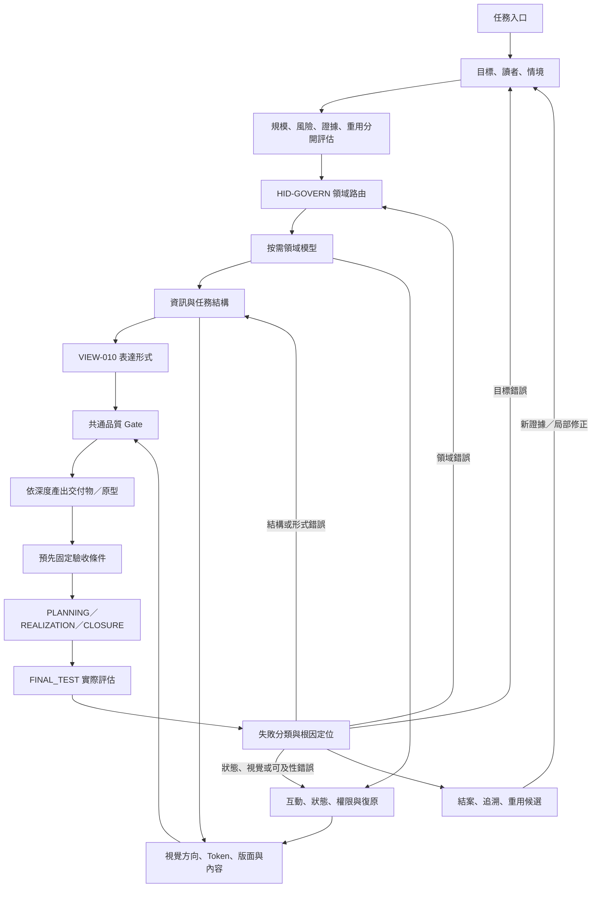

# UI 治理框架｜整合研究企劃書

- 日期：2026-10-28
- 狀態：研究結論、任務契約與正式責任映射已整理；正式整合待既有治理閘門放行
- 研究範圍：網頁製作工具、UI／UX 設計與原型工具、設計系統、互動模式、人類理解與操作治理
- 目的：建立一套跨網頁、報告、圖表、操作介面與互動流程通用的「如何讓人理解並正確完成任務」治理方法
- 研究邊界：分析可公開檢視的產品功能、官方文件、設計系統與互動模式；不宣稱取得廠商未公開的內部原始碼、演算法或設計決策。

## 摘要與裁決

**裁決：有必要納入 forAVAr，但應作為既有能力 VIEW-010「適應式呈現」的流程級治理補全，而不是另建一個平行認知核心，也不是把 UI 樣式做成固定模板。**

forAVAr 現行能力登錄已存在 VIEW-010：依讀者與用途選文字、表格或圖，避免簡單任務被過度圖表化，也避免複雜依賴無法直觀檢查；問題登錄已存在 PR-046「呈現形式與任務複雜度不匹配」。這表示責任方向已存在，缺口主要是可重複執行的判斷步驟、版型／風格的適用條件，以及可以驗收的品質條件。不應再新增同義能力。

本研究建議將 UI 治理定義為 **人類展示與互動的決策流程**，以 VIEW-010 為既有責任擁有者，並與既有 A1（目標與限制）、A3（問題模型與關係）、A4（方法與表達路由）、A6（驗收與修正）銜接。它是核心認知架構的支援能力，不是新的思考核心；每項介面仍由任務目的與證據決定，不能由視覺偏好凌駕。

需要成為必要流程的是「判斷該不該設計、選什麼表達方式、如何驗收」；不需要把每次回答都變成網頁，也不需要每項任務都跑完完整 UI 設計週期。簡單答案走輕量路徑，複雜操作介面才升級到資訊架構、風格系統、互動原型及實際驗收。

## 目錄

1. 研究問題與方法
2. 外部榜單與網頁製作工具樣本
3. UI 設計、原型與治理工具樣本
4. 成熟工具共通原理
5. UI 治理核心
6. 表達形式與視覺風格選型矩陣
7. 從需求到驗收的標準流程
8. 必要功能、非目標與整合方式
9. 驗收條件與風險
10. 來源索引
11. 跨領域擴展：遊戲、軟體、學習、協作與美學
12. 階段性選擇樹
13. 對接 forAVAr 的整合原則
14. 本輪研究限制
15. 完成企劃所需的能力總清單
16. 外部標準／框架交叉比對
17. 現有能力覆蓋、缺口與證據狀態
18. 目標框架與權責邊界
19. 運行軌跡與節點關係圖
20. 分階段融入路線與資料權責
21. 驗收設計與不誤判規則
22. 能力範圍校準：鑑賞、診斷、交代與基本製作
23. 評價標準、分媒介診斷流程與需求轉譯契約
24. 可直接使用的鑑賞檢查表與製作 Brief
25. 與 A1–A6、VIEW-010 及四階段的執行映射
26. 任務輸入／輸出契約與缺陷回退規則
27. 正式責任映射、最小整合範圍與放行條件

## 1. 研究問題與方法

研究要回答的不是「哪個工具看起來最漂亮」，而是：

- 怎樣先讓使用者知道這是什麼、為什麼存在，以及第一步應該做什麼？
- 如何把資訊量、重要性、依賴關係和操作順序轉成易理解的頁面層級？
- 什麼情況適合文字、表格、卡片、流程圖、樹狀圖、關係圖、儀表板、分步表單或敘事式頁面？
- 如何在不同品牌調性中保持可讀性、可操作性、一致性與可維護性？
- 如何判定介面真的讓人更容易完成任務，而不只是視覺上吸引人？

方法採「公開產品功能盤點 → 官方設計文件 → 跨工具共通模式 → 任務適配矩陣 → 治理流程 → 驗收條件」。工具清單是跨類型的成熟樣本，不是聲稱有一個適用所有人的唯一世界排名。網站建置平台、文件框架、原型工具和設計治理工具用途不同，不能只用同一分數硬排高下。

來源優先順序：官方文件與設計系統用於判斷產品功能及其公開設計原則；獨立評測只用來補充市場樣本和類別，不把帶有贊助或聯盟行銷的榜單當成客觀排名證據。

## 1.1 外部榜單交叉參考：前十候選與排名限制

為對應「網頁製作前十、UI 設計前十」的要求，將第三方榜單作為**候選池與市場快照**，再使用官方文件逆向分析其功能。這些榜單不是統一的學術排名；評分標準、測試深度、受眾、地區、商業合作與更新時間都可能不同，因此不得將名次直接等同於設計品質或普遍適用性。

### 網頁製作工具：2026 十項候選

iTechGuides 的 2026 網站建置比較以用途區分工具，並提供十個候選。下列用途是研究用的簡化標籤，不等於該來源所有評分理由：

| 榜單位置 | 工具 | 主要用途（研究分類） |
|---:|---|---|
| 1 | Wix | 泛用網站、初學者與小型企業 |
| 2 | Squarespace | 品牌、作品集與視覺導向網站 |
| 3 | Shopify | 電商與商品銷售 |
| 4 | WordPress.com | 內容出版、部落格與擴充 |
| 5 | Hostinger Website Builder | 低門檻、低預算網站 |
| 6 | Webflow | 高自由度視覺設計、CMS 與精細版面 |
| 7 | Framer | 作品集、品牌與動態行銷頁 |
| 8 | Duda | 代理商／自由工作者及多站管理 |
| 9 | BigCommerce | 大型商品目錄與較複雜電商 |
| 10 | GoDaddy | 快速建立基礎商業網站 |

來源：iTechGuides，*10 Best Website Builders in 2026*（2026-08-10）：<https://www.itechguides.com/10-best-website-builders-in-2026-our-evidence-based-picks/>。交叉參考：TechRadar 的 2026 評測涵蓋 80 多個建站平台，按整體、價格、模板、電商、小型企業、行銷、代理商、大型商店與免費方案等用途分項推薦；頁面揭露聯盟行銷佣金，因此此榜只能作為候選來源之一，而非無商業偏差的客觀排名。<https://www.techradar.com/news/the-best-website-builder>

### UI 設計／原型工具：2026 十項榜單候選

iTechGuides 的 2026 UI/UX 工具榜顯示以下十個排序位置。來源頁明確揭露廣告商可以付費取得較高展示位置，故本報告只用它建立市場樣本，不把名次／分數當成工具優劣的中立證明。

| 榜單位置 | 工具 | 主要用途（研究分類） |
|---:|---|---|
| 1 | Figma | 協作式介面設計、原型與交接 |
| 2 | Axure RP | 條件式、資料型與高互動 UX 原型 |
| 3 | Sketch | macOS 介面設計、Library 與原型 |
| 4 | Penpot | 開源設計平台、元件與設計 Token |
| 5 | Lunacy | 介面設計與素材／文件工作流 |
| 6 | Balsamiq Wireframes | 低保真線框與早期需求討論 |
| 7 | Framer | 視覺設計、原型及網站發布 |
| 8 | UXPin | 程式元件驅動設計、原型與交接 |
| 9 | Mockplus | 線框、協作與互動原型 |
| 10 | Justinmind | 高保真原型與互動流程模擬 |

來源：iTechGuides，*Best UI/UX Design Tools in 2026*：<https://www.itechguides.com/best/ui-ux-design-tools/>。榜單的商業揭露與局限必須保留，不應使用其名次推導「第 1 名一定最適合 forAVAr」。

### 為什麼原理研究還會納入 Storybook、Miro、ProtoPie、Visily 等工具？

榜單回答「哪些工具值得列入樣本」，不完整回答「介面治理必須學什麼」。因此後續逆向分析另外納入具代表性的治理／互動工具：
- **Storybook**：隔離展示元件狀態、互動與無障礙測試。
- **Miro**：整理流程、結構、線框與共同理解。
- **ProtoPie**：分析觸發條件、變數、公式與多階段互動。
- **Visily**：觀察 AI 生成畫面如何保持可編輯、可修改。
這些是用來補足特定設計機制的代表樣本，不冒充上述榜單的前十名次。

## 2. 網頁製作工具十項樣本

以下十項按「用途覆蓋、成熟度、工作流程代表性」選入，不表示從第一名到第十名的絕對排名。

| 工具 | 主要定位 | 公開可觀察的做法 | 可借鑑之處 | 不應照搬之處 |
|---|---|---|---|---|
| Webflow | 視覺化專業建站、CMS、互動 | 視覺畫布、即時預覽、CMS、變數／元件與發布流程 | 設計系統與內容管理要能共用，變更需可跨頁生效 | 專業自由度高不表示新手初始畫面也該開放所有選項 |
| Framer | 設計導向的行銷及品牌網站 | 畫布編輯、響應式版面、CMS、互動與發布 | 視覺方向、排版、行動版和實際發布應一起檢查 | 行銷頁的大型主視覺不能直接套用到操作台或技術文件 |
| Wix | 泛用無程式碼建站 | 範本、拖放、AI 起稿、行動版調整、網站功能整合 | 從目標與受眾開始，再挑範本、定內容、調整與發布 | 功能廣泛的工具容易把所有商業功能同時放進一個介面 |
| Squarespace | 品牌、作品集與內容型網站 | 範本、全站字體／色彩／按鈕風格、響應式編輯 | 以整體視覺規則維持品牌一致，而非每個區塊獨立設計 | 高度風格化的模板不一定適合資訊密集的技術工作 |
| WordPress Site Editor | 內容管理與整站編輯 | 將頁面、導覽、樣式、範本、區塊模式分開管理 | 區塊／模板重用與全站樣式治理，讓內容與外觀分層 | 插件與主題的堆疊會增加維護與相容性成本 |
| Shopify Theme Editor | 電商 storefront 與商品內容 | 預覽、區段與區塊、商品／集合資料和主題設定 | 編輯時即時預覽實際輸出；有風險的修改先備份／複製 | 電商購買流程的強 CTA 不該變成所有產品的通用視覺語言 |
| Carrd | 單頁網站與快速簡介 | 畫布加屬性面板、區段與簡單進階選項 | 低複雜度需求採少量工作區、按選取物件顯示相關屬性 | 單頁極簡模式不適用於多角色、多狀態、深層依賴系統 |
| Lovable | 以自然語言建立應用 | 先描述需求，再生成介面、資料與流程，後續用文字或程式細修 | 將需求轉成可檢視的初稿，再透過修正迭代 | 一次提示生成的外觀不是需求確認或可靠性驗收的替代品 |
| Bolt.new | AI 網站／應用建置 | 自然語言描述、即時程式與預覽、迭代及發布 | 讓方案很快可視化，提早揭露資訊架構與互動假設 | 「很快產生」不等於「已理解使用者」或「已驗證邊界情況」 |
| Docusaurus | 開源專案文件與內容網站 | 分層文件、側邊導覽、搜尋、版本、國際化及可客製元件 | 文件產品應以內容層級、導航、可搜尋性與版本清晰度為主 | 不應為了用框架而引入比內容本身更複雜的建置棧 |

### 本組工具的可追溯來源

- Webflow 設計系統與變數、元件、樣板：<https://help.webflow.com/hc/en-us/articles/41959932025235-Using-a-design-system-in-Webflow>、<https://webflow.com/feature/cms>
- Framer 響應式網站建置：<https://www.framer.com/solutions/responsive-website-builder/>、<https://www.framer.com/solutions/website-builder/>
- Wix 建站與響應式能力：<https://www.wix.com/website-builder>、<https://support.wix.com/en/article/creating-responsive-sites-with-wix>
- Squarespace 品牌、版面與響應式編輯：<https://www.squarespace.com/website-design>
- WordPress Site Editor 的樣式、導覽、頁面、範本和區塊模式：<https://wordpress.com/support/site-editor/>
- Shopify Theme Editor 的即時預覽與區段設定：<https://help.shopify.com/en/manual/online-store/themes/customizing-themes>
- Carrd 畫布與屬性面板：<https://carrd.com/docs/building/overview>
- Lovable 從提示到介面、資料與流程：<https://lovable.dev/build/app-builder>
- Bolt 的應用建置方式：<https://support.bolt.new/building/intro-bolt>
- Docusaurus 的文件架構、搜尋、版本、設計原則與部署：<https://docusaurus.io/docs>

## 3. UI 設計／原型／治理工具十項樣本

這一組刻意涵蓋從早期線框、畫面設計、細緻互動到設計系統與品質驗收的不同階段。

| 工具 | 主要定位 | 公開可觀察的做法 | 可借鑑之處 |
|---|---|---|---|
| Figma Design／FigJam | 協作介面設計、原型、白板與交接 | 共用設計稿、元件、變數、原型、協作與 Dev Mode | 設計意圖、重用規則與交付規格應可被同一團隊理解 |
| Penpot | 開源設計平台與設計系統 | 設計 Token、共用元件、設計檔案與程式交接 | 使用命名一致的語意 Token，而不是在每個畫面手選色值 |
| Sketch | 介面設計、Library、原型與交接 | 共用 Library、畫面原型、覆蓋層、固定元素及滾動區 | 把跨畫面共用結構與互動模式做成可重用項目 |
| Axure RP | 高互動／條件式 UX 原型 | 事件觸發、條件、變數、資料表單與狀態面板 | 複雜互動要測狀態與分支，不能只檢查靜態截圖 |
| Balsamiq | 低保真線框與早期討論 | 粗略結構優先、減少視覺細節、釐清問題及使用者流程 | 結構還不清楚時，先做低保真；不要太早追求精緻外觀 |
| ProtoPie | 逼真互動原型 | 觸發器、變數、公式、多步回應與分支 | 互動的狀態、觸發條件、回饋及錯誤分支應可明確檢查 |
| UXPin | 程式元件驅動的設計系統與原型 | 將真實元件、屬性、樣式和互動帶進設計流程 | 設計稿與落地元件應盡可能共用同一來源，減少交接落差 |
| Miro | 白板、流程、線框與協作 | 同一畫布整合發想、圖示、流程與原型 | 複雜問題先讓團隊共同看見結構與流程，再決定視覺細節 |
| Visily | AI 輔助的可編輯 UI 初稿 | 從文字、截圖或圖表產生可編輯畫面並重新套用風格 | AI 生成應產生可修訂的結構，不只是不可編輯的圖片 |
| Storybook | 元件工作台、文件、互動與無障礙測試 | 隔離展示元件、記錄不同狀態、視覺／互動／無障礙檢查 | 不能只驗收首頁；需驗收元件狀態與錯誤、空值、載入等情境 |

### 本組工具的可追溯來源

- Figma 功能與工作區：<https://help.figma.com/hc/en-us/articles/14563969806359-What-is-Figma>；設計系統指南：<https://help.figma.com/hc/en-us/articles/14552901442839-Overview-Introduction-to-design-systems>
- Penpot 設計 Token 與元件：<https://help.penpot.dev/user-guide/design-systems/design-tokens/>、<https://help.penpot.app/user-guide/design-systems/components/>
- Sketch 工具與原型：<https://www.sketch.com/docs/getting-started/what-is-sketch/>、<https://www.sketch.com/docs/prototyping/>
- Axure 條件、變數與互動：<https://www.axure.com/axure-rp>
- Balsamiq 十項線框原則：<https://balsamiq.com/blog/ten-principles-effective-wireframes/>
- ProtoPie 互動邏輯：<https://www.protopie.io/features/interaction-logic>
- UXPin 程式元件與設計系統：<https://www.uxpin.com/>、<https://www.uxpin.com/docs/design-systems/design-systems/>
- Miro 線框與原型：<https://help.miro.com/hc/en-us/articles/360017572154-Wireframing-library>、<https://help.miro.com/hc/en-us/articles/26654102601874-Miro-Prototypes-overview>
- Visily AI 設計：<https://www.visily.ai/ai-design/>
- Storybook 元件工作台與測試：<https://storybook.js.org/>、<https://storybook.js.org/docs/writing-tests/accessibility-testing>

**狀態提醒：** Adobe XD 不列入前十樣本，因官方已明確標示進入 maintenance mode，不再持續開發新功能。官方來源：<https://helpx.adobe.com/xd/desktop/introduction/faq.html>。這是以維護狀態而非歷史知名度篩選工具的例子。

## 4. 逆向歸納：成熟工具的共同原理

這裡的「逆向」是從公開功能與文件歸納可觀察的設計原理，不宣稱知道廠商內部決策。

### 4.1 共通的結構原理

1. **先定義任務，再呈現操作工具。** Wix 的建站步驟先定網站目標；Balsamiq 要求先理解問題與使用者需求；Docusaurus 把內容與建置框架的責任分開。
2. **低保真先於視覺精修。** 先確定資訊階層、使用流程與狀態，再決定字體、色彩、圖像與動效。此順序能避免美化一個錯誤的內容結構。
3. **把經常重複的規則抽成共用資產。** 設計 Token、元件、樣板、版面和內容模式能降低不一致；但只有在重用收益明確時才抽象化。
4. **編輯時應能看見結果。** 畫布預覽與原型讓內容、結構和互動在發布前可被審視；「有程式碼」或「有設計稿」本身不是正確性的證據。
5. **把互動當成狀態與轉換，不只是裝飾。** 觸發條件、狀態、回饋、錯誤出口、空狀態和取消／復原都應是設計的一部分。
6. **為任務選擇合適的抽象層。** 簡單事情用少量步驟；複雜依賴用結構圖；狀態分支用流程／狀態圖；需要判斷的資料用表格；需要操作大量資料時才使用儀表板。
7. **視覺一致性必須能維護。** 全站色彩、字體、間距、邊界、元件狀態與主題用 Token 和規範維護，不應靠開發者每次憑感覺重選。
8. **品質驗收要看使用與行為，不只看截圖。** Storybook 把元件、狀態、互動與無障礙檢查納入工作台；W3C WCAG 則用可感知、可操作、可理解、穩健四原則描述無障礙要求。

### 4.2 一個重要區分：資訊架構、互動模式、視覺風格是三件事

- **資訊架構**決定放哪些內容、分幾層、先讓人看到什麼。
- **互動模式**決定使用者如何切換、輸入、定位、確認、撤銷與收到回饋。
- **視覺風格**決定色彩、字體、材質感、圖像、動效與品牌氣質。

三者需要一致，但不可互相代替。把一個過度擁擠的單頁改成玻璃擬態或 Bento 卡片，只是換了外觀；真正的改善必須先重新整理任務與資訊層級。

### 4.3 共同設計原則與來源

- **漸進式揭露：** 先呈現完成主要任務需要的資訊，進階選項按需要展開。Nielsen Norman Group：<https://www.nngroup.com/articles/progressive-disclosure/>
- **設計系統不是色票集合：** 由基礎 Token、元件、使用規範與流程共同構成。Atlassian Design：<https://atlassian.design/design-system>；Token 原理：<https://atlassian.design/foundations/design-tokens>
- **可訪問與可理解是基本品質，不是裝飾：** WCAG 2.2 四大原則為 Perceivable、Operable、Understandable、Robust。W3C：<https://www.w3.org/WAI/WCAG22/Understanding/intro>
- **按使用情境選模式：** GOV.UK Design System 將 Patterns 定義為特定使用者任務與頁型的設計解法。<https://design-system.service.gov.uk/patterns/>
- **響應式排版應以彈性配置為主，不是逐台設備硬編：** MDN：<https://developer.mozilla.org/en-US/docs/Learn_web_development/Core/CSS_layout/Responsive_Design>
- **設計系統與真正落地之間要有審查連結：** Figma 對設計系統實作的指南要求先審查既有設計與程式，再定義 Token 與常用元件。<https://www.figma.com/resource-library/design-system-implementation/>

## 5. UI 治理核心

建議正式採用以下原則，作為 VIEW-010 的操作契約：

### 原則 A：先解釋目的，才安排元件

介面必須能在合理的第一眼回答：這是什麼？主要用途是什麼？使用者下一步可以做什麼？不要求所有頁面都使用同一種首頁設計，但必須有清楚的入口與閱讀順序。

### 原則 B：先資訊架構，再風格

先決定主要任務、資訊分組、頁面／步驟、導航與例外狀態；再挑字體、色彩、圖像、卡片和動效。若資訊層級仍不清楚，先做線框，不進入視覺精修。

### 原則 C：風格依任務，不依潮流

風格是讓內容更容易被理解、建立信任或傳達品牌個性的工具。不得只因某種樣式流行，就將它用於不合適的任務。任何風格都必須通過可讀性、對比、操作清晰、響應式及維護成本檢查。

### 原則 D：讓複雜性有地方收納

把主要任務放在主要視野；低頻選項放到進階區；把單一物件的詳細內容放在選取後才呈現；大量資料要先提供分組、搜尋、篩選或局部聚焦。隱藏內容不得造成必須的操作不易發現。

### 原則 E：所有圖表與視圖都是權威內容的投影

樹狀圖、關係圖、卡片與儀表板不得成為另一份真相。重要節點、關係與結論要能回到來源、正式規格或可重生成資料；圖表與來源衝突時修改圖表或其生成邏輯，不偷偷改寫權威資料。

### 原則 F：行為、狀態和例外都要設計

互動元件至少要思考預設、執行中、完成、無資料、錯誤、部分完成及不可用狀態；高風險行為須提供明確範圍、確認及能做到時的復原路徑。操作結果要有可理解的回饋，不只靠顏色或動畫暗示。

### 原則 G：可讀性、無障礙與行動裝置是硬性品質門檻

遵循 WCAG 2.2 的可感知、可操作、可理解與穩健原則。不可只靠顏色表達狀態；可互動項目需要清楚名稱、焦點與鍵盤操作；行動版不能只把桌面欄位縮小，而要重新安排內容優先序。

### 原則 H：證據勝過設計者主觀好惡

設計理由要回扣使用者任務、問題模型、正式內容、已知限制和可觀察的驗收結果。若尚未做真實使用測試，明確標示為設計假說，不得說成已證明更好用。

## 6. 表達形式與視覺風格選型矩陣

### 6.1 先選表達形式

| 任務／問題特性 | 優先表達形式 | 輔助形式 | 不適用時的警訊 |
|---|---|---|---|
| 簡單問題、短結論 | 直接文字、短段落 | 簡短清單 | 把一句話做成完整儀表板或多層圖表 |
| 需要掃描並逐項比較 | 表格、比較卡 | 強調差異的摘要 | 以長段文字逐項重複相同欄位 |
| 階層、分類、上下位 | 樹狀圖、分層清單 | 搜尋、展開／收合 | 用關係網路圖表現純階層，讓交叉連線干擾閱讀 |
| 相依、影響、衝突、網絡 | 關係圖、依賴圖 | 節點詳情、局部聚焦 | 一口氣顯示所有節點，連線交錯且無圖例 |
| 時序、狀態轉換、決策分支 | 流程圖、狀態機、時間軸 | 步驟清單 | 只用抽象段落描述分支，但沒有條件與出口 |
| 多筆資料監看、篩選與操作 | 儀表板、資料表、篩選器 | 摘要指標、細節面板 | 只展示圖表，卻沒有數值、單位、日期、篩選或來源 |
| 一個主要任務、多個步驟 | 分步流程、Wizard | 進度標示、返回與草稿 | 一頁塞入所有欄位，或讓使用者失去步驟位置 |
| 單一物件的深入理解 | 卡片／詳情面板／分頁 | 原始資料收合 | 每筆物件都把所有原始欄位直接展開 |
| 對外介紹或品牌說明 | 敘事式首頁、清楚標題、少量重點視覺 | 功能摘要、行動入口 | 第一屏就塞技術清單，或只有裝飾而沒有說明目的 |
| 需高信任度的確認或不可逆操作 | 乾淨的分步表單、確認摘要、明確按鈕 | 輔助說明、撤銷／回復 | 把危險行為藏進含糊圖示，或以強烈裝飾干擾閱讀 |
| 手機單手操作 | 單欄、短區塊、清楚的主要操作 | 次要動作收納、底部導覽 | 桌面三欄硬壓到小螢幕，主要按鈕難觸及 |
| 教學與初次使用 | 少量步驟、示例、漸進解鎖 | 可跳過導覽、情境範例 | 一次顯示所有說明，或強迫熟手反覆看入門教學 |

**規則：** 形式不是依個人喜好挑選，而是依資訊關係、任務頻率、讀者經驗、風險、資料量、裝置與操作需求決定。若兩種形式都可行，選維護成本較低、能直接滿足接受條件的形式。

### 6.2 再選視覺方向

| 視覺方向 | 適合使用情境 | 主要設計語言 | 不適合／風險 |
|---|---|---|---|
| 極簡／編輯式 Editorial | 簡介、理念、長文閱讀、文件入口 | 強字級層次、舒適行距、留白、少量強調色 | 不要因為極簡而隱藏必要導航或關鍵操作 |
| 瑞士式／資訊設計 | 技術文件、架構圖、規格、研究報告 | 網格、對齊、清楚標籤、有限色彩、明確層級 | 過度規整會削弱故事性或品牌溫度 |
| 企業工具／資料密集型 | 後台、管理台、模型檢視器、資料工作區 | 穩定導航、表格／面板、狀態色、固定間距與密度 | 初學者容易迷失；須配合清楚的主任務和進階收納 |
| 溫暖／自然型 | 教育、生活、健康、社群、需要親和力的服務 | 柔和中性色、低壓力配色、有節制的插圖與圓角 | 對高密度分析或高風險操作，裝飾可能稀釋嚴肅性 |
| 品牌敘事／高編輯度 | 作品集、創意品牌、行銷首頁、展示型內容 | 大型標題、影像、節奏、留白與有目的的動效 | 首屏高度過大、載入慢、重要內容被推到過下方 |
| Bento／模組卡片 | 三到六個並列入口、摘要、功能總覽 | 獨立卡片、不同層級、可掃描分區 | 不要把每條資訊都變卡片；卡片數過多會變成另一種資訊牆 |
| 新野性／強表現力 Neo-brutalism | 藝術、實驗產品、年輕且強烈的品牌 | 高對比、粗線條、明顯形狀與強調色 | 高刺激不一定有助於理解；檢查對比、長文閱讀及信任感 |
| 玻璃質感 Glassmorphism | 少量疊層、浮動控制或有景深語意的展示 | 透明層、模糊、細邊框與背景深度 | 文字對比、層次辨識、低效能裝置與背景複雜度的風險 |
| 高保真擬物／柔和陰影 Neumorphism | 少量裝置概念或物理隱喻明確的控制 | 凹凸陰影與表面層次 | 控制邊界容易不清楚、對比不足，不適合大量標準操作控制 |
| 動態／實驗式互動 | 故事體驗、創意工具、探索與演示 | 有意義的過場、回饋、狀態變化 | 動效若只裝飾、拖慢任務或無法關閉，便是負擔而非價值 |

### 6.3 風格選擇順序

1. 先決定資訊形式與頁面骨架，不先選潮流風格。
2. 依品牌性格、讀者預期與使用情緒，選一個主要視覺方向；最多用一個輔助方向。
3. 定義色彩角色、字級、間距、邊框、陰影、圓角、圖示與動效規則。
4. 先套用到一個代表頁面，檢查標題層級、主操作、長文、資料密集區與手機版。
5. 只有證明主視覺有幫助而沒有破壞可讀性時，才擴展到其他頁面。

## 7. 從需求到驗收的標準流程

此流程命名為 **UI-GOVERN**，歸屬現有 VIEW-010。每個階段只做足夠完成當前判斷的工作；不是每次任務都建立一整套設計文件。

### G0｜觸發判定

觸發條件：建立或修改人類使用的網頁、操作介面、報告版型、圖表、導覽、表單、流程或資料呈現；或已出現 PR-046 類型的理解問題。

若只需一段簡短回答，沒有複雜結構或互動，不強制製作 UI。只需選好表達形式即可。

### G1｜定義任務與讀者

回答：誰使用、要完成什麼、完成後如何判定成功、使用什麼裝置、資料／權限／操作的風險是什麼。必要時指出初次使用者與熟手的差異。

輸出：目標、讀者、關鍵任務、限制、接受條件。不可拿「看起來漂亮」當唯一接受條件。

### G2｜建立資訊架構

先寫出頁面／區段／步驟的層級與關係，標明：
- 主要目的與主操作；
- 次要內容與進階內容；
- 內容順序與導航；
- 物件、狀態與關係；
- 空資料、錯誤、載入、部分完成與離開路徑。

若資訊架構未定或存在實質歧義，先用文字骨架、樹狀圖或低保真線框，不進行視覺精修。

### G3｜選擇表達形式

依 6.1 矩陣比較候選形式。決策記錄至少包含選擇理由，以及為何沒有採用最接近的替代形式。當圖表沒有增加可理解性時，不做圖表。

### G4｜選擇視覺語言

從任務與讀者預期選擇視覺方向，建立最小 Token 集：背景與文字色彩角色、強調／狀態色、字級、行距、間距、容器寬度、圓角、邊框、陰影與動效。不可把色彩本身當唯一狀態訊號。

### G5｜設計互動與回饋

逐項說明主要操作的觸發條件、結果、忙碌狀態、完成回饋、無資料與錯誤出口、取消／返回／撤銷條件，以及鍵盤、觸控和焦點行為。低風險的簡單介面可用簡短操作清單；複雜分支或高風險操作才需要互動原型。

### G6｜建立適當保真度的原型

- 低複雜度：文字骨架或少量頁面草圖即可。
- 中複雜度：頁面流、主要狀態與一個代表性頁面。
- 高複雜度／高風險：建立可點擊原型，覆蓋主要分支、錯誤、取消與恢復。
- 對有實際原始碼的系統：盡量使用實際資料模型、既有元件與狀態，而不是畫一張與程式無關的示意稿。

### G7｜驗收

最少檢查：
1. 使用者能否在初始畫面理解目的與第一步。
2. 主要資訊是否比低頻細項更醒目；是否有多餘區塊或不必要的重複。
3. 選用的表達形式能否直接回答目標問題；圖表是否有必要圖例、標籤、來源與回指。
4. 主操作、導航、搜尋、篩選、選取、錯誤及返回／復原行為是否一致。
5. 行動版是否重新排列必要內容；是否有橫向溢出、太小的操作目標或失去主要操作。
6. 鍵盤焦點、可讀標籤、文字對比、語意結構與狀態訊息是否可用；對應 WCAG 2.2 檢查範圍。
7. 重要數據與主張是否仍符合權威來源；圖表與來源不一致時，先修正投影。

驗收證據要按真實執行狀態記錄。靜態原始碼檢查不等於瀏覽器互動通過；自我評價也不能冒充獨立使用者測試。

### G8｜記錄與修正

對複雜、多頁或會重用的設計，記錄：任務、讀者、接受條件、表達形式、視覺方向、替代方案、來源、已知風險、驗收結果和未解項。簡單一次性回答不要求產生額外文件。

驗收失敗時，分類為：
- 目標／資訊架構錯誤；
- 表達形式錯配；
- 視覺層級錯誤；
- 互動／狀態錯誤；
- 無障礙或響應式錯誤；
- 內容與權威來源不一致；
- 測試環境／證據缺失。

只修正受影響層，並重驗對應條件；若根本問題是目標或資訊結構，不以加樣式掩蓋。

## 8. 必要功能、非目標與整合方式

### 必要性判定

**必要：**
- 人類可讀性／可操作性成為 UI 或資訊輸出決策的明確檢查項；
- 按任務選表達形式，而不是總是文字或總是圖；
- 按任務／讀者選視覺方向，而不是每次預設同一風格；
- 明確的主要／次要／進階資訊層級；
- 對互動狀態、無障礙、響應式及來源一致性的驗收；
- 把理由、限制與驗收結果留在適合的紀錄中，供後續迭代。

**暫不需要：**
- 新增一套與 A1–A6、N01–N18、F0–F7 平行的認知流程；
- 為每個任務自動生成網站或視覺稿；
- 一開始引入昂貴的設計軟體、外部 UI 套件、付費服務或大型前端框架；
- 建立完整的 AI 自動評審引擎，以單一分數宣稱設計品質；
- 以固定的玻璃擬態、Bento 或極簡風格替代情境決策。

### 整合映射

| 現有責任 | UI-GOVERN 的對接方式 |
|---|---|
| VIEW-010 適應式呈現 | 唯一責任擁有者；承擔文字、表格、圖表、介面形式與風格的選擇 |
| PR-046 呈現形式與任務複雜度不匹配 | 本流程要減少與追蹤的既有問題，不另建同義問題 |
| A1／N01–N03 | 定義讀者、目標、限制、成功條件與資訊範圍 |
| A3／N07–N09 | 建模節點、關係、條件、因果候選與未知，供圖形表達依據 |
| A4／N10–N12 | 選最低成本、足夠且可驗收的表達方式；定停止條件 |
| A6／N16–N18 | 檢查理解、互動、來源一致性、風險及失敗後修正 |
| F6 持久化與交接 | 只有多頁、跨任務、重用或正式變更時，保存設計決策與必要交接內容 |

### 治理位置

這項能力屬於既有認知架構的「人類展示與互動支援層」。它可以呈現在網站 UI，也可以作為代理／模型接任務時執行的過程檢查。前者讓使用者更容易理解和操作，後者確保模型不會只產生機械可用但難理解的呈現。

它不是獨立 runtime executor，也不應繞過授權、來源、證據和現行變更流程。對已存在的 UI，先稽核與修正；對新 UI，先定義任務和資訊架構；只有當標準流程不足以解決已觀察到的問題，才考慮新元件或新機制。

## 9. 驗收條件與風險

### 可接受的成果

- 所有需要人類理解或操作的複雜輸出，都能說明選擇的資訊形式及其理由。
- 主要目標與第一步容易定位；必要資訊不會被收進難以發現的進階區。
- 樹狀、關係圖、表格和卡片只在符合其用途時採用。
- 視覺風格與讀者、品牌、內容密度、風險及裝置相符；樣式不是照抄一個熱門工具。
- 有互動的介面已設計主要狀態、錯誤和返回路徑；正式驗收有實際證據。
- 所有可視化結果能回到權威內容或明確標示為概念示意；未知、未驗證和未執行不被美化成確定答案。
- 不因這項治理增加不必要的檔案、重複規則、外部依賴或固定工作成本。

### 主要風險與控制

- **風格模板化：** 用途矩陣提供選項而非強制模板；可提出新風格，但必須說明任務收益。
- **流程過重：** 簡單文字回答使用輕量分支；只有複雜／高影響／重用型 UI 才需原型與完整驗收。
- **以審美代替驗收：** 任何「更容易理解」的成功宣稱都要有任務條件或觀察支持。
- **圖表與來源脫節：** 視圖是權威資料投影；資料更新後重建圖，不手改圖來掩蓋差異。
- **無障礙成為最後補救：** 將鍵盤、對比、標籤、重排與減少動效納入初步設計，而不是只在發布前看外觀。
- **生成式工具過度自信：** AI 初稿只能是候選；先核對內容，再檢查流程、狀態與響應式，最後才正式發布。

### 本研究未證明的事項

本報告沒有進行正式使用者實驗，也沒有聲稱任何一個風格必然提高轉換率或理解速度。工具廠商自己的功能說明可支持「產品提供哪些功能」，不能單獨證明「這個功能一定比其他方法更好」。對 forAVAr 的實際收益，仍需在代表性使用情境中驗收。

## 10. 來源索引

### 互動、資訊架構與無障礙
- Nielsen Norman Group — Progressive Disclosure: <https://www.nngroup.com/articles/progressive-disclosure/>
- W3C — Understanding WCAG 2.2: <https://www.w3.org/WAI/WCAG22/Understanding/intro>
- W3C — WCAG 2.2 at a Glance: <https://www.w3.org/WAI/standards-guidelines/wcag/glance/>
- GOV.UK Design System — Patterns: <https://design-system.service.gov.uk/patterns/>
- MDN — Responsive Design: <https://developer.mozilla.org/en-US/docs/Learn_web_development/Core/CSS_layout/Responsive_Design>

### 設計系統、Token 與元件治理
- GitHub Primer Design System: <https://primer.github.io/design/>
- Atlassian Design System: <https://atlassian.design/design-system>
- Atlassian Design Tokens: <https://atlassian.design/foundations/design-tokens>
- Penpot Design Tokens: <https://help.penpot.dev/user-guide/design-systems/design-tokens/>
- Figma Design Systems: <https://help.figma.com/hc/en-us/articles/14552901442839-Overview-Introduction-to-design-systems>
- Storybook UI Development & Testing: <https://storybook.js.org/>

### 線框、互動原型與可視化
- Balsamiq — Ten Principles of Effective Wireframes: <https://balsamiq.com/blog/ten-principles-effective-wireframes/>
- Axure RP: <https://www.axure.com/axure-rp>
- ProtoPie Interaction Logic: <https://www.protopie.io/features/interaction-logic>
- Miro Wireframing: <https://help.miro.com/hc/en-us/articles/360017572154-Wireframing-library>
- Visily AI Design: <https://www.visily.ai/ai-design/>

### 網頁建置與文件平台
- Webflow Design System: <https://help.webflow.com/hc/en-us/articles/41959932025235-Using-a-design-system-in-Webflow>
- Framer Responsive Website Builder: <https://www.framer.com/solutions/responsive-website-builder/>
- Wix Website Builder: <https://www.wix.com/website-builder>
- Squarespace Website Design: <https://www.squarespace.com/website-design>
- WordPress Site Editor: <https://wordpress.com/support/site-editor/>
- Shopify Theme Editor: <https://help.shopify.com/en/manual/online-store/themes/customizing-themes>
- Carrd Builder Overview: <https://carrd.com/docs/building/overview>
- Lovable App Builder: <https://lovable.dev/build/app-builder>
- Bolt Intro: <https://support.bolt.new/building/intro-bolt>
- Docusaurus: <https://docusaurus.io/docs>

### 市場樣本與產品狀態補充
- TechRadar — Best Website Builders of 2026（獨立評測但含聯盟行銷揭露；僅作市場樣本）：<https://www.techradar.com/news/the-best-website-builder>
- Shopify — UI Design Tools（廠商內容，僅用於發現工具類別）：<https://www.shopify.com/blog/ui-design-tools>
- Adobe XD Maintenance Mode：<https://helpx.adobe.com/xd/desktop/introduction/faq.html>

- iTechGuides — *10 Best Website Builders in 2026*: <https://www.itechguides.com/10-best-website-builders-in-2026-our-evidence-based-picks/>（第三方候選榜單；使用前需考量各榜單的商業揭露與評分條件）。
- iTechGuides — *Best UI/UX Design Tools in 2026*: <https://www.itechguides.com/best/ui-ux-design-tools/>（明確揭露廣告商可能付費取得較高榜單位置；僅作候選池，不作中立的品質證明）。
- TechRadar — *The best website builders of 2026*: <https://www.techradar.com/news/the-best-website-builder>（評測 80+ 平台，按不同用途分類推薦，頁面揭露聯盟行銷佣金）。

## 11. 跨領域擴展：遊戲、軟體、學習、協作與美學

### 11.1 範圍裁決：領域很廣，但不應以單體功能承接

本系統如果試圖直接涵蓋所有遊戲規則、所有軟體 UX、全部視覺流派、所有協作方法與無障礙標準，將變成難以查詢、難以驗收且每次使用都過重的百科全書。這是架構風險，不代表領域不值得支援。

推薦採「一個共同治理核心＋領域分支＋按需載入的設計模式＋共同品質 Gate」：

- 共通核心只保留跨領域共用的問題：人要完成什麼、需要理解什麼、能做什麼、系統如何回應、發生錯誤如何恢復、如何判斷設計有效。
- 領域分支只保留該領域獨有的目標與方法，例如遊戲的核心循環／玩家體驗、軟體的工作流／資料狀態、教學的逐步學習、協作的共同語言／交接治理。
- 視覺風格、配色與動效是一個可重用的表現層，不應反過來決定任務目的或內容結構。
- 品質 Gate 共用無障礙、可讀性、狀態回饋、錯誤恢復、來源一致性、裝置適配及實際驗收。
- 每次任務只載入相關分支。不要讓單純修改一個按鈕，也被迫閱讀完整遊戲設計、字體理論和所有協作規範。

### 11.2 樹狀職權結構

```text
人類互動設計治理（共通入口；不新增認知核心）
├─ A. 共通設計核心（所有分支適用）
│  ├─ A1 任務與使用者目標
│  ├─ A2 心智模型／資訊架構
│  ├─ A3 可供性、操作與狀態回饋
│  ├─ A4 錯誤預防、取消／復原與自主性
│  ├─ A5 漸進式揭露、注意力與認知負荷
│  ├─ A6 可及性、裝置與使用情境
│  └─ A7 證據、驗收與迭代
├─ B. 領域分支（依主要任務選擇；可組合）
│  ├─ B1 遊戲體驗：核心循環、機制、玩家行動、回饋、難度、沉浸
│  ├─ B2 軟體／產品：使用者任務、導覽、表單、資料視圖、錯誤狀態
│  ├─ B3 資訊／學習：解說、資訊圖、文件、教學、情境提示
│  ├─ B4 創作／專業工具：編輯器、工作台、畫布、命令與預覽
│  └─ B5 協作／服務：角色分工、共同語言、交接、審查、決策紀錄
├─ C. 表達與美學層（橫向套用，不是根據潮流決定）
│  ├─ C1 版面、網格、留白、對齊與資訊密度
│  ├─ C2 字體、字級、行距、標籤與閱讀節奏
│  ├─ C3 色彩角色、對比、狀態編碼與品牌色
│  ├─ C4 圖像、圖示、形狀、材質與視覺隱喻
│  └─ C5 動效、聲音、震動與轉場（僅在有傳達價值時）
└─ D. 共通品質 Gate
   ├─ D1 目的與第一步是否清楚
   ├─ D2 主要／次要內容層級
   ├─ D3 操作、回饋、錯誤出口與復原
   ├─ D4 無障礙、響應式與多輸入方式
   ├─ D5 權威內容、資料與畫面一致
   └─ D6 在真實情境下驗收並回收證據
```

此圖是職權／分類視圖，不表示每次任務都執行全部分支。遊戲、軟體與資訊設計可以共用相同的可理解性底線，但由不同的分支擁有其專業規則。

### 11.3 遊戲設計：不能只把它當成一種 UI 皮膚

遊戲設計至少要區分三層：

1. **遊戲機制（Mechanics）**：規則、輸入、資源、勝負條件、行動成本及系統限制。
2. **動態行為（Dynamics）**：機制在玩家行動與系統回應下，實際形成的策略、節奏、風險、合作／競爭與反覆遊玩行為。
3. **體驗美學（Aesthetics）**：玩家希望感受到的挑戰、探索、緊張、掌控、敘事、社交或成就等體驗。

MDA 是一個經典的分析框架，適合提醒設計者從規則追到實際遊戲行為和玩家體驗；後續研究也指出其概念定義與實務應用有局限，因此應將它當作分析透鏡，而非完整的遊戲設計定律。來源：Hunicke、LeBlanc、Zubek，*MDA: A Formal Approach to Game Design and Game Research*（AAAI）；概念批判與再定義討論見 *Redefining the MDA Framework*。<https://aaai.org/papers/ws04-04-001-mda-a-formal-approach-to-game-design-and-game-research/> <https://www.mdpi.com/2078-2489/12/10/395>

遊戲專業分支至少需要針對以下問題做選擇：
- **核心循環是否成立？** 玩家反覆做什麼、獲得什麼回饋、下一輪為何值得繼續？
- **玩家的行動是否可理解？** 玩家能否理解當前目標、可行選項、行動成本、結果與失敗原因？
- **回饋是否可辨識？** 成功、失誤、受傷、資源變更、敵人狀態與任務進度可否在當下被感知？
- **教學是否在正確時機出現？** 必要規則先教；低頻機制可透過情境式教學或適時提示引入，避免開始時一次塞入所有規則。
- **介面是否損害遊戲空間？** HUD 需要讓玩家看到重要狀態，但不能不必要地遮住核心玩法區域；資訊應按重要性、變動頻率與當下情境分級。
- **玩家是否保有能動性？** 提示應在必要時支援，而不是每一步都強迫玩家照唯一方式行動。

Unity 的近期遊戲 UI／UX 指南把輸入輸出盤點、重要度排序、可供性、即時回饋、刪減、原型和遊玩測試列為可操作流程；Roblox 的官方教學指南則區分視覺提示、情境式教學與計時提示，說明非必要資訊可延後至相關情境出現。這些證據支持遊戲設計分支必須納入時機與遊戲流程，不只是配色與畫面。<https://unity.com/blog/video-game-ui-ux-basics> <https://create.roblox.com/docs/production/game-design/onboarding-techniques>

### 11.4 軟體／專業工具：優先讓任務順利完成

軟體與專業工具應先列出使用者要完成的任務，然後把任務拆成可理解的步驟、狀態、輸入、輸出與錯誤路徑。設計重點包括：

- 主要工作入口明確，低頻／高階功能延後顯示，但必要能力不能被藏住。
- 一致的導覽、控制位置、按鈕語意、焦點順序與標籤，減少每個頁面重新學習的成本。
- 狀態可見：系統正在載入、已完成、沒有資料、部分完成或出錯時，不要讓使用者猜測。
- 重要行動要有結果回饋；高影響行動先顯示目標、後果與可用的復原方式。
- 資料表、圖表與儀表板應支持比較、搜尋、篩選或決策；若只展示裝飾性數字，應移除或改成更適合的形式。
- 給熟手有效率的捷徑，也要讓新手能透過標籤、示例和可預期的步驟完成相同工作。

Nielsen Norman Group 的十項可用性啟發法包括系統狀態可見、符合真實世界語言、使用者控制與自由、一致性、錯誤預防、辨認而非回憶、效率與簡約，以及幫助理解錯誤等。這些是跨軟體任務的共同檢查項，不是替代使用者研究的完整規格。<https://www.nngroup.com/articles/ten-usability-heuristics/>

### 11.5 資訊、教學與新手引導

對需要人類學習或理解的系統，核心問題不是最短操作路徑，而是人在正確時機能否理解並記住重要內容。

- 先教必需的概念與動作，再逐步加入次要規則。
- 把解說放在與任務相關的地方；使用者第一次遇到一個功能時，按情境提供提示，比一開始列出全部手冊更合適。
- 將文字、畫面標示、示例與可操作練習搭配使用；不可只靠顏色或抽象圖示傳遞關鍵規則。
- 允許暫停、跳過熟悉步驟、重看說明或在安全環境練習。
- 對長期任務提供目前進度、目標與摘要，以減少重新進入情境的成本。

Roblox Creator Hub 明確建議利用情境式教學降低新手初期要記住的內容，並讓提示只在相關條件出現時顯示。Apple 的 onboarding 指南也建議教學盡量透過互動讓使用者實際操作，並讓流程快速、必要時可跳過。<https://create.roblox.com/docs/production/game-design/onboarding-techniques> <https://developer.apple.com/design/human-interface-guidelines/onboarding>

### 11.6 視覺美學：組成一套可調整的語法，而非堆砌效果

視覺美學應拆為可獨立判斷的維度：

- **構圖與網格**：決定閱讀路徑、對齊、分組、邊界、重心與留白。
- **字體與文字節奏**：標題、正文、標籤、數據與註解分層；字級、字重、行長與行距共同決定閱讀負荷。
- **色彩系統**：中性色建立表面與層級；品牌色建立識別；語意色表示狀態、警告與成功。語意色不能僅作裝飾，也不能讓顏色成為唯一訊號。
- **形狀與可供性**：按鈕、標籤、分隔線、容器與圖示應讓人知道哪些元素可操作、哪些代表分類或狀態。
- **圖像與材質**：照片、插圖、紋理、陰影、透明度和景深要與內容語意相符，不能削弱文字對比或主要資訊。
- **動效與聲音**：用於說明狀態轉換、操作回饋、注意力移動或體驗氛圍；無意義的常駐動畫只增加分心與效能成本。
- **風格一致性**：一個產品可以有品牌特色，但同類控制、狀態、字級和間距應遵守可重複的規則。

Microsoft Fluent 的色彩指南將中性色、共用／語意色與品牌色分開，並要求狀態色一致使用、不可只依賴顏色傳遞意義；其動效指南指出動畫應服務於功能、層級與回饋，並考慮減少動效的需求。這支持把美學納入治理，而不是將美學等同於裝飾。<https://fluent2.microsoft.design/color> <https://fluent2.microsoft.design/motion>

### 11.7 協作：讓設計決策能被理解、實作、驗收與追溯

跨領域設計失敗往往不只是風格問題，也可能是設計、產品、工程、領域專家與驗收人員對「做什麼、為什麼、誰決定、如何驗收」沒有共識。應建立以下職權分工；小團隊可以由同一人兼任，但責任本身仍需清楚：

| 職責 | 主要責任 | 不應單方面決定的事項 |
|---|---|---|
| 產品／需求負責人 | 使用者、目標、成功條件、優先序與非目標 | 不以個人審美替代使用證據 |
| 使用者研究／領域專家 | 使用情境、研究證據、領域規則及未知 | 不把少量觀察推廣成所有使用者的定律 |
| 互動／資訊架構設計 | 任務流程、資訊層級、導航、狀態與錯誤路徑 | 不越過需求負責人更改產品目標 |
| 視覺／體驗設計 | 色彩、字體、版面、圖像、動效及風格語法 | 不以美感凌駕可讀性、可操作性或遊戲核心體驗 |
| 工程實作 | 技術可行性、元件重用、效能、資料及狀態接線 | 不將程式已存在當作 UX 已驗收 |
| QA／無障礙／驗收 | 依預先定義條件檢查、記錄結果與未解風險 | 不在事後降低門檻來宣告成功 |

協作應以少量共用產物為中心：一份需求／成功條件、一份資訊／互動結構、一套共用視覺 Token／元件、一份決策與變更記錄、可追溯的驗收證據。避免設計稿、程式、規格和操作文件各自成為互相矛盾的真相來源。IBM Carbon 的原則也將使用者優先、包容性、模組化、開放貢獻與一致性列為設計系統的重要支柱。<https://www.carbondesignsystem.com/getting-started/about-carbon>

## 12. 階段性選擇樹：運行時該思考什麼

### 12.1 主選擇樹

```text
START
└─ Q1：交付物是否要讓人閱讀、理解、決策或操作？
   ├─ 否 → 沿原任務流程；只有內容形式需要判斷時才調用 VIEW-010
   └─ 是
      └─ Q2：主要任務屬於哪個領域？（可多選，但只啟動必要分支）
         ├─ 遊戲體驗 → 核心循環／機制與動態／玩家回饋／難度與沉浸
         ├─ 軟體或專業工具 → 使用者任務／資訊架構／資料狀態／錯誤與恢復
         ├─ 資訊或學習 → 說明層級／教學時機／示例／記憶與查找
         ├─ 視覺或品牌展示 → 構圖／文字／色彩／圖像／動效／美學一致性
         └─ 團隊協作或服務流程 → 角色／共同語言／決策權／交接／追溯
      └─ Q3：工作範圍多大？
         ├─ 一次性簡單回答 → 只選最佳表達形式，不建立完整 UI
         ├─ 單頁／單一報告／低互動 → 明確層級、版式與基本驗收
         ├─ 多頁／多步驟／複雜依賴 → 完整資訊架構、分支與原型
         └─ 系統級／跨領域重用 → 治理規則、共用元件／Token、角色責任與變更流程
      └─ Q4：是否有高風險或難以復原的行為？
         ├─ 是 → 額外加入明確授權、確認、錯誤防護、恢復策略與實際驗收
         └─ 否 → 以足夠完成任務的最低成本路徑處理
      └─ Q5：選擇表達形式、風格與互動模式
         ├─ 形式：文字／表格／樹／關係圖／流程／卡片／儀表板／實際 UI
         ├─ 風格：依任務／讀者／品牌／內容密度／裝置，而非依潮流
         └─ 互動：只設計實際需要的狀態、回饋、取消與復原
      └─ Q6：驗收證據是否符合預設條件？
         ├─ 是 → 記錄結果，完成或交接
         ├─ 局部不符 → 修正受影響部分並重驗
         ├─ 方法／領域分支不適用 → 重新選擇分支
         ├─ 資訊架構或目標錯誤 → 回到需求與結構層
         └─ 無測試／缺證據 → 標記 NOT_RUN／NOT_PROVEN，不宣稱通過
```

### 12.2 不要把規模與風險混成一個分數

小介面也可能涉及危險操作；大型展示網站也可能沒有高風險副作用。因此要分開判斷：

- **範圍／複雜度**決定需要多少資訊架構、設計分支、原型與協作文件。
- **風險／可逆性**決定授權、確認、保護、獨立驗收與回復需求。
- **證據／未知**決定研究深度與結論強度。
- **重用／影響範圍**決定是否要升格成共用模式、Token、元件或正式規則。

應沿用 forAVAr 現行的 L0–L3 任務風險與四階段工作流程；以上選擇樹只負責路由人類互動設計分支，不另外創造一套平行的系統建置梯次。

### 12.3 思考時的六個核心問題

1. **誰在什麼情境下做什麼？** 不只列功能名稱，而是找出真正的使用目標。
2. **他必須先理解什麼，才能正確行動？** 找出必要資訊、心智模型、隱含前提與常見錯誤。
3. **他下一眼應該看到什麼？** 用資訊層級、位置、文字、圖像與狀態突出當下最重要內容。
4. **行動後如何知道結果？** 設計即時、可理解的回饋，讓成功、失敗、載入及部分完成都可辨識。
5. **他如何退出、返回或修正？** 特別檢查錯誤、取消、撤銷、復原與自主性。
6. **如何證明設計有幫助？** 預先固定任務與驗收條件，實際觀察／測試；未測試就標明未知。

## 13. 如何對接 forAVAr，而不擴張成巨型系統

建議的權威分工：

- **現有認知核心 A1–A6、N01–N18、F0–F7**：繼續負責任務理解、問題模型、方法路由、執行、驗收與回饋，不建立第二套思考主幹。
- **VIEW-010**：負責依人類目標選擇表達形式及呈現方式。UI-GOVERN 是它的操作契約，不是獨立認知核心。
- **PR-046**：繼續追蹤表達形式與任務複雜度不匹配；遊戲／軟體／協作的錯配案例只有在確有不同失效責任時，才依既有治理流程決定是否擴展登錄。
- **領域分支**：先以按需讀取的設計指南和決策矩陣落地；沒有重複案例、明確接受條件與可重現收益前，不急著新增 Runtime 模組。
- **共同品質 Gate**：使用現行驗收及無障礙／權限／證據政策，不另造重複的 PASS 標準。
- **視覺設計資料**：保存語意 Token、元件規範、可重生成圖表與決策紀錄；不要讓單純截圖或畫面稿成為唯一真相。

### 與既有四階段流程對接

| 現行階段 | 在人類互動設計中的工作 | 放行條件方向 |
|---|---|---|
| PLANNING | 明確任務、讀者、成功條件、資訊架構、領域分支與風格假設 | 關鍵需求可判定、沒有已知重複責任、驗收條件可檢查 |
| REALIZATION | 製作線框、互動原型、實際版面、共用 Token／元件或遊戲內提示 | 主要路徑與必要狀態已具體呈現，實作差異可追溯 |
| CLOSURE | 依賴／角色／來源一致性、響應式、可及性、回復路徑與文件同步 | 沒有重大未解落差；剩餘限制與測試缺口明確 |
| FINAL_TEST | 真實裝置／瀏覽器／遊玩情境與必要使用者測試 | 依先前固定的任務與接受條件記錄真實結果 |

這些工作歸屬既有四階段，不代表每項微小視覺調整都要建立全新專案或跑完整流程。是否啟用完整測試，仍依既有影響範圍與凍結規則判定。

## 14. 本輪研究的限制

- 本輪把官方設計指南、MDA 學術框架、遊戲教學指引、可用性啟發法與設計系統原則綜合起來；沒有取得商業產品未公開的內部程式或設計決策。
- 沒有進行代表性使用者研究，也沒有量出某種視覺風格一定提高成功率的效果量。本文中的建議是以公開來源為依據的設計治理建議，不是已完成的 forAVAr 成效驗證。
- 各領域所需的測量不同：遊戲需結合遊玩測試與行為數據；軟體需觀察任務完成、錯誤、尋找成本等；教學需觀察理解與回憶；協作需觀察交接錯誤與決策延誤。不能用一個通用美感分數取代這些指標。

### 新增來源

- Unity — Video Game UI and UX Basics（2026-10-23）：<https://unity.com/blog/video-game-ui-ux-basics>
- Roblox Creator Hub — Onboarding Techniques：<https://create.roblox.com/docs/production/game-design/onboarding-techniques>
- Roblox Creator Hub — Onboarding：<https://create.roblox.com/docs/production/game-design/onboarding>
- Apple Human Interface Guidelines — Design Principles：<https://developer.apple.com/design/human-interface-guidelines/design-principles>
- Apple Human Interface Guidelines — Onboarding：<https://developer.apple.com/design/human-interface-guidelines/onboarding>
- Nielsen Norman Group — 10 Usability Heuristics for User Interface Design：<https://www.nngroup.com/articles/ten-usability-heuristics/>
- Microsoft Fluent 2 — Color：<https://fluent2.microsoft.design/color>
- Microsoft Fluent 2 — Motion：<https://fluent2.microsoft.design/motion>
- Microsoft Fluent 2 — Accessibility：<https://fluent2.microsoft.design/accessibility>
- Game Accessibility Guidelines：<https://gameaccessibilityguidelines.com/full-list/>
- IBM Carbon Design System — About Carbon：<https://www.carbondesignsystem.com/getting-started/about-carbon>
- GOV.UK — Designing Good Government Services：<https://www.gov.uk/service-manual/design/introduction-designing-government-services>


## 15. 完成企劃所需的能力總清單

下表 K01–K23 是本研究的盤點代號，不是正式 capability ID，也不代表已批准新增能力。它們用來檢查所需能力是否都有責任歸屬、輸入、輸出與驗收方式；能併入既有責任的細項不應拆成獨立 Runtime 模組。

| 研究代號／能力組 | 必要子能力 | 主要產物 | 缺少時的典型失效 |
|---|---|---|---|
| K01 人類與情境理解 | 辨認使用者／利害關係人、新手與熟手、裝置、環境、壓力、語言與能力差異；分清口述需求和實際行為 | 使用情境、角色、已知／未知清單 | 以設計者自身習慣代替真實需求 |
| K02 目標與任務建模 | 拆解目標、主要任務、子任務、前置條件、成功條件、非目標、任務頻率及錯誤代價 | 任務模型、主要路徑、成功條件 | 按功能清單排版，而非按人要完成的事組織 |
| K03 問題框定與研究證據 | 訪談、觀察、情境詢問、既有資料分析、假說與反假說；標記來源、觀察、推論、假設、未知與衝突 | 證據表、需求優先序、待確認假說 | 將少量意見當成普遍定律 |
| K04 資訊架構與內容模型 | 分類、命名、標籤、層級、導航、搜尋、篩選、交叉引用、分組、漸進揭露及心智模型檢查 | 網站地圖、內容樹、導航與分類規則 | 資訊存在但無法找到，分類與任務順序混淆 |
| K05 表達形式與資訊視覺化 | 在文字、清單、表格、卡片、樹、關係圖、流程圖／狀態機、時間線、儀表板和互動畫面間選型；定義圖例、標註、連線語意和回鏈 | 表達形式決策、圖表契約與來源連結 | 用錯圖形；把分類誤認為依賴；視圖失真且不可追溯 |
| K06 互動設計與可供性 | 可操作性、控制項語意、順序、焦點、導航、鍵盤／觸控／控制器輸入、選取、確認、取消、返回、撤銷與重做 | 互動流程、控制項契約 | 使用者不知道什麼可按或如何返回 |
| K07 狀態機與回饋 | 初始、載入、成功、失敗、空資料、部分完成、離線、權限不足、逾時、衝突、恢復等狀態；每個重要動作都有可理解的反應 | 狀態轉移圖、回饋與錯誤出口表 | 系統沉默、狀態混淆或重複操作 |
| K08 錯誤預防與復原 | 預防可預見錯誤；高影響操作明示後果與授權；取消、撤銷、備份、恢復、衝突解決和清楚錯誤提示 | 危險操作表、復原策略 | 小錯誤導致資料遺失或不可逆改動 |
| K09 版面構圖與空間語法 | 格線、欄寬、比例、對齊、分組、間距、留白、視覺重心、密度、閱讀路徑、響應式重排 | 格線與間距規則、版面層級 | 內容擁擠、重點不明、分組錯誤 |
| K10 文字、排版與內容設計 | 字型、字級、字重、行長、行距、段落節奏、標題與標籤、按鈕文案、錯誤訊息、術語一致、易懂語言、數字／日期格式及在地化 | 字體階層、文案規則、術語表 | 畫面整齊但閱讀困難，標籤或錯誤訊息含糊 |
| K11 色彩與語意系統 | 區分中性色、品牌色、狀態色與資料色；亮／暗／高對比主題；文字對比；不把色彩作為唯一訊號 | 色彩 Token、語意色映射、對比驗收 | 狀態歧義，色覺差異或不同環境下無法辨識 |
| K12 圖像、圖示、形狀與材質 | 圖示一致性、照片／插畫、圖像來源與授權、形狀暗示、邊框／陰影／透明度、質感與品牌調性 | 圖像方向、圖示規則、資產來源 | 裝飾和功能矛盾、風格混亂或來源不可信 |
| K13 動效、聲音與觸覺 | 動效是否解釋方向、狀態、層級與回饋；速度、停止條件、減少動效；音效／語音／震動和替代訊號 | 動效／聲音規則、靜音與替代策略 | 動畫分心、效能成本或缺少非視覺回饋 |
| K14 設計系統與共用元件 | 統一 Token、元件、變體、狀態、規範、版本、棄用及跨平台映射；設計資產對應實作 | Token／元件目錄、使用和變更規則 | 各頁自行發明樣式，設計稿和實作漂移 |
| K15 無障礙、包容與多裝置 | WCAG 2.2 適用條件、鍵盤、焦點、語意標籤、輔助科技、替代文字、字幕、對比、觸控目標、放大、減少動效、認知可理解性、語言與裝置差異 | 無障礙清單、適用性矩陣、裝置矩陣 | 部分使用者無法感知、理解或操作 |
| K16 遊戲體驗設計 | Mechanics／Dynamics／Aesthetics、核心循環、策略、行動成本、難度、節奏、風險、沉浸、敘事、社交、玩家能動性和回饋節奏 | 核心循環、玩法規則、體驗假說 | 只把遊戲換皮；玩法目標與回饋不成立 |
| K17 遊戲操作、教學與可及性 | HUD 優先序、鍵鼠／控制器／觸控映射、戰鬥／任務回饋、情境教學、適時提示、跳過／重看、練習區、難度調整、遊戲無障礙和遊玩測試 | HUD 規格、教學觸發條件、可及性選項 | 新手過載、提示時機不對或排除部分玩家 |
| K18 軟體與專業工具 | 任務流程、表單／資料表／搜尋／篩選、權限、批次操作、草稿／提交／同步、驗證、空狀態、熟手捷徑、撤銷與差異檢視 | 工作流程、資料狀態表、權限矩陣 | 功能存在但操作成本高、資料狀態不明 |
| K19 教學、資訊與新手引導 | 先備知識、漸進揭露、情境式說明、案例、互動練習、提示時機、摘要、回看、即時回饋和知識轉移 | 教學路徑、提示條件、理解指標 | 長篇說明取代學習，資訊過早或過晚 |
| K20 創作工具與探索流程 | 安全試驗、預覽、分支探索、非破壞編輯、參數控制、撤銷／重做、版本比較、匯入匯出、精度與可發現性 | 創作工作流、預覽／復原與版本模型 | 使用者不敢嘗試，或操作不可逆 |
| K21 協作與服務設計 | 角色／決策權／審查者、共同詞彙、跨職能溝通、共同草圖、設計交接、衝突處理、跨渠道旅程、決策理由及版本追溯 | 角色責任矩陣、決策紀錄、交接包 | 需求、設計、程式與驗收互相脫節 |
| K22 研究、驗收與成效測量 | 啟發式檢查、任務型可用性測試、無障礙檢查、認知走查、card sort／tree test、裝置測試、行為觀察、基線、必要的 A/B；按領域訂成功率、時間、錯誤、理解或協作指標 | 驗收標準、測試任務、證據紀錄與限制 | 把「看起來不錯」當成功，或只看點擊／留存 |
| K23 治理、路由與可演化性 | 按需選領域；分開範圍、風險／可逆性、證據缺口、重用價值；權威、責任、映射、衝突、失敗分類、局部修正、退出和停止條件 | 路由結果、責任映射、差異與未解項、重用候選 | 系統過大、每次載入全部規則、重複職權或沒有退場機制 |

### 15.1 能力前置關係與載入規則

這 23 組不是 23 個必須獨立實作的模組。K01–K03 先釐清人、情境、目標、限制和證據；K04 建立資訊與任務結構，K16–K21 按需載入專業方法；K05 決定形式，K06–K08 處理互動、狀態、錯誤與復原；K09–K14 建立可變的視覺語法和共用元件；K15 全程施加適用限制；K22 預先制定驗收並依既有階段執行；K23 管理路由、權威、責任和停止條件。

最小共通路徑是：使用者／任務、資訊架構、表達選型、重要互動狀態／回饋、可讀性、適用無障礙、來源一致和驗收條件。遊戲啟動 K16–K17；軟體／專業工具啟動 K18；資訊／學習啟動 K19；創作工具啟動 K20；協作／服務啟動 K21。K15、K22、K23 是依任務深度調整的橫向能力。若美學／品牌是主要目的，K09–K14 必須納入主成功條件，不能當成最後的裝飾工作。

## 16. 外部標準／框架交叉比對

| 外部來源 | 覆蓋範圍與支持點 | 單獨使用時的缺口 | 本企劃的整合方式 |
|---|---|---|---|
| ISO 9241-210:2019 | 互動系統全生命週期的人本設計原則與活動；支持持續考慮使用者 | 官方摘要指出它不提供全部細部方法，也不完整處理所有專案管理和健康安全問題 | 用作人本流程基線，不將其當作完整 UI 檢查表。<https://www.iso.org/standard/77520.html> |
| ISO 9241-110:2020 | 跨情境的一般互動原則框架 | 明確不涵蓋每個專業領域的細節，包括安全關鍵系統、協作和 AI | 共通互動原則放在核心，領域專門規則分支處理。<https://www.iso.org/standard/75258.html> |
| W3C WCAG 2.2 | 可感知、可操作、可理解、穩健四原則及成功準則 | 是 Web 無障礙技術規範，不等於美學、玩法或服務流程完整規格 | 作為適用性品質 Gate；依實際項目判斷，不宣稱簡化清單等同完整符合。<https://www.w3.org/WAI/WCAG22/Understanding/intro> |
| Nielsen Norman Group 十項啟發法 | 狀態可見、熟悉性、控制與自由、一致性、錯誤預防、辨認而非回憶等 | 一般經驗法則不是實際使用者成功證據 | 作為專家走查，搭配實際任務觀察。<https://www.nngroup.com/articles/ten-usability-heuristics/> |
| NN/G 視覺設計原則及可用性測試 | 視覺層級、比例、平衡、對比、格式塔分組，以及真實任務觀察 | 視覺規則必須按情境取捨，測試也必須先定義任務 | 把視覺品質和任務驗收連結，而不是固定套版。<https://www.nngroup.com/articles/principles-visual-design/> <https://www.nngroup.com/articles/usability-testing-101/> |
| Apple Human Interface Guidelines | 熟悉性、使用者能動性、簡潔、回饋、復原；快速且盡量互動式的新手引導 | 主要為 Apple 生態指南 | 借鑑跨平台可轉用的原理，不複製單一平台風格。<https://developer.apple.com/design/human-interface-guidelines/design-principles> <https://developer.apple.com/design/human-interface-guidelines/onboarding> |
| Microsoft Fluent 2 | 語意 Token、色彩、字級、格線、留白、跨平台設計系統 | 是一套具體產品設計系統，不代表其視覺風格適用所有產品 | 取其 Token、語意和維護治理機制，不照搬外觀。<https://fluent2.microsoft.design/design-tokens> <https://fluent2.microsoft.design/color> <https://fluent2.microsoft.design/layout> <https://fluent2.microsoft.design/typography> |
| Design Council Double Diamond | Discover／Define／Develop／Deliver、發散／收斂、多角色共創與迭代 | 不定義 forAVAr 內部職權、風險、來源權威和證據狀態 | 用於研究／設計階段思路，仍沿用 forAVAr 既有四階段。<https://www.designcouncil.org.uk/resources/the-double-diamond/> <https://www.designcouncil.org.uk/resources/framework-for-innovation/> |
| MDA 遊戲框架 | Mechanics／Dynamics／Aesthetics，把規則、系統行為與玩家體驗串起來 | 主要用於遊戲分析，並非完整的遊戲設計定律；後續研究提出概念與應用限制 | 只作遊戲分支分析透鏡，仍須核心循環、難度／平衡和玩家測試。<https://aaai.org/papers/ws04-04-001-mda-a-formal-approach-to-game-design-and-game-research/> <https://www.mdpi.com/2078-2489/12/10/395> |
| Unity 遊戲 UI／UX 指南（2026-10-23） | 輸入／輸出盤點、優先序、可供性、即時回饋、刪減、原型和遊玩測試 | 不涵蓋完整玩法平衡、敘事、經濟或多人社交 | 支援遊戲介面方法，與 MDA／領域規則合用。<https://unity.com/blog/video-game-ui-ux-basics> |
| Roblox Creator Hub | 視覺提示、情境式教學、計時提示和新手流程分析 | 遊戲留存／漏斗指標不能直接代表所有任務的使用者利益 | 支援提示時機和漸進學習；指標按目的另訂。<https://create.roblox.com/docs/production/game-design/onboarding-techniques> |
| Game Accessibility Guidelines | 遊戲的運動、感官、認知、控制、設定及測試建議 | 各項建議需按遊戲機制和平台判斷適用性 | 補足 WCAG 以外的玩家控制、提示、速度及練習選項。<https://gameaccessibilityguidelines.com/full-list/> |
| GOV.UK Service Manual | 端到端使用者目標、前台／後台、跨渠道一致性、多學科團隊與成效 | 公共服務背景不等於商業遊戲／創作工具 | 引入全程服務旅程和協作觀點，不照搬所有程序。<https://www.gov.uk/service-manual/design/introduction-designing-government-services> |
| IBM Carbon Design System | 使用者優先、包容、模組化、一致性、共同貢獻 | 設計系統不會自行決定每個產品的資訊架構、玩法或體驗目標 | 參考共用元件和治理，而不是複製一套完整系統。<https://www.carbondesignsystem.com/getting-started/about-carbon> |
| Figma 設計—開發交接指南 | 對齊設計與工程目標、共用語言和交接 | 商業工具供應商的觀點，不能當作中立且唯一的方法 | 取交接原理，不假設必須採用 Figma。<https://www.figma.com/blog/the-designers-handbook-for-developer-handoff/> |

### 16.1 比對結論

外部證據共同支持八項原理：先理解人與任務；資訊結構先於畫面細節；美學會影響層級、情緒與互動，不只是裝飾；操作需要狀態、回饋、錯誤出口與復原；無障礙是跨階段約束；通用核心必須配合領域專業分支；協作產物必須能追溯；驗收指標必須對應該領域的目標。沒有任何單一標準能獨自覆蓋上述全部範圍。

## 17. 現有能力覆蓋、缺口與證據狀態

標記定義：**已有明確責任**＝Current 文件存在直接擁有者；**文件／流程部分具備**＝原則已寫，但不能推論已自動執行或實測有效；**待映射／缺口候選**＝本次 Current 核對未找到足夠具體的責任映射和驗收條件，不代表整個歷史資料庫完全不存在；**尚未證明有效**＝缺少真實任務／使用者證據。

| 能力 | 現有對應 | 判斷與下一步 |
|---|---|---|
| 依目的選文字／表格／圖／介面 | VIEW-010、PR-046 | 已有明確責任；VIEW-010 為 MANUAL_BY_RULING。保留唯一擁有者，補路由輸入／輸出及案例 |
| 樹狀分類、關係與依賴 | VIEW-004、A3、N07–N09 | 文件契約已有，VIEW-004 為 MANUAL_BY_RULING；補齊資料流、控制流、授權、證據、驗收等邊語意 |
| 人類視圖、機器資料、來源和狀態一致 | VIEW-001–003、VIEW-005 | 有既有登錄與一致性治理；不代表視覺效果已驗收 |
| 任務理解、方法路由、驗收與修正 | A1–A6、N01–N18、F0–F7、既有四階段 | 核心架構已有承接位置；UI 流程應當作支援分支而非新主幹 |
| 權威、衝突、採納、退場和映射 | VIEW-006、VIEW-009、VIEW-011、VIEW-012 及既有證據規則 | 有治理責任；先做能力雙向映射再討論新增正式 ID |
| 互動狀態、回饋、錯誤、取消、復原 | UI G5/G7、A6/N16–N18 | 文件／流程部分具備；待把必要狀態列成可檢查契約 |
| 格線、留白、層級、排版、色彩 | UI 規格與研究報告 | 文件／流程部分具備；未見完整跨專案 Token 契約，先定語意規則，不強制唯一風格 |
| 影像、圖示、材質、動效、聲音 | 研究報告 | 待映射／缺口候選，尤其是減少動效與多感官替代的驗收 |
| 無障礙、包容、響應式、在地化 | UI 規格提及 WCAG 2.2 與手機驗收 | 部分具備；待形成按任務／平台適用的驗收矩陣 |
| 使用者研究與可用性驗收 | A6、UI G7、研究報告 | 方法已描述，但本案尚無代表性使用者研究或效果量；只先規劃，最終測試留至 FINAL_TEST |
| 遊戲玩法與玩家體驗 | 研究報告中的 MDA、核心循環、HUD、提示與測試 | 研究分支已存在；待作為可按需載入和驗收的專業指南 |
| 軟體資料／權限／批次／復原 | UI 任務流程和狀態原則 | 部分具備；專業資料狀態和權限規則待依實際專案映射 |
| 教學／認知負荷／新手引導 | 漸進揭露、情境教學等研究原則 | 部分具備；理解和知識轉移指標待定義 |
| 創作工具的預覽／探索／非破壞編輯 | 本次核對的 UI 契約未見完整專業指南 | 待映射／缺口候選；只在此類任務出現時啟動 |
| 多職能協作及設計—工程—QA 交接 | 研究報告中的責任表、既有 handoff／變更治理 | 概念部分具備；尚未證明存在完整的 UI 交接契約 |
| 設計 Token／元件與跨平台維護 | 研究報告和 UI 規格提及 Token；Fluent／Carbon 為參考 | 文件／流程部分具備；正式跨專案 Token 登錄與版本治理待核實 |
| 領域路由 | UI_GOVERNANCE.md 第 8–11 節有 HID-GOVERN 概念及選擇樹 | 文件級路由已有；未證明 Runtime 自動接線 |
| 領域化驗收指標 | A6 與既有證據階段 | 一般驗收治理存在；遊戲、軟體、學習、美學及協作指標仍待具體定義 |
| 真實使用成效 | 既有 FINAL_TEST 和證據分層 | 尚未證明有效；本輪不實測，先制定評估計畫 |

### 17.1 主要缺口

1. K01–K23 與現有 capability／problem／SOP／A/N/F 節點的雙向映射。
2. 互動狀態契約：成功、失敗、等待、空狀態、權限不足、取消、復原。
3. 美學 Token 治理：版面、排版、色彩語意、影像、動效和品牌方向的可重用規則。
4. 五個專業分支的責任界線與專門驗收指標。
5. 設計—工程—QA 交接契約與視覺規格／實作的共同映射。
6. Runtime 接線證據：文件可循不代表自動路由已完成。
7. 使用者成效證據：工具存在、文檔完整、程式能編譯均不等於「更容易理解／操作」。
8. 歷史資料對帳範圍：本次只對照 Current 登錄與指定核心文件；未找到的項目應標待映射，不能直接斷言完全不存在。

## 18. 目標框架與權責邊界

### 18.1 三層架構

**共通治理核心：** 任務入口、人與成功條件、資訊／任務結構、形式和互動路由、適用品質門檻、驗收與失敗回饋。

**按需專業分支：** 遊戲；軟體／專業工具；資訊／學習；創作工具；協作／服務。分支可以組合，但只載入本任務需要的內容。

**橫向能力：** 視覺語法、無障礙／包容／在地化、設計系統／Token、研究與驗收、治理／來源／版本追溯。

### 18.2 與現有架構的唯一責任映射

- A1–A6／N01–N18／F0–F7 保持認知與任務主幹。
- HID-GOVERN 只負責識別人類理解／互動需求，路由領域分支和工作深度，不是新的 Runtime 或認知核心。
- VIEW-010 唯一負責人類輸出的表達形式和呈現方式選擇；不承包完整遊戲設計、產品策略、教學內容或團隊治理。
- VIEW-004 負責樹狀與關係圖的語意區別；所有視圖都是權威資料的投影。
- VIEW-001–003、VIEW-005–006 維持機器登錄、人類視圖、狀態層級、一致性與雙向映射。
- VIEW-007–009、VIEW-011–012 維持新增類型分流、缺陷追溯、權威／責任／衝突檢查、採納合併與文件狀態治理。
- A6 和既有驗收／證據規則擁有驗收、失敗分類、局部修正及結果聲明；UI 指南不建立第二套 PASS 語意。

### 18.3 風格與功能衝突時的裁決

授權、資料／隱私、安全、不可逆行為與適用的基本可及性是硬限制。其次是使用者任務和領域目標；若遊戲體驗或美學表達本身是使用者指定的主目標，就必須列入核心成功條件。接著檢查內容正確、狀態一致、操作可理解與錯誤可恢復，再檢查風格一致、閱讀節奏、品牌識別、沉浸、情緒和細節質感；最後才刪減純裝飾或低收益效果。

這不代表美學永遠低於功能。美學會影響理解、情緒和互動，必須從需求階段納入目標，並和可用性、安全、領域體驗共同驗收；不能以「漂亮」掩蓋失效，也不能以「最低可用」為由忽略明確的品質要求。

## 19. 運行軌跡與節點關係圖

| 節點 | 核心判斷／動作 | 輸出 | 現有責任方向 |
|---|---|---|---|
| T0 任務入口 | 是否有人類理解、操作、決策或體驗目標？ | 啟動／不啟動 | A1 |
| T1 目標與情境 | 誰要完成什麼、裝置／環境、成功／限制？ | 任務模型 | A1、N01–N03 |
| T2 四維分級 | 工作規模、風險／可逆性、證據缺口、重用價值分開評估 | 深度和防護決策 | A4、既有 L0–L3／停止規則 |
| T3 領域路由 | 遊戲、軟體、資訊學習、創作工具、協作服務的必要分支 | 分支集合 | HID-GOVERN、A4 |
| T4 領域模型 | 載入該領域規則、情境與未知 | 領域模型 | A3、N07–N09＋分支指南 |
| T5 資訊／任務結構 | 分類、導航、依賴、操作順序和優先級 | 資訊模型 | A3、VIEW-004 |
| T6 表達形式路由 | 選文字、表格、樹、關係圖、流程、卡片、儀表板或 UI | 呈現決策 | VIEW-010 |
| T7 互動／狀態模型 | 控制入口、狀態、回饋、權限、錯誤與復原 | 互動狀態模型 | UI G5、A6 修正出口 |
| T8 視覺方向與 Token | 版面、字體、色彩、圖像、形狀、動效、聲音和風格取捨 | 視覺規格／Token 候選 | UI G4、設計系統原則 |
| T9 共通品質 Gate | 可讀、可操作、可及、響應式、來源一致、安全 | 缺口與 Gate 報告 | 既有權限／證據／驗收規則 |
| T10 交付物／原型 | 按深度形成文字、表格、圖、線框、原型或實作 | 交付物 | PLANNING／REALIZATION 授權 |
| T11 預先固定驗收 | 定義成功／失敗案例、指標、門檻與禁止推論 | 驗收計畫 | A6／stage gate |
| T12 實際評估 | 凍結交付物後依既有放行條件實測 | 證據、結果、未知 | FINAL_TEST |
| T13 根因定位 | 判斷是目標、分支、結構、形式、互動、視覺、可及性、實作或證據失效 | 失敗類型與修正範圍 | A6、N16–N18、問題追溯 |
| T14 結案與復用 | 採用、局部修正、重框、保留未知、延後或停止 | 結案紀錄／重用候選 | VIEW-008／011／012、CLOSURE |

### 19.1 關係圖

以下為研究草圖，不是新增 Runtime 節點或自動化已完成的證據。





### 19.2 橫向約束

- 風險／授權自 T2 起持續生效，不能只在最後檢查。
- 無障礙／在地化從 T1 起影響字體、色彩、輸入、動效和文案，在 T9 核對適用準則。
- 美學目標從 T1 記錄、在 T8 具體化；不應全延後，也不應讓風格自行決定內容結構。
- 所有節點都遵守權威來源和資料契約，視圖不得反向改寫權威源。
- 在 T1/T2 定義需求決策者，在 T4/T8 讓領域專家和設計責任者協作，在 T11 前固定驗收責任。
- 失敗後回到最早出錯的節點，先做局部修正，不要每次都增加流程或重寫整個系統。

## 20. 分階段融入路線與資料權責

| 梯次 | 工作與交付 | 放行條件 | 明確不做 |
|---|---|---|---|
| R0 覆蓋與裁決（本研究） | 能力清單、外部比對、既有責任映射、缺口候選、節點關係圖 | 能說明必要性、既有擁有者、證據等級和未知區 | 不新增正式 ID、不改 Runtime、不測試 |
| R1 契約整合 | 將確認的路由與責任界線整合至現有 UI_GOVERNANCE.md／交接模板 | 沒有重複流程；每一職責有唯一權威；變更治理完整 | 不建立第二份同義規格，不宣稱自動接線 |
| R2 最小領域指南 | 遊戲、軟體、資訊學習、創作、協作的按需指南／決策卡；只先建實際需要的分支 | 每分支有觸發、獨有問題、輸出、驗收和不適用條件 | 不複製整份共通規格，不每次載入全部分支 |
| R3 視覺／互動規則化 | 語意 Token、狀態模式、排版選型、圖形關係語意和實作映射 | 規則可重用但風格可變，語意與可讀性不因品牌任意改變 | 不把商業產品外觀設為全域強制風格 |
| R4 最小化機器接線 | 只有當人工流程反覆失效且有可驗收需求，才評估路由與欄位契約 | 有反覆案例、明確收益、低成本基線和回復方案 | 不為了「有系統」新建認知核心或大型評分引擎 |
| R5 正式登錄與文件閉環 | 完成能力／問題／SOP／機制／進度／索引雙向映射，依 JSONIO 和變更日誌處理 | 唯一責任、來源、驗收和狀態讀回一致 | 不把研究表格直接當正式 JSON，不批量新增同義 ID |
| R6 最終成效驗收 | 全系統到 FINAL_TEST 後才按已固定計畫實際測試 | 結果可追溯，依預定門檻判斷，未知維持未知 | 規劃階段不提前要求重跑測試 |

### 20.1 寫入位置與資料權責

- **forAVAr／研究**：本企劃、來源比對、能力覆蓋矩陣和架構草圖的主文字。
- **forAVAr1／docs/UI_GOVERNANCE.md**：正式授權與變更流程完成後，作為 VIEW-010 的操作契約；不另建同義的正式規格。
- **forAVAr1／docs/capability_registry.json**：僅在映射和責任正式確認後更新，須使用現有 tools/jsonio.py 規則；本輪不改。
- **forAVAr1／docs/progress_ledger.json**：正式核准建置項和接受條件後更新，不能把研究完成寫成 Runtime 完成；本輪不改。
- **forAVAr1／docs/change_log.json、docs/index.json**：依 append-only 變更規則、索引更新流程與 JSONIO 操作；本輪不改。
- **forAVArb／forAVArb1**：保存後續原始研究材料、測試資料、實驗樣本與驗收輸出；正式主文件只保留精煉結論和必要來源。
- **P1／P2**：只讀，不寫入任何能力、企劃或驗收資料。

## 21. 驗收設計與不誤判規則

### 21.1 規劃和實測分開

本輪只完成研究、規格、映射與驗收計畫。真正的瀏覽器／裝置／使用者可用性／遊戲遊玩／A/B／Runtime 成效測試，都依既有放行規則留至 FINAL_TEST；不在規劃階段先要求測試，也不把模擬冒稱真實驗證。

### 21.2 各領域驗收維度

| 領域 | 核心問題 | 可選觀察指標 | 不能單獨當作通過證據 |
|---|---|---|---|
| 共通理解 | 是否理解目的、位置、下一步與結果？ | 任務成功、錯誤類型、尋找時間、求助、回述 | 設計者自認清楚 |
| 軟體工具 | 能否完成任務並正確處理資料／權限／錯誤？ | 完成率、耗時、誤操作、復原成功、支援需求 | 編譯成功或按鈕可點 |
| 遊戲 | 是否理解目標與操作，回饋是否符合體驗目標？ | 學會操作的時間、卡關點、任務完成、行動與回饋理解、適用的退出資料 | 只看留存或遊玩時長 |
| 教學／資訊 | 是否理解、找到及能運用內容？ | 正確回述、查找時間、任務轉移、錯誤理解、延後回憶（適用時） | 閱讀或點擊完成即認定學會 |
| 視覺／美學 | 層級、品牌／情緒目標是否達成且仍可讀、可操作？ | 事先定義的視覺目標、目標讀者理解／偏好、可讀性觀察 | 單一美感分數 |
| 協作／服務 | 不同角色是否共享目標、版本、決策權和下一步？ | 交接缺漏、返工原因、決策延遲、衝突、錯用版本 | 文件或會議數量 |
| 無障礙／響應式 | 主要內容和操作是否能透過適用裝置、輸入與輔助科技使用？ | 適用 WCAG 項目、鍵盤／輔具、不同尺寸操作結果 | 只檢查一種桌面瀏覽器或只測色彩對比 |

### 21.3 防誤判規則

- 文件有能力描述不等於正式登錄；登錄不等於實作；實作不等於接線；契約測試不等於真實使用體驗通過。
- 外部原則支持設計假說，不自動證明 forAVAr 的介面有效。
- 本次沒有代表性使用者研究與效果量，不宣稱任何風格、色彩、排版或教學方式必然提高任務成功率。
- Current 文件未找到具體映射時標記待映射／缺口候選，歷史資料對帳之前不斷言完全不存在。
- K01–K23 不放入正式能力登錄；不因細項多就拆成大量 Runtime 功能。
- 工作範圍、風險／可逆性、證據不確定性、重用／影響範圍分開評估。
- 未證明收益的分支可以保持候選、延後或退場，治理本身也需要停止條件。

### 21.4 正式整合前的決策點

1. 確認 K01–K23 只作覆蓋盤點，不是新增正式能力 ID。
2. 確認 HID-GOVERN 只作路由模型，VIEW-010 仍是呈現形式唯一擁有者。
3. 確認五個專業分支先採按需指南／決策卡，不立即新建 Runtime。
4. 確認本輪只完成 PLANNING；正式 JSON、變更日誌、進度和索引依治理流程更新。
5. 確認實際使用者／領域測試延至既有 FINAL_TEST。


## 22. 能力範圍校準：鑑賞、診斷、交代與基本製作

### 22.1 能力目標不是全能製作，而是「看得懂、判斷得出、交代得清、基本做得出」

本企劃的能力深度需要明確限制，避免將研究變成打造高階圖像／影片／遊戲生產引擎。最低必要能力分成四個層次：

| 能力層次 | 必須做到的事情 | 適用對象 | 最低可接受成果 |
|---|---|---|---|
| LIT｜視覺與媒體素養 | 理解常用術語、基本原理、技術限制，以及畫面各元素如何影響觀眾理解和感受 | 圖片、影片、動畫、遊戲畫面、簡報、網頁 | 能正確辨認主要元素，避免把構圖、鏡頭、燈光、色彩、動作、介面等概念混為一談 |
| CRIT｜品質鑑賞與缺陷診斷 | 依目標、媒介和受眾判斷優點、缺陷、影響與嚴重度；區分可觀察缺陷、目標不匹配和個人偏好 | 所有視覺／互動交付物 | 能指出「哪裡好／壞、為何、影響什麼、怎麼改善」，並列出證據不足的部分 |
| BRIEF｜製作需求轉譯與專業交代 | 把含糊意圖轉成欄位、限制、分鏡／畫面安排、風格描述、正反例與品質條件，交給合適的專業 AI 或製作人員 | 圖片／影片生成 AI、遊戲美術／UI 人員、簡報或網頁協作 | 形成結構完整、可填缺漏、可交接、可驗收的製作 Brief；不假設接手工具必然完全照做 |
| BUILD｜基本製作與修改 | 直接產出一般任務需要的簡報、網頁、圖表、說明文件、基礎視覺架構和可交付的初稿，並按標準檢查 | 簡報、網頁、圖表、資訊呈現、基本互動頁面 | 交付可讀、結構合理、基本可操作、來源可追溯的產物，能處理常見修改 |

**範圍裁決：**

- 圖片、影片與遊戲：目標是 LIT＋CRIT＋BRIEF，也就是理解、評價、診斷與交代；不要求本系統具備專業級圖片生成、影片生成／剪輯或遊戲製作引擎。
- 簡報、網頁及基本資訊交付物：除 LIT、CRIT、BRIEF 外，必須具有 BUILD 基本製作能力；只提供建議而無法製作基本交付物，不足以滿足本系統訴求。
- 任何產物均不可將「看起來像完成」當成品質保證。工具、資源或執行環境不足時，必須清楚交代能直接完成的部分、需要外部工具的部分和未驗證的部分。

這四層是本企劃的能力成熟度描述，不是新增的正式 capability ID。它們應映射到既有 K01–K23 盤點、VIEW-010、A1–A6、既有交付流程與證據規則，不另造一套 Runtime。

### 22.2 視覺鑑賞不能只回覆「好看／不好看」

圖片、影片、遊戲畫面、簡報和網頁的鑑賞都要以**目的—可觀察特徵—觀者效果—判斷理由—修正方向**組成，而不是只給喜好評分。

建議評價分成五類：

1. **目標適配**：它是否達成使用者的目的、情緒、敘事、品牌或操作目標？
2. **視覺／媒體結構**：主體是否清楚？構圖、層級、視線路徑、鏡頭、光影、色彩、動作和節奏是否互相支持？
3. **理解與可讀性**：觀眾能否辨認人物、物件、動作、重要資訊、因果與空間關係？
4. **執行品質**：是否出現比例／透視錯誤、光影矛盾、遮擋、邊緣瑕疵、錯字、視覺噪音、動作不連貫或畫面狀態不一致？
5. **風格一致性與完成度**：元素是否屬於同一視覺語言，細節是否服務整體，而非只靠效果或裝飾堆疊？

每次評價需明確區分：

- **可觀察問題**：例如重要人物被切出畫面、關鍵動作被遮擋、文字過小、投影方向互相矛盾。
- **目標不匹配**：例如要營造壓迫感卻採用輕鬆明亮的構圖；要看清格鬥動作卻使用大量快速晃動和遮擋。
- **可討論的風格選擇**：例如是否採用高飽和配色、對稱構圖、手持攝影或強烈陰影。除非違背目標或限制，不應將偏好直接判成客觀錯誤。
- **證據不足**：靜態截圖無法證明影片動作連續性；單一遊戲畫面不能完全代表手感、難度或完整遊玩體驗。

### 22.3 可重用的鑑賞與缺陷診斷格式

對圖片、影片畫面、遊戲截圖、簡報或網頁，使用同一個精簡結果格式：

| 欄位 | 要回答的問題 |
|---|---|
| 目標／情境 | 這個作品想讓觀眾看見、理解、感受或完成什麼？ |
| 第一視覺焦點 | 人第一眼會看哪裡？是否符合作者想強調的主體？ |
| 主要優點 | 哪些具體選擇有效？它們如何幫助目標？ |
| 主要問題 | 哪個可觀察特徵不合適，或哪項必要資訊／動作難以理解？ |
| 影響 | 問題會造成分心、誤解、情緒削弱、動作不可讀、操作困難或品牌不一致中的哪一種後果？ |
| 嚴重度 | 阻斷目標／重大／中等／細節；依後果而不是依個人不喜歡的程度排序 |
| 修正方向 | 具體說明應調整什麼、保留什麼，以及預期改善哪個問題 |
| 信心與未知 | 此判斷來自可見證據、媒介知識、目標假設還是未經驗證的推論？ |

可以使用 0–4 級作為輔助排序：0＝不適用／沒有足夠材料；1＝明顯失效；2＝局部有問題但仍可辨識；3＝符合目標；4＝高度有效且選擇彼此呼應。此級別只用於有明確錨點的單一維度，不能把所有美學壓縮成一個看似客觀的總分，也不可把主觀偏好包裝成精密測量。

### 22.4 視覺與影像語言的最低術語知識

本企劃至少要能辨認並正確運用下列術語。目的不是要求專業攝影師等級的技術，而是確保系統能理解使用者表達、判斷畫面問題，並把需求交代給生成工具或專業人員。

| 類別 | 最低必要術語／概念 | 評價時應能判斷的問題 |
|---|---|---|
| 構圖與視線 | 構圖、取景／畫框、三分法、對稱／不對稱、視覺平衡、主體、焦點、前景／中景／背景、負空間、引導線、圖底關係、遮擋、視覺層級 | 主體在哪裡？畫面重量是否失衡？視線是否被引導到正確位置？背景是否干擾主體？ |
| 景別與人物呈現 | 遠景、全景、中景、中近景、近景、特寫、極特寫、雙人鏡頭、過肩鏡頭、主觀視角 | 距離是否能表達場景、動作、情緒和細節？是否裁掉必要的手腳、道具或動作資訊？ |
| 角度與透視 | 平視、仰角、俯角、鳥瞰、蟲視／貼地角度、荷蘭角、視點、透視、消失點、焦距與透視效果的差異 | 角度是否產生預期的力量感、脆弱感、壓迫感或空間感？透視與人物比例是否合理？ |
| 焦點與鏡頭 | 焦點、景深、淺景深／深景深、焦點轉移、廣角／標準／長焦、焦距、視野、失焦、運動模糊 | 觀眾應看見的部分是否清楚？背景虛化是否有助主體？鏡頭選擇是否造成不希望的變形或空間壓縮？ |
| 光影與曝光 | 主光（key light）、補光（fill light）、背光／輪廓光（back/rim light）、硬光／柔光、光源方向、陰影、明暗層次、曝光、過曝／欠曝、反差、色溫、白平衡、光比 | 光源方向是否合理？人物能否從背景分離？陰影是否破壞重要資訊？高光或暗部是否失去必要細節？ |
| 色彩與影調 | 色相、飽和度、明度、冷暖、互補色、類似色、色彩重心、色彩分級／調色、色彩一致性 | 色彩是否支援情緒與主體辨識？是否過度搶眼、灰濁、混亂或缺乏層級？ |
| 形體與材質 | 輪廓（silhouette）、人體比例、關節、姿態、重心、接觸點、透視、材質、紋理、反射、表面粗糙度、細節一致性 | 人物姿勢是否可讀？肢體是否合理？材質和光線是否呼應？生成瑕疵是否破壞可信度？ |
| 動作與連續性 | 動作節點、預備動作、動作跟隨、動作節奏、軌跡、動作模糊、空間方向、動作接點、連續性、速度變化、因果回饋 | 觀眾能否看懂誰做了什麼、如何命中／失手、對方如何反應以及動作結果？ |
| 影片語法與剪輯 | 鏡頭（shot）、場景（scene）、段落／序列（sequence）、分鏡、鏡頭清單、建立鏡頭、切鏡、跳切、動作接剪、正反打、180 度軸線、節奏、轉場、音效、環境聲、音樂 | 剪輯是否保持空間方向與因果？節奏是否服務情緒與動作？是否無故跳位、重複、漏接或太快而看不清？ |
| 遊戲畫面與 HUD | HUD、狀態提示、回饋、資訊優先序、可供性、選取狀態、命中提示、傷害回饋、鏡頭／角色遮擋、互動提示、輸入映射 | 玩家能否辨認目前狀態、可用動作、行動結果和下一步？介面是否遮住核心玩法？ |
| 簡報／網頁畫面 | 標題層級、欄格、對齊、留白、字級、字重、對比、版面密度、內容順序、圖表標註、響應式版面、鍵盤焦點、互動狀態 | 重要訊息是否一眼可辨？同頁是否爭奪注意力？在手機、投影或輔助輸入下是否仍可用？ |

這張術語表是最低素養範圍，而不是封閉清單。遇到特定媒介、風格或專業情境時，應只補充當前任務需要的知識，不要求所有對話載入完整影視教科書。

### 22.5 把術語轉成判斷，而非只背名詞

系統需要能將「術語—畫面證據—觀看效果—修改策略」連起來。例如：

- **構圖有問題**不能只說「不平衡」。應指出主體被擠到邊緣、主要視線被背景高對比物件搶走，或動作方向沒有留出空間；接著依作品目標決定重新取景、移動主體、降低背景對比或增加負空間。
- **光線很差**不能只說「不夠電影感」。應判斷主體是否過暗、臉部細節是否丟失、光源方向是否矛盾、背景是否與主體混在一起，或陰影是否削弱想表達的情緒；再提出補光、改變光向、調整反差或增加輪廓分離等方向。
- **鏡頭不對**不能只說「要更有電影感」。應指出景別是否讓觀眾看不到必要的動作、角度是否沒有表達預期關係、運鏡是否導致迷失方向，或景深是否把必要角色模糊掉。
- **畫面很亂**不能只要求「簡潔」。應判斷元素層級、邊緣干擾、文字密度、顏色競爭、遮擋與對齊問題，並說明哪些元素應保留、縮小、移位或移至次層。
- **遊戲畫面不好**不能只評畫風。還要確認玩家能否讀懂敵我、行動選項、命中／受傷結果、任務目標和危險狀態，以及 HUD 是否擋住遊戲區域。

修正建議應保留作品原本的目標。如果作品刻意採取混亂、曝光過度、偏斜構圖或手持晃動來表現失序，便不能只因違反傳統規則而判錯；應檢查這種選擇是否有目的，是否達到預期效果，以及是否造成未預期的理解障礙。

### 22.6 專業 AI 交代能力：以格鬥影片為例

當使用者只說「我要一個格鬥影片」時，系統不應立即猜成唯一場景，也不應把整份專業問卷丟給使用者。應先建立合理骨架、明示可替換的預設，再只詢問最影響結果的缺漏。

**格鬥影片的基本元素**至少包括：

1. **目的與基調**：寫實競技、武術展示、電影式對決、動畫格鬥、誇張喜劇或其他；主要是爽快、緊張、優雅、殘酷、幽默還是英雄式。
2. **角色**：參與者數量、外觀特徵、服裝、能力、武器（如適用）、彼此關係與戰力差距。
3. **場景**：空間大小、地面、背景、天氣、時間、可使用物件和環境限制。
4. **動作節點**：開始試探、第一次出手、閃避／格擋、反擊、局勢變化、決定性動作、受擊反應、結束姿態；不需要每次使用所有節點，但要有清楚的動作因果。
5. **動作可讀性**：觀眾必須看得出攻擊來源、軌跡、接觸或未命中、對方反應和動作結果。人物不能因剪輯或鏡頭移動而失去空間位置。
6. **鏡頭安排**：用遠／全景先交代人物和空間；用中景表現雙方距離和攻防；在有意義的瞬間用近景或特寫加強表情、接觸或情緒。具體景別依動作需要選擇，而不是所有片段一律切特寫。
7. **鏡頭角度與運動**：平視、低角度、側面、過肩、跟拍、橫移、推近或手持等，必須服務於力量關係、動作追蹤或緊張感；避免無目的的持續晃動。
8. **光線與色彩**：主光方向、明暗反差、背景分離、冷暖和色彩主調，需支援角色辨識及影片基調。
9. **剪輯和節奏**：建立清楚的動作前後關係，避免跳位、動作瞬間消失、重複動作或切點使觀眾無法判定命中結果；快慢節奏應對應攻防變化。
10. **聲音**：拳腳／武器效果、衣物與腳步、環境聲、呼吸、音樂和靜音時刻；聲音應對應畫面動作，不以聲音掩蓋視覺不清楚。
11. **技術與平台限制**：影片時長、橫／直／方形比例、解析度、畫面風格、是否有字幕／台詞、是否需要無縫循環、生成模型限制。
12. **避免事項與驗收**：例如不要讓人物或肢體變形、角色外觀無故改變、武器忽然換手、鏡頭遮住核心攻防、身體穿模、空間軸線跳轉或在關鍵動作前後失去連續性。

#### 可預填的格鬥影片 Brief

| 欄位 | 系統先提供的預設或示例 | 使用者要補充／修改的內容 |
|---|---|---|
| 影片目的 | 短篇、清楚呈現攻防和勝負變化 | 想表達什麼？發佈平台？ |
| 風格 | 電影式寫實；不預設為唯一風格 | 寫實／動畫／遊戲 CG／漫畫式／其他 |
| 角色 | 兩位外觀容易區分的對手 | 人物外觀、服裝、能力、關係 |
| 場景 | 空間足以看清全身和移動路徑 | 地點、時間、環境、可互動物件 |
| 動作流程 | 試探 → 攻防交換 → 局勢逆轉 → 決定性結尾 | 指定招式、節奏、勝負或結局 |
| 景別／構圖 | 先交代全身與位置，再按動作切到中景／近景 | 是否有特定角度或構圖目標 |
| 鏡頭運動 | 以跟得上動作的穩定運鏡為基線 | 手持、跟拍、推近、環繞或靜態 |
| 光影／色彩 | 主體可辨、光源方向大致一致、背景不搶戲 | 明暗、冷暖、逆光、色彩基調 |
| 剪輯／聲音 | 動作因果清楚，聲音與動作同步 | 快慢節奏、音樂、台詞、環境聲 |
| 技術規格 | 預設 16:9、短片；未確認前只作暫定值 | 時長、畫幅、解析度、平台 |
| 禁止問題 | 避免肢體畸變、角色漂移、遮擋、空間跳位和不明確命中 | 使用者在意的特定禁忌 |
| 品質驗收 | 每個主要動作可辨認起因、過程、結果；角色及場景一致 | 其他專屬驗收條件 |

這種表格讓使用者可以逐欄填寫、直接改預設或保持空白。系統要標示哪些是使用者已指定、哪些是建議預設、哪些仍未知。若關鍵資訊不足，可先提供一個明確標示為草案的方案，不要把推測冒充成使用者的意思。

最後的交付不只是長篇自然語言提示詞，應依接手工具提供適當格式：完整製作 Brief、分鏡／鏡頭清單、每個鏡頭的主體／動作／景別／角度／運動／光線／聲音／連續性限制，以及整體一致性與負面條件。不同生成工具可能有各自的輸入格式，應再轉成對應工具適用的格式，不宣稱存在一份能控制所有模型的萬能 Prompt。

### 22.7 對生成結果的審核與迭代

生成工具交付結果後，系統的工作不是宣稱「生成成功」便結束，而是按製作 Brief 逐項檢查：

- **意圖一致性**：角色、情境、基調、重要動作和結尾是否符合需求。
- **構圖／鏡頭執行**：主體是否清楚、景別是否足夠、角度和運鏡是否支援動作。
- **光影／色彩／風格**：主體分離、明暗、色溫、視覺語言和跨鏡頭一致性。
- **時序連續性**：時間線、角色位置、服裝／道具、動作因果、軸線與剪輯接點是否能理解。
- **瑕疵與失敗**：人物／肢體變形、穿模、物件生成或消失、文字亂碼、閃爍、紋理漂移、遮擋、碰撞結果不明等。
- **修正建議**：指出具體失效鏡頭／畫面、觀察證據、嚴重度、需要修改的單一或少數條件，以及哪些元素應鎖定保留。

圖片只評其可見畫面；單一影片截圖只評該格構圖與執行；影片需額外評時間和跨鏡頭一致性；遊戲截圖能評畫面和 HUD，但完整手感、平衡、難度及玩家行為需要實際操作或遊玩證據。若材料不足，要明確限制結論。

### 22.8 簡報、網頁與基本視覺產物：必須直接製作，而不只是建議

本系統的基本訴求包含簡報和網頁，所以 BUILD 層至少要能直接製作一般用途的初稿和迭代版本。

**簡報基本製作能力**

- 先定義受眾、目標、核心訊息與使用方式，再組織敘事順序。
- 每張投影片有清楚的主要訊息；依內容選摘要、對比、流程、時間線、架構圖、數據圖表、案例或結論頁。
- 具備標題／正文／註記層級、對齊、留白、字級、對比與一致的視覺語法。
- 圖表需有正確標籤、來源和不誤導的尺度；圖片要服務訊息，不能只當裝飾。
- 需考慮投影距離、手機閱讀、是否由簡報者講解，並視需要提供講者備註。
- 交付後至少檢查內容完整性、字級／對比、版面溢出、重複資訊、來源與敘事連貫性。

Microsoft 的 2026 簡報設計指南將「每頁一個核心想法」、有意義的留白、可獨立理解的投影片與小螢幕閱讀列為實用方向。這是設計基線，不是要求每種簡報都採用完全相同的模板。<https://powerpoint.cloud.microsoft/create/en/blog/powerpoint-design-ideas/>

**網頁基本製作能力**

- 能將目的、頁面層級、導航、內容分區和主要操作組成合理資訊架構。
- 能產出語意清楚的 HTML、可維護的 CSS，以及必要的基本互動；不把所有內容塞入單頁或只做裝飾性卡片。
- 能設計桌面和手機版的內容重排、文字層級、留白、配色、圖片／圖表、連結和按鈕。
- 重要控制項要有清楚標籤、狀態、鍵盤焦點與可理解的操作回饋；檢查適用的無障礙和響應式條件。
- 保留來源鏈接、可更新的內容結構和必要的錯誤／空狀態。
- 完成後要能從程式碼、檔案讀回和適用測試檢查結果；未實際運行或測試的功能不可聲稱驗收通過。

**共同原則：** 基本製作不等於只有文字草稿，也不等於專業工作室等級。系統應交付可實際使用、可修改、品質可檢查的初稿；專業級影像、影片或遊戲生成則只需支援需求規劃、專業交代和結果鑑賞。

### 22.9 能力判定的外部來源與邊界

- Australian Centre for the Moving Image（ACMI）的電影教育內容把電影視為視覺語言，明確連結鏡頭景別、角度、構圖、運鏡與光線如何建立情緒和意義；這支持本企劃至少要懂基礎影像詞彙，而不能只會寫抽象形容詞。<https://www.acmi.net.au/education/school-program-and-resources/film-it-cinematography/>
- Australian Screen Online／澳洲國家電影與聲音檔案的術語表定義畫幅比例、攝影機角度、構圖、景深、剪輯與 film language，可作為基本詞彙核對來源。<https://aso.gov.au/about/glossary/>
- Adobe 的攝影構圖指南討論三分法、視覺平衡、負空間、引導線、焦點和景深，同時明確提醒構圖規則是輔助判斷的工具，不是必須遵守的公式。<https://www.adobe.com/creativecloud/photography/technique/composition.html>
- Nielsen Norman Group 的視覺設計原則將尺度、視覺層級、平衡、對比和格式塔列為有助理解的基本維度；因此批評時應描述可觀察的構圖與層級，而非只說「不美」。<https://www.nngroup.com/articles/principles-visual-design/>
- Unity 的遊戲 UI／UX 指南將 HUD、提示、輸入回饋、資訊優先序、減少干擾、原型和遊玩測試連在一起，支持遊戲畫面評估不可只看藝術風格。<https://unity.com/blog/video-game-ui-ux-basics>
- W3C WCAG 2.2 提供網頁內容的對比、文字放大及可操作性準則；這些可以協助核查簡報／網頁中適用的可讀性和可及性要求，但不可誤稱 WCAG 已涵蓋所有視覺美學或完整遊戲體驗。<https://www.w3.org/TR/WCAG22/>
- Microsoft 的簡報指南將每頁核心訊息、留白、字級、圖表清晰度和一致背景作為可實行的基線，可用來補足本系統直接製作簡報時的品質核查。<https://powerpoint.cloud.microsoft/create/en/blog/powerpoint-design-ideas/>

這些來源提供詞彙、原則與檢查方向，不等同於一套已被實證為適用所有作品的唯一美學標準。最終判斷仍要回到作品意圖、觀看情境、可觀察特徵和實際效果。

### 22.10 對現有 K01–K23 能力盤點的映射

這輪不新增 K24 以後的新能力代號，避免能力清單無限膨脹。新增需求應擴充既有盤點中的責任：

| 新明確化的要求 | 擴充既有研究盤點 | 現有系統主要接點 |
|---|---|---|
| 圖片／影片／遊戲畫面鑑賞 | K05、K09–K13、K16–K18、K22 | VIEW-010、VIEW-004、A3、A6 |
| 基礎構圖、光影、鏡頭、色彩與畫面術語 | K05、K09–K13、K16–K17 | UI_GOVERNANCE 視覺方向；按需領域指南 |
| 以證據說明優點、缺陷、影響與修正 | K03、K22、K23 | A3、A6、VIEW-008、既有證據狀態規則 |
| 將概念轉為 AI 可執行的 Brief／分鏡／鏡頭清單 | K02、K03、K05、K16、K17、K20、K21 | A1、A4、VIEW-010、既有交付流程 |
| 根據缺漏產生有限問題並提供可修改預設 | K01、K02、K23 | A1、A4、既有分級和停止規則 |
| 直接製作簡報／網頁並自我檢查 | K05、K09–K15、K18、K22 | VIEW-010、既有交付及驗收責任 |
| 區分設計判斷與生成／製作引擎的責任 | K14、K21、K23 | VIEW-009、VIEW-011、VIEW-012、權威與責任治理 |

### 22.11 本輪的完成判準

這項能力規劃達到下一階段可用狀態的條件，不是能生成最漂亮的影片，而是：

1. 能用正確的基本術語描述圖片、鏡頭、光影、構圖、動作和 UI 狀態。
2. 能對至少圖片、影片／分鏡、遊戲畫面、簡報、網頁五類材料套用適當的鑑賞問題。
3. 能從作品目的出發，指出具體的優點、可觀察缺陷、影響、嚴重度與可操作的修正方向。
4. 能把像「做一段格鬥影片」的模糊指令轉為結構化 Brief，預填合理預設，標記未知，且不以大量問題阻塞使用者。
5. 能直接產出簡報、網頁、圖表等基本交付物，而不是只告訴使用者應該怎麼做。
6. 能在來源不足或需要實際觀察時保留不確定性；不把主觀好惡、單張截圖或文字規格冒稱成客觀實測。
7. 能維持既有職權：VIEW-010 負責呈現形式，A1–A6 等既有架構負責任務、方法、驗收與修正；不另建新的認知核心。


## 23. 評價標準、分媒介診斷流程與需求轉譯契約

### 23.1 視覺素養的完整循環：需要、觀察、解讀、評估、使用

ACRL 的 Visual Literacy Competency Standards 不只要求人能描述視覺元素，也要求能界定需要什麼圖像、解讀圖像與來源、評估視覺訊息的有效性與可靠性，並在專案中有效運用視覺材料。這支持本企劃從「懂術語」擴展為完整的鑑賞與交付循環，而不是只設一張構圖名詞表。

因此，每次視覺工作至少沿用以下順序：

| 階段 | 必做動作 | 不能做的跳步 |
|---|---|---|
| V0 目的與用途 | 確認作品是為了說服、說明、娛樂、建立氣氛、教學、品牌表達還是讓人操作 | 不可未定目的就直接判定風格好壞 |
| V1 觀察 | 只先描述材料中實際看見／聽見的元素、位置、光影、動作、字詞、狀態與關係 | 不可把推論寫成觀察事實 |
| V2 解讀 | 根據構圖、色彩、鏡頭、剪輯、符號、情境及類型慣例，提出其可能傳達的意義 | 不可把一種文化或風格慣例說成所有觀眾都會有的反應 |
| V3 評估 | 比較作品意圖、可觀察執行與受眾需求，指出有效處及未達標處 | 不可只給總分或使用「不高級」「沒質感」等不可操作判語 |
| V4 診斷 | 找出最早出錯的層：目標、資訊結構、構圖、光影、鏡頭、動作、互動、文字、實作或驗收方法 | 不可用調色或加裝飾掩蓋根本的內容／結構錯誤 |
| V5 修正交代 | 提出保留項、修改項、修改原因、預期效果與避免事項 | 不可只說「更電影感」「更精緻」而不描述可執行選擇 |
| V6 回看與學習 | 如有新版本或實際結果，對照同一目標和維度，記錄哪些修正有用 | 沒有新材料時不可宣稱已驗證修正有效 |

此流程可以依任務縮短。例如簡單的單張圖片先做 V0–V5；需要評價影片剪輯或遊戲手感時，若只有單張截圖，就必須明確保留無法評估的時間連續性或操作體驗。

### 23.2 評價必須分軸，不建立虛假的通用美感總分

任何一張圖片都可能在技術上不完美，但藝術意圖有效；一個網站也可能視覺整齊，卻無法完成任務。因此建立共通評價維度，但依媒介選擇適用項，並保留硬性門檻。

| 評價軸 | 評估問題 | 常見證據 |
|---|---|---|
| A. 目標適配 | 作品是否達成主要目的、情緒、敘事、品牌或操作目標？ | 任務描述、作品簡介、預定受眾、明示限制 |
| B. 主體與視覺層級 | 第一眼焦點是否正確？主體、次要資訊和背景的權重是否合理？ | 位置、尺寸、對比、清晰度、遮擋、留白、視線路徑 |
| C. 構圖與空間關係 | 取景、畫框、平衡、負空間、透視、視線方向與動作留白是否支援目的？ | 邊界裁切、元素位置、人物／物件關係、前中後景 |
| D. 光影與可辨識度 | 光源方向、明暗、反差、輪廓分離與曝光是否保留必要形體及情緒？ | 主體與背景分離、暗部細節、過曝、投影方向與影子形狀 |
| E. 色彩與風格一致性 | 色彩、材質、圖像語言和處理方式是否彼此一致並支援意圖？ | 冷暖、飽和度、明度、風格漂移、無理由的視覺競爭 |
| F. 技術與製作執行 | 是否有破壞可信度或理解的錯誤？ | 透視、人體／物件結構、圖像瑕疵、文字、閃爍、比例和壓縮問題 |
| G. 時序／互動因果 | 對時間媒介或操作介面而言，事件是否接得上、行動是否有回應？ | 動作接點、角色位置、狀態轉換、輸入與結果、剪輯方向 |
| H. 內容與語意清楚度 | 觀者能否辨認人物、物件、資料、文案、狀態或需要完成的任務？ | 標籤、圖例、文案、圖形編碼、音畫對應與上下文 |
| I. 可及性與使用條件 | 在目標裝置、觀看距離、輸入方式或使用者能力下能否感知及操作？ | 字級、對比、鍵盤焦點、觸控目標、字幕、替代訊號、響應式布局 |
| J. 專業交付與一致性 | 是否符合預期畫幅、檔案格式、字型、品牌、跨鏡頭／跨頁一致性與來源要求？ | 尺寸、比例、元件狀態、人物外觀、字體、引用和版本 |

#### 分軸分級錨點

如需比較版本，可以對每一適用維度使用 1–4 級錨點，並獨立記錄未知與不適用：

- **1｜失效**：該維度明顯阻礙核心目標，或出現重大矛盾；例如格鬥影片完全看不清攻防，或網頁的主操作無法找到。
- **2｜部分成立**：主要意思尚可理解，但可定位的問題造成顯著摩擦、歧義或視覺損失。
- **3｜達到目標**：主要要求清楚且一致；存在的細節問題不會明顯破壞主要任務。
- **4｜高度有效**：各元素互相支持目標；不是單純增加裝飾，而是主體、層級、節奏、細節和受眾需求形成完整方案。
- **N/A｜不適用**：該維度對此作品不是必要條件，必須說明原因。
- **UNKNOWN｜資訊不足**：材料不夠判定；不能硬填分數。

1–4 級是工作用的評價錨點，不是經過校準的普遍美感量表。除非有預先定義的任務、權重和門檻，不要計算一個看似精確的總平均。若核心目標失敗，即使其他維度得分高，也不得以平均分掩蓋失效。

### 23.3 以嚴重度決定修正優先序

缺陷應按影響，而非依設計者的喜好排序：

| 嚴重度 | 判定條件 | 修正策略 |
|---|---|---|
| S0 阻斷 | 主要目標不能完成、關鍵內容不存在／錯誤、主要操作無法使用、重要動作不可理解或安全／授權條件失效 | 停止微調外觀；先修正目標、內容、結構、操作或安全問題 |
| S1 重大 | 核心訊息或動作被遮擋、錯誤層級令人誤解、主要流程缺少必要回饋、影片連續性嚴重破壞 | 優先修正主體／流程／狀態／鏡頭與主要資訊層級 |
| S2 中等 | 局部閱讀、辨識、節奏、風格一致性或操作有明顯摩擦，但仍能完成主要目標 | 對症修正，不改動已經有效的整體方向 |
| S3 細節 | 較小的對齊、微小色差、次要留白、非關鍵細節瑕疵 | 在不擾動主要結構且成本合理時處理 |
| U 未知 | 缺少原始解析度、影片完整時間線、互動操作、目標讀者或其他必要證據 | 說明需要哪種材料；不把未知當作缺陷，也不判 PASS |

同一畫面可以同時有風格爭議和客觀缺陷。優先處理直接阻礙目標的缺陷，保留有明確意圖的風格選擇。

### 23.4 分媒介的最低鑑賞規格

#### A. 單張圖片／插畫／生成圖

必須檢查：目標和受眾、主體辨識、取景／裁切、視覺層級、前中後景、構圖平衡和負空間、透視與形體、光源／陰影、色彩與風格、材質和細節、可見生成瑕疵、畫幅與用途。

主要診斷問題：
- 第一眼看見的是不是預定主體？
- 主體是否被邊緣、背景或相鄰物件搶走注意力？
- 人物／物件比例、透視與光照是否相互一致？
- 畫面是否留有必要的觀看方向、動作空間或文字空間？
- 色彩、材質和細節是否服務主題，還是只增加噪音？
- 如果作品刻意採用不對稱、失焦、過曝或粗糙風格，這些選擇有沒有達成特定表達目的？

#### B. 影片／動畫／分鏡

除了圖片維度，還必須檢查時間線與鏡頭關係：
- **鏡頭功能**：每個鏡頭是交代空間、辨識角色、展示動作、傳遞反應、轉變情緒，還是結束事件？
- **空間連續性**：角色相對位置、視線方向、運動方向、軸線和鏡頭切換是否令觀眾迷失？
- **動作完整性**：重要動作是否有起因、過程、接觸／未命中、反應及結果？
- **節奏與停留時間**：觀眾是否有足夠時間理解關鍵動作／文字？快切是否服務情緒，還是掩蓋執行缺陷？
- **視聽一致性**：動作、音效、音樂、台詞和環境聲是否有意義地配合？重要聲音資訊是否有適當替代方式？
- **跨鏡頭一致性**：人物外觀、服裝、道具、光線、時段、場景和風格是否無故漂移？
- **交付條件**：時長、畫幅、解析度、字幕、安全區、循環要求與平台規格是否符合目的？

單一靜態畫面只能對其可見構圖和執行作判斷，不能證明動作連續性、剪輯節奏或音畫同步通過。

#### C. 遊戲畫面／HUD／選單

必須檢查：玩家目前要做什麼、可執行哪些操作、主角與敵我辨識、主要威脅和資源狀態、命中／受傷／選取等回饋、HUD 的資訊優先序、核心玩法區域是否被遮擋、控制器／觸控／鍵鼠一致性、字級及使用距離、空／錯誤／暫停／存檔狀態。

鑑賞時將畫面美術、資訊可讀性和玩法體驗分開評估。高品質畫面不等同好玩的遊戲；玩法手感、平衡、難度與玩家行為，必須有可操作版本及遊玩證據。

#### D. 簡報

必須檢查：全篇論點與敘事順序、單頁核心訊息、標題是否能傳達結論、每頁資訊量、文字與圖表可讀性、視覺層級、資料是否正確且有來源、圖形是否真的增加理解、前後頁視覺一致性、在投影距離及手機／共享畫面中的可讀性。

圖表必須檢查尺度、單位、圖例、標籤、來源與誤導風險；不可以為了視覺效果犧牲數據真實性。需要講者口頭補充的內容應與供人獨立閱讀的簡報分開處理。

#### E. 網頁／軟體介面

必須檢查：使用者能否立刻理解目的、主入口和下一步；資訊架構和導航是否符合任務；主次層級是否清楚；按鈕與控制項是否可辨識；操作後是否有狀態回饋；載入、空資料、錯誤、權限不足和取消是否被設計；響應式、鍵盤焦點、對比、語意標籤和適用無障礙條件是否處理；頁面內容是否回到權威來源。

「看起來像專業產品」只是外觀判斷，不能代替實際任務可用性、正確性和操作結果。

### 23.5 把鑑賞轉成可執行的修正建議

每項主要缺陷的輸出需符合以下格式：

| 欄位 | 內容格式 |
|---|---|
| 位置 | 指出具體畫面區域、投影片、網頁元件、時間碼或分鏡編號；沒有可靠定位時明示 |
| 觀察 | 只寫可以指出或重現的現象 |
| 判斷 | 說明其違反了哪個目標、構圖／互動原則或交付限制 |
| 影響 | 說明它使主體難辨、情緒削弱、因果不清、資訊誤解、操作不便或風格漂移 |
| 嚴重度 | S0／S1／S2／S3／U，附上分級理由 |
| 建議修改 | 用可執行的方向，例如「降低背景高亮區對比，保留右側輪廓光，讓視線回到臉部」；不要只說「更有質感」 |
| 保留條件 | 明示哪些內容不可因修正而改變，例如角色身分、招式、核心文案、品牌色或敘事結果 |
| 驗收方法 | 指明修改後要再看什麼，及需要圖片、影片、操作或使用者證據中的哪一種材料 |

對比範例：

- 不佳評論：「畫面不好看，沒有電影感。」
- 可用評論：「人物和背景亮度接近，輪廓不易分辨；主要動作又落在高細節背景上，第一眼焦點被分散。保留人物位置和冷暖基調，降低背景局部對比，增加側後方輪廓分離；修改後檢查人物全身與動作方向能否在縮圖尺寸下辨識。」

第二個版本指出可觀察問題、原因、保留條件與修正方向，即使使用者不同意判斷，也能具體討論哪個環節應調整。

### 23.6 從含糊需求生成 Brief：先填骨架，只追問關鍵缺口

使用者不需要先學會攝影或介面設計，才能提出需求。系統應先產生可修改的預設方案，把欄位分成三種狀態：

- **USER_SPECIFIED**：使用者明確指定，不可擅自改寫。
- **PROPOSED_DEFAULT**：為讓工作能開始而提出的合理預設，可由使用者改動。
- **UNKNOWN／NEEDS_DECISION**：會顯著改變成果或成本、但目前無法安全推定的欄位。

選擇問題時按「影響度 × 不確定性 × 不可逆性」排序，不對所有欄位逐一盤問。先呈現一份可看懂的草案，只追問最多 1–3 個最能改變成果的問題；低影響細項先用有標籤的預設，不因缺少次要資訊阻塞流程。如果主要目標相互矛盾或涉及高風險選擇，則必須先釐清，不能自行補值。

#### 各類需求的最小 Brief 欄位

| 類型 | 最低必填／必要決策 | 可先採用的預設 | 必須保留的品質檢查 |
|---|---|---|---|
| 圖片 | 主體、主要用途、想傳達的效果、媒介／畫幅 | 一個主體、明確背景、可辨認的視覺焦點 | 構圖、光影、主體辨識、比例／瑕疵、文字需求與用途符合度 |
| 影片 | 主體、動作／事件、場景、時長或平台限制、風格方向 | 少量角色、清楚的事件起因與結果、簡單鏡頭節奏 | 動作因果、鏡頭／空間連續性、角色一致性、節奏、聲音、技術規格 |
| 遊戲畫面 | 玩家所處情境、目標、主要狀態、輸入方式、遊戲風格 | 主體與 HUD 分區、最重要狀態優先 | 玩家能否辨認目標、操作和回饋；是否遮擋玩法 |
| 簡報 | 受眾、目的、核心論點、內容／來源、使用方式 | 一頁一個主要訊息、清晰標題、少量視覺語法 | 敘事、可讀性、數據正確、來源、跨頁一致性 |
| 網頁 | 主要使用者、主要任務、主入口、必要內容、主要裝置 | 一個清楚的主行動、分層內容、響應式重排 | 導航、操作狀態、錯誤／復原、可及性、來源及基本運作 |

### 23.7 格鬥影片的最小製作 Brief 與分鏡骨架

需求只寫「我要一段格鬥影片」時，可以先回覆一份標明預設值的起始方案，而不是直接生成一篇冗長、元素互相衝突的提示詞。

**可先採用的草案**

- 目的：短篇格鬥片段，讓觀眾清楚讀懂攻防變化。
- 角色：兩名外觀和服裝容易區分的對手；人物能力與關係為待填欄位。
- 風格：先暫定電影式寫實，標為可修改，不把它當成使用者已指定的偏好。
- 動作骨架：相互試探 → 一方先攻 → 另一方閃避／格擋 → 反擊使局勢改變 → 明確的結束姿態。
- 鏡頭策略：用寬一點的畫面交代空間與兩人距離；攻防主體用足以看清身體動作的中景；關鍵反應才使用近景。鏡頭切換必須讓觀眾維持對人物位置的理解。
- 光影策略：讓角色輪廓和攻防軌跡清楚，背景不能比動作更搶眼；顏色與反差服務情緒，而不是單純追求高反差。
- 聲音策略：腳步、衣料、呼吸、接觸聲和環境聲與動作同步；音效不能代替不清楚的視覺動作。
- 主要避免事項：肢體變形、角色外觀漂移、動作被遮擋、攻擊結果不明、場景／道具無故變化、鏡頭切換造成方向跳轉。

**示例分鏡骨架**

| 鏡頭 | 功能 | 景別／角度 | 動作與剪輯要求 | 品質驗收 |
|---|---|---|---|---|
| S1 空間建立 | 讓觀眾認識兩位對手、場地和距離 | 全景或遠景，視角穩定 | 角色站位明確，背景只提供必要情境 | 一眼辨認兩人與主要移動空間 |
| S2 試探 | 建立戒備與節奏 | 中景或雙人鏡頭 | 讓觀眾讀懂誰先移動、距離如何改變 | 不被背景或運鏡干擾 |
| S3 首次攻防 | 看清攻擊、閃避／格擋和反應 | 依動作選中景；避免無故特寫 | 交代起動、軌跡、接觸／未命中及結果 | 觀眾能說出動作發生的次序 |
| S4 局勢轉變 | 表現反擊或優勢變化 | 角度可強化力量關係，但須維持空間方向 | 剪輯點跟隨動作因果，不省略必要反應 | 不產生角色瞬間換位或不明命中 |
| S5 結束 | 清楚呈現結果與情緒 | 中景／近景依結尾需求選用 | 結果、角色姿態和情緒能被讀懂 | 不靠含糊剪輯掩飾結局 |

此分鏡為**示範骨架，不是通用格鬥模板**。使用者可能想要武術展示、競技比賽、動畫超能力對決、喜劇打鬥或寫實短兵相接，各自需要不同規則。系統應先辨識主要風格方向，再把這個骨架調整為符合該目的的版本。

Adobe Firefly 的官方影片提示指引建議以「鏡頭描述＋角色＋動作＋地點＋美學」組織影片提示，並將景別、角度與運鏡作為獨立可控制的描述面向。這支持本企劃把 Brief 拆成結構化欄位；但不同生成工具的控制能力與提示格式不一，輸出前仍須轉成目標工具支援的格式。來源：<https://helpx.adobe.com/firefly/web/work-with-audio-and-video/work-with-video/writing-effective-text-prompts-for-video-generation.html>、<https://helpx.adobe.com/firefly/web/work-with-audio-and-video/work-with-video/generate-videos-using-text-prompts.html>

### 23.8 基本製作能力的交付標準

簡報／網頁不是只交「應該怎麼做」的分析。完成這些任務時，系統應能直接交付實際檔案或可運作的內容初稿，然後依產物類型自我檢查。

| 交付物 | 最低完成標準 | 必須檢查 | 不可誇大 |
|---|---|---|---|
| 簡報 | 有敘事主線、頁面順序、清楚標題、合適圖表和一致視覺層級的可編輯簡報 | 字體與版面溢出、投影／手機可讀性、資料與來源、重複頁、敘事斷裂 | 不以套模板、產生投影片或內容填滿就宣稱簡報品質已通過 |
| 網頁 | 有合理資訊架構、可辨主入口、基本響應式布局和必要互動的 HTML／CSS／JavaScript 或適合專案的實作 | 語意結構、連結、互動狀態、鍵盤焦點、基本響應式、資料來源、錯誤處理 | 未在目標瀏覽器實際運行時，不宣稱真實互動驗收通過 |
| 圖表／架構圖 | 圖形語意正確、圖例與節點清楚、來源可回查，必要時保留可重建的資料或程式碼 | 關係是否誤表達、標籤／尺度、節點／邊的一致性、內容是否超出畫面 | 美觀不能代替資料正確或關係完整 |
| 圖片／影片／遊戲製作 Brief | 有使用者意圖、必要視覺要素、具體限制、可填欄位、預設標記、避免事項和驗收條件 | 術語正確、需求不互相矛盾、工具能力相容、未知有明示 | 不宣稱 Brief 已生成最終媒體或能保證外部模型完全照做 |

### 23.9 從作品回饋中改善方法，但不過度擬合

每次審核的持久化結果應集中在少量必要紀錄中：作品目標、使用的評價維度、主要問題、證據、修正建議、採納結果與未解限制。只有跨多個任務重複出現、責任清楚且能被驗收的失效模式，才考慮成為可重用規則或既有 PR 的修正候選。

不可因一個使用者偏好暗色、廣角或快速剪輯，就把它升格為全域預設；也不可將單次生成模型失誤直接歸因於整個設計方法。若要判斷規則是否有效，需比較目標、輸入條件、原結果與修改後結果，並保留工具版本及證據限制。

### 23.10 本節採用的外部資料與限制

- **ACRL 2011 Visual Literacy Competency Standards（歷史參考，已被 2022 年框架取代）**：其需求界定、圖像解讀分析、來源與效果評估等能力仍可作歷史對照；現行優先參考應採 2022 年 Visual Literacy Framework。<https://www.ala.org/acrl/standards/visualliteracy> <https://www.ala.org/acrl/sites/ala.org.acrl/files/content/standards/Framework_Companion_Visual_Literacy.pdf>
- **ACMI Cinematography**：明確將鏡頭景別、角度、運鏡、構圖與光線連到觀眾資訊、情緒和感受，也鼓勵回看素材比較不同選擇。<https://www.acmi.net.au/education/school-program-and-resources/film-it-cinematography/>
- **Australian Screen Online Glossary**：提供畫幅比例、攝影機角度、構圖、特寫、景深等詞彙定義，適合作為基本媒體用語的查核入口。<https://aso.gov.au/about/glossary/>
- **Adobe Composition Guide**：以視覺平衡、三分法、負空間、色彩權重等說明構圖判斷，也能提醒規則是觀察／修正工具，不應被當成僵化定律。<https://www.adobe.com/creativecloud/photography/technique/composition.html>
- **Nielsen Norman Group: 5 Principles of Visual Design in UX**：以尺度、視覺層級、平衡、對比及格式塔，說明視覺組織如何影響使用性；該頁於 2026-09-01 有標示最近審閱日期。<https://www.nngroup.com/articles/principles-visual-design/>
- **Adobe Firefly: Effective Video Prompts**：示範鏡頭類型、角色、動作、地點和美學方向如何組成可交接提示。它是特定工具的供應商指南，不能推論各影片生成器都支援同樣控制。<https://helpx.adobe.com/firefly/web/work-with-audio-and-video/work-with-video/writing-effective-text-prompts-for-video-generation.html>
- **Adobe Firefly: Generate Videos from Text Prompts**：說明景別、角度和鏡頭移動等可控設定，支持將這些選項變成 Brief 欄位。<https://helpx.adobe.com/firefly/web/work-with-audio-and-video/work-with-video/generate-videos-using-text-prompts.html>
- **Microsoft PowerPoint Design Ideas and Tips for 2026**：涵蓋一頁一個訊息、留白、手機閱讀、字級階層及圖表標示，可作為簡報基本製作的檢查來源。<https://powerpoint.cloud.microsoft/create/en/blog/powerpoint-design-ideas/>
- **ISO 9241-210:2019**：ISO 官網顯示本版於 2025 年重新確認仍為現行版；它支援互動系統生命週期的人本設計，但明確不取代詳細的人因、無障礙或可用性方法。<https://www.iso.org/standard/77520.html>
- **Design Council Double Diamond**：支持先理解問題再定義，並在發展與交付階段比較、測試和改善方案；它是思考框架而非完整施工規格。<https://www.designcouncil.org.uk/resources/the-double-diamond/>

上述資料支持的是能力範圍、可觀察維度和流程方法，不代表已經建立一套跨文化、跨媒介並經實證校準的普遍美學量表。本企劃將評價定義為有目的、可說明、能指出證據和限制的專業判斷；真正的使用者／領域成效仍需依既有 FINAL_TEST 規則取得。


## 24. 可直接使用的鑑賞檢查表與製作 Brief

本節將前述原理收斂為可以直接套用的工作模板。它不是新增功能，也不是每次都要填完的表單；應依任務選用最短足夠版本。簡單任務可只回答幾個核心問題，只有多媒體、複雜 UI、跨頁交付、高風險操作或重複使用的任務，才使用完整表格。

### 24.1 快速鑑賞：先看六件事

初次檢視圖片、影片片段、遊戲畫面、簡報頁或網頁時，先回答：

1. **目的**：這個作品想讓人看見、理解、感受或完成什麼？
2. **焦點**：第一眼注意力落在哪裡？是否正是最重要的主體／訊息？
3. **可理解性**：觀眾能否辨認人物、物件、主要動作、資料或下一步？
4. **主要失效**：最影響目標的一個問題是什麼？是構圖、光影、鏡頭、動作、資訊層級、文案、狀態還是內容本身？
5. **保留／修改**：哪個有效選擇應保留？哪個具體元素需要改？
6. **證據限制**：現在看到的是整張圖片、影片完整片段、可操作版本，還是只有局部截圖？哪些判斷暫時不能做？

快速鑑賞的輸出最多先給三個最重要的優點和三個最重要的問題，避免用大量細節掩蓋關鍵缺陷。若核心目標失敗，先處理阻斷目標的問題，暫不討論細微裝飾。

### 24.2 完整鑑賞結果模板

適用於正式評論、作品比較、生成結果審核或需要留存判斷理由的任務。

| 欄位 | 填寫規則 |
|---|---|
| 作品／版本 | 名稱、版本、檔案或連結；如涉及多個版本，分開記錄 |
| 材料範圍 | 靜態圖片、完整影片、單一時間碼、遊戲截圖、可操作版本、投影片或網頁 |
| 預期目的與受眾 | 使用者明示的目標；無法確定時標 UNKNOWN，不要擅自定義 |
| 觀察事實 | 只記錄可見／可聽／可操作的事實，必要時指定畫面區域或時間碼 |
| 作品的主要優點 | 每點都說明具體選擇和它支援的目標 |
| 主要缺陷 | 指出位置、可觀察現象、受影響目標與嚴重度 |
| 媒介專項分析 | 圖像的構圖／形體／光影；影片的時序／剪輯／音畫；遊戲的資訊與玩家回饋；簡報／網頁的閱讀和操作 |
| 風格與意圖 | 區分有意為之的風格取捨與非預期瑕疵 |
| 來源／脈絡／操弄風險 | 來源是否可信、上下文是否缺失、裁切或編輯是否改變含義，是否可能誤導 |
| 建議修改 | 優先改動最少的必要因素；列出要保留的元素 |
| 評價信心 | 高／中／低，並解釋依據；如缺資料則使用 UNKNOWN |
| 下一步 | 可直接修改、需要更多材料、需要專業工具，或需留至 FINAL_TEST 才可驗收 |

建議的評論語句結構是：「在【位置】可觀察到【現象】；這與【目標／原則】不匹配，會造成【影響】，嚴重度為【級別】。建議【具體修改】，同時保留【已有效的部分】。要確認改善，需檢查【驗收條件／所需材料】。」

不要用「很高級、很廉價、很有電影感、很 AI、很有質感」作為唯一結論。這些詞可以描述主觀感受，但必須接著解釋是哪些可觀察選擇造成該感受。

### 24.3 分媒介最小檢查表

每次只勾選適用項目。以下清單用於初審及形成下一步，不取代完整的使用者研究或領域驗收。

#### A. 圖片／插畫／生成圖

- [ ] 作品目的、受眾與預期用途清楚。
- [ ] 主體、焦點與閱讀順序明確。
- [ ] 構圖、裁切、視線方向、負空間和元素分組支援目的。
- [ ] 人物／物件比例、透視、接觸關係與形體可辨識。
- [ ] 主光、補光、陰影、曝光及主體／背景分離合理，或其不合理屬於明確的風格選擇。
- [ ] 色彩、材質、圖像風格及細節層級相互一致。
- [ ] 沒有影響理解的生成瑕疵、異常文字、不合理物件、重複肢體或不一致陰影。
- [ ] 畫幅、解析度、文字空間和使用平台符合要求。
- [ ] 來源、使用權、裁切／修圖及上下文沒有造成未處理的誤導風險。
- [ ] 評論有指出具體位置、原因、嚴重度和修改方向。

#### B. 影片／動畫／分鏡

- [ ] 整段影片的主要事件、情緒、節奏和結尾可辨識。
- [ ] 每個鏡頭有明確功能；景別、角度和運鏡不是無目的堆疊。
- [ ] 觀眾能追蹤人物／物件的位置和運動方向。
- [ ] 重要動作有必要的起因、執行、接觸／未接觸、反應與結果。
- [ ] 剪輯接點不造成未預期的跳位、跳軸、動作消失或因果斷裂。
- [ ] 角色外觀、服裝、道具、場景、光線與風格在跨鏡頭中保持必要一致性。
- [ ] 動作速度、鏡頭停留時間、音效、環境聲、音樂和台詞彼此配合。
- [ ] 關鍵動作不被遮擋、過度晃動、模糊或過短的鏡頭時間破壞可讀性。
- [ ] 時長、比例、解析度、字幕／安全區和目標平台要求符合規格。
- [ ] 若只檢查截圖或片段，已標明不能判定的時序／音訊／全片連續性。

#### C. 遊戲畫面／HUD／選單

- [ ] 玩家能理解當前目標、所處狀態和下一步可行動作。
- [ ] 角色、敵我、危險、資源、任務狀態和重要道具容易辨識。
- [ ] 命中、受傷、選取、冷卻、資源變化或操作結果有足夠回饋。
- [ ] HUD 的優先序符合遊戲當下任務與變動頻率。
- [ ] HUD、提示、對話框或特效沒有不必要地遮住核心玩法區域。
- [ ] 字體、色彩、圖示、聲音和控制回饋不要求玩家只靠單一感官辨認必要狀態。
- [ ] 鍵鼠、控制器、觸控及其他實際輸入方式的映射清楚且一致。
- [ ] 新手提示出現在相關情境，能跳過／重看時有合理設計。
- [ ] 需要可及性選項的地方有依遊戲機制考慮速度、控制、字幕、對比或替代輸入。
- [ ] 靜態畫面評論沒有被錯誤推廣為手感、平衡、難度或整款遊戲通過。

#### D. 簡報

- [ ] 全篇有明確敘事主線、受眾和希望聽眾帶走的結論。
- [ ] 每頁有主要訊息，標題能協助理解該頁結論。
- [ ] 頁面順序及轉場理由清楚，沒有無目的重複或跳躍。
- [ ] 字級、字重、行長、留白、顏色及對比適合閱讀距離和使用方式。
- [ ] 表格／圖表只在確實增加理解時使用，且標籤、單位、尺度、來源正確。
- [ ] 圖片支援訊息，不只是裝飾；必要時有圖說或來源。
- [ ] 重要數據、主張與引文可回查來源，未把視覺修飾變成誤導。
- [ ] 全篇元件與樣式一致，內容沒有溢出、斷行錯誤或過度擁擠。
- [ ] 投影、共享螢幕或手機閱讀等實際使用情境有被納入檢查。

#### E. 網頁／軟體介面

- [ ] 首屏／主要畫面能交代目的、主入口和下一步。
- [ ] 資訊架構、標籤、導航和頁面關係符合主要任務。
- [ ] 主要與次要資訊有層級，低頻細節能延後但必要功能不會被藏起來。
- [ ] 按鈕、連結、表單和互動控制項可辨識，狀態和作用對象清楚。
- [ ] 載入、成功、空資料、失敗、部分完成、權限不足、取消和恢復等適用狀態有設計。
- [ ] 搜尋、篩選、選取、排序、提交、保存或其他主要功能的行為可預測。
- [ ] 色彩、字體、間距、圖示和元件狀態保持必要一致性。
- [ ] 響應式布局沒有把桌面版機械地縮窄到手機而造成溢出或主操作不便。
- [ ] 適用的鍵盤焦點、語意標籤、對比、文字放大、重排及其他 WCAG 2.2 檢查已列入。
- [ ] 文字、資料、圖表和狀態可以回到權威來源；若為示意／假資料有清楚標示。
- [ ] 未實際執行的互動和瀏覽器行為標記 NOT_RUN，不從原始碼外觀推定通過。

### 24.4 可直接填寫的通用製作 Brief

先建立以下欄位，不要求使用者一次回答全部內容。

| 欄位 | 狀態與填寫規則 |
|---|---|
| 任務名稱／目的 | 必須說清楚要產生什麼，以及最重要的使用情境 |
| 主要受眾 | 使用者已指定就鎖定；未知時可提出假設並標示 |
| 核心訊息／體驗 | 希望觀眾理解什麼、感受什麼，或完成什麼動作 |
| 主體／內容 | 人物、物件、資料、論點、功能或核心事件 |
| 必須保留 | 人物身分、關鍵事實、品牌要求、結果、字詞、既有資產或其他不可變項 |
| 風格／參考方向 | 以可理解描述和參考範例表達；不把模糊形容詞當成完整規格 |
| 版面／鏡頭／資訊結構 | 依媒介選擇：頁面結構、投影片順序、鏡頭、構圖、互動狀態或圖表形式 |
| 技術／交付規格 | 尺寸、比例、時長、平台、檔案格式、可編輯性及其他硬限制 |
| 避免事項 | 最可能破壞目標的瑕疵、風格偏差、誤導、錯誤操作或內容變形 |
| 預設與未知 | 每個重要欄位標 USER_SPECIFIED、PROPOSED_DEFAULT、UNKNOWN／NEEDS_DECISION |
| 驗收條件 | 可觀察、可判斷；避免只有「好看」「專業」「高級」等含糊要求 |
| 能力與工具邊界 | 說明本系統能直接交付什麼，哪些需外部生成工具／專業人員，哪些尚未驗證 |

#### 必須使用的三種值狀態

- **USER_SPECIFIED**：使用者明確要求。除非要求互相衝突、不可行或不安全，不能擅自更改。
- **PROPOSED_DEFAULT**：系統建議的暫定選項，必須可修改，且不冒稱使用者已同意。
- **UNKNOWN／NEEDS_DECISION**：資訊不足。只在此資訊會明顯改變成果、成本、風險或交付可行性時才優先追問。

系統應先用已知資料產生可以討論的初稿，只問最影響結果的少數問題。除非目標矛盾或風險很高，不要把所有細節一次問完。

### 24.5 製作 Brief 的四種專用輸出模式

| 輸出模式 | 必要內容 | 最適用情況 |
|---|---|---|
| 視覺分析 Brief | 作品意圖、主體、構圖、層級、光影、色彩、技術瑕疵、參考與不希望出現的特徵 | 評圖、改圖、風格統一、提供美術方向 |
| 影片／分鏡 Brief | 事件摘要、角色、場景、鏡頭清單、動作節點、景別／角度／運鏡、光線、聲音、連續性與輸出規格 | 外部影片生成器、剪輯師、分鏡或攝影製作 |
| 互動／遊戲 Brief | 玩家／使用者目標、遊戲狀態、可用操作、資訊優先序、回饋、失敗與復原、可及性與體驗目標 | 遊戲畫面、HUD、選單、交互原型或軟體工具 |
| 簡報／網頁 Brief | 受眾、核心訊息、內容結構、導覽／敘事、版面方向、元件／互動、技術交付與驗收標準 | 本系統直接製作簡報、網頁、圖表及資訊頁面 |

每種 Brief 必須標示哪些要求由使用者指定、哪些是系統預設、哪些仍未知。外部工具不支援的控制項應轉成接近的可用描述或明確標註無法保證，不能假裝所有生成器都有相同控制能力。

### 24.6 最小例子：由「做一段格鬥影片」到可交接方案

**使用者原始意圖**：我要一段格鬥影片。

**先提出的起始方案（未經確認的欄位都標為預設）**

- 目的：短片；讓觀眾能清楚看懂攻防變化。
- 風格：暫定電影式寫實，可更換為武術展示、動畫／遊戲 CG、喜劇打鬥或其他風格。
- 角色：暫定兩名外觀容易區分的對手；姓名、服裝、能力和關係待填。
- 動作骨架：試探 → 首次攻防 → 一次有原因的局勢轉變 → 清楚的結束狀態。
- 場景：暫定有足夠空間讓全身動作可見的場地。
- 鏡頭：先建立空間和雙方位置；主要攻防用能看清身體動作的景別；近景只用於有意義的反應或細節。
- 光影：主體與背景分離，明暗不遮蔽關鍵動作；色彩風格服務於情緒目標。
- 聲音：動作聲、腳步、呼吸、環境聲和音樂應配合動作；聲音不能取代畫面對攻防結果的交代。
- 禁止問題：人物肢體變形、角色外觀漂移、動作被遮擋、接觸結果不明、道具無故變化、跨鏡頭位置跳轉。
- 驗收：主要動作因果可追蹤，角色和道具保持必要一致，關鍵鏡頭不妨礙辨認攻防，符合平台時長和畫幅。

**只優先詢問三件事**

1. 你想要哪一種格鬥風格：寫實競技、武術展示、電影式對決、動畫／超能力、喜劇，還是其他？
2. 你想看什麼樣的對決結果：一方勝出、勢均力敵、被打斷、和解，還是沒有明確勝負？
3. 有沒有必須固定的人物外觀、服裝、武器、場景或特定動作？

其餘項目先以可修改預設填入。若使用者只回答其中一部分，仍可根據已知內容生成下一版 Brief，並維持未決欄位的狀態。

### 24.7 修正建議的驗收關係

每一個被提出的主要修正，都應能連到一個明確的驗收問題。例：

| 缺陷 | 修正方向 | 驗收問題 |
|---|---|---|
| 主體與背景亮度接近，輪廓難辨 | 降低背景局部對比或調整輪廓光；保留原本色調 | 在縮圖與正常觀看大小下，主體是否仍可快速辨識？ |
| 格鬥鏡頭切換後角色位置跳轉 | 調整鏡頭方向、補足建立鏡頭或改剪接點 | 觀眾是否能維持雙方相對位置和動作方向的理解？ |
| 簡報圖表標籤太小 | 調整圖表形式、標籤、字級或拆頁 | 投影／共享畫面中，關鍵值和結論能否辨讀？ |
| 網頁主要按鈕不明顯 | 重排資訊層級、文案與視覺對比；必要時調整位置 | 使用者能否辨認第一步，且操作後獲得明確回饋？ |
| 遊戲 HUD 遮擋敵人或重要攻擊 | 移動資訊區、調整顯示時機或降噪 | 核心玩法資訊是否更清楚，而不是只讓畫面更空？ |

改善方向是可檢查的假說。沒有實際新版本或測試材料時，只能說「預期改善」，不能宣稱已改善。

## 25. 與 A1–A6、VIEW-010 及四階段的執行映射

### 25.1 唯一責任映射

以下是本企劃對既有架構的操作映射，不是新增正式 capability ID。A1–A6 的既有定義仍是權威，表格只說明視覺／媒體工作如何使用它們。

| 既有責任 | 在視覺／媒體工作中的具體工作 | 主要輸出 | 不應越權承擔 |
|---|---|---|---|
| A1 意圖與問題框定 | 確認作品用途、受眾、目標、交付形式、硬限制、非目標，以及哪些缺漏會改變成果 | VisualIntent、Audience、SuccessCriteria、UnknownList | 不可自行把風格預設說成使用者已指定，也不能先決定採用哪個工具 |
| A2 證據與知識狀態 | 記錄所檢查材料、版本、媒介範圍、參考來源、可見觀察、推論、主觀偏好與未知 | SourceRecord、Observation、Claim／Inference、Confidence、UNKNOWN | 不可把風格慣例當普遍事實；不可由單張圖推論整段影片或遊戲手感 |
| A3 問題模型與解釋 | 將作品拆成主體、背景、視線、光影、鏡頭、時間線、資訊層級、互動狀態與依賴關係；提出候選根因 | VisualModel、Shot／State／Layout Map、FailureHypotheses | 不可把相關性當因果；不可將分類圖當成完整的作品模型 |
| A4 方法選擇與策略 | 判斷採用快速鑑賞、完整審核、分鏡規劃、專用 Brief、簡報／網頁施工或外部工具路由；選擇最低成本足夠方法 | ReviewDepth、RouteDecision、BriefType、StopRule | 不可把「需要外部工具」誤當成已獲授權，也不必為每次任務跑完全部步驟 |
| A5 求解、推導與方案形成 | 實際產出鑑賞報告、缺陷清單、可操作修正建議、分鏡／製作 Brief，或基本簡報、網頁和圖表 | ReviewReport、DefectList、Brief、Slides／Web／Chart Artifact | 不可只輸出建議代替使用者明確要求的基本交付物；也不可假裝未接入的生成引擎已完成生成 |
| A6 驗證、重框與回饋 | 依目標驗收；分類失敗在目標、證據、結構、形式、視覺執行、互動、可及性或實際測試哪一層；決定局部修正或重框 | EvaluationReceipt、FailureClass、CorrectionPlan、Closeout | 不可用平均美感分掩蓋核心目標失效；不得由自我評論取代實際測試證據 |
| VIEW-010 適應式呈現 | 選擇文字、表格、圖、畫面、分鏡、原型或互動形式；確保形式服務於讀者和任務 | PresentationDecision、視圖／Brief 形式 | 不負責整套遊戲規則、產品策略、所有媒體製作工具或團隊治理 |
| VIEW-004 樹／關係圖契約 | 選擇樹或關係圖時，為節點和邊指定正確語意及來源 | 圖形規格、圖例、來源回鏈 | 不以漂亮的連線替代資料與關係正確性 |
| VIEW-008 問題追溯 | 重複發生且根因明確時，連接問題、控制點、驗收及復發檢查 | 問題追溯候選 | 不把單次主觀偏好自動升格為系統規則 |
| VIEW-009／VIEW-011／VIEW-012 | 檢查權威、職責、重疊、採納／合併／延期與文件狀態 | 變更裁決候選及來源映射 | 不直接新增平行能力、不將研究候選冒充 Current |
| 既有四階段和證據規則 | 控制規劃、實作、結案與真實驗收的時機和宣稱力度 | 階段產物、執行證據、結案狀態 | 不把研究完整、程式存在或模型自評等同真實驗收 |

### 25.2 運行分流：評價任務與製作任務不能混成一條路

在開始前，先區分使用者主要在要求什麼：

- **REVIEW｜評價現有作品**：輸入是圖片／影片／遊戲畫面／簡報／網頁；輸出是目的判斷、觀察、優點、缺陷、嚴重度、修正建議與未知。不要未經要求就重做作品。
- **BRIEF｜規劃交給專業工具**：輸入是使用者想實現的畫面或作品；輸出是欄位完整、預設清楚、沒有重要矛盾的製作 Brief、分鏡或交付規格。不要把 Brief 說成作品本身。
- **BUILD｜基本製作**：使用者要求簡報、網頁、圖表或其他本系統可直接完成的產物；輸出須以可編輯／可交付的實際檔案或內容為主，附上合適的自我檢查結果。
- **ITERATE｜依回饋修改**：有既有作品和明確缺陷；先固定必須保留項，針對主要缺陷做局部修改並以相同標準比較。若沒有可檢視的新版本，不宣稱已確認改善。
- **RESEARCH｜需查資料或判定專業事實**：外部術語、工具能力、媒介規格或法規未明時，先找權威來源；引用時標明來源、適用範圍與日期，不把工具行銷宣稱作通用真理。

同一任務可以有主要模式與次要模式，例如「評價一張圖片，再幫我寫改圖 Brief」＝REVIEW → BRIEF；「製作簡報並檢查排版」＝BUILD → REVIEW。模式是任務路由，不是新角色或新認知核心。

### 25.3 運行時必須保留的五種資訊狀態

| 狀態 | 意義 | 例子 |
|---|---|---|
| USER_SPECIFIED | 使用者明示的目標或限制 | 指定角色、主色、影片比例、簡報對象 |
| OBSERVED | 在現有材料中可直接辨識的現象 | 主體與背景亮度相近；鏡頭切換後人物方位改變 |
| INFERRED | 依術語或原理推導的效果／根因 | 亮度接近可能降低輪廓可辨性；需視圖像實際細節確認 |
| PROPOSED_DEFAULT | 為了開始工作提出的可修改方案 | 暫定雙人對決、先用全景建立空間、再用中景展示攻防 |
| UNKNOWN／NOT_RUN | 欠缺材料或尚未執行檢查 | 只有截圖無法判斷動作連續性；尚未實際在手機瀏覽器運行 |

這些狀態要出現在必要的 Brief 或審核報告中。未確認的預設不得偷渡成需求，推論不得冒充觀察，未執行的測試不得冒充通過。

### 25.4 與既有四階段的精確對接

| 既有階段 | 本企劃的工作 | 必須留存的產物 | 放行方向 |
|---|---|---|---|
| PLANNING | 分流 REVIEW／BRIEF／BUILD／ITERATE／RESEARCH；確定目的、範圍、分支、標準和未知；為高複雜度工作選定審核尺度 | 任務模型、能力／責任映射、選型理由、Brief／驗收計畫 | 主要目標可判斷、責任唯一、成功條件可檢查；不要求此階段跑真實驗收 |
| REALIZATION | 依模式分析作品、編寫 Brief、產生分鏡，或直接製作簡報／網頁／圖表；修改時保留已確認條件 | 評價報告、缺陷清單、可交接 Brief、實際交付物 | 輸出與任務範圍相符，未解項清楚，修改差異可追溯 |
| CLOSURE | 核對輸出、來源、權威、角色／素材一致性、格式、適用無障礙、交接和剩餘風險；修正明顯的契約／內容缺漏 | 差異清單、來源與版本、待解問題、測試計畫及復原方式 | 沒有重大未知被隱藏，交付物、規格與實際內容沒有已知重大矛盾 |
| FINAL_TEST | 在凍結版本和預先定義條件後，執行真實瀏覽器／裝置操作、影片播放／跨鏡頭審視、遊戲遊玩或適用的使用者測試 | 實際證據、結果、失敗分類、採納／否決與結案判斷 | 依預設條件和證據判定；無測試證據時保持 NOT_RUN／NOT_PROVEN |

規劃階段可以用現有素材做靜態分析，也可以制定測試案例；但不得提前宣稱完整的使用者體驗通過。實際測試仍須遵守系統當下的正式凍結與階段放行條件。

### 25.5 修改時的根因回退規則

遇到問題時，按最早失效層回退，而不是立即改風格：

1. **目標或受眾錯了**：回 A1，重新確認目的、預期感受、任務和硬限制。
2. **來源／證據不足或互相衝突**：回 A2，補材料、標記未知或降低判斷強度。
3. **對作品結構的解釋不正確**：回 A3，重建構圖／時間線／資訊／狀態模型並比較替代根因。
4. **選錯工作模式或工具**：回 A4，改用合適的鑑賞、Brief、基本製作或研究路徑。
5. **實際方案或產物執行出錯**：回 A5，局部修正作品、Brief、版面、分鏡或互動。
6. **已完成的方案未達預定標準**：A6 依原接受條件重驗；若根因指向更早層才回退。不能只降低門檻宣告通過。

例如：網頁主要按鈕找不到，先檢查任務與資訊層級，不要直接只改按鈕顏色；格鬥影片看不懂攻防，先檢查鏡頭和動作因果，不要直接加強音效或調色；圖片主體不突出，先診斷背景對比、構圖和取景，不要將「增加細節」視為萬用解法。

### 25.6 本次外部框架的版本校正與來源

- **ACRL 2022 Framework for Visual Literacy in Higher Education** 是本企劃的優先視覺素養參考。它取代 2011 年舊版能力標準，並用「視覺資訊環境的變化、視覺會傳達資訊、視覺辨識與批判、透過視覺實踐追求社會正義」等主題組織能力。這補足了原有術語清單沒有充分覆蓋的脈絡、批判、表象與權力／偏見面向。<https://www.ala.org/acrl/sites/ala.org.acrl/files/content/standards/Framework_Companion_Visual_Literacy.pdf>
- **Adobe Firefly 官方影片提示指引** 建議以鏡頭描述、角色、動作、地點與美學方向組織文字提示，另鼓勵明確說明鏡頭角度、運動、時間條件與反覆修正。這支持 Brief 模板將欄位分開，但仍須依具體生成器的控制能力調整。<https://helpx.adobe.com/firefly/web/work-with-audio-and-video/work-with-video/writing-effective-text-prompts-for-video-generation.html>
- **W3C WCAG 2.2 Understanding Documents** 提供非文字對比、文字呈現、時間媒體替代、鍵盤操作和狀態訊息等具體成功準則的解釋。這支持將適用的無障礙要求明列在檢查表，不只泛稱「要友善」。<https://www.w3.org/WAI/WCAG22/Understanding/>
- **Nielsen Norman Group 的十項可用性啟發法** 明確稱為廣義原則而非每個情境的具體檢查規格，因此適合用於快速專家走查，不能單獨替代真實任務驗收。<https://www.nngroup.com/articles/ten-usability-heuristics/>

來源支持方法選擇與檢查維度，但不證明上述模板已在 forAVAr 中通過效果測量；它們先作為文件／流程層的可重用候選。


## 26. 任務輸入／輸出契約與缺陷回退規則

本節把前述研究轉成可重複套用的人工執行契約。它沿用現有 A1–A6 與 VIEW 治理，不是新增認知核心；目前屬於文件／流程候選，尚不代表 Runtime 已自動路由。

### 26.1 最小任務輸入契約

系統至少接收使用者原始任務；其他欄位先從上下文與權威文件推定，不得因模板而要求使用者重填已說明的內容。

| 欄位 | 系統處理規則 |
|---|---|
| 任務原文 | 保留原意，不擅自改寫目標或限制 |
| 主作業類型 | 自行判斷為「研討／搜尋／確認／施工」之一；混合任務需拆成有順序的子任務 |
| 目標與交付物 | 能可靠推定就先填 `PROPOSED_DEFAULT`；無法判定且會影響方向時才詢問 |
| 範圍、權限、禁區 | 從使用者明示指令及專案治理文件判定；不得用推定覆蓋明示限制 |
| 證據與驗收條件 | 依任務風險選最低足夠的證據及可檢查的完成條件 |
| 呈現形式 | 預設由 VIEW-010 依任務、讀者與複雜度決定；不得先假設必須使用長文、表格、樹或圖 |

只有在缺失會改變重要決策、造成不可逆操作，或使完成條件無法判定時才追問；每輪優先問 1–3 個最關鍵問題。其餘明確標記 `PROPOSED_DEFAULT`、`UNKNOWN` 或 `NEEDS_DECISION`，不要把假設寫成使用者已確認的事實。

### 26.2 主作業類型與必要分支

| 主作業類型 | 觸發條件 | 必要輸出／行為 | 禁止的錯誤 |
|---|---|---|---|
| `研討` | 開放式分析、架構選擇、取捨評估 | 問題定義、可行選項、取捨、建議及其成立條件 | 未比較選項就把第一個想法當定案 |
| `搜尋` | 需要外部、最新、陌生或可追溯的事實 | 可追溯來源、日期／版本、證據強度、衝突與未知 | 把搜尋摘要當成已驗證結論 |
| `確認` | 核對檔案、主張、規格、差異、狀態或驗收條件 | 逐項列出判準、證據及 `PASS／FAIL／NOT_RUN／NOT_PROVEN` | 把推演、讀文件或未執行測試宣稱為實測通過 |
| `施工` | 明確要求新增、修改、整理、刪除或執行具體工件 | 依權限直接處理指定範圍，回報檔案、變更、提交與驗證狀態 | 只提供做法卻不執行可執行的明確工作；越權改動或擴大範圍 |

混合任務以主要交付目標決定主類型，再明列必要順序，例如 `搜尋 → 確認 → 施工`。不得把四種類型同時全部展開。分支按交付物選用，只載入完成當前任務所需的部分：

- 作品理解／品質評估：啟用 `LIT + CRIT`，提供觀察、判斷、缺陷與修正依據。
- 將意圖交給其他人或 AI 製作：啟用 `BRIEF`，把目標、內容、限制、風格、鏡頭／互動要求與驗收條件寫成可交接規格。
- 簡報、網頁、圖表等基本產物：需要時啟用 `BUILD`，必須產出可檢查的實際成果，不得只停留在建議。
- 多頁、複雜互動、高風險操作或需復原的 UI：依 `UI_GOVERNANCE.md` 啟用完整 UI-GOVERN；簡單一次性呈現不得被迫走完整設計流程。
- 遊戲、軟體、學習、協作等領域分支，只在交付物確實涉及該領域時加載；可及性、權限、安全、證據來源與錯誤恢復則依風險作為跨領域檢查。

### 26.3 A1–A6 的最小執行契約

1. **A1｜定義任務**：說清楚目標、使用者／讀者、交付物、範圍、非目標及完成條件。
2. **A2｜管理證據**：分離來源事實、觀察、推論與提案；保留 `UNKNOWN／CONFLICT／STALE／NOT_CHECKED／NOT_RUN` 等狀態。
3. **A3｜建立問題模型**：辨識必要的內容、角色、狀態、關係、因果候選與缺口；不要在模型不成立時先製作外觀。
4. **A4｜選方法與分支**：依任務類型、媒介、複雜度、風險、資源及停止條件，選擇最低足夠的處理深度。
5. **A5｜產出成果**：依選定分支產生分析、查證紀錄、Brief、設計或實際工件；遵守專案寫入權限與變更流程。
6. **A6｜按原條件核對**：對照 A1 的目標及驗收條件，指出通過、失敗、未執行與尚無證據的部分；發現缺陷時先定位根因再回退，不得降低標準掩蓋失敗。

低複雜度任務可縮短記錄與表達，但不得省略會改變結論的關鍵判斷。VIEW-010 擁有呈現形式選擇；VIEW-004 負責樹狀結構與關係圖的語意契約，不取代 A3 的問題建模或 A4 的方法選擇。

### 26.4 輸出契約：不同任務必須交付什麼

| 任務類型／分支 | 最低交付物 |
|---|---|
| 研討 | 裁決問題、主要選項、關鍵取捨、建議、成立條件與未決事項 |
| 搜尋 | 有來源的結論、來源日期／版本、證據強度、衝突資訊與尚未確認之處 |
| 確認 | 核對項目、預先判準、支持證據、狀態及失敗項目的原因 |
| 施工 | 修改檔案與路徑、變更摘要、提交連結／識別碼（如有）、讀回核對結果、實際執行的檢查及未執行項目 |
| 鑑賞／診斷 | 目標與評估軸、具體觀察、問題位置、影響、嚴重度、修正動作及對應驗收條件 |
| Brief／製作 | 目標受眾、目的、內容／資訊結構、媒介與呈現方向、必要狀態、限制、交付規格及驗收條件 |

所有輸出都要分清「任務完成狀態」與「驗證狀態」：

- 任務狀態：`COMPLETED`、`PARTIAL`、`BLOCKED`。
- 驗證狀態：`PASS`、`FAIL`、`NOT_RUN`、`NOT_PROVEN`。
- 未知或衝突資訊沿用 A2 的證據狀態，不得以「已完成文件」推導「實際有效」。

### 26.5 缺陷回退表：定位根因，返回既有節點

| 缺陷訊號 | 回退位置 | 修正動作 |
|---|---|---|
| 目標、讀者、交付物或範圍理解錯誤 | **A1** | 重新界定問題與完成條件；不可只修飾原答案 |
| 來源不可靠、證據缺失、版本過期或來源彼此衝突 | **A2** | 補證據、標示衝突／未知；證據不足時降低結論強度，不降低驗收標準 |
| 內容分類、狀態、依賴、因果或關係建錯 | **A3** | 重建問題模型；若樹與關係圖表達語意不符，同時依 VIEW-004 修正表示契約 |
| 選錯任務類型、媒介分支、工具、處理深度或風險控制 | **A4** | 重新路由，移除不必要分支或補入必要分支 |
| 目標與模型正確，但產物缺漏、格式錯、操作不一致或實作有誤 | **A5** | 修正受影響的最小部分，保留已通過部分，重新產出 |
| 產物看似完成但不符合原始驗收條件，或回饋推翻原判斷 | **A6 → 根因節點** | 記錄失敗項、證據與根因，再返回 A1–A5 中對應節點；不得只重跑相同方法或事後改低標準 |
| 資訊正確但呈現方式讓人誤解、難以掃讀或不符合任務 | **A4（VIEW-010）→ A5** | 重新選擇呈現形式，再調整實際輸出；不要無故重建認知核心 |
| 互動缺少狀態、錯誤提示、取消／返回／復原路徑 | **A3 → A4 → A5** | 先補狀態與轉移模型，再選互動防護深度，最後修正實作 |
| 寫入權限、資料權威或操作範圍不清楚 | **停止施工；返回 A1／A4** | 先確認目標、授權、目標儲存區與變更程序；未釐清前不得執行破壞性或越權操作 |
| 真實瀏覽器、裝置、遊玩或使用者證據尚未執行 | **保留 `NOT_RUN`／`NOT_PROVEN`，依既有階段管理** | 不得用模擬代替實測；按既有 FINAL_TEST 放行規則安排驗收 |

標準修正迴圈為：**辨認失敗項 → 找根因 → 回到指定節點 → 最小範圍修正 → 用原驗收條件重核**。若同一缺陷反覆出現，必須重新檢查 A3 的問題模型或 A4 的方法選擇，不得無限重試而不改變原因分析。

### 26.6 可直接套用的簡短任務封套

日常工作只需提供任務原文；需要跨模型交接、正式施工或高風險操作時，可使用以下封套。未填欄位由系統依權威資訊推定，並標出假設與未知。

~~~text
任務：
主作業類型：自動判斷（研討／搜尋／確認／施工）
目標與交付物：
範圍／禁止事項／寫入權限：
依據與驗收條件：
執行深度：最低足夠；規劃階段只做推演，實際驗收依既有放行規則
輸出形式：由 VIEW-010 依任務判定
~~~

執行後的最小回報固定為：**完成了什麼、改了哪些工件、根據什麼判定、哪些項目尚未驗證、失敗時回到哪個節點**。若沒有修改檔案，明確寫「未修改工件」；若沒有執行測試，明確寫 `NOT_RUN`。

此封套供既有流程人工套用與後續正式整合使用。正式接入 VIEW-010 或更新權威登錄前，仍須依既有變更治理完成影響分析、責任映射與要求的核對；本節本身不宣稱已新增 Runtime 閘門或完成真實成效驗證。


## 27. 正式責任映射、最小整合範圍與放行條件

本節把第 26 節的任務契約對接到 forAVAr1 現行權威文件，供下一個合法變更批次直接使用。**本節是整合前的責任／變更規格，不代表正式規格、JSON 登錄或 Runtime 已修改。**

### 27.1 先裁決責任層級：任務分流不等於呈現分流

| 問題 | 既有責任擁有者 | 本契約應如何使用 | 不應做的事 |
|---|---|---|---|
| 使用者真正要求什麼、要交付什麼、範圍與限制為何 | A1 | 固定原始指令、目標、交付物、非目標及成功條件 | 以格式偏好取代使用者目標 |
| 哪些內容有來源、哪些只是觀察／推論／假設、哪些未知或衝突 | A2 | 對搜尋與確認結果保留來源及證據狀態 | 用找到 URL 代替來源支持；把未知改成肯定 |
| 內容、角色、狀態、關係、依賴與因果候選是否建模正確 | A3；樹／關係圖語意另依 VIEW-004 | 先建立足以支援交付物的模型，再決定怎麼呈現 | 把漂亮的樹或圖當成正確模型的證據 |
| 主要作業模式、方法、領域分支、深度、資源與停止條件 | A4；既有 operating contract 負責任務生命周期 | 將「研討／搜尋／確認／施工」當作面向人的任務模式，並選最低足夠路徑 | 把四種模式全部展開；把任務模式另建成新的能力 ID |
| 回答、檢索結果、鑑賞報告、Brief、設計稿或實際工件 | A5 | 按已選路徑交付可檢查的成果，遵守寫入權限 | 只有計畫、沒有交付物，卻宣稱施工完成 |
| 對照原始驗收條件、分類失敗、回退與修正 | A6 | 保留原基準，按根因返回 A1–A5 的適當節點 | 事後降低驗收門檻或只重跑相同方法 |
| 人類輸出採文字、表格、樹、關係圖、流程圖、卡片、報告或 UI 的選擇 | **VIEW-010**；錯配問題仍由 **PR-046** 追溯 | 在人類呈現／操作任務中，依讀者、用途、複雜度、風險和裝置選形式 | 把整體任務路由、研究方法或執行授權全部塞入 VIEW-010 |
| 樹狀結構與關係圖的語意規則 | **VIEW-004** | 樹表示階層／隸屬，關係圖表示依賴／影響／衝突等非單純階層關係 | 為了圖形化而混淆關係類型 |

結論：**A4 決定做哪一種工作與載入哪個分支；VIEW-010 只決定人類成果如何呈現；A5 負責產出；A6 按原條件驗收與回退。** UI-GOVERN 的 G0–G8 是 VIEW-010 在人類介面／呈現範圍內的詳細流程，不是取代 A1–A6 的第二條主流程。

### 27.2 對齊現有正式任務模式，不建立第二套枚舉

`docs/operating_contract.json` 已有正式 task mode：`DISCUSS`、`SEARCH`、`CONFIRM`、`BUILD`。本企劃使用的中文操作標籤應映射如下：

| 面向人的標籤 | 既有正式值 | 主要工作 | 最低交付 |
|---|---|---|---|
| 研討 | `DISCUSS` | 探索問題、比較方案、裁決取捨 | 選項、取捨、建議、成立條件與未決點 |
| 搜尋 | `SEARCH` | 取得外部／最新／可追溯資訊 | 有來源的結論、日期／版本、衝突與未知 |
| 確認 | `CONFIRM` | 對規格、主張、檔案或狀態逐項核對 | 判準、證據、`PASS／FAIL／NOT_RUN／NOT_PROVEN` |
| 施工 | `BUILD` | 在授權範圍內實際修改／建立工件 | 工件路徑、變更摘要、讀回狀態與實際檢查結果 |

這是顯示名稱與既有值的一對一映射，不是新增 `DISCUSSION`、`CONSTRUCTION` 或其他同義枚舉。明確使用者指令優先；混合任務依主要交付目標選主模式，再記錄有依賴順序的子步驟，例如 `SEARCH → CONFIRM → BUILD`。任務模式也不能取代獨立授權檢查：選到 `BUILD` 不等於自動獲准修改所有檔案。

### 27.3 對正式文件的最小整合提案

| 權威位置 | 最小建議變更 | 是否新增能力／程式 |
|---|---|---|
| `docs/UI_GOVERNANCE.md` | 加入第 26 節輸入／輸出／回退契約的引用與 VIEW-010 專屬邊界；把呈現錯配、互動狀態缺漏及 `NOT_RUN` 的處理連回既有 G0–G8 | 不新增能力 ID；不複製整段研究文件 |
| `docs/operating_contract.json` | 保留現有 `DISCUSS／SEARCH／CONFIRM／BUILD` 與 `INTAKE → AUTHORIZE → SELECT_SOP → PLAN → EXECUTE → VERIFY → PERSIST → REVIEW`；只補必要的中文標籤／契約引用或任務收據規則。先檢查現有欄位能否承載，不能為了形式完整而加重複欄位 | 第一個整合切片不新增 Runtime 閘門 |
| `docs/progress_ledger.json#/functions/VIEW-010` | 維持 `PROCESS`、`MANUAL_BY_RULING`；將驗收明確對應為「有做呈現選型、有理由、可追溯到交付物／handoff；簡單任務可採最短記錄」 | 不宣稱自動化或 `ACCEPTED` |
| `docs/progress_ledger.json#/problems/PR-046` | 沿用既有問題與回歸責任；用任務契約中的「呈現形式不匹配」作失敗分類，保留原有接受條件 | 不複製一份新的問題登錄 |
| `docs/change_log.json` | 依既有流程新增獨立條目，記錄必要性、現有擁有者、採納方式、替代方案、非目標、影響範圍與 E1–E4 判定；不得改寫已接受的舊條目 | 不預先指定未核實的下一個 CL 編號 |
| `docs/index.json`／README | 只有正式來源或路徑確實改變時，透過既有 `tools/sync_docs.py --write` 更新衍生索引 | 不直接手動改生成結果 |
| `runtime/`、`adapters/`、`tests/` | 第一個正式整合切片不碰這些範圍；先確認人工流程能否被穩定套用，只有持續發生可重現失敗且有明確機械判準時，才另立最小 Runtime 變更 | 本輪不新增、不修改 |

### 27.4 變更前置條件與正式流程

目前 `docs/progress_ledger.json` 將 VIEW-010 與 PR-046 定為 `PROCESS`／`MANUAL_BY_RULING`，VIEW-010 的驗收規則要求每次執行在既有 handoff 留下紀錄。這意味著第一步應是**明確規範人工執行收據如何填入現有 handoff 欄位**，不是先寫一個自動評分器或新 Runtime gate。

正式更新權威文件時，必須遵守 `docs/operating_contract.json` 與 `docs/blueprint.json` 的變更程序：

1. **鎖定範圍與基線**：確認目標 repo、branch／commit、授權檔案與非目標；目前任務只處理 VIEW-010／PR-046 的文件流程映射，不改架構版本。
2. **確認必要性與重用**：檢查既有 `DISCUSS／SEARCH／CONFIRM／BUILD`、VIEW-010、VIEW-004、PR-046、handoff 欄位和 `UI_GOVERNANCE.md`；不另建同義能力／登錄／流程。
3. **先記變更條目，再改正式檔案**：新條目列出 `need`、`owner`、`ruling`、`change`、`why`、`alternatives`、`not_this` 與 `replan`，並按既有規則填 `echelon_check`。
4. **機械推導影響範圍**：在受控工作樹執行 `python tools/overlap.py ...` 及 `python tools/closure_report.py impact <files>`，不是靠人工猜依賴。
5. **最小修改**：先同步 `UI_GOVERNANCE.md` 和必要的權威任務／進度欄位；若既有 handoff 欄位足以記錄任務模式、選型理由、交付物、證據與驗收，則不增欄位。
6. **依現有梯次複核**：先做 E1 完整性，再做 E2 重疊／衝突，最後做 E3 機械一致性與效率核對；每一個被影響項目都須有 `PASS` 或具理由的 `NOT_APPLICABLE`，否則 `replan` 不得關閉。若碰到正式凍結集合，再依規則記錄 E4 待實際運行，不得沿用過期結果。
7. **生成衍生文件並批末核對**：依規則執行 `python tools/sync_docs.py --write`；有可用工作樹時，批末再執行 `python tools/standard_verify.py .`，保存真實輸出、返回碼和實際核對結果。
8. **讀回並記錄真實狀態**：讀回每個修改檔案；未執行項目維持 `NOT_RUN`，阻塞項維持 `BLOCKED`。不要把成功提交等同內容正確，也不要把契約文件完成等同 Runtime 或使用者效果已驗證。

### 27.5 本輪實際限制與合法出口

本輪查得的正式狀態如下：

- `VIEW-010.status = MANUAL_BY_RULING`，`target_level = PROCESS`，沒有新增機制；`PR-046` 同樣是 `MANUAL_BY_RULING`。
- `docs/progress_ledger.json` 記錄 `PLANNING`、`REALIZATION`、`CLOSURE` 的既有放行狀態；`FINAL_TEST` 為 `NOT_STARTED`。此記錄不授權本任務提前進行真實使用者／裝置驗收。
- 目前 `docs/change_log.json` 的 CL-047 雖為 `ACCEPTED`，其 `replan.status` 仍為 `OPEN`，並明列未執行 `closure_report impact`、`sync_docs.py` 與 `standard_verify.py`。其範圍涉及 operating contract、blueprint、progress ledger、change log 與 README；在此影響分析未完成之前，不應把本提案的正式改動疊到相同權威檔案上。
- 目前可透過 GitHub 連接器讀寫遠端檔案，但本輪未取得可同時存取 live repo 的受控本機工作樹，無法誠實宣稱已實際執行上述 Python 工具。依 JSONIO 規則，亦不以直接 API 文字替換來繞過 `tools/jsonio.py`。

因此，本輪合法完成範圍是：完成責任映射、明確正式變更範圍、列出具體放行條件，並讓後續施工不必重新研究。尚未完成的是：關閉既有變更的影響分析、正式 JSON 寫入與生成核對。應先在可執行工具的受控工作樹完成已開啟的治理閉環，再按上述最小範圍推進；不能因阻塞而反覆重跑同一環境探測，也不能把阻塞包裝成「已整合」。

### 27.6 可直接納入變更條目的驗收條件

- 任務模式沿用 `DISCUSS／SEARCH／CONFIRM／BUILD`，中文標籤僅作人類展示，不產生新枚舉。
- A1–A6、VIEW-010、VIEW-004 與 PR-046 的責任界線明確，無重複責任。
- 人類呈現任務有適應式形式選擇；簡單任務不被迫做圖或建立設計文件。
- 搜尋／確認交付保留來源、證據狀態、衝突與未知；施工交付記錄實際變更及讀回狀態。
- 缺陷分類能返回正確既有節點；修正以原始接受條件重新核對。
- 既有 handoff 欄位已足夠承載的資訊不再另造欄位；沒有證據證明必要時不新增 Runtime gate。
- 正式變更流程完成影響分析與 E1–E3；涉及凍結集合時遵守 E4 規則。
- 未執行的程式核對、FINAL_TEST 與使用者效果評估全部保留 `NOT_RUN／NOT_PROVEN`，不升格成已驗證。


## 最終結論

本企劃目前已具備五層內容：能力範圍與外部研究、評價原理與分媒介檢查、可直接使用的鑑賞／Brief／基本製作模板、任務輸入／輸出與缺陷回退契約，以及對接正式責任與變更治理的整合規格。它不要求 forAVAr 生成專業級圖片、影片或遊戲，但要求系統懂得基本視覺語言、判斷作品與目標的匹配程度、指出具體缺陷與修正方向，並將使用者意圖轉譯為可交接的專業規格。簡報、網頁和圖表則需要直接製作的基本能力。

接下來的執行依舊沿用 A1–A6／N01–N18／F0–F7：A1 定目標，A2 管證據與未知，A3 建作品結構模型，A4 選鑑賞／Brief／製作模式，A5 產出分析或交付物，A6 依原條件驗收與修正；VIEW-010 只負責呈現形式選擇，VIEW-004 負責圖形語意，既有問題、權威與證據治理繼續生效。

這些模板目前是研究／流程候選，不等於 Runtime 已自動接線或成效已驗證。正式規格和登錄變更仍須經既有治理流程；實際使用者、瀏覽器、裝置、影片／遊戲體驗評估仍應遵守既有 FINAL_TEST 放行規則。整體目標不是讓每個任務變得更複雜，而是用最低足夠的分析和製作能力，把人類的想法準確地轉成可理解、可交付、可評估、可修正的成果。
